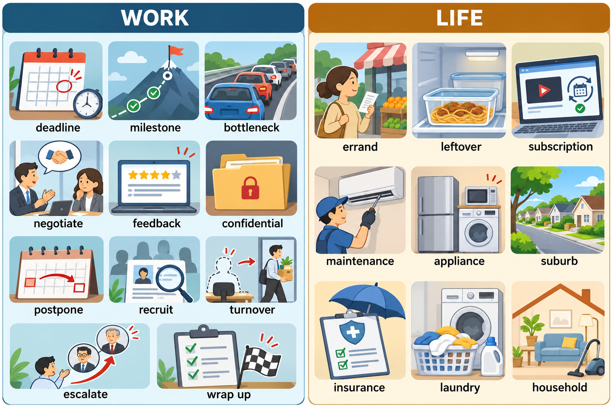

# 每日英语单词 20 个 · 2026-10-23

> 职场 11 个 + 生活 9 个，均已避开昨日词表。附 5 题自测于文末。
> **场景记忆图**：`场景配图/image25-sunburst-20261023-011627-041f33fd.png`（gpt-image-2.5-sunburst，WORK / LIFE 双场景）。

## 职场篇（11 个）

### 1. deadline
- **词义**：n. 截止日期，最后期限
- **音标**：/ˈdedlaɪn/
- **例句**：We need to finish the report before Friday's deadline.（我们需要在周五的截止日期前完成报告。）
- **记忆提示**：dead（死）+ line（线）——越线即“死”，一战壕里的铁线，死线即 deadline。

### 2. milestone
- **词义**：n. 里程碑，阶段性成果
- **音标**：/ˈmaɪlstoʊn/
- **例句**：Reaching 10,000 users was a major milestone for the startup.（达到一万用户是这家初创公司的重要里程碑。）
- **记忆提示**：mile（英里）+ stone（石头）——古罗马路边每英里立一石碑标记里程，引申为“里程碑”。

### 3. bottleneck
- **词义**：n. 瓶颈，阻碍环节
- **音标**：/ˈbɑːtlnek/
- **例句**：The approval process is the bottleneck of the whole project.（审批流程是整个项目的瓶颈。）
- **记忆提示**：bottle（瓶子）+ neck（脖子）——瓶口最窄处水流最慢，正是“卡脖子”环节。

### 4. negotiate
- **词义**：v. 谈判，协商
- **音标**：/nɪˈɡoʊʃieɪt/
- **例句**：He negotiated a higher salary before accepting the offer.（他在接受录用前谈到了更高的薪水。）
- **记忆提示**：词根 neg（不）+ oti（空闲）——没有闲工夫，必须“商谈”才能解决；名词 negotiation 常缩写为 nego。

### 5. feedback
- **词义**：n. 反馈，意见回馈
- **音标**：/ˈfiːdbæk/
- **例句**：Please send me your feedback on the draft by tomorrow.（请明天前把对草稿的反馈发给我。）
- **记忆提示**：feed（喂）+ back（回）——把结果“喂回去”，形成回环，即反馈。

### 6. confidential
- **词义**：adj. 保密的，机密的
- **音标**：/ˌkɑːnfɪˈdenʃl/
- **例句**：This document is confidential and for internal use only.（这份文件是保密的，仅供内部使用。）
- **记忆提示**：con（共同）+ fid（信任）+ ent——只给共同信任的人看，故为“机密”；同根词 confidence（信任）。

### 7. postpone
- **词义**：v. 推迟，延期
- **音标**：/poʊˈspoʊn/
- **例句**：The meeting was postponed to next Monday.（会议被推迟到下周一。）
- **记忆提示**：post（后）+ pone（放）——往后放一放，即“推迟”；对比 cancel（取消）是不办，postpone 是晚点办。

### 8. recruit
- **词义**：v. 招聘，招募
- **音标**：/rɪˈkruːt/
- **例句**：The team is recruiting two more engineers this quarter.（团队本季度正在再招聘两名工程师。）
- **记忆提示**：re（重新）+ cruit（成长，同 root）——让队伍“重新长出新枝”，即补充新人。

### 9. turnover
- **词义**：n. 人员流动率；（也指）营业额
- **音标**：/ˈtɜːrnoʊvər/
- **例句**：High employee turnover hurts team morale.（员工流动率高会损害团队士气。）
- **记忆提示**：turn（转）+ over（翻）——人“翻着转着换”，就是流动率；生意“翻着转着进钱”，就是营业额，一词两义。

### 10. escalate
- **词义**：v. 升级（问题）；上报
- **音标**：/ˈeskəleɪt/
- **例句**：If the issue isn't fixed today, we'll escalate it to the manager.（如果问题今天没解决，我们将上报给经理。）
- **记忆提示**：联想 escalator（自动扶梯）——问题像扶梯一样“步步升高”，一级解决不了就往上一级送。

### 11. wrap up
- **词义**：v. 完成，收尾，总结
- **音标**：/ræp ʌp/
- **例句**：Let's wrap up the discussion and start coding.（我们结束讨论，开始写代码吧。）
- **记忆提示**：wrap（包裹）——像打包行李一样把事情“打包收尾”；会议结尾常说 "Let's wrap up."

## 生活篇（9 个）

### 12. errand
- **词义**：n. 差事，跑腿琐事
- **音标**：/ˈerənd/
- **例句**：I have a few errands to run this afternoon, like picking up the laundry.（我今天下午有几件跑腿的差事，比如取洗好的衣服。）
- **记忆提示**：谐音“爱软的”——跑腿事都是“软差事”，但一件件都得跑；run errands 固定搭配必记。

### 13. leftover
- **词义**：n. 剩饭剩菜；adj. 剩余的
- **音标**：/ˈleftoʊvər/
- **例句**：We had leftovers for dinner instead of cooking.（我们晚饭吃了剩菜，没有做饭。）
- **记忆提示**：left（剩下）+ over（过来）——昨天“剩下留过来”的就是 leftovers。

### 14. subscription
- **词义**：n. 订阅，订阅费
- **音标**：/səbˈskrɪpʃn/
- **例句**：I canceled my gym subscription to save money.（我取消了健身房的订阅来省钱。）
- **记忆提示**：sub（下面）+ script（写）——在名单“下面写下名字”即签约订阅；常与 cancel/renew 搭配。

### 15. maintenance
- **词义**：n. 维护，保养
- **音标**：/ˈmeɪntənəns/
- **例句**：The elevator is under maintenance until Friday.（电梯正在维护中，周五前不能用。）
- **记忆提示**：maintain（维持）的名词——main（主要）+ tain（拿住）——把主要东西“拿稳不坏”，就得常保养。电梯上 "Under Maintenance" 标识常见。

### 16. appliance
- **词义**：n.（家用）电器，器具
- **音标**：/əˈplaɪəns/
- **例句**：Modern kitchens are full of smart appliances.（现代厨房里全是智能电器。）
- **记忆提示**：apply（应用）的名词家族——能“应用”到家务上的工具，就是家用电器；home appliances 固定搭配。

### 17. suburb
- **词义**：n. 郊区，近郊
- **音标**：/ˈsʌbɜːrb/
- **例句**：They moved to the suburbs for a bigger house and quieter streets.（为了更大的房子和更安静的街道，他们搬到了郊区。）
- **记忆提示**：sub（下/边）+ urb（城市，同 urban）——城市“下边”的外围就是郊区；注意与 subway（地铁）同前缀不同义。

### 18. insurance
- **词义**：n. 保险
- **音标**：/ɪnˈʃʊrəns/
- **例句**：Health insurance is a basic benefit in most companies.（医疗保险是大多数公司的基本福利。）
- **记忆提示**：in + sure（确定）——让未来“变得确定”，出事有人赔，即保险；health / car / life insurance 分类记忆。

### 19. laundry
- **词义**：n. 洗衣；待洗/洗好的衣物
- **音标**：/ˈlɔːndri/
- **例句**：I do laundry every Sunday morning.（我每周日上午洗衣服。）
- **记忆提示**：谐音“懒的”再“干活”——衣服堆成山，再懒也得干 laundry；do the laundry 固定搭配。

### 20. household
- **词义**：n. 家庭，住户；adj. 家用的，家喻户晓的
- **音标**：/ˈhaʊshoʊld/
- **例句**：Smartphones have become a household item.（智能手机已成为家家户户都有的物品。）
- **记忆提示**：house（房子）+ hold（持有）——一所房子里“持家”的人就是 household；household name 即“家喻户晓的名字”。

## 快速自测（5 题）

1. 项目中最卡进度的环节叫什么？（提示：b______）
2. “会议推迟到下周”用哪个词？（提示：p______）
3. 员工离职频繁、流动率高，叫 high e______ t______。
4. 电梯上挂的“维护中”英文标识是 U______ M______。
5. “跑腿办杂事”的固定搭配是 r______ e______。

答案

1. bottleneck　2. postpone　3. employee turnover　4. Under Maintenance　5. run errands

