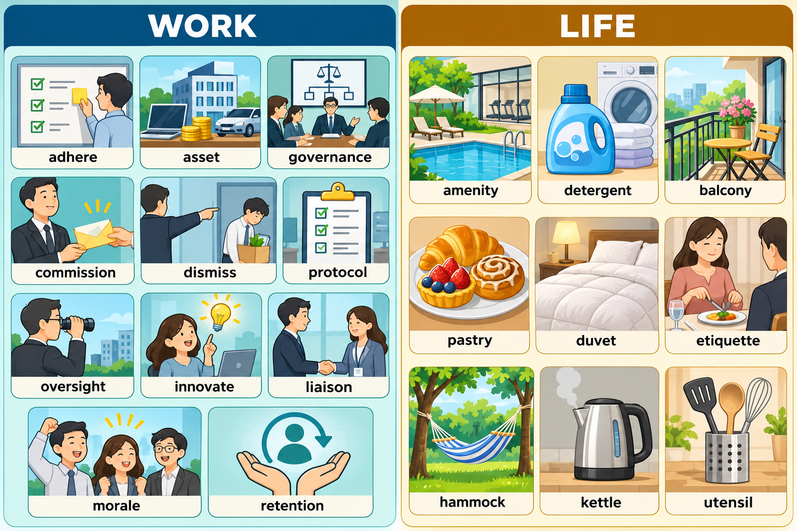

# 每日英语单词 20 个 · 2026-10-24（第 3 期 · 补录）

> **词表定位**：补建 2026-10-24 期次；当天自动生成任务未落盘，本文件为事后按同一规范补写，不是原始运行产物。
> **构成**：职场 11 + 生活 9。
> **去重**：已避开前两期全部 40 词（10-22 / 10-23），并避开其余各期既有词条。
> **配套**：复习窗口 `每日20词-复习窗口.md` 同步追加至 280 词。
> **场景记忆图**：`场景配图/image25-sunburst-20261024-012644-4895b575.png`（gpt-image-2.5-sunburst，WORK / LIFE 双场景）。

## 职场篇（11 词）

**1. adhere** /ədˈhɪr/
- **词义**：v. 遵守，遵循；坚持；黏附
- **例句**：All contractors must adhere to the safety protocol on site.
  （所有承包商在现场都必须遵守安全规程。）
- 💡 **记忆**：ad（向）+ here（黏住）——"牢牢贴在规则上"。固定搭配 adhere to a rule / adhere to a standard；名词 adherence。

**2. asset** /ˈæset/
- **词义**：n. 资产；有用的资源；优势
- **例句**：Her cross-domain experience is a real asset to the research team.
  （她的跨领域经验对研究团队来说是真正的财富。）
- 💡 **记忆**：与 assess 区分：asset 是"资产、资源"，assess 是"评估"。搭配 a valuable asset / an asset to the team。

**3. governance** /ˈɡʌvərnəns/
- **词义**：n. 治理，管理；治理结构
- **例句**：Good data governance requires clear ownership of every dataset.
  （良好的数据治理要求每个数据集都有明确的负责人。）
- 💡 **记忆**：govern（治理）+ ance——"治理这件事"。搭配 corporate governance / data governance。

**4. commission** /kəˈmɪʃən/
- **词义**：n. 委员会；佣金；委托；v. 委托（制作、创作）
- **例句**：The university commissioned an independent review of the project.
  （学校委托了对该项目的独立审查。）
- 💡 **记忆**：com（共同）+ miss（送）——"把任务送出去给人办"，即委托；销售语境是 commission（佣金）。

**5. dismiss** /dɪsˈmɪs/
- **词义**：v. 驳回，不予考虑；解雇；解散
- **例句**：The reviewer dismissed the anomaly as a measurement error.
  （审稿人把这个异常当作测量误差驳回了。）
- 💡 **记忆**：dis（分开）+ miss（送）——"把人或事送走"。搭配 dismiss an idea / dismiss an employee；名词 dismissal。

**6. protocol** /ˈproʊtəkɔːl/
- **词义**：n. 协议，规程；外交礼节
- **例句**：The two labs agreed on a common protocol for data sharing.
  （两个实验室约定了共享数据的统一规程。）
- 💡 **记忆**：proto（原始）+ col（书写材料）——原指卷轴首页的说明，引申为"约定好的规程"。搭配 safety protocol / communication protocol。

**7. oversight** /ˈoʊvərsaɪt/
- **词义**：n. 监督，监管；疏忽
- **例句**：The bug slipped through because of an oversight in the review process.
  （这个漏洞因为评审流程中的疏忽而漏掉了。）
- 💡 **记忆**：over（在上）+ sight（看）——"在上面盯着"是监督，"看漏了"是疏忽。搭配 under the oversight of / an oversight in。

**8. innovate** /ˈɪnəveɪt/
- **词义**：v. 创新，革新
- **例句**：Small teams often innovate faster because they iterate more cheaply.
  （小团队常常创新更快，因为他们迭代成本更低。）
- 💡 **记忆**：in（进入）+ nov（新，同 novel）+ ate（使动）——"引入新东西"。名词 innovation，形容词 innovative。

**9. liaison** /liˈeɪzɑːn/
- **词义**：n. 联络人；联络，联系
- **例句**：She acts as the liaison between the vendor and our engineering team.
  （她担任供应商与我们工程团队之间的联络人。）
- 💡 **记忆**：法语 liaiser（连接）——把人或部门"连起来"的角色。搭配 a liaison officer / maintain liaison with。

**10. morale** /məˈræl/
- **词义**：n. 士气，精神面貌
- **例句**：Clear milestones help maintain team morale during a long project.
  （清晰的里程碑有助于在长项目中维持团队士气。）
- 💡 **记忆**：与 moral（道德的）区分：morale 是"士气"，重音在第二音节。搭配 boost morale / low morale。

**11. retention** /rɪˈtenʃn/
- **词义**：n. 保留，留存；保持率
- **例句**：Spaced repetition improves long-term retention of vocabulary.
  （间隔重复能提高词汇的长期留存率。）
- 💡 **记忆**：re（回）+ tent（持住，同 contain）+ ion——"留住不放"。搭配 employee retention / knowledge retention。

## 生活篇（9 词）

**12. amenity** /əˈmenəti/
- **词义**：n. 便利设施；生活设施（常用复数 amenities）
- **例句**：The apartment complex offers amenities such as a gym and a reading room.
  （这个公寓小区提供健身房、阅览室等便利设施。）
- 💡 **记忆**：amen（令人愉快）+ ity——"让人住得舒服的东西"。搭配 public amenities / modern amenities。

**13. detergent** /dɪˈtɜːrdʒənt/
- **词义**：n. 洗涤剂，清洁剂
- **例句**：Use a mild detergent for these delicate fabrics.
  （这些精细面料要用温和的洗涤剂。）
- 💡 **记忆**：deterg（擦净）+ ent——"把污渍擦掉的东西"。搭配 laundry detergent / dish detergent。

**14. balcony** /ˈbælkəni/
- **词义**：n. 阳台；（剧场）楼座
- **例句**：We watered the plants on the balcony before breakfast.
  （早餐前我们给阳台上的植物浇了水。）
- 💡 **记忆**：balc（突出物）+ ony——房子向外突出的一块。搭配 on the balcony / a sea-view balcony。

**15. pastry** /ˈpeɪstri/
- **词义**：n. 糕点，酥皮点心
- **例句**：She bought a box of pastries for the afternoon tea.
  （她买了一盒酥皮点心当下午茶。）
- 💡 **记忆**：paste（面团）+ ry——"面团做出来的点心"。搭配 a pastry shop / Danish pastry。

**16. duvet** /duːˈveɪ/
- **词义**：n. 羽绒被；被子
- **例句**：She pulled the duvet over her head and went back to sleep.
  （她把被子拉过头顶，又睡了过去。）
- 💡 **记忆**：法语 duvet（绒毛）——装着绒毛的被子。搭配 a down duvet / under the duvet。

**17. etiquette** /ˈetɪket/
- **词义**：n. 礼仪，礼节；规矩
- **例句**：Email etiquette suggests keeping the subject line short and specific.
  （邮件礼仪建议主题行保持简短而具体。）
- 💡 **记忆**：法语 etiquette（小标签）——贴在场合上的"行为规范"。搭配 table etiquette / business etiquette。

**18. hammock** /ˈhæmək/
- **词义**：n. 吊床
- **例句**：He spent the afternoon reading in a hammock between two trees.
  （他整个下午都在两棵树之间的吊床上看书。）
- 💡 **记忆**：ham（悬挂）+ mock（模拟躺椅）——两棵树之间吊起来的床。搭配 lie in a hammock / string up a hammock。

**19. kettle** /ˈketl/
- **词义**：n. 水壶；烧水壶
- **例句**：She filled the kettle and set it to boil for tea.
  （她灌满水壶，开始烧水泡茶。）
- 💡 **记忆**：与 cattle（牛）只差首字母；厨房里烧水的那只壶。搭配 an electric kettle / put the kettle on。

**20. utensil** /juːˈtensl/
- **词义**：n. 用具，器具；（常用复数 utensils）餐具
- **例句**：Please put the utensils back in the drawer after dinner.
  （晚饭后请把餐具放回抽屉。）
- 💡 **记忆**：utens（使用）+ il——"被使用的东西"。搭配 kitchen utensils / cooking utensils。

---

## 助记卡（词根抓手 + 高频搭配）

| 单词 | 词根/画面抓手 | 高频搭配 |
|---|---|---|
| adhere | ad + here（黏住）→ 贴住规则 | adhere to a rule |
| asset | 联想：值得评估的资源 | an asset to the team |
| governance | govern + ance → 治理这件事 | data governance |
| commission | com + miss → 送出去委托 | commission a review |
| dismiss | dis + miss → 送走不再考虑 | dismiss an idea |
| protocol | proto + col → 约定好的规程 | safety protocol |
| oversight | over + sight → 在上面盯着 | under the oversight of |
| innovate | nov（新）→ 引入新东西 | innovate on a process |
| liaison | 联想：连接两方的人 | a liaison officer |
| morale | 联想：团队的精神状态 | boost morale |
| retention | re + tent → 留住不放 | knowledge retention |
| amenity | 联想：让生活舒服的设施 | modern amenities |
| detergent | deterg（擦净）→ 擦掉污渍 | laundry detergent |
| balcony | 联想：向外伸出的平台 | on the balcony |
| pastry | paste（面团）→ 面团做的点心 | a pastry shop |
| duvet | 法语"绒毛"→ 羽绒被 | under the duvet |
| etiquette | 法语"小标签"→ 行为规范 | email etiquette |
| hammock | 联想：两树之间的吊床 | lie in a hammock |
| kettle | 与 cattle 只差首字母 | put the kettle on |
| utensil | utens（使用）→ 被使用的东西 | kitchen utensils |

## 一句话串记

**上班线**：团队 **adhere** 规范 → 把经验当作 **asset** → 做好 **governance** → 委员会 **commission** 独立审查 → 不轻率 **dismiss** 异常 → 先约定 **protocol** → 流程 **oversight** 不缺位 → 小团队持续 **innovate** → 由 **liaison** 对接供应商 → 里程碑维持 **morale** → 间隔重复提升 **retention**。

**生活线**：小区的 **amenity** 齐全 → 用温和 **detergent** 洗精细面料 → 在 **balcony** 浇花 → 中午来一块 **pastry** → 裹着 **duvet** 午睡 → 注意 **etiquette** → 傍晚在 **hammock** 看书 → 用 **kettle** 烧水 → 把 **utensil** 收好。

---

## 记忆宫殿 · 双线场景故事

### 职场线（11 词）· 一次项目评审日

晨会开始，主持人强调所有实验都要 **adhere**（遵守）统一协议。你把跨领域经验写进材料，视其为团队的 **asset**（财富）。数据治理（**governance**）明确了每个数据集的负责人，评审委员会随后 **commission**（委托）了一份独立复核。面对异常数据，你没有直接 **dismiss**（驳回），而是先约定统一 **protocol**（规程）；流程里的 **oversight**（监督）不能缺位。小组在同一个流程里持续 **innovate**（创新），会后由 **liaison**（联络人）对接供应商，明确的里程碑稳住了团队 **morale**（士气），最后用间隔重复巩固了知识的 **retention**（留存）。

### 生活线（9 词）· 在家的周日

小区的 **amenity**（便利设施）很齐全，你用温和的 **detergent**（洗涤剂）洗了精细面料，到 **balcony**（阳台）给植物浇水。中午尝了一块 **pastry**（糕点），午后裹着 **duvet**（羽绒被）小睡。下午写邮件时注意 **etiquette**（礼仪），傍晚在两棵树间的 **hammock**（吊床）里读书。随后用 **kettle**（水壶）烧水泡茶，睡前把 **utensil**（餐具）收进抽屉。

---

## 排雷台（6 组易混）

| 易混对 | 一句话差别 | 考场陷阱 |
|---|---|---|
| adhere / comply | adhere to 强调坚持原则、规程；comply with 强调服从要求、规定 | 规程类用 adhere to |
| asset / assess | asset 是名词"资产、资源"；assess 是动词"评估" | 别把 asset 当动词用 |
| commission / committee | commission 可指委员会、佣金或委托；committee 只指委员会 | 委托动作是 commission |
| dismiss / disregard | dismiss 是正式驳回或不再考虑；disregard 是主观忽视 | 书面评审用 dismiss |
| morale / moral | morale 是"士气"；moral 是"道德的"或"寓意" | 士气重音在第二音节 |
| retention / reservation | retention 是"保留、留存率"；reservation 是"预订、保留意见" | 知识留存用 retention |

## 快速自测（5 题 · 答案折叠）

**1. 填空**：All contractors must ______ to the safety protocol.（遵守）

**2. 选词填空**：Spaced repetition improves long-term ______ of vocabulary.（retention / reservation）

**3. 中译英**：两个实验室约定了共享数据的统一规程。

**4. 词义辨析**：morale 和 moral 分别是什么意思？

**5. 生活场景选词**：He read in a ______ between two trees.（hammock / kettle）

👉 点击展开答案

1. **adhere**；固定搭配 adhere to，表示遵守规程、坚持原则。
2. **retention**；表示长期留存率，reservation 是预订或保留意见。
3. **The two labs agreed on a common protocol for data sharing.**；protocol 是"协议、规程"，safety protocol 是安全规程。
4. **morale** 是"士气、精神面貌"；**moral** 是"道德的"或"寓意"。
5. **hammock**；吊床，kettle 是烧水的水壶。

---

*第 3 期 · 补录于 2026-10-24 · 累计已学 60 词（CET-6 向）*
