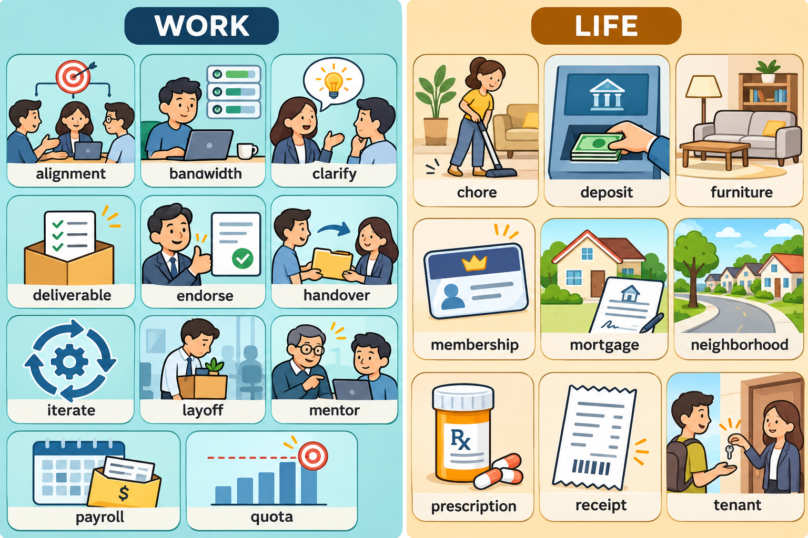

# 每日英语单词 20 个 · 2026-10-25

> 职场 11 个 + 生活 9 个，已避开 10-22、10-23、10-24 三期共 60 词。
> **场景记忆图**：`场景配图/image25-sunburst-20261025-011732-625addb4.png`（gpt-image-2.5-sunburst，WORK / LIFE 双场景）。

## 职场篇（11 个）

### 1. alignment
- **词义**：n. 对齐，一致性；（团队）目标一致
- **音标**：/əˈlaɪnmənt/
- **例句**：We need alignment between sales and engineering before the launch.（发布之前，销售和工程团队需要先对齐目标。）
- **记忆提示**：a + lign（直线，同 line）——大家都站在同一条线上，即"对齐"；get alignment 是职场高频说法。

### 2. bandwidth
- **词义**：n.（比喻）精力，时间余量；本义为带宽
- **音标**：/ˈbændwɪdθ/
- **例句**：I don't have the bandwidth to take on another project this month.（我这个月没有余力再接一个项目了。）
- **记忆提示**：band（频带）+ width（宽度）——网络里是"带宽"，职场里借喻"个人带宽"，即精力容量；委婉拒绝任务的神词。

### 3. clarify
- **词义**：v. 澄清，讲清楚
- **音标**：/ˈklærɪfaɪ/
- **例句**：Could you clarify what you meant by "final version"?（你能澄清一下"最终版"是什么意思吗？）
- **记忆提示**：clar（清楚，同 clear）+ ify（使动后缀）——"使清楚"即澄清；名词 clarification 会议常用。

### 4. deliverable
- **词义**：n. 交付物，可交付成果
- **音标**：/dɪˈlɪvərəbl/
- **例句**：The main deliverable for this sprint is a working prototype.（本次迭代的的主要交付物是一个可运行的原型。）
- **记忆提示**：deliver（交付）+ able（可……的）——"可以交付出去的东西"；项目排期表上常见复数 deliverables。

### 5. endorse
- **词义**：v. 认可，背书，支持
- **音标**：/ɪnˈdɔːrs/
- **例句**：My manager endorsed the proposal, so we can start next week.（我的经理为这个方案背书了，所以我们下周就能启动。）
- **记忆提示**：en（在……上）+ dorse（背，同 dorsal 背部）——古时在文件"背面签字"担保，即背书；LinkedIn 上给同事 endorse 技能即此词。

### 6. handover
- **词义**：n. 工作交接，移交
- **音标**：/ˈhændoʊvər/
- **例句**：He prepared a detailed handover document before leaving the company.（离职前他准备了一份详细的交接文档。）
- **记忆提示**：hand（手）+ over（过去）——把手上的事"递过去"，即交接；英美也写作 hand-over 或 takeover 的近邻。

### 7. iterate
- **词义**：v. 迭代，逐步改进
- **音标**：/ˈɪtəreɪt/
- **例句**：We'll iterate on the design based on user feedback.（我们会根据用户反馈不断迭代设计。）
- **记忆提示**：iter（再次，拉丁词根）+ ate——一遍遍地"再来一次"即迭代；同根 reiterate（重申）。

### 8. layoff
- **词义**：n. 裁员，解雇
- **音标**：/ˈleɪɔːf/
- **例句**：The company announced layoffs affecting 5% of its staff.（公司宣布裁员，涉及 5% 的员工。）
- **记忆提示**：lay（放下）+ off（离开）——把人"放下让他走"，即裁员；注意是名词，动词说 lay someone off。

### 9. mentor
- **词义**：n. 导师，带教人；v. 指导
- **音标**：/ˈmentɔːr/
- **例句**：She mentors two junior engineers on the team.（她在团队里带教两名初级工程师。）
- **记忆提示**：源自荷马史诗《奥德赛》中智慧友人 Mentor 的名字——典出即"良师"；反义对应 mentee（被带教者）。

### 10. payroll
- **词义**：n. 工资名单，发薪事务
- **音标**：/ˈpeɪroʊl/
- **例句**：HR processes payroll on the 25th of every month.（人事每月 25 日处理发薪。）
- **记忆提示**：pay（付）+ roll（名册）——"付钱名册"即工资单；on the payroll = 在职领薪中。

### 11. quota
- **词义**：n. 配额，指标
- **音标**：/ˈkwoʊtə/
- **例句**：Sales reps must hit their monthly quota to earn the bonus.（销售必须完成月度指标才能拿奖金。）
- **记忆提示**：源自拉丁语 quota pars（"多大一份"）——按人头分好的"那一份"即配额；与 quote（报价）仅一字母之差，注意区分。

## 生活篇（9 个）

### 12. chore
- **词义**：n. 家务杂活
- **音标**：/tʃɔːr/
- **例句**：In our flat, we split the chores: I cook, my roommate cleans.（在我们公寓里家务分工：我做饭，室友打扫。）
- **记忆提示**：谐音"扫"——扫地的"扫"就是 chore 的灵魂；do the chores 固定搭配，注意与 chorus（合唱）形近区分。

### 13. deposit
- **词义**：n. 押金，定金；存款；v. 存入
- **音标**：/dɪˈpɑːzɪt/
- **例句**：The landlord asked for one month's rent as a deposit.（房东要求一个月房租作为押金。）
- **记忆提示**：de（向下）+ posit（放，同 position）——钱"放下存住"就是存款/押金；反义词 withdraw（取款）一起记。

### 14. furniture
- **词义**：n. 家具（不可数）
- **音标**：/ˈfɜːrnɪtʃər/
- **例句**：We bought second-hand furniture when we moved in.（搬进来时我们买了二手家具。）
- **记忆提示**：furnish（布置房间）的名词——布置房间的东西即家具；不可数名词，"一件家具"要说 a piece of furniture。

### 15. membership
- **词义**：n. 会员资格，会员身份
- **音标**：/ˈmembərʃɪp/
- **例句**：My gym membership expires at the end of the month.（我的健身房会员月底到期。）
- **记忆提示**：member（成员）+ ship（状态后缀，同 friendship）——"成为成员的状态"即会员资格；常与 renew/cancel 搭配。

### 16. mortgage
- **词义**：n. 房贷，按揭
- **音标**：/ˈmɔːrɡɪdʒ/
- **例句**：They took out a 30-year mortgage to buy the apartment.（他们贷了 30 年的房贷来买这套公寓。）
- **记忆提示**：mort（死，同 mortal）+ gage（担保）——"押上性命的担保"，还不上房子就没了，正是房贷的分量。

### 17. neighborhood
- **词义**：n. 街区，社区，附近一带
- **音标**：/ˈneɪbərhʊd/
- **例句**：There's a great coffee shop in our neighborhood.（我们社区有一家很棒的咖啡店。）
- **记忆提示**：neighbor（邻居）+ hood（集体后缀，同 childhood）——邻居们聚成的"那片地方"即街区；口语常缩写为 hood。

### 18. prescription
- **词义**：n. 处方，药方
- **音标**：/prɪˈskrɪpʃn/
- **例句**：You need a prescription to buy this medicine.（这种药需要凭处方购买。）
- **记忆提示**：pre（提前）+ script（写）——医生"提前写好"的单子即处方；缩写 Rx 就是拉丁语 recipe（取此方）演变来的。

### 19. receipt
- **词义**：n. 收据，小票
- **音标**：/rɪˈsiːt/
- **例句**：Keep the receipt in case you want to return the item.（保留小票，以防你想退货。）
- **记忆提示**：re（回）+ ceipt（拿，同 receive）——"拿回来的凭证"即收据；注意 p 不发音，别读成 ree-sept。

### 20. tenant
- **词义**：n. 房客，租户
- **音标**：/ˈtenənt/
- **例句**：The tenant is responsible for small repairs in the apartment.（房客负责公寓里的小修小补。）
- **记忆提示**：ten（持有，同 tenacious）+ ant（人）——"持住房子住下的人"即租户；与上期 landlord（房东）正好一对。

## 快速自测（5 题）

1. "我这个月没精力再接项目了"用哪个比喻词？（提示：b______）
2. 经理"为方案背书"用哪个词？（提示：e______）
3. 离职前写的交接文档叫 h______ d______。
4. 一件家具为什么不能说 a furniture？（提示：不可数）
5. "一个月房租作押金"用哪个词？（提示：d______）

答案

1. bandwidth　2. endorse　3. handover document　4. furniture 不可数，需说 a piece of furniture　5. deposit

