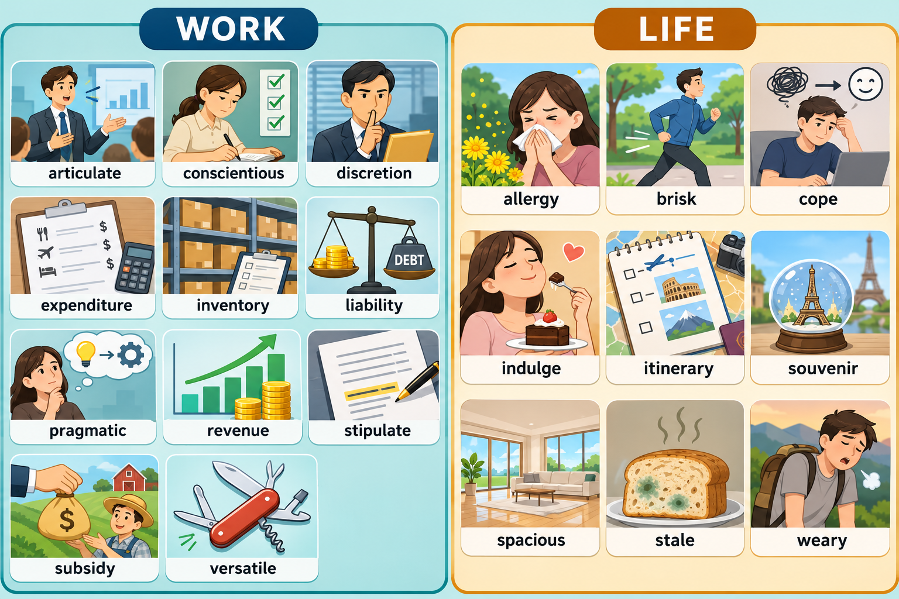

# 每日英语单词 20 个 · 2026-10-30（第 9 期）

> **词表定位**：锚定 CET-6 六级高频/中频核心词汇，无超纲生僻词，无 apple / happy 类基础词。
> **构成**：职场 11 + 生活 9。
> **去重**：已避开前八期全部 160 词（10-22 / 10-23 / 10-25 / 10-26 / 10-27 / 10-28 / 10-29 / 10-24）。
> **配套**：复习窗口 `06-Growth/Education/六级考试/每日20词-复习窗口.md` 同步追加至 160 词。
> **场景记忆图**：本期 image25-flare 调用遇 SSL 连接中断（`UNEXPECTED_EOF_WHILE_READING`），未产出 PNG，按技能规则未自动重试；文字与复习窗口照常完成。

---
> **场景记忆图**：`场景配图/image25-sunburst-20261030-012210-b7e34e68.png`（gpt-image-2.5-sunburst，WORK / LIFE 双场景）。

## 职场篇（11 词）

**1. articulate** /ɑːrˈtɪkjuleɪt/ v.；/ɑːrˈtɪkjələt/ adj.
- **词义**：v. 清晰表达，明确阐述；adj. 口齿清楚的，表达有力的
- **例句**：She can articulate complex technical trade-offs in under a minute.
  （她能在一分钟内把复杂的技术取舍讲清楚。）
- 💡 **记忆**：词根 articul（关节，同 article / arthritis）——"把话一节一节接起来"，说得关节分明即为表达清晰。名词 articulation；动词与形容词读音不同（-leɪt / -lət）。

**2. conscientious** /ˌkɑːnʃiˈenʃəs/ adj.
- **词义**：认真尽责的，一丝不苟的
- **例句**：A conscientious reviewer catches the typos everyone else skips.
  （尽责的评审能抓到别人都跳过的错字。）
- 💡 **记忆**：con（共同）+ sci（知道，同 science / conscious）——"心里始终知道自己的责任"。别与 conscious（有意识的）混；名词 conscientiousness。

**3. discretion** /dɪˈskreʃn/ n.
- **词义**：自行决定权；谨慎，慎重（言行得体）
- **例句**：You can adjust the budget at your own discretion.
  （预算你可以自行决定调整。）
- 💡 **记忆**：与 discreet（谨慎的）同源——"知道什么时候闭嘴"是谨慎，把判断权交出去就是"自行决定"。固定搭配 at one's discretion；discretionary bonus 酌情奖金。

**4. expenditure** /ɪkˈspendɪtʃər/ n.
- **词义**：支出，开支；耗费
- **例句**：Marketing expenditure doubled, but sign-ups barely moved.
  （营销支出翻倍，注册量却几乎没动。）
- 💡 **记忆**：ex（向外）+ pend（称重、支付，同 spend / pension）——"把钱一笔笔称出去"。偏宏观总额，capital expenditure 资本开支。

**5. inventory** /ˈɪnvəntɔːri/ n.
- **词义**：库存，存货；清单，盘点
- **例句**：The warehouse is holding three months of inventory.
  （仓库里压着三个月的库存。）
- 💡 **记忆**：in（进来）+ vent（来，同 invent / convention）——"进来的东西逐项记下来"。take inventory 盘点；inventory turnover 库存周转。

**6. liability** /ˌlaɪəˈbɪləti/ n.
- **词义**：责任，义务；负债；累赘、包袱
- **例句**：The clause limits our liability to the contract value.
  （该条款把我们的责任上限限定在合同金额之内。）
- 💡 **记忆**：li（捆绑，同 ally / ligament）+ able——"被法律绑住、跑不掉的那部分"。反义 asset；limited liability 有限责任。

**7. pragmatic** /præɡˈmætɪk/ adj.
- **词义**：务实的，讲求实效的
- **例句**：He took a pragmatic approach: ship a smaller version first.
  （他采取务实做法：先上一个精简版本。）
- 💡 **记忆**：prag（做，同 practice / practical）——"先看能不能做成，再谈好不好看"。反义 idealistic；名词 pragmatism。

**8. revenue** /ˈrevənuː/ n.
- **词义**：（公司、政府的）收入，营收，税收
- **例句**：Subscription revenue now covers 60% of our costs.
  （订阅收入已覆盖我们 60% 的成本。）
- 💡 **记忆**：re（回）+ ven（来，同 convene / intervene）——"回流进来的钱"。注意：个人工资收入用 income，说 revenue 会显得像在报公司账。

**9. stipulate** /ˈstɪpjuleɪt/ v.
- **词义**：（合同、法规）明确规定，约定
- **例句**：The contract stipulates a 30-day notice period.
  （合同明确规定需提前 30 天通知。）
- 💡 **记忆**：stip（压紧，同 stiff）——"把条件压死在纸面上"。常接 that 从句；as stipulated 按规定。

**10. subsidy** /ˈsʌbsədi/ n.
- **词义**：补贴，补助金
- **例句**：The city offers a subsidy for installing charging piles.
  （市里对安装充电桩给予补贴。）
- 💡 **记忆**：sub（在下）+ sid（坐，同 sediment / session）——"在下面托你一把的钱"。复数 subsidies；housing subsidy 住房补贴。

**11. versatile** /ˈvɜːrsətl/ adj.
- **词义**：多才多艺的，多面手的；多用途的
- **例句**：She's a versatile engineer—backend, firmware, and a bit of design.
  （她是个多面手工程师：后端、固件，还会一点设计。）
- 💡 **记忆**：vers（转，同 reverse / version）——"能来回转，什么场合都接得住"。versatile tool 多功能工具。

---

## 生活篇（9 词）

**12. allergy** /ˈælərdʒi/ n.
- **词义**：过敏（症）；极度反感
- **例句**：His pollen allergy acts up every April.
  （他每年四月花粉过敏就犯。）
- 💡 **记忆**：all（异，同 alias / alien）+ erg（作用，同 energy）——"身体对异物过度反应"。形容词 allergic，be allergic to（也可指"对…极其反感"）。

**13. brisk** /brɪsk/ adj.
- **词义**：轻快的，利落的；（风）清爽的；（生意）兴旺的
- **例句**：A brisk twenty-minute walk clears my head better than coffee.
  （轻快走二十分钟，比咖啡更能让我头脑清醒。）
- 💡 **记忆**：联想 brush——"刷地一下"，动作干净利落。brisk walk / brisk business；别与 brusque（唐突无礼）混。

**14. cope** /koʊp/ v.
- **词义**：应对，对付；承受住
- **例句**：How do you cope with three deadlines in one week?
  （一周三个截止日期，你怎么扛？）
- 💡 **记忆**：联想"抄起盾牌顶住"——cope with 是固定搭配，漏掉 with 必错。名词 coping（应对机制）。

**15. indulge** /ɪnˈdʌldʒ/ v.
- **词义**：放纵，沉溺；满足（欲望）
- **例句**：On Fridays I indulge in a slice of cheesecake.
  （周五我放纵自己吃一块芝士蛋糕。）
- 💡 **记忆**：in + dulge（顺从，联想"迁就"）——"顺着欲望走"。indulge in sth / indulge sb；形容词 indulgent。

**16. itinerary** /aɪˈtɪnəreri/ n.
- **词义**：行程安排，旅行路线
- **例句**：Our itinerary is tight: three cities in four days.
  （行程很赶：四天跑三座城。）
- 💡 **记忆**：itiner（旅程，同 itinerant 流动的）——"一路走下去的那张清单"。拼写 itin-er-ary，中间是 -er-，别丢字母。

**17. souvenir** /ˌsuːvəˈnɪr/ n.
- **词义**：纪念品，旅游纪念物
- **例句**：I bought a cheap magnet as a souvenir, not a real gift.
  （我买了个便宜冰箱贴当纪念品，不算正经礼物。）
- 💡 **记忆**：源自法语"想起（se souvenir）"——"一看到就想起那趟旅行"。重音落在最后一个音节 -nir。

**18. spacious** /ˈspeɪʃəs/ adj.
- **词义**：宽敞的，空间大的
- **例句**：The new flat is small but surprisingly spacious.
  （新房面积不大，但出乎意料地宽敞。）
- 💡 **记忆**：spat（空间，同 space / spatial）——"空间感足"。反义 cramped（狭窄拥挤的）。

**19. stale** /steɪl/ adj.
- **词义**：不新鲜的，走味的；陈旧的，老套的
- **例句**：The bread went stale because nobody closed the bag.
  （没人封袋，面包放硬了。）
- 💡 **记忆**：联想 stand still（停滞不动）——"放太久不动就陈了"。stale bread / stale air / a stale joke。

**20. weary** /ˈwɪri/ adj.
- **词义**：疲惫的；厌倦的
- **例句**：After the night train I felt weary but couldn't sleep.
  （坐完夜车，我又累又睡不着。）
- 💡 **记忆**：与 wear（磨损）同形联想——"被磨薄了"。be weary of sth（对…厌倦）；名词 weariness。

---

## 助记卡（词根抓手 + 高频搭配）

| 单词 | 词根/画面抓手 | 高频搭配 |
|---|---|---|
| articulate | articul（关节）→ 话一节节接起来 | articulate a vision |
| conscientious | sci（知道）→ 心里记着自己的责任 | a conscientious worker |
| discretion | discreet（谨慎）→ 判断权交给你 | at one's discretion |
| expenditure | ex + pend（称出去）→ 钱称出门 | capital expenditure |
| inventory | vent（进来）→ 进来的都记账 | take inventory |
| liability | li（捆绑）→ 被法律绑住 | limited liability |
| pragmatic | prag（做）→ 先看能不能做成 | a pragmatic approach |
| revenue | ven（来）→ 回流进来的钱 | annual revenue |
| stipulate | stip（压紧）→ 压死在纸面 | as stipulated |
| subsidy | sub + sid（在下坐着托） | housing subsidy |
| versatile | vers（转）→ 什么都能转接 | a versatile player |
| allergy | all（异）+ erg（作用）→ 对异物反应 | be allergic to |
| brisk | brush 联想 → 刷地一下 | a brisk walk |
| cope | 抄起盾牌顶住 | cope with pressure |
| indulge | dulge（顺从）→ 顺着欲望 | indulge in sth |
| itinerary | itiner（旅程）→ 一路的清单 | a tight itinerary |
| souvenir | 法语"想起"→ 一看就想起 | a souvenir shop |
| spacious | spat（空间）→ 空间感足 | a spacious room |
| stale | still 联想 → 放着不动就陈 | go stale |
| weary | wear（磨损）→ 被磨薄了 | be weary of sth |

---

## 记忆宫殿 · 双线故事

### 职场线：季度经营会（会议室）

> 推开会议室的门，老板先用一分钟把季度难题 **articulate** 成一句人话（**画面：手在空中一节一节比划，把话接成一条链**）。白板旁贴着 **inventory** 盘点表，仓库压着三个月的货（**画面：货架上纸箱堆到天花板，扫码枪逐一"嘀"过**）。财务指着屏幕：**revenue** 是涨了，可 **expenditure** 涨得更快（**画面：进水管细、出水管粗的水箱**）。桌角那份合同被红笔圈出 **stipulate** 的"30 天通知"（**画面：条款上压了一枚沉重的印章**），旁边贴着 **liability** 责任上限的封条（**画面：文件被铁链锁在秤砣上**）；门口还躺着一封 **subsidy** 批复（**画面：信封里伸出一只手，在桌下托住桌子**）。全组最 **conscientious** 的同事把每行数据核了三遍（**画面：鼻尖几乎贴到屏幕，逐格打勾**），**versatile** 的多面手顺手把报表做成了图（**画面：一把瑞士军刀，工具全弹开**），**pragmatic** 的老板拍板"先上精简版"（**画面：桌上一架小天平，一头压着一面小旗**），最后把预算调整权交给我——**at my discretion**（**画面：一串钥匙被推进我手心**）。

**画面抓手回忆法**：闭眼只走一遍房间动线——门（嘴在说话）→ 白板（纸箱）→ 屏幕（水箱）→ 桌角（合同+锁）→ 门口（信封）→ 同事（鼻尖）→ 老板（军刀、天平）→ 手心（钥匙）。八个位置对应 11 个词。

### 生活线：周末四天三城（民宿与小镇）

> 周六一早按 **itinerary** 出门，四天三城（**画面：折叠地图上三个图钉被虚线串起来**）。清晨风很 **brisk**，走二十分钟人就醒了（**画面：衣角被风掀起，步子带风**）。民宿房间意外 **spacious**，两个行李箱摊开还有余地（**画面：广角镜头下一片空地板**）。路过面包店，**stale** 的那炉被挪到一边，我还是 **indulge** 了一块刚出炉的（**画面：托盘左边发霉的面包被推远，右边奶油甜点正被闭眼咬下**）。临走买了枚冰箱贴当 **souvenir**（**画面：冰箱门上那枚小小的雪山贴**）。四月花粉让 **allergy** 准时发作（**画面：对着胳膊肘打喷嚏，旁边一枝满是花粉的花**）。夜里回房，**weary** 到抬不起手（**画面：人陷进扶手椅，揉着后颈**），可第二天六点的闹钟，还是 **cope** 住了（**画面：两只手稳稳撑住一把被风吹歪的伞**）。

**画面抓手回忆法**：地图 → 风 → 空地板 → 面包托盘 → 冰箱贴 → 花粉 → 扶手椅 → 雨伞。八个画面覆盖 9 个生活词。

---

## 易混辨析（7 组）

| 易混对 | 一句话差别 | 考场陷阱 |
|---|---|---|
| conscientious / conscious | conscientious 是**做事尽责**；conscious 是**有意识的、清醒的** | 两个都含 sci，前者多 -tious 且只修饰人做事的风格 |
| versatile / flexible | versatile 是**能力面宽、什么都能干**；flexible 是**可调整、好商量** | 夸人多面手用 versatile；说时间可协调用 flexible |
| expenditure / expense | expenditure 是**总额、宏观开支**；expense 多是**一笔具体费用** | 政府/公司年度开支用 expenditure；报销单上是 expenses |
| revenue / income | revenue 是**企业或政府的营收税收**；income 是**个人收入** | 说自己的工资只能 income，用 revenue 会闹笑话 |
| liability / responsibility | liability 是**法律责任、负债**（可量化、可追偿）；responsibility 是**职责、道义担当** | 合同限责用 liability；"这是我的职责"用 responsibility |
| brisk / brusque | brisk 是**轻快利落**（褒）；brusque 是**唐突无礼**（贬） | 只差一个字母，阅读态度题常拿它俩设套 |
| stale / shabby | stale 是**不新鲜、走味、老套**；shabby 是**破旧寒酸** | 面包、空气、笑话用 stale；衣服家具旧用 shabby |

> ⚠️ **本期搭配雷区**：cope **with**、indulge **in**、be allergic **to**、at one's **discretion**、stipulate **that** 从句——五个介词/句式是完形与写作的高频扣分点。另注意 articulate 动名同形不同音：动词 /-leɪt/，形容词 /-lət/。

---

## 快速自测（5 题，答案折叠）

**1.** 合同里"明确规定提前 30 天通知"，动词用 ______。

点开看答案

**stipulate**——The contract stipulates a 30-day notice period. 常接 that 从句，被动用 as stipulated。

**2.** "他工作特别尽责" 与 "他还清醒着" 分别用哪两个词？

点开看答案

尽责 = **conscientious**；清醒 = **conscious**。拼写差在 -tious / -scious，别写混。

**3.** 填空：She is a ______ engineer who can handle backend, firmware and design.

点开看答案

**versatile**（多面手的）。若填 flexible 只表示"好商量/可调整"，不表示能力面宽。

**4.** "公司营收" 与 "个人收入" 分别用 ______ / ______。

点开看答案

公司营收 = **revenue**；个人收入 = **income**。revenue 不用于个人工资。

**5.** 改错：I can't cope the pressure of three deadlines. / He indulges chocolate every night.

点开看答案

两处都缺介词：**cope with** the pressure；**indulge in** chocolate。cope 与 indulge 都是不及物用法带介词。

---

## 四轮复习节奏

| 轮次 | 时间 | 做什么 | 耗时 |
|---|---|---|---|
| 第 1 轮 | 10-30 晚 21:00 前 | 看「助记卡」遮住右两列，凭单词回想抓手与搭配 | 10 分钟 |
| 第 2 轮 | 10-31 早 | 过「易混辨析」7 组，默写每组中文差别 | 5 分钟 |
| 第 3 轮 | 11-01 晚 | 用总索引（160 词）遮盖自测：只露单词，填音标 + 词义 | 15 分钟 |
| 第 4 轮 | 11-06（7 天后） | 完整回炉：双线故事 + 五个搭配雷区（with / in / to / discretion / that） | 20 分钟 |

---

*本期由「每日英语单词（08:30）」自动化生成；词表锚定 CET-6 高频/中频，历史 160 词零重复。*
