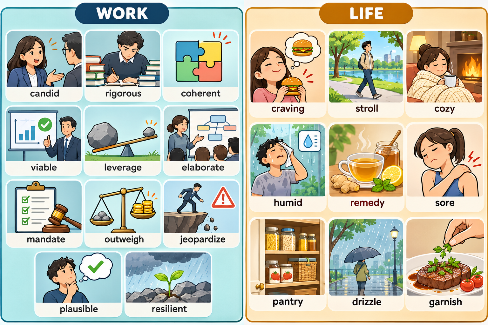

# 每日英语单词 20 个 · 2026-10-31（第 10 期）

> **词表定位**：锚定 CET-6 六级高频/中频核心词汇，无超纲生僻词，无 apple / happy 类基础词。
> **构成**：职场 11 + 生活 9。
> **去重**：已避开前九期全部 180 词（10-22 / 10-23 / 10-25 / 10-26 / 10-27 / 10-28 / 10-29 / 10-30 / 10-24 / 10-24）。
> **配套**：复习窗口 `06-Growth/Education/六级考试/每日20词-复习窗口.md` 同步追加至 180 词。
> **场景记忆图**：`../场景配图/image25-flare-20261031-122617-35cc1522.png`（Image 2.5 Flare，WORK / LIFE 双场景，左职场右生活）。

---
> **场景记忆图**：`场景配图/image25-sunburst-20261031-014116-09299581.png`（gpt-image-2.5-sunburst，WORK / LIFE 双场景）。

## 职场篇（11 词）

**1. candid** /ˈkændɪd/
- **词义**：adj. 坦率的，直言不讳的；坦率的评价
- **例句**：To be candid, I don't think the team can finish this by Friday.
  （坦白说，我认为团队这周内做不完。）
- 💡 **记忆**：拉丁 candidus「白、亮」——候选人 candidate 的 cand- 正是"穿白衣者"，candid 则取"清白坦荡"之意，故说话不绕弯。固定搭配 be candid about sth（对某事直言）。

**2. rigorous** /ˈrɪɡərəs/
- **词义**：adj. 严谨的，严格的；（训练）艰苦而规范的
- **例句**：The paper went through a rigorous peer review before acceptance.
  （这篇论文在录用前经过严格的同行评审。）
- 💡 **记忆**：rig（刻纹，同 rigor 严格 / vigorous 有力的）——"一道纹路都不放过"，故一丝不苟。搭配 rigorous testing / rigorous standards。⚠️ 别与 stringent（规定苛刻）混。

**3. coherent** /koʊˈhɪrənt/
- **词义**：adj. 连贯的，条理清楚的；论点一致的；有凝聚力的
- **例句**：His explanation was clear and coherent even under pressure.
  （即便在压力下，他的解释也清晰有条理。）
- 💡 **记忆**：co（共同）+ her（黏着，同 adhere / herd）——"把各部分黏回一整块"。名词 coherence，形容词 cohesive（凝聚力）。

**4. viable** /ˈvaɪəbl/
- **词义**：adj. 可行的，能落地的；能存活下去的
- **例句**：We need a viable fallback plan before we sign the contract.
  （签合同之前我们需要一个可行的备选方案。）
- 💡 **记忆**：vi（生命，同 vital / vitamin）——"有生命力的"，商业语境就是"跑得通的"。搭配 a viable option / commercially viable。⚠️ 与 feasible 都译"可行"，见辨析。

**5. leverage** /ˈlevərɪdʒ/
- **词义**：v. 利用，撬动（资源、影响力）；n. 杠杆；影响力，谈判筹码
- **例句**：We can leverage the existing user base to cut launch costs.
  （我们可以借力现有用户基础来压低上线成本。）
- 💡 **记忆**：lever（杠杆）+ age——"用一根杠杆撬动"。名词义是"你手里的筹码/话语权"，如 negotiating leverage。⚠️ 名词在英式英语中也可读 /ˈliːvərɪdʒ/。

**6. elaborate** /ɪˈlæbərət/（adj.）/ˈlæbəreɪt/（v.）
- **词义**：adj. 精心制作的，精细的；v. 详述，阐述
- **例句**：Could you elaborate on how the two teams will split the work?
  （你能不能详细说说两个团队怎么分工？）
- 💡 **记忆**：e（出）+ labor（劳动，同 laboratory）——"多下功夫做出来的"。作动词是"把事情讲开讲细"。⚠️ 形容词读 /-rət/、动词读 /-reɪt/；搭配 elaborate **on** sth，介词 on 不能省。

**7. mandate** /ˈmændeɪt/
- **词义**：v. 强制要求，下令；n. 授权，委任；指令
- **例句**：The new regulation mandates that all staff wear a badge indoors.
  （新规强制要求所有员工在室内佩戴工牌。）
- 💡 **记忆**：man（手）+ date（指派，同 candidate / agent）——"上级用手把任务指给你"，动词即"下令"，名词即"正式授权"。搭配 mandate that 从句 / a regulatory mandate。

**8. outweigh** /ˌaʊtˈweɪ/
- **词义**：v. 在重要性上超过；比…更重；胜过
- **例句**：The benefits of moving the servers overseas far outweigh the setup cost.
  （服务器外迁的收益远大于初期成本。）
- 💡 **记忆**：out（在外）+ weigh（称重）——"放上秤称一称谁更重"。⚠️ 宾语是"较轻的那一方"：benefits outweigh costs。

**9. jeopardize** /ˈdʒepərtaɪz/
- **词义**：v. 危及，损害，破坏（计划、成果、安全）
- **例句**：Cutting the test window could jeopardize the whole release.
  （缩短测试窗口可能危及整个版本发布。）
- 💡 **记忆**：jeopardy（西洋棋里"把将"送掉的险局，同 jeopardy 危险）——"一着不慎，满盘皆输"。⚠️ **及物**动词，后直接跟宾语，不加 with。

**10. plausible** /ˈplɔːzəbl/
- **词义**：adj. 貌似合理的，听起来可信的（未必是真的）；说得通的
- **例句**：His explanation sounded plausible, but the timestamps told a different story.
  （他的解释听着挺合理，但时间戳说的是另一回事。）
- 💡 **记忆**：plaud（拍掌赞赏，同 applaud）——"听着值得鼓掌"，故像那么回事。⚠️ plausible ≠ true，只表示"像真的"，正好用来设骗局。

**11. resilient** /rɪˈzɪliənt/
- **词义**：adj. 有韧性的，能迅速恢复的；复原力强的
- **例句**：Small teams tend to be more resilient when priorities shift.
  （优先级一变动，小团队往往更有韧性。）
- 💡 **记忆**：拉丁 resilire「弹回」——像弹簧被压扁还能弹回原状。搭配 a resilient economy / resilient systems。

---

## 生活篇（9 词）

**12. craving** /ˈkreɪvɪŋ/
- **词义**：n. 强烈的渴望，渴求（尤指对食物或某种瘾）；v. 强烈想要
- **例句**：I had a late-night craving for something salty.
  （深夜里特别想吃咸的东西。）
- 💡 **记忆**：crave（强烈渴望）+ -ing——"馋"。搭配 a craving for sth / satisfy a craving。⚠️ 与 appetite（生理食欲）分清，见辨析。

**13. stroll** /stroʊl/
- **词义**：v./n. 散步，溜达（悠闲地走）
- **例句**：We took a slow stroll along the river after dinner.
  （晚饭后我们沿着河边慢慢溜达了一圈。）
- 💡 **记忆**：联想"溜达"——不赶路的那种走。搭配 take / go for a stroll。⚠️ 对比 stride（大步流星）、stagger（踉跄）。

**14. cozy** /ˈkoʊzi/
- **词义**：adj. 舒适温馨的，暖洋洋的；n.（英式）舒适小憩
- **例句**：A cup of tea and an old blanket made the room feel cozy.
  （一杯热茶加一条旧毯子，让房间格外温馨。）
- 💡 **记忆**：**联想**（词源有争议，不作定论）：像壁炉边烤火——"暖和得让人不想动"。搭配 a cozy corner / feel cozy。

**15. humid** /ˈhjuːmɪd/
- **词义**：adj. 潮湿闷热的（空气湿度大）
- **例句**：The lab is so humid in July that the printouts curl up.
  （实验室七月太潮，打印纸都卷边了。）
- 💡 **记忆**：humid 管的是**空气**（天气的形容词），moist 管的是**表面**（手摸得到的湿）。名词 humidity。

**16. remedy** /ˈremədi/
- **词义**：n. 补救办法，疗法；v. 补救，纠正
- **例句**：A short nap is my usual remedy for a slow afternoon.
  （效率低下的下午，我照例靠小睡一会儿解决。）
- 💡 **记忆**：re（再一次）+ med（治，同 medical / medicine）——"再治一次"。⚠️ remedy 是"办法、疗法"，cure 才是"治愈"。

**17. sore** /sɔːr/
- **词义**：adj. 酸痛的；（口语）恼火的；n. 痛处，隐痛
- **例句**：My shoulders are sore after three days of crouching over the model.
  （连着三天伏在模型上，我的肩膀酸痛。）
- 💡 **记忆**：联想最熟的两个搭配：a sore throat（喉咙痛）、a sore loser（输不起的人）。搭配 feel sore / sore muscles。

**18. pantry** /ˈpæntri/
- **词义**：n. 食品储藏室，食品柜；食品储藏
- **例句**：She keeps enough snacks in the pantry for a midnight study session.
  （她在食品柜里囤了够半夜赶工时吃的零食。）
- 💡 **记忆**：pan（平底锅）+ try（存放处）——"锅碗罐罐的存放地"。搭配 a well-stocked pantry / pantry staples。⚠️ 拼写易错，p-an-t-ry，别写成 pantey / pantrie。

**19. drizzle** /ˈdrɪzl/
- **词义**：n. 细雨，毛毛雨；v. 下小雨；（液体）滴洒
- **例句**：A light drizzle started just as we left the office.
  （我们刚下班，就开始下起了毛毛雨。）
- 💡 **记忆**：联想"滴滴答答"的小雨声。搭配 a light drizzle / drizzle with rain。⚠️ 对比 shower（阵雨）、downpour（倾盆大雨）。

**20. garnish** /ˈɡɑːrnɪʃ/
- **词义**：n. 配菜，装饰物；v. 装饰，点缀；给…加配菜
- **例句**：He garnished the soup with a sprig of thyme.
  （他用一小枝百里香给汤做了点缀。）
- 💡 **记忆**：联想"给菜戴上一圈花环"。⚠️ 厨房高频混用：garnish 是**摆上去好看**，season 是**调进去入味**（season the soup）。

---

## 助记卡（词根抓手 + 高频搭配）

| 单词 | 词根/画面抓手 | 高频搭配 |
|---|---|---|
| candid | candidus（清白坦荡）→ 不绕弯 | be candid about sth |
| rigorous | rig（刻纹）→ 一道纹不放过 | rigorous testing |
| coherent | co + her（黏着）→ 黏回一整块 | a coherent strategy |
| viable | vi（生命）→ 跑得通的 | a viable option |
| leverage | lever（杠杆）→ 撬动 | leverage existing assets |
| elaborate | e + labor（多下功夫）→ 说开讲细 | elaborate on sth |
| mandate | man + date（指派）→ 上级下令 | mandate that... |
| outweigh | out + weigh（称重）→ 谁更重 | outweigh the risks |
| jeopardize | jeopardy（送将险局）→ 满盘皆输 | jeopardize safety |
| plausible | plaud（拍掌）→ 听着像真的 | a plausible explanation |
| resilient | resilire（弹回）→ 弹簧复位 | a resilient economy |
| craving | crave（强烈渴望）→ 馋 | a craving for sth |
| stroll | 溜达 → 不赶路那种走 | take a stroll |
| cozy | 联想壁炉烤火 → 暖得不想动 | a cozy corner |
| humid | humid 管空气 → 天气潮 | humid climate |
| remedy | re + med（再治一次）→ 补救 | a remedy for sth |
| sore | sore throat / sore loser → 痛点 | feel sore |
| pantry | pan + try（锅碗存放处）→ 食品柜 | a stocked pantry |
| drizzle | 滴滴答答 → 毛毛雨 | a light drizzle |
| garnish | 戴花环 → 摆上去好看 | garnish with herbs |

## 双线记忆宫殿（职场线 + 生活线）

**职场线 · 「十月最后一个周三的提案室」**
CEO 开口就 **candid**：这周必须出结论，别粉饰。团队只好 **rigorous** 地抠每个数据，把逻辑捋成 **coherent** 的一条线。方案要活得久，得挑 **viable** 的那个——有人提议拿老接口当杠杆 **leverage**，把流程 **elaborate** 成可执行三步。总部随后 **mandate** 月底上线，deadline 是死的；权衡后众人认定新版收益 **outweigh** 风险，理由写得 **plausible**，但谁都知道一次回滚就可能 **jeopardize** 整季目标。全程没人喊口号，靠的是 **resilient** 地硬扛。

**生活线 · 「雨天的小屋」**
周六下着 **drizzle**，你撑着伞慢慢 **stroll** 回家。推门先去 **pantry** 翻一圈，存货正好对上此刻的 **craving**。屋里很 **cozy**，沙发软塌塌；连日伏案，肩颈有点 **sore**，翻出药膏当 **remedy**。泡一杯柠檬水，扔一片柠檬、几枝薄荷做 **garnish**。窗外空气 **humid**，屋里却暖得让人不想动。

## 易混辨析（8 组当日高频失分点）

| 易混对 | 一句话差别 | 考场陷阱 |
|---|---|---|
| rigorous / stringent | rigorous 是**严谨细致**（褒，方法与标准）；stringent 是**严苛**（多形容规定条件） | 说"实验严谨"用 rigorous；说"门槛严苛"用 stringent |
| coherent / consistent | coherent 是**（表达）连贯有条理**；consistent 是**前后一致不矛盾** | 讲逻辑结构用 coherent；讲数据不打架用 consistent |
| viable / feasible | viable 是**能长期存活运转**；feasible 是**条件与技术允许** | 商业模式、能落地的方案用 viable |
| mandate / require / order | mandate 是**上级正式下令**；require 是**常规要求**；order 是**命令口气** | 法规条文写 mandate |
| jeopardize / risk / endanger | jeopardize 是**及物**动词，直接接宾语；risk 只能 risk doing | 不能写 jeopardize with the deal |
| plausible / credible / probable | plausible 是**貌似合理但未必真**；credible 是**值得信**；probable 是**很可能** | 骗子话术用 plausible，别当 true |
| resilient / resistant | resilient 是**受打击后能恢复**（人、系统、经济）；resistant 是**材质本身抗性强** | 人扛住用 resilient；材料防水用 resistant |
| cozy / snug | cozy 是**氛围温馨**；snug 是**贴合刚合身**（a snug fit） | 写房间用 cozy，写尺寸用 snug |

> ⚠️ **搭配雷区**：elaborate **on** sth（on 不可省）/ be plausible / leverage sth（及物）/ mandate **that** 从句 / outweigh + 宾语（受益方在前）/ a craving **for** sth / take a stroll / a drizzle **of** rain / garnish **with** sth —— 九个固定搭配是完形与写作的高频扣分点。

## 快速自测（5 题 · 答案折叠）

**1. 填空**：The new regulation ______ that every employee display a badge indoors.（强制要求）

**2. 选词填空**：His explanation sounded ______ , but the timestamps told a different story.（plausible / probable / credible）

**3. 中译英**：坦白说，我认为团队这周内做不完。

**4. 词形变换**：elaborate 作形容词时读音是 ______，作动词时读音是 ______；动词常搭配的介词是 ______。

**5. 生活场景选词**：After three hours of hiking, my legs were ______ , so I sat down and stretched.（从 sore / humid / cozy 中选）

👉 点击展开答案

1. **mandate**；mandate that 从句是法规、章程类文本的固定句式，比 require 更强调"强令"。
2. **plausible**；probable 是"很可能为真"，credible 是"值得相信"，plausible 强调"听起来像真的"，正好用来暗示可疑。
3. **To be candid, I don't think the team can finish this by Friday.**；开头用 To be candid 是职场邮件里坦率表态的固定说法。
4. 形容词 **/ɪˈlæbərət/**，动词 **/ˈlæbəreɪt/**，介词 **on**；elaborate on sth = 详述，切勿漏掉 on。
5. **sore**；**sore** 指肌肉酸痛，humid 是空气潮湿，cozy 是房间温馨，三个词里只有 sore 能接 legs。

---

*第 10 期 · 生成于 2026-10-31 · 累计已学 200 词（CET-6 向）*
