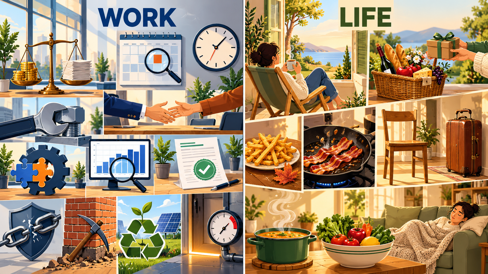

# 每日英语单词 20 个 · 2026-11-01（第 11 期）

> **词表定位**：锚定 CET-6 六级高频/中频核心词汇，无超纲生僻词，无 apple / happy 类基础词。
> **构成**：职场 11 + 生活 9。
> **去重**：已避开前十期全部 200 词（10-22 / 10-23 / 10-25 / 10-26 / 10-27 / 10-28 / 10-29 / 10-30 / 10-31 / 10-24 / 10-24）。
> **配套**：复习窗口 `06-Growth/Education/六级考试/每日20词-复习窗口.md` 同步追加至 200 词。
> **场景记忆图**：`../场景配图/image25-flare-20261101-083808-cd36d04d.png`（Image 2.5 Flare，WORK / LIFE 双场景，左职场右生活）。

---

## 职场篇（11 词）

**1. weigh** /weɪ/
- **词义**：v. 称重，衡量；权衡，斟酌；压
- **例句**：We need to weigh the cost of the upgrade against the risk of delaying the release.
  （我们需要把升级的成本与延迟发布的风险权衡一下。）
- 💡 **记忆**：weigh 源自古英语 wey「秤盘、载重」——把两头放上秤比轻重。固定搭配 weigh A against B。⚠️ 宾语是"被称的那一方"：weigh the risks against the gains。

**2. reinforce** /ˌriːɪnˈfɔːrs/
- **词义**：v. 加强，强化；巩固（信念、地位）；给…加支撑
- **例句**：The new policy is designed to reinforce our position with key clients.
  （新政策旨在强化我们在关键客户中的地位。）
- 💡 **记忆**：re（再一次）+ force（力量）——"再补上一把力"。名词 reinforcement 指加固物，比喻层面的"正反馈加强"。搭配 reinforce confidence / reinforce a claim。

**3. schedule** /ˈskedʒuːl/
- **词义**：n. 日程表，时刻表，计划表；v. 安排，排定
- **例句**：Let's schedule a 30-minute call for Monday morning.
  （我们把一个 30 分钟的电话会安排在周一上午吧。）
- 💡 **记忆**：拉丁 schedula「小纸条」——"把事项写在纸条上排队"，故是排期。⚠️ 美音重音在第一音节 /ˈsked-/，英音在第二音节；搭配 schedule a meeting / be scheduled for。

**4. audit** /ˈɔːdɪt/
- **词义**：v. 审核，审计，查账；n. 审计，审查
- **例句**：An external team will audit our expense records at the end of the quarter.
  （季度末将有外部团队审计我们的报销记录。）
- 💡 **记忆**：拉丁 audire「听」——审计师不听故事，只逐笔核对账目。搭配 audit the accounts / an internal audit / auditor。

**5. compromise** /ˈkɑːmprəmaɪz/
- **词义**：n. 妥协，折中；v. 妥协，各退一步；v. 危及，损害（健康、声誉）
- **例句**：Both teams compromised on the deadline and shipped a thinner feature set.
  （两个团队在截止日期上各让一步，交付的功能范围更小。）
- 💡 **记忆**：com（共同）+ promise（承诺）——"各自的承诺对不上，就各退一半求个折中"。⚠️ 它也能作动词表示"损害"：The scandal compromised his career. 见辨析。

**6. deploy** /dɪˈplɔɪ/
- **词义**：v. 部署，调派；调度，投放（资源、软件、兵力）
- **例句**：We will deploy the updated model on the edge device before Friday.
  （我们会在周五前把更新后的模型部署到端侧设备上。）
- 💡 **记忆**：de（向下）+ ploy（折叠）——"把折叠的东西展开铺开到位"，故是部署到位。搭配 deploy resources / deploy a version / deploy troops。

**7. certify** /ˈsɜːrtɪfaɪ/
- **词义**：v. 证明，证实；认证，颁发证书；保证，担保
- **例句**：The lab certified that the samples met all safety standards.
  （实验室证明样品符合全部安全标准。）
- 💡 **记忆**：cert（确定，同 certain / certificate）——"给出一个确定结论"。名词 certificate（证书）、certification（认证过程）。搭配 certify that... / be certified by。

**8. breach** /briːtʃ/
- **词义**：n. 违反，违约；缺口，裂口；v. 违反（协议），破坏（墙、堤坝）
- **例句**：Reporting the bug immediately reduced the risk of a contract breach.
  （立刻上报这个 bug 降低了违约风险。）
- 💡 **记忆**：联想"墙被撕开一道口子"——原义是"缺口、破口"，引申为"破坏约定、撕毁协议"。⚠️ 与 violate 区分，见辨析。

**9. undermine** /ˌʌndərˈmaɪn/
- **词义**：v. 暗中破坏，削弱（信心、根基、权威）
- **例句**：Constantly moving the deadline undermined the team's confidence in the plan.
  （反复推迟截止时间，削弱了团队对计划的信心。）
- 💡 **记忆**：under（在下面）+ mine（挖）——"从底下掏空地基"，表面没事，暗里松劲。搭配 undermine confidence in sth / undermine authority。

**10. sustainable** /səˈsteɪnəbl/
- **词义**：adj. 可持续的，能长期维持的；环保的
- **例句**：The company set a sustainable target of zero waste by 2030.
  （公司设定了 2030 年零废弃的可持续目标。）
- 💡 **记忆**：sus（在下）+ tain（持有，同 maintain / contain）——"托得住、接得住"，即能长期维持。搭配 sustainable development / sustainable growth。⚠️ 与 renewable（可再生的）区分。

**11. threshold** /ˈθreʃhoʊld/
- **词义**：n. 门槛，临界点，起点；界线，起始线
- **例句**：Our pain threshold for a bad review dropped to almost zero this week.
  （这周我们对差评的容忍门槛几乎降到了零。）
- 💡 **记忆**：本义是"门槛横木"——"跨过这道木门槛才算数"。比喻义即临界点。搭配 cross the threshold / below the threshold / pain threshold。

---

## 生活篇（9 词）

**12. lounge** /laʊndʒ/
- **词义**：v. 闲逛，闲坐；懒洋洋地躺；n. 休息室，贵宾室
- **例句**：We lounged on the balcony all afternoon, doing absolutely nothing.
  （我们整个下午都瘫在阳台上，什么也没干。）
- 💡 **记忆**：拉丁 longa（长）——"拉长身子懒洋洋地待着"。搭配 lounge around / lounge in a chair。⚠️ 名词 lounge 指机场、俱乐部的"休息室"。

**13. lavish** /ˈlævɪʃ/
- **词义**：adj. 奢华的，大量的；厚重的（赞美）；v. 大量给予，厚待
- **例句**：Her parents lavished her with books when she started university.
  （她上大学时，父母送了她很多书。）
- 💡 **记忆**：联想"大量用水洗"——奢侈、不吝惜。搭配 lavish praise / lavish attention **on** sb / be lavish **with** sth。

**14. crisp** /krɪsp/
- **词义**：adj. 脆的（薯条、生菜）；清爽的，爽利的；冷而不湿的；v. 使变脆
- **例句**：The lettuce was still crisp when we took it out of the fridge.
  （从冰箱里拿出来的生菜还是脆的。）
- 💡 **记忆**：联想"咬下去咔嚓一声"——crisp 也可形容说话"干脆利落"。搭配 crisp bacon / a crisp morning。⚠️ 与 brittle（硬而一碰就碎）区分。

**15. grease** /ɡriːs/
- **词义**：n. 油脂，润滑油，肥肉；v. 给…涂油，润滑
- **例句**：Wipe the grease off the stove before you cook the eggs.
  （煎蛋前先把灶台上的油污擦掉。）
- 💡 **记忆**：源自拉丁 crassus「肥厚的」——油厚厚一层。搭配 grease a pan / a greasy stain / grease the wheels（给轮子加油）。⚠️ 名词 grease 是油脂，形容词是 greasy（油腻的）。

**16. sturdy** /ˈstɜːrdi/
- **词义**：adj. 结实的，坚固的；坚定的（信念、支撑）
- **例句**：That second-hand desk is sturdier than the one we bought new.
  （那二手桌子比我们买的新桌子还结实。）
- 💡 **记忆**：sturd- 里藏着 hard 的音——"不虚不飘，实打实"。搭配 a sturdy chair / sturdy construction / a sturdy argument。⚠️ 与 stiff（僵硬不灵活）区分。

**17. porter** /ˈpɔːrtər/
- **词义**：n. 搬运工，脚夫；行李员；看门人；v. 搬运，背负
- **例句**：A porter carried my heavy suitcase up to the fourth floor.
  （一个搬运工把我的沉重行李搬上了四楼。）
- 💡 **记忆**：拉丁 portare「搬运」——火车站的 porter 就是"站台搬运工"。搭配 a luggage porter / be employed as a porter。⚠️ 医院门房也叫 porter。

**18. aroma** /əˈroʊmə/
- **词义**：n. 香气，香味（尤指食物弥漫开的那股味道）
- **例句**：The aroma of fresh bread filled the whole stairwell.
  （新鲜面包的香气飘满了整个楼道。）
- 💡 **记忆**：联想 aroma-therapy（芳香疗法）——"闻着就治愈"。搭配 the aroma of coffee / a pungent aroma。⚠️ 与 scent（气味，可好可坏）区分。

**19. nutritious** /nuˈtrɪʃəs/
- **词义**：adj. 有营养的，滋补的；营养充足的
- **例句**：Her lunch was simple but surprisingly nutritious.
  （她的午饭很简单，但营养得出乎意料。）
- 💡 **记忆**：nutri（滋养，同 nutrient / nutrition）+ -ous（充满）——"充满营养的"。搭配 a nutritious meal / nutritionally balanced。名词 nutrition、nutrient。

**20. drowsy** /ˈdraʊzi/
- **词义**：adj. 昏昏欲睡的，困倦的；催眠的
- **例句**：The warm lecture room made everyone drowsy by 3 p.m.
  （暖和的教室让所有人到下午三点都昏昏欲睡。）
- 💡 **记忆**：drowse（打盹，同 doze）+ -y——"正在打盹的那张脸"。搭配 feel drowsy / drowsiness（嗜睡，医学用语）。⚠️ 与 dizzy（头晕）区分。

---

## 助记卡（词根抓手 + 高频搭配）

| 单词 | 词根/画面抓手 | 高频搭配 |
|---|---|---|
| weigh | wey（秤盘）→ 两头比轻重 | weigh A against B |
| reinforce | re + force（再补一把力）→ 加固 | reinforce confidence |
| schedule | schedula（小纸条）→ 排队排期 | schedule a meeting |
| audit | audire（听）→ 逐笔核账 | audit the accounts |
| compromise | com + promise（承诺对不上）→ 各退一半 | compromise on sth |
| deploy | de + ploy（展开铺开）→ 部署到位 | deploy a version |
| certify | cert（确定）→ 给确定结论 | certify that... |
| breach | 墙被撕开一道口子 → 违约 | a breach of contract |
| undermine | under + mine（从底下掏空）→ 暗中削弱 | undermine confidence in |
| sustainable | sus + tain（托得住）→ 能长期维持 | sustainable growth |
| threshold | 门槛横木 → 临界点 | cross the threshold |
| lounge | longa（长）→ 瘫着不动 | lounge around |
| lavish | 不吝惜 → 大量给 | be lavish with sth |
| crisp | 咬下去咔嚓 → 脆 | crisp bacon |
| grease | crassus（肥厚的）→ 一层油 | grease a pan |
| sturdy | sturd- 藏着 hard → 实打实 | a sturdy chair |
| porter | portare（搬运）→ 站台搬运工 | a luggage porter |
| aroma | aroma-therapy → 闻着治愈 | the aroma of coffee |
| nutritious | nutri + -ous → 充满营养 | a nutritious meal |
| drowsy | drowse（打盹）+ -y → 困 | feel drowsy |

## 双线记忆宫殿（职场线 + 生活线）

**职场线 · 「周三下午的冲刺办公室」**
会议室角落立着一架黄铜天平，大家把方案与预算分别放上两端 **weigh**，称哪个更划得来。工程师抄起扳手夹住承重螺栓，一层层 **reinforce** 墙基；墙上的日历被重新排满，**schedule** 一格接一格，旁边大钟滴答作响。财务拿着放大镜对着柱状图做 **audit**；两个部门隔桌握手，**compromise** 出折中方案。运维在机房 **deploy** 新版本，齿轮像拼图般严丝合缝；质检给报告盖上绿色对勾 **certify**。法务提醒：若合同被 **breach**，赔偿很贵；有人在砖墙底下悄悄起 **undermine**，动摇了根基。新园区插上太阳能板，回收标志旁冒出嫩芽，**sustainable** 目标写在墙上；上线门槛亮起红线，压力表逼近红色极限 **threshold**。

**生活线 · 「周日下午的公寓」**
你瘫在阳台躺椅上 **lounge**，手边一杯茶，窗开着。朋友拎着 **lavish** 的野餐篮来串门，篮里塞满礼物。茶几上一盘薯条咬下去 **crisp**，旁边落着一片脆秋叶。厨房里平底锅滋滋响，培根油光发亮，锅里腾起一层 **grease**；玄关旁站着 **porter**，帮你把沉重皮箱扛上楼。汤锅冒着 **aroma**，香气漫过整个屋子；餐桌摆满蔬菜水果，样样 **nutritious**。吃饱往沙发上一倒，困意上头有点 **drowsy**，裹着毯子睡了过去。

## 易混辨析（8 组当日高频失分点）

| 易混对 | 一句话差别 | 考场陷阱 |
|---|---|---|
| weigh / outweigh | weigh 是**称重、权衡**；outweigh 是**比…更重要**（结果对比） | "权衡利弊"用 weigh，别直接写 weigh importance |
| audit / inspect / examine | audit 是**审计查账**（带合规财务色彩）；inspect 是**按职责检查**（设施设备）；examine 是**仔细查验**（物证细节） | 审计财务用 audit |
| breach / violate | breach 是**撕开一道口子**（合同、堤坝、保密）；violate 是**明知故犯规则**（法律、原则） | 合同违约用 breach of contract |
| compromise / concede | compromise 是**双方各让一步**达成折中；concede 是**一方单方面让步或承认** | 谈判互惠用 compromise on sth |
| sustainable / renewable | sustainable 是**整体可持续**（系统、发展）；renewable 是**本身可再生**（能源、材料） | 太阳能板是 renewable，整套方案是 sustainable |
| undermine / sabotage | undermine 是**暗中削弱**（信任、士气、根基）；sabotage 是**蓄意外显的破坏** | 职场冷处理属 undermine |
| threshold / limit / quota | threshold 是**临界点、门槛**；limit 是上限；quota 是**配额**（人头、任务量） | 数值起点用 threshold |
| sturdy / stiff | sturdy 是**结实抗造**（材料、椅子）；stiff 是**僵硬不灵活**（肢体、关节） | 写木椅用 sturdy |

> ⚠️ **搭配雷区**：weigh A **against** B / reinforce confidence **in** sth / be scheduled **for** / audit the accounts / compromise **on** sth / deploy a version / certify **that**... / a breach **of** contract / undermine confidence **in** sth / cross the threshold / be lavish **with** sth / a greasy stain / a luggage porter / the aroma **of** coffee / a nutritious meal / feel drowsy —— 十八个固定搭配是完形与写作的高频扣分点。

## 快速自测（5 题 · 答案折叠）

**1. 填空**：We must ______ the increased maintenance cost ______ the risk of a system failure.（权衡…与…）

**2. 选词填空**：The report was signed off by an external ______ team at the end of the quarter.（audit / inspect / examine）

**3. 中译英**：持续推迟截止时间，削弱了团队对计划的信心。

**4. 词形辨析**：合同被撕开一道口子，属于违约；请用 breach 一词的动词形式填空：Repeated delays may ______ the contract.

**5. 生活场景选词**：The lettuce was still ______ when we took it out of the fridge, so it was good for a salad.（从 crisp / greasy / drowsy 中选）

👉 点击展开答案

1. **weigh ... against ...**；weigh A against B 是权衡两个选项的固定结构，也可说 weigh up，但 against 更常见于书面。
2. **audit**；audit 专指财务与合规层面的审查，inspect 用于设施设备的例行检查，examine 用于对物证、细节的细致查验。
3. **Constantly moving the deadline undermined the team's confidence in the plan.**；undermine 强调"从内部悄悄削弱"，比 weaken 更贴合语境。
4. **breach**；breach 作动词直接接宾语：breach the contract，不加 with。
5. **crisp**；crisp 指蔬菜咬起来脆，greasy 是油腻的（管油不脆），drowsy 是犯困的（管人），只有 crisp 能接 lettuce。

---

*第 11 期 · 生成于 2026-11-01 · 累计已学 220 词（CET-6 向）*
