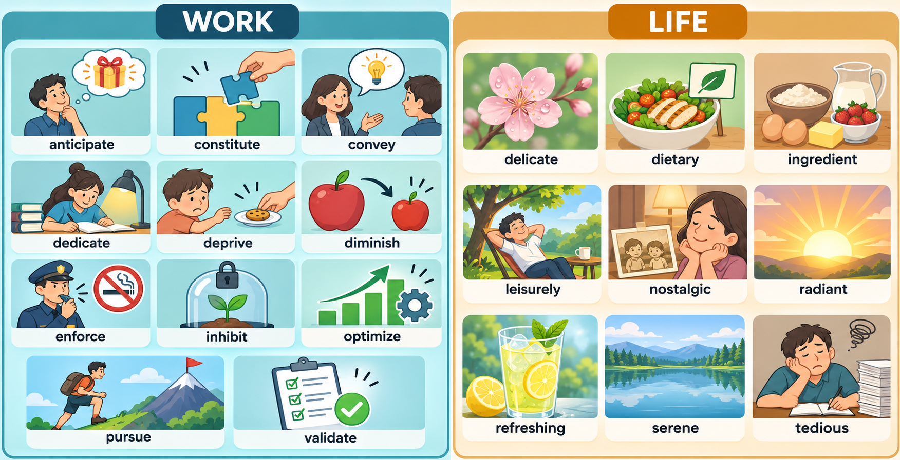

# 每日英语单词 20 个 · 2026-11-03（第 13 期）

> **词表定位**：锚定 CET-6 六级高频/中频核心词汇，无超纲生僻词，无 apple / happy 类基础词。
> **构成**：职场 11 + 生活 9。
> **去重**：已避开前十二期全部 240 词（10-22 / 10-23 / 10-25 / 10-26 / 10-27 / 10-28 / 10-29 / 10-30 / 10-31 / 11-01 / 11-02 / 10-24 / 10-24）。
> **配套**：复习窗口 `/Users/insistgang/Desktop/个人工具/liuji/每日英语单词/每日20词-复习窗口.md` 同步追加至 240 词。
> **场景记忆图**：`../场景配图/image25-flare-20261103-095346-275ff01a.png`（Image 2.5 Flare，WORK / LIFE 双场景，左职场右生活，1672×941）。

---
> **场景记忆图**：`场景配图/image25-sunburst-20261103-014525-f1f986b8.png`（gpt-image-2.5-sunburst，WORK / LIFE 双场景）。

## 职场篇（11 词）

**1. anticipate** /ænˈtɪsɪpeɪt/
- **词义**：v. 预料，预期；期待；预先处理
- **例句**：We anticipate a spike in traffic once the new features go live.
  （新功能上线后我们预计流量会激增。）
- 💡 **记忆**：拉丁 ante（前）+ capere（拿，同 capture / capable）——"提前拿到手"，即事先料到并预留应对。⚠️ 搭配 **anticipate problems**（预判问题），比 expect 更主动、更书面；名词 anticipation 在商务听力里常是关键词。

**2. constitute** /ˈkɑːnstətuːt/
- **词义**：v. 构成，组成；设立，成立（机构）
- **例句**：These three modules constitute the core of the new platform.
  （这三个模块构成了新平台的核心。）
- 💡 **记忆**：拉丁 con + stitute（站立，同 institute / substitute / constituent）——"把几样东西立在一起"，故为"构成"。⚠️ 方向别搞反：**A constitutes B** 是" A 构成 B "；**B consists of A** 是"B 由 A 组成"。名词 **constituent** 是"组成部分、选民"。

**3. convey** /kənˈveɪ/
- **词义**：v. 传达，表达；运送，输送
- **例句**：A single chart can convey the whole result faster than ten slides.
  （一张图表比十页幻灯片更快传达整个结果。）
- 💡 **记忆**：拉丁 con + veh（带，同 vehicle / convey / invective）——"用车带过去"，故可"运送"，也可"把意思带过去"。⚠️ 搭配 **convey a message / convey meaning / convey an idea**，宾语不能是具体物品（那是 transport）。

**4. dedicate** /ˈdedɪkeɪt/
- **词义**：v. 致力于，献身于；题献，献给
- **例句**：After graduation she dedicated herself to rural education.
  （毕业后她把全部精力投入了乡村教育。）
- 💡 **记忆**：拉丁 de + dicare（宣告，同 predict / verdict / dedicate）——"公开宣告归属"。⚠️ 固定搭配 **dedicate oneself to** sth / **be dedicated to** sth；介词是 to，不是 for。

**5. deprive** /dɪˈpraɪv/
- **词义**：v. 剥夺，使丧失（权利、机会、感官）
- **例句**：Cutting the sensor deprived the model of its most useful feature.
  （砍掉传感器使模型失去了最有用的特性。）
- 💡 **记忆**：de（去除）+ priv（私，同 private / privilege）——"把属于你的东西拿走"，故剥夺。⚠️ 固定搭配 **deprive sb of sth**，介词是 of；名词 **deprivation**（匮乏）在社会类阅读中常见。

**6. diminish** /dɪˈmɪnɪʃ/
- **词义**：v. 减少，降低；（使）显得不重要，贬低
- **例句**：The medicine gradually diminishes the pain without causing drowsiness.
  （这药能逐渐缓解疼痛且不引起困倦。）
- 💡 **记忆**：拉丁 di + minuere（变小，同 minute / minus / miniature）——"往小里走"，故是逐渐减少。⚠️ 三个近义方向不同：**diminish** 强调"变小/变弱"，**decrease** 强调"数量下降"，**reduce** 偏"人为减少"。

**7. enforce** /ɪnˈfɔːrs/
- **词义**：v. 执行，实施（法律、规定）；强制执行（禁令）
- **例句**：The new policy is difficult to enforce without clear guidelines.
  （没有明确指引，这项新政策很难执行。）
- 💡 **记忆**：en（使）+ force（力量，同 enforce / force / reinforce）——"把力量灌进去让它生效"，故是强制落地。⚠️ **enforce a law**（执行法律，有强制力）；**implement a plan**（实施计划，只是落地）；**comply with**（遵守，是主语的行为）——三者常被混用。

**8. inhibit** /ɪnˈhɪbɪt/
- **词义**：v. 抑制，阻碍；使拘谨，使内敛
- **例句**：Cold weather inhibits the battery performance on the edge device.
  （低温会抑制边缘设备的电池表现。）
- 💡 **记忆**：拉丁 in + habere（持有，同 have / inhabit / inhibit）——"把东西按在里面不让出来"，故是抑制。⚠️ 与 prevent 的差别：inhibit 压的是**内部过程**（生长、情绪、反应），prevent 挡的是**外部行为**。

**9. optimize** /ˈɑːptɪmaɪz/
- **词义**：v. 优化，使最优；充分利用
- **例句**：We optimized the pipeline and cut inference latency by a third.
  （我们优化了流水线，把推理延迟砍掉了三分之一。）
- 💡 **记忆**：拉丁 optimus（最好的，同 optimum / optimistic）——"调到最好"，故是优化。⚠️ **optimize** 是找最优平衡，**maximize** 是拉满上限，**minimize** 是压到最低；写作里 optimize 显专业，improve 更泛。

**10. pursue** /pərˈsuː/
- **词义**：v. 追求；从事，继续（计划）；追赶
- **例句**：She decided to pursue a master's degree in computer vision.
  （她决定攻读计算机视觉方向的研究生。）
- 💡 **记忆**：拉丁 per + sequi（跟随，同 sequence / consecutive / sequel）——"一路跟上去"，故为追求与追赶。⚠️ 搭配 **pursue a goal / pursue a career / pursue further studies**；**chase** 偏具体追赶，**seek** 偏"寻求（物/机会）"。

**11. validate** /ˈvælɪdeɪt/
- **词义**：v. 验证，证实；确认（数据、系统）；批准，认可
- **例句**：We validated the model on a held-out dataset before deployment.
  （我们在部署前用留出数据集验证了模型。）
- 💡 **记忆**：拉丁 validus（有效的，同 valid / value）——"确认它站得住"。⚠️ 搭配 **validate a result / validate an input / validate a hypothesis**；名词 validation 与 10-28 的 viable 同属"能不能落地"一族。

---

## 生活篇（9 词）

**12. delicate** /ˈdelɪkət/
- **词义**：adj. 精致的，精美的；易碎的；微妙的，需小心处理的
- **例句**：The bowl is delicate, so wash it by hand rather than in the dishwasher.
  （这只碗很易碎，要手洗，不要放洗碗机。）
- 💡 **记忆**：拉丁 delicatus（精细的，同 delight / delicious 同源）——"精巧到一碰就碎"。⚠️ 一词三义要分场景：**delicate food** 是"精致美味"，**delicate glass** 是"易碎"，**a delicate situation** 是"微妙敏感"。与 10-27 的 fragile（易碎）近义，但 fragile 只指易碎。

**13. dietary** /ˈdaɪəteri/
- **词义**：adj. 饮食的；饮食的，规定的
- **例句**：Her doctor put her on a low-salt dietary for a month.
  （医生让她实行一个月低盐饮食。）
- 💡 **记忆**：diet（饮食，同 diet / dietetic）+ -ary（与…有关的）——"跟吃饭有关的"。⚠️ 搭配 **dietary requirements**（饮食要求，体检、移民材料高频）/ **dietary supplement**（膳食补充剂）；名词是 **diet**（节食）不是 dietary。

**14. ingredient** /ɪnˈɡriːdiənt/
- **词义**：n. 原料，配料；组成部分，成分
- **例句**：Read the ingredient list before you buy the sauce.
  （买酱料前先看配料表。）
- 💡 **记忆**：拉丁 ingredi（进入，同 ingress / ingredient / grade）——"走进来的东西"，即被加进去的配料。⚠️ 一词两义：食品是"配料"，技术文档里是"组成部分"（a key ingredient of the system）。

**15. leisurely** /ˈleʒərli/
- **词义**：adj. 从容的，悠闲的，慢悠悠的；adv. 从容地
- **例句**：We took a leisurely walk along the lake after dinner.
  （晚饭后我们沿着湖边悠闲地散了一会儿步。）
- 💡 **记忆**：leisure（闲暇，同 leisure / leisureless）+ -ly——"有闲情的样子"。⚠️ 副词是 **leisurely**，不是 leisurely 的"ly"变体漏写；搭配 **a leisurely pace / at a leisurely pace**，形容"不慌不忙"，不是"懒散"。

**16. nostalgic** /nɑːˈstældʒɪk/
- **词义**：adj. 怀旧的， nostalgia 的；对往昔的
- **例句**：The old film strip on his phone makes him nostalgic.
  （手机里的那段旧胶片让他很怀旧。）
- 💡 **记忆**：希腊 nostos（回家）+ algos（痛苦，同 agony）——"回到故乡却满是痛苦"，故怀旧。⚠️ 名词是 **nostalgia**（/nɑːˈstældʒə/，无 c 音），形容词才带 c；描述"对过去产生情感依恋"用它，别用 sentimental。

**17. radiant** /ˈreɪdiənt/
- **词义**：adj. 容光焕发的，笑逐颜开的；光芒四射的
- **例句**：She looked radiant after the announcement of her promotion.
  （得知晋升后，她整个人容光焕发。）
- 💡 **记忆**：拉丁 radius（射线，同 radius / radial）+ -ant——"浑身发着光"。⚠️ 形容人时是"神采奕奕"，形容物时是"灿烂夺目"（radiant sunlight）；与 brilliant（才华横溢）不同，别混。

**18. refreshing** /rɪˈfreʃɪŋ/
- **词义**：adj. 令人耳目一新的，令人愉快的；提神的，解乏的
- **例句**：A cold shower in the afternoon is refreshing after a long shift.
  （长时间值班后，午后冲个冷水澡很解乏。）
- 💡 **记忆**：re（再次）+ fresh（清新的，同 refresh / fresh）——"重新清爽一遍"。⚠️ 搭配 **a refreshing break / refreshing breeze / refreshing drink**；主语通常是"事物"（a refreshing nap），不是"人"。名词 refreshment 指"点心、提神物"。

**19. serene** /səˈriːn/
- **词义**：adj. 宁静的，安详的；平和的
- **例句**：The lake was serene in the early morning mist.
  （清晨薄雾中，湖面十分宁静。）
- 💡 **记忆**：拉丁 serenus（晴朗而平静，同 serene / serenity）——"无风无浪"。⚠️ 近义三连：**serene** 是"外表平静安详"，**tranquil** 也强调宁静，**calm** 更口语、也指情绪镇定；阅读里 serene 常修饰风景与心境。

**20. tedious** /ˈtiːdiəs/
- **词义**：adj. 冗长乏味的，单调沉闷的
- **例句**：The last three hours of data entry were tedious but necessary.
  （最后三个小时录数据既枯燥又必要。）
- 💡 **记忆**：拉丁 taedere（使人厌倦，同 tedium / tedious）——"让人累得想打哈欠"，故乏味。⚠️ 辨析：**tedious** 强调"长而单调"，**dull** 偏"无趣、迟钝"，**mundane** 偏"平凡日常"；CET-6 阅读里 tedious 常与 monotonous 互指。

---

## 助记卡（词根抓手 + 高频搭配）

| 单词 | 词根/画面抓手 | 高频搭配 |
|---|---|---|
| anticipate | ante（前）+ capere（拿）→ 提前拿到手 | anticipate problems |
| constitute | con + stitute（立）→ 立在一起 | A constitutes B |
| convey | con + veh（带）→ 带过去 | convey a message |
| dedicate | de + dicare（宣告）→ 公开归属 | dedicate oneself to sth |
| deprive | de + priv（私）→ 把你的拿走 | deprive sb of sth |
| diminish | di + minuere（变小）→ 往小里走 | diminish the risk |
| enforce | en + force（力量）→ 灌力使其生效 | enforce a law |
| inhibit | in + habere（持有）→ 按住不让出 | inhibit growth |
| optimize | optimus（最好）→ 调到最好 | optimize performance |
| pursue | per + sequi（跟随）→ 一路跟上去 | pursue a goal |
| validate | validus（有效）→ 确认站得住 | validate a result |
| delicate | delicatus（精细）→ 一碰就碎 | a delicate situation |
| dietary | diet + -ary → 跟吃饭有关的 | dietary requirements |
| ingredient | ingredi（进入）→ 走进来的料 | ingredient list |
| leisurely | leisure（闲暇）+ -ly → 有闲情的 | at a leisurely pace |
| nostalgic | nostos + algos → 回乡却 painful | nostalgic memories |
| radiant | radius（射线）→ 浑身发着光 | look radiant |
| refreshing | re + fresh → 重新清爽一遍 | a refreshing break |
| serene | serenus（无风无浪）→ 静 | a serene lake |
| tedious | taedere（厌倦）→ 让人打哈欠 | a tedious process |

## 记忆宫殿 · 双线串记

**职场线（11 词）· 上线前一天的冲刺室**

早上八点，项目上线倒计时。你先站在排期板前 **anticipate** 三个可能爆掉的节点；接着把散在各处的代码块 **constitute** 成一个完整服务；需求文档写完，你用一条消息 **convey** 给下游同事；这条线只剩你一个人扛，于是 **dedicate** 整整一天不再分心；资源却被别的项目 **deprive** 走了一半，留给你的时间 **diminish** 到只剩两小时；这时候必须 **enforce** 流程底线，把测试环境锁住；想冲进度的心情被自己 **inhibit** 住，先跑基准再改参数；一轮轮 **optimize**，把延迟压到可接受；那个卡了很久的指标，你决定今天 **pursue** 到底；最后所有结论都跑过一遍，负责人 **validate** 盖章——上线。

> 画面抓手：一条虚线箭头指向未来 → 方块立成一摞 → 一条消息递出去 → 一盏献身桌灯 → 被拿走一半的零件 → 蜡烛越烧越矮 → 闸杆抬起守住关卡 → 被按住的手腕 → 拧动调参旋钮 → 追着光环跑 → 绿勾印章落下。

**生活线（9 词）· 一个不设闹钟的周末**

难得睡到自然醒，你 **leisurely** 地走去早市，买回一把 **delicate** 的青菜和一袋 **ingredient**，顺手挑了两样看着健康的 **dietary** 搭配。回家路上看见旧照片摊，心里一阵 **nostalgic**；午后阳光 **radiant** 地铺满整面墙，你在窗边喝一杯冰薄荷饮，**refreshing** 得很。傍晚一个人走到湖边，水面 **serene** 得只剩一条小船；坐了一下午，看云一层层挪，才觉得这短暂的一天才不 **tedious**。

> 画面抓手：不慌不忙的脚步 → 精致易碎的菜叶 → 摆成一排的小料碗 → 健康的餐盘 → 泛黄旧照片 → 铺满墙的金色晨光 → 挂着水珠的薄荷饮 → 静得像镜子的湖 → 一摞重复的灰盒子。

## 排雷台（10 组易混，本期高频失分点）

| 易混对 | 一句话差别 | 考场陷阱 |
|---|---|---|
| constitute / consist / compose | constitute 是"A 构成 B"（A 是整体）；consist of 是"B 由 A 组成"（A 是部分）；compose 是"组成"也指"创作" | ⚠️ 方向相反，务必看谁是整体 |
| convey / transport / transmit | convey 传达**意思与情感**；transport 运送**实物**；transmit 传输**信号、能量、疾病** | 说"把意思传过去"用 convey |
| deprive / prevent / deny | deprive sb of sth 是**剥夺（使其失去）**；prevent sb from doing 是**阻止发生**；deny sb sth 是**否认拥有** | 固定介词不同，别互串 |
| diminish / decrease / reduce | diminish 强调**逐渐变小、变弱**；decrease 强调**数量下降**；reduce 强调**人为减少** | "逐渐缓解"用 diminish |
| enforce / implement / comply | enforce 是**强制执行（法律）**；implement 是**落地实施（计划）**；comply 是**主语遵守** | 执法用 enforce，落地用 implement |
| inhibit / prevent / suppress | inhibit 压住**内部过程**（生长、情绪、反应）；prevent 挡住**外部行为**；suppress 强行**压制**（情绪、信息、声音） | 压性能用 inhibit |
| dedicate / devote / commit | dedicate oneself to 指**投入某领域或某事**；devote time to 指**投入时间**；commit 指**承诺、犯（罪/错）** | 搭配介词都是 to |
| optimize / maximize / minimize | optimize 是**找最优平衡点**；maximize 是**拉满上限**；minimize 是**压到最低** | 写作用 optimize 更专业 |
| delicate / fragile / subtle | delicate 可指**易碎**也可指**微妙敏感**；fragile 只指易碎；subtle 指**细微难察觉** | "敏感的局势"用 delicate |
| tedious / dull / mundane | tedious 是**长而单调**；dull 是**无趣、迟钝**；mundane 是**平凡日常** | 形容流程折磨用 tedious |

> ⚠️ **搭配雷区**：anticipate problems / A constitutes B / convey a message / dedicate oneself **to** sth / deprive sb **of** sth / diminish the risk / enforce a law / inhibit growth / optimize performance / pursue a goal / validate a result / a delicate situation / dietary requirements / ingredient list / at a leisurely pace / nostalgic memories / look radiant / a refreshing break / a serene lake / a tedious process —— 二十个固定搭配是完形与写作的高频扣分点。

## 快速自测（5 题 · 答案折叠）

**1. 方向辨析**：These three modules ______ the core of the new platform.（constitute / consist）

**2. 搭配填空**：Cutting the sensor ______ the model of its most useful feature.（deprive / deny）

**3. 中译英**：新功能上线后我们预计流量会激增。

**4. 选词填空**：Cold weather ______ the battery performance on the edge device.（inhibit / prevent）

**5. 生活场景选词**：The bowl is quite ______, so wash it by hand rather than in the dishwasher.（delicate / fragile / subtle）

👉 点击展开答案

1. **constitute**；A constitutes B 是"A 构成 B"，本题主语 modules 是整体，用 constitute；consist of 需要主语是整体（The platform consists of three modules），方向相反。
2. **deprive**；deprive sb of sth 是"剥夺某人的某物"，本题是被拿走特性，用 deprive；deny sb sth 是"否认其拥有"，语义不合。
3. **We anticipate a spike in traffic once the new features go live.**；anticipate 表示"预先料到并留出应对"，比 expect 更主动，符合工程语境；traffic spike 用"流量激增"。
4. **inhibit**；inhibit 压的是内部过程——低温影响电池的化学与性能表现；prevent 挡的是外部行为（阻止某人做某事），语义不符。
5. **delicate**；delicate 指易碎的器皿，同时也可指"精致的"，此处是易碎；fragile 也表易碎但只此一义，subtle 指细微难察觉（如细微差别），均不如 delicate 贴切。

---

*第 13 期 · 生成于 2026-11-03 · 累计已学 260 词（CET-6 向）*
