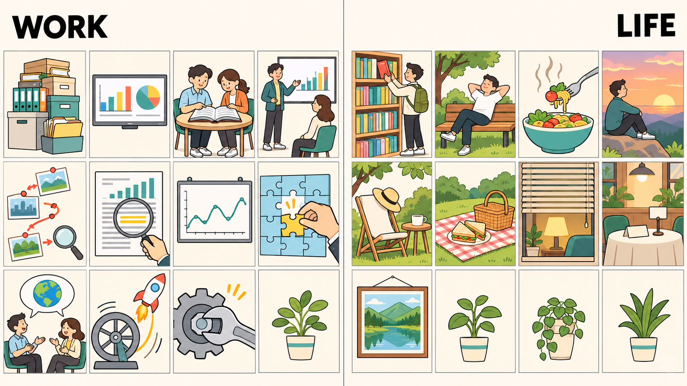

# 每日英语单词 20 个 · 2026-11-06（第 16 期）

> **定位**：面向 CET-6 核心词汇复习，以职场和生活语境掌握常用义与搭配；六级词汇包含与四级重叠的词，本期不宣称逐词具有经统计核验的真题频次。
> **构成与去重**：职场 11 + 生活 9；避开两个历史索引全部 300 个词条，短语按逗号整体去重。本期累计 320 词。
> **记忆说明**：以下画面提示均明确作为联想，不作词源解释；搭配辨析表示常见用法，不作绝对规则。
> **配套**：根目录 `每日20词-复习窗口.md` 与 `已推荐单词索引.md`。

## 场景记忆图

- 请求模型：`gpt-image-2.5-flare`；实际尺寸：1672 × 941；生成耗时：52.33 秒。
- 原图保留于 `/Users/insistgang/Pictures/Sub2API Images/gpt-image-2.5-flare-20261106-112325-01ad12e7.png`；上图使用新真源内的归档副本。
- 图片文件已验证为有效 PNG 并确认归档成功；当前无法读图，**尚未完成视觉验收**，不保证网格或每个概念都准确呈现。
- 看图路线：左侧依次对应职场 11 词；右侧依次对应 browse、casual、flavor、gaze、resort、recreation、privacy、routine、scenery。野餐代表休闲娱乐 recreation，布置餐桌代表日常程序 routine，画面只作联想线索。

## 职场篇（11 词）

**1. accumulate** /əˈkjuːmjəleɪt/
- **词义**：v. 积累，积聚；逐渐增加。
- **例句**：Small unresolved issues can accumulate over time.
- **翻译**：没有解决的小问题会随着时间逐渐积累。
- **记忆提示（联想）**：把未处理的文件夹一层层堆高；越拖越高，就是 accumulate。搭配：accumulate experience（积累经验）。

**2. comprehensive** /ˌkɑːmprɪˈhensɪv/
- **词义**：adj. 全面的，综合的，详尽的。
- **例句**：We need a comprehensive review of the project before the next meeting.
- **翻译**：下次会议前，我们需要对项目作一次全面审查。
- **记忆提示（联想）**：想象一张总览屏同时覆盖进度、成本和风险，而不是只看一项。搭配：a comprehensive review。

**3. consult** /kənˈsʌlt/
- **词义**：v. 请教，咨询；查阅；商议。
- **例句**：Please consult the manual before changing the settings.
- **翻译**：更改设置前，请先查阅手册。
- **记忆提示（联想）**：圆桌上两个人一起翻手册，既能“查资料”，也能“找人商量”。搭配：consult an expert / consult with colleagues。

**4. convince** /kənˈvɪns/
- **词义**：v. 使确信，使信服；说服。
- **例句**：The test results convinced the client that the design was reliable.
- **翻译**：测试结果让客户相信这个设计是可靠的。
- **记忆提示（联想）**：用一张证据图让原本摇头的人点头。搭配：convince someone that... / convince someone of something。

**5. deduce** /dɪˈduːs/
- **词义**：v. 推断，推论，演绎。
- **例句**：We deduced from the logs that the failure occurred during the update.
- **翻译**：我们根据日志推断，故障发生在更新过程中。
- **记忆提示（联想）**：沿着照片和线索箭头，一步步走到结论。搭配：deduce something from something。

**6. emphasize** /ˈemfəsaɪz/
- **词义**：v. 强调，着重指出。
- **例句**：The manager emphasized the importance of clear documentation.
- **翻译**：经理强调了文档清晰的重要性。
- **记忆提示（联想）**：拿荧光笔把关键的一行涂亮，再把它放大。搭配：emphasize the importance of；名词 emphasis。

**7. fluctuate** /ˈflʌktʃueɪt/
- **词义**：v. 波动，起伏，涨落。
- **例句**：Demand for the service fluctuates throughout the year.
- **翻译**：这项服务的需求全年都在波动。
- **记忆提示（联想）**：墙上的折线像波浪一样上下走，不是单向上升。搭配：fluctuate between two levels / fluctuate with demand。

**8. incorporate** /ɪnˈkɔːrpəreɪt/
- **词义**：v. 把……纳入，包含；合并。
- **例句**：We incorporated customer feedback into the final design.
- **翻译**：我们把客户反馈纳入了最终设计。
- **记忆提示（联想）**：把代表反馈的小拼图嵌进大方案里。搭配：incorporate A into B。

**9. interpret** /ɪnˈtɜːrprɪt/
- **词义**：v. 解释，理解；口译。
- **例句**：Different teams may interpret the same requirement differently.
- **翻译**：不同团队可能对同一项需求作出不同理解。
- **记忆提示（联想）**：两个人之间的地球图案气泡：可以是语言口译，也可以是解释一条信息。搭配：interpret A as B。

**10. momentum** /moʊˈmentəm/
- **词义**：n. 动力，势头；动量。
- **例句**：The project gained momentum after the first successful trial.
- **翻译**：第一次试验成功后，项目的推进势头增强了。
- **记忆提示（联想）**：飞轮越转越顺，火箭开始加速，把“已有进展带来的推动力”记住。搭配：gain / maintain / lose momentum。

**11. tackle** /ˈtækəl/
- **词义**：v. 着手处理，应对；抢断，擒抱；n. 用具，器械。
- **例句**：Let's tackle the most urgent problem first.
- **翻译**：我们先着手解决最紧迫的问题吧。
- **记忆提示（联想）**：拿起大扳手，主动对付卡住的齿轮，不再绕着它走。搭配：tackle a problem / tackle a challenge。

## 生活篇（9 词）

**12. browse** /braʊz/
- **词义**：v. 浏览，随意翻阅；逛商店。
- **例句**：I spent half an hour browsing in the bookstore.
- **翻译**：我在书店随意逛了半个小时。
- **记忆提示（联想）**：指尖轻轻划过书架，东翻一本、西看一本，并非逐页精读。搭配：browse through a magazine。

**13. casual** /ˈkæʒuəl/
- **词义**：adj. 随意的，非正式的；偶然的；不经意的。
- **例句**：The invitation said casual clothes were fine.
- **翻译**：邀请函说，穿便装就可以。
- **记忆提示（联想）**：把西装换成 T 恤和运动鞋，场合轻松但不代表做事马虎。搭配：casual clothes / a casual conversation。

**14. flavor** /ˈfleɪvər/
- **词义**：n. 味道，风味；v. 给……调味。英式拼写为 flavour。
- **例句**：A little lemon juice gives the soup a fresh flavor.
- **翻译**：少许柠檬汁让这碗汤有了清新的风味。
- **记忆提示（联想）**：叉子送来一口热食，让舌头记住整体风味。搭配：add flavor to / a rich flavor。

**15. gaze** /ɡeɪz/
- **词义**：v. 凝视，注视；n. 凝视，目光。
- **例句**：We gazed at the sunset in silence.
- **翻译**：我们静静地凝望夕阳。
- **记忆提示（联想）**：人站住不动，目光长久停在天边，而不是快速扫一眼。搭配：gaze at / gaze into the distance。

**16. resort** /rɪˈzɔːrt/
- **词义**：n. 度假胜地；可采用的办法；v. 诉诸，求助于（resort to）。
- **例句**：We stayed at a small mountain resort for the weekend.
- **翻译**：我们周末住在一家小型山间度假村。
- **记忆提示（联想）**：遮阳帽、躺椅与小桌提示“度假地”；另想最后一张备用方案卡，记 as a last resort（作为最后办法）。

**17. recreation** /ˌrekriˈeɪʃən/
- **词义**：n. 娱乐，消遣，休闲活动。
- **例句**：The park offers plenty of space for outdoor recreation.
- **翻译**：这座公园为户外休闲活动提供了充足空间。
- **记忆提示（联想）**：野餐垫和篮子代表工作之外恢复精神的休闲；这是联想，不是单词的构词拆解。搭配：outdoor recreation。

**18. privacy** /ˈpraɪvəsi/
- **词义**：n. 隐私；独处，不受打扰的状态。
- **例句**：I closed the door because I needed some privacy.
- **翻译**：我关上门，因为我需要一点不受打扰的私人空间。
- **记忆提示（联想）**：拉上半扇百叶窗，给自己留一个安静角落。搭配：respect someone's privacy / protect personal privacy。

**19. routine** /ruːˈtiːn/
- **词义**：n. 常规，惯例，日常安排；adj. 常规的，例行的。
- **例句**：A short walk has become part of my evening routine.
- **翻译**：短暂散步已经成为我晚间日常安排的一部分。
- **记忆提示（联想）**：每天在同一张桌子按相同步骤摆餐具，是重复且稳定的流程。搭配：a daily routine / a routine check。

**20. scenery** /ˈsiːnəri/
- **词义**：n. 自然风景，景色；舞台布景。通常为不可数名词。
- **例句**：We stopped to enjoy the mountain scenery.
- **翻译**：我们停下来欣赏山间风景。
- **记忆提示（联想）**：一幅山与湖组成的全景画，强调一片地区的整体景色。搭配：beautiful scenery / mountain scenery。

## 助记卡（联想抓手 + 高频搭配）

| 单词 | 画面抓手（均为联想） | 常用搭配 |
|---|---|---|
| accumulate | 越堆越高的文件盒 | accumulate experience |
| comprehensive | 覆盖多维度的总览屏 | a comprehensive review |
| consult | 圆桌上共翻手册 | consult an expert |
| convince | 证据图让人点头 | convince someone that... |
| deduce | 线索串到结论 | deduce A from B |
| emphasize | 一行被放大和标亮 | emphasize the importance of |
| fluctuate | 上下起伏的折线 | fluctuate with demand |
| incorporate | 小拼图嵌入大方案 | incorporate A into B |
| interpret | 两人间的地球气泡 | interpret A as B |
| momentum | 加速的飞轮与火箭 | gain momentum |
| tackle | 扳手对付卡住的齿轮 | tackle a problem |
| browse | 手指划过书架 | browse through a magazine |
| casual | T 恤与运动鞋 | casual clothes |
| flavor | 叉子上的一口热食 | add flavor to |
| gaze | 久久凝望夕阳 | gaze at |
| resort | 躺椅与遮阳帽 | a mountain resort |
| recreation | 野餐垫和篮子 | outdoor recreation |
| privacy | 半扇百叶窗 | respect someone's privacy |
| routine | 每日按步骤摆餐具 | a daily routine |
| scenery | 山湖全景画 | beautiful scenery |

## 记忆宫殿 · 双线场景故事

### 职场线（11 词）· 从堆积问题到推进项目

进门先看到文件盒不断 **accumulate**（积累），总览屏让你作 **comprehensive**（全面的）审查；你翻手册 **consult**（查阅），拿证据 **convince**（使信服）同事，再沿日志线索 **deduce**（推断）故障原因。你用亮色 **emphasize**（强调）关键点，看着需求曲线 **fluctuate**（波动），把反馈 **incorporate**（纳入）方案；大家统一 **interpret**（理解）需求，项目获得 **momentum**（推进势头），最后拿起扳手 **tackle**（处理）最难的问题。

> 画面链：文件堆 → 总览屏 → 共翻手册 → 证据图 → 线索箭头 → 高亮行 → 波浪折线 → 拼图 → 地球气泡 → 飞轮火箭 → 扳手齿轮。

### 生活线（9 词）· 在度假地找回自己的节奏

你先在书店 **browse**（随意翻阅），穿着 **casual**（便装的）衣服尝一口当地 **flavor**（风味），再停下 **gaze**（凝望）夕阳。回到山间 **resort**（度假村），用一场野餐作 **recreation**（休闲娱乐）；拉下百叶窗保护 **privacy**（私人空间），按熟悉的 **routine**（日常程序）摆好晚餐，最后望着窗外 **scenery**（风景）慢慢收尾。

> 画面链：书架 → T 恤球鞋 → 热食 → 夕阳 → 躺椅 → 野餐垫 → 百叶窗 → 固定摆餐步骤 → 山湖全景。

## 排雷台（8 组易混与搭配辨析）

| 辨析 | 关键差别与常见搭配 |
|---|---|
| deduce / deduct（旧词） | deduce 是依据线索推断：deduce A from B；deduct 的常用义是从金额中扣除：deduct a fee from the total。不要把“推断”优先写成 deduct。 |
| comprehensive / comprehensible | comprehensive 是全面的；comprehensible 是可理解的。a comprehensive report 可以覆盖很全，却不一定容易看懂。 |
| consult / consult with | consult the manual 是查阅；consult an expert 是请教；consult with colleagues 是与同事商议。consult 人可以不加 with，不要当成缺介词。 |
| convince / persuade | convince 常强调让人相信，persuade 常强调促使行动；convince someone to do 也成立，不把两词划成绝对不可互换。 |
| incorporate / accumulate | incorporate A into B 强调纳入整体；accumulate 强调逐渐积聚。收集了一堆反馈，不等于已把反馈纳入设计。 |
| gaze / glance / stare | gaze 常指持续凝望；glance 是快速一瞥；stare 是直盯，可能有惊讶或不礼貌意味。语境决定感情色彩。 |
| resort（名词）/ resort to | a holiday resort 是度假胜地；resort to doing 是诉诸某做法，to 是介词。as a last resort 是“作为最后办法”。 |
| scenery / scene / view | scenery 通常不可数，指整体风景；scene 可数，可指场面或一处景象；view 常指从某位置看到的景观。写 beautiful scenery，不写 a beautiful scenery。 |

## 快速自测（5 题 · 答案折叠）

**1. 选词填空**：We ______ from the logs that the error began during the update.（deduce / deduct；使用过去式）

**2. 介词填空**：Please incorporate this feedback ______ the design. We should not resort ______ guessing.

**3. 中译英**：项目在第一次试验成功后获得了推进势头。

**4. 改错**：We enjoyed a beautiful scenery during our outdoor recreation.

**5. 场景选词**：I spent ten minutes ______ through a magazine, then closed the door for some ______.（从 browse / privacy / momentum 中选择并变形）

点击展开答案

1. **deduced**。deduce from the logs 表示根据日志推断；deduct 常用来表达扣除。
2. **into；to**。incorporate A into B；resort to guessing 中 guessing 是动名词。
3. **The project gained momentum after the first successful trial.** 关键搭配是 gain momentum。
4. **We enjoyed beautiful scenery during our outdoor recreation.** 删除 a；scenery 通常不可数。
5. **browsing；privacy**。spend time doing；browse through a magazine；some privacy 表示不受打扰的私人空间。

---

*第 16 期 · 2026-11-06 · 本期 20 词 · 累计 320 词 · 唯一资料真源：每日英语单词/*
