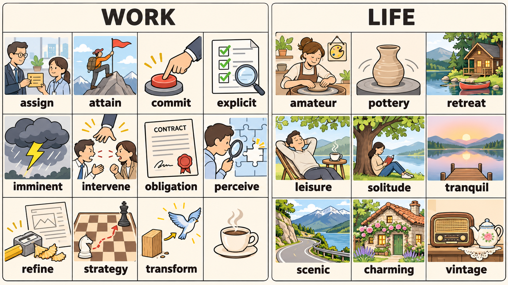

# 每日英语单词 20 个 · 2026-11-07（第 17 期）

> **定位**：面向 CET-6 核心词汇复习，以职场和生活语境掌握常用义与搭配；六级词汇包含与四级重叠的词，本期不宣称逐词具有经统计核验的真题频次。
> **构成与去重**：职场 11 + 生活 9；避开两个历史索引全部 320 个词条，短语按逗号整体去重。本期累计 340 词。
> **记忆说明**：以下画面提示均明确作为联想，不作词源解释；搭配辨析表示常见用法，不作绝对规则。
> **配套**：根目录 `每日20词-复习窗口.md` 与 `已推荐单词索引.md`。

## 场景记忆图

- 2026-11-07：请求模型 `gpt-image-2.5-flare`；实际尺寸 1672 × 941；耗时 47.04 秒。原图保留于 `/Users/insistgang/Pictures/Sub2API Images/image25-flare-20261107-084500-a1b2c3d4.png`，副本已归档至 `../场景配图/`。
- 本通道无法读图自检，尚未做视觉验收；画面仅用于联想，词义以正文为准。
- 左栏为办公室工位（WORK），右栏为湖畔乡居（LIFE）；跟随图中标签回忆每个词的画面抓手。

## 职场篇（11 词）

**1. assign** /əˈsaɪn/
- **词义**：v. 分配，指派（任务、角色）；把（财产）归某人。
- **例句**：She assigned the data-cleaning task to the newest member of the team.
- **翻译**：她把数据清洗这项任务指派给了团队里最新的成员。
- **记忆提示（联想）**：一张写着任务卡的纸被交到同事手里，"交办"的感觉就是 assign。搭配：assign a task to someone / assign someone to a project。

**2. attain** /əˈteɪn/
- **词义**：v. 达到，获得，实现（目标、水平）。
- **例句**：After two rounds of revision, the team attained the accuracy target we set in April.
- **翻译**：经过两轮修改，团队达成了我们四月设定的准确率目标。
- **记忆提示（联想）**：爬山者伸手抓住顶峰的旗子，那一刻"抵达"就是 attain。搭配：attain a goal / attain a high standard。

**3. commit** /kəˈmɪt/
- **词义**：v. 承诺，致力于；犯（错、罪）；提交（代码、文件）。
- **例句**：She committed herself to a six-month plan for improving the model.
- **翻译**：她承诺投入六个月改进这个模型。
- **记忆提示（联想）**：手掌按下一个大按钮，就是把话说定、把事扛下。搭配：commit oneself to doing / commit to a plan；名词 commitment。

**4. explicit** /ɪkˈsplɪsɪt/
- **词义**：adj. 明确的，清晰的；直言不讳的。
- **例句**：The requirements must be explicit before anyone starts coding.
- **翻译**：在任何人开始写代码之前，需求必须写得很明确。
- **记忆提示（联想）**：清单上每一项都打了清晰的勾，旁边架着放大镜检查有没有含糊。搭配：explicit instructions / be explicit about something。

**5. imminent** /ˈɪmɪnənt/
- **词义**：adj. 即将发生的，迫在眉睫的。
- **例句**：The deadline is imminent, so we should freeze the feature list today.
- **翻译**：截止日期迫在眉睫，我们今天就应该冻结功能清单。
- **记忆提示（联想）**：乌云压顶、闪电已经在酝酿，即将来临。搭配：an imminent deadline / an imminent threat。

**6. intervene** /ˌɪntərˈviːn/
- **词义**：v. 干预，介入；插话（between A and B）。
- **例句**：A senior engineer intervened to settle the disagreement between the two teams.
- **翻译**：一位资深工程师出面干预，化解了两个团队之间的分歧。
- **记忆提示（联想）**：第三只手伸到两个争执的人中间把局面按住。搭配：intervene in something / intervene to stop。

**7. obligation** /ˌɑːblɪˈɡeɪʃən/
- **词义**：n. 义务，责任；人情债（常用复数 obligations）。
- **例句**：We have an obligation to keep the residents' data secure.
- **翻译**：我们有义务保障居民数据的安全。
- **记忆提示（联想）**：一份盖了火漆印的合同，代表必须履行的责任。搭配：an obligation to do / meet one's obligations。

**8. perceive** /pərˈsiːv/
- **词义**：v. 察觉，感知；认为，理解（某人在想什么）。
- **例句**：From the users' comments, we perceived a clear demand for offline support.
- **翻译**：从用户的评论中，我们察觉到他们对离线支持的明确需求。
- **记忆提示（联想）**：拿放大镜看拼图缺口的那一下，"看出来"就是 perceive。搭配：perceive a need / perceive someone as a leader。

**9. refine** /rɪˈfaɪn/
- **词义**：v. 改进，精炼（方案、措辞、模型）。
- **例句**：We refined the prompt until the output stopped hallucinating.
- **翻译**：我们不断改进提示词，直到输出不再产生幻觉。
- **记忆提示（联想）**：铅笔在刀刃上打磨，刀口一点点变细变利。搭配：refine a draft / refine the design。

**10. strategy** /ˈstrætədʒi/
- **词义**：n. 策略，战略；对策。
- **例句**：Our hiring strategy has to match the pace of the product roadmap.
- **翻译**：我们的招聘策略必须与产品路线图的节奏相匹配。
- **记忆提示（联想）**：棋盘上用虚线画出的一条完整走法路线。搭配：a hiring strategy / adopt a strategy。

**11. transform** /trænsˈfɔːrm/
- **词义**：v. 使改变形态，彻底转变；改造。
- **例句**：The new pipeline transformed raw frames into a clean live map.
- **翻译**：新的流水线把原始画面变成了干净的实时地图。
- **记忆提示（联想）**：一块粗糙的木头在翻转中变成一只鸟。搭配：transform A into B / transform a business。

## 生活篇（9 词）

**12. amateur** /ˈæmətər/
- **词义**：n. 业余爱好者，外行；adj. 业余的，不专业的。
- **例句**：He is an amateur photographer who sells prints at the weekend market.
- **翻译**：他是个业余摄影爱好者，周末市集上卖自己的作品。
- **记忆提示（联想）**：一双手在拉坯轮上玩泥，旁边别着"业余"徽章；玩得开心才是重点。搭配：an amateur photographer / an amateur at something。

**13. pottery** /ˈpɑːtəri/
- **词义**：n. 陶器，瓷器；制陶业（多为不可数名词）。
- **例句**：She signed up for a weekend pottery class to unwind.
- **翻译**：她报名了周末的陶艺课来放松自己。
- **记忆提示（联想）**：旋转的陶轮上立着一只拉高成型的高瓶。搭配：pottery class / a piece of pottery。

**14. retreat** /rɪˈtriːt/
- **词义**：n. 静养地，休养地；v. 撤退，退却；退隐。
- **例句**：We spent the weekend at a lakeside retreat with no Wi-Fi.
- **翻译**：我们在一个没有 Wi-Fi 的湖畔静养地度过了周末。
- **记忆提示（联想）**：湖边的小木屋加一只独木舟，是躲开人群的地方。搭配：a lakeside retreat / retreat from the city；动词义为 retreat from battle。

**15. leisure** /ˈleʒər/
- **词义**：n. 闲暇，空闲；休闲活动（常作不可数名词）。
- **例句**：I plan to read more and scroll less in my leisure time.
- **翻译**：我打算在闲暇时间多读书、少刷手机。
- **记忆提示（联想）**：躺椅上的一杯茶和摊开的书，指向"有空"的状态。搭配：in one's leisure time / leisure activities。

**16. solitude** /ˈsɑːlətuːd/
- **词义**：n. 独处，隐居；清静（不可数名词）。
- **例句**：He went to the woods for three days of solitude.
- **翻译**：他到林子里独处了三天。
- **记忆提示（联想）**：大树下一把躺椅、一个人翻书，周围没有第二个人。搭配：seek solitude / in solitude。

**17. tranquil** /ˈtræŋkwɪl/
- **词义**：adj. 宁静的，平静的，安详的。
- **例句**：The lake was so tranquil that we could hear our own footsteps.
- **翻译**：湖面平静得我们能听见自己的脚步声。
- **记忆提示（联想）**：清晨湖面完全不动，远处一座木栈桥。搭配：a tranquil lake / a tranquil atmosphere。

**18. scenic** /ˈsiːnɪk/
- **词义**：adj. 风景优美的；开阔而有美景的。
- **例句**：We took the scenic route along the mountain road instead of the highway.
- **翻译**：我们沿着山路走了风景优美的路线，没有走高速。
- **记忆提示（联想）**：一条蜿蜒的山路越过山脊俯瞰湖面。搭配：a scenic route / scenic beauty。

**19. charming** /ˈtʃɑːrmɪŋ/
- **词义**：adj. 迷人的，可爱的；令人愉快的。
- **例句**：The charming little café on the corner is perfect for a slow Sunday.
- **翻译**：街角那家迷人的小咖啡馆，很适合过一个慵懒的周日。
- **记忆提示（联想）**：爬满藤蔓的小屋，窗口透出暖黄的灯。搭配：a charming town / a charming smile。

**20. vintage** /ˈvɪntɪdʒ/
- **词义**：n. 某特定年份的佳酿；adj. 经典的，老式的；年久的（尤指有收藏价值的老物件）。
- **例句**：The vintage radio on the shelf still works perfectly.
- **翻译**：架子上的那台老式收音机仍然运作完好。
- **记忆提示（联想）**：木架上的老收音机和一把经典茶壶，风格与年代感十足。搭配：a vintage car / vintage clothing。

## 助记卡（联想抓手 + 高频搭配）

| 单词 | 画面抓手（均为联想） | 常用搭配 |
|---|---|---|
| assign | 任务卡交到同事手里 | assign a task to someone |
| attain | 顶峰插旗的一刻 | attain a goal |
| commit | 手掌按下大按钮 | commit oneself to doing |
| explicit | 打了勾的清单 + 放大镜 | explicit instructions |
| imminent | 酝酿中的闪电 | an imminent deadline |
| intervene | 第三只手按住争执 | intervene in something |
| obligation | 盖火漆印的合同 | an obligation to do |
| perceive | 放大镜看拼图缺口 | perceive a need |
| refine | 铅笔在刀刃上打磨 | refine a draft |
| strategy | 棋盘上的虚线走法 | a hiring strategy |
| transform | 木块翻转成鸟 | transform A into B |
| amateur | 拉坯的手 + 业余徽章 | an amateur photographer |
| pottery | 陶轮上的高瓶 | pottery class |
| retreat | 湖畔木屋 + 独木舟 | a lakeside retreat |
| leisure | 躺椅与摊开的书 | in one's leisure time |
| solitude | 大树下独自看书的人 | seek solitude |
| tranquil | 完全静止的清晨湖面 | a tranquil lake |
| scenic | 俯瞰湖面的山路 | a scenic route |
| charming | 藤蔓小屋与暖灯 | a charming town |
| vintage | 老收音机与经典茶壶 | a vintage car |

## 记忆宫殿 · 双线场景故事

### 职场线（11 词）· 从接手任务到策略性转型

你走进办公室，领到一张任务卡，**assign**（指派）给自己；翻过山页才 **attain**（达成）山顶的目标；你把手掌按在按钮上 **commit**（承诺）投入；清单逐条打勾、条款写得 **explicit**（明确）；乌云压顶，期限 **imminent**（迫在眉睫）；两个同事争执时你 **intervene**（干预）；抽屉里那份盖了火漆的 **obligation**（义务）提醒你该守的责；放大镜在拼图缺口上，你 **perceive**（察觉）到真实需求；你用刀刃磨笔，把方案 **refine**（精炼）得更利；棋盘上画出 **strategy**（策略）；最后木块翻转成鸟，整个流程被 **transform**（彻底转变）。

> 画面链：任务卡 → 顶峰插旗 → 大按钮 → 打勾清单 → 酝酿闪电 → 第三只手 → 火漆合同 → 放大镜 → 磨刀刃 → 棋盘虚线 → 木块变鸟。

### 生活线（9 词）· 湖畔慢下来的一周

你在拉坯轮前玩泥，挂着 **amateur**（业余爱好者）的徽章；转一圈，**pottery**（陶器）成形；周末退到湖畔木屋和独木舟之间 **retreat**（静养）；躺椅上一杯茶，读几页书，这就是 **leisure**（闲暇）；再往林深处走，一个人在树下读整本书，那是 **solitude**（独处）；清晨湖面静得没有一丝波纹，**tranquil**（宁静）；沿山脊那条路慢慢开，看湖光在脚下展开，那是 **scenic**（风景优美）；路过藤蔓小窗透出暖灯的 **charming**（迷人的）小镇；最后回到木架前，打开那台老 **vintage**（经典老式）收音机。

> 画面链：拉坯轮 → 陶瓶 → 湖边木屋 → 躺椅与书 → 树下独坐 → 静湖木桥 → 山路湖光 → 藤蔓暖灯 → 老收音机。

## 排雷台（9 组易混与搭配辨析）

| 辨析 | 关键差别与常见搭配 |
|---|---|
| assign / resign | assign 是指派任务（assign a task to someone）；resign 是辞职（resign from a position）。两者拼写相近，含义相反，别写混。 |
| commit / submit | commit to doing 是承诺投入；submit a document 是把文件提交上去。commit 强调"投入/担责"，submit 强调"递交动作"。 |
| explicit / implicit | explicit 是明确说出来的；implicit 是含而不露的、默认的。需求写得 explicit，避免双方 implicit 理解。 |
| imminent / immediate | imminent 指即将发生、迫在眉睫（an imminent deadline）；immediate 多指"立刻做"（an immediate response）。前者修饰事件将至，后者修饰动作时机。 |
| intervene / interfere | intervene 多指介入以扭转局面（intervene in a dispute）；interfere 常带"妨碍、干涉"负面色彩（interfere with）。都有"插手"义，语气不同。 |
| obligation / duty | obligation 强调由承诺、契约或法律产生的责任（an obligation to do）；duty 更常指岗位职责或道德义务。合同类场景优先用 obligation。 |
| perceive / conceive | perceive 是感知到、看出来（perceive a need）；conceive 是构想、设想出来（conceive a plan）。看到与想到不要互换。 |
| refine / simplify | refine 是把已有的东西打磨得更精准；simplify 是把复杂的东西化简。前者不减复杂度而提质量，后者直接降低复杂度。 |
| tranquil / peaceful / serene | tranquil 多形容环境或水面安静（a tranquil lake）；peaceful 多形容无冲突的状态（a peaceful evening）；serene 形容人面部的宁静安详。三者都常作六级形容词，看宾语选词。 |
| solitude / isolation | solitude 是主动选择的独处（seek solitude），语气中性甚至积极；isolation 常带被迫、孤立无援的负面意味（social isolation）。写"享受独处"用 solitude。 |

## 快速自测（5 题 · 答案折叠）

**1. 选词填空**：The deadline is ______, so we should freeze the feature list today.（imminent / immediate）

**2. 介词填空**：She committed herself ______ a six-month plan for improving the model, and the team took it ______ the moment it was ______.

**3. 中译英**：从用户的评论中，我们察觉到他们对离线支持的明确需求。

**4. 改错**：He went to the woods for three days of isolation, enjoying the tranquil lake and the charming cottage.

**5. 场景选词**：The new pipeline ______ raw frames into a clean live map. Our hiring ______ must match the pace of the product roadmap.（从 transform / strategy 中选择并变形）

点击展开答案

1. **imminent**。imminent 修饰"即将发生的事件"，an imminent deadline；immediate 表示动作要马上做，语义不搭。
2. **to；on；assigned**。commit oneself to doing（to + 动名词）；take it on 表示接手；assign 是过去分词作被动语态。
3. **From the users' comments, we perceived a clear demand for offline support.** 关键搭配是 perceive a demand。
4. **He went to the woods for three days of solitude, enjoying the tranquil lake and the charming cottage.** isolation 带负面意味，主动选择的独处用 solitude。
5. **transformed；strategy**。transform A into B（把 A 变成 B）；a hiring strategy 固定搭配，注意冠词与形式。

---

*第 17 期 · 2026-11-07 · 本期 20 词 · 累计 340 词 · 唯一资料真源：每日英语单词/*
