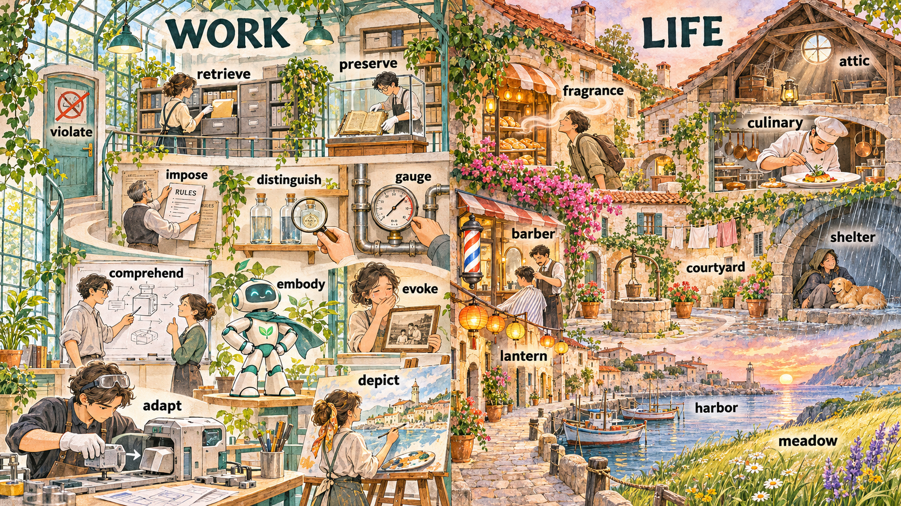

# 每日英语单词 20 个 · 2026-11-08（第 18 期）

> **定位**：面向 CET-6 核心词汇复习，以职场和生活语境掌握常用义与搭配；六级词汇与四级存在重叠，本期不宣称逐词具有经统计核验的真题频次。
> **构成与去重**：职场 11 + 生活 9；避开两个历史索引全部 340 个词条，短语按逗号整体去重。本期累计 360 词。
> **记忆说明**：以下记忆提示分两类标注——「词根」为可确认的构词提示，「联想」为便于记忆的画面联想，不作严格词源考据；搭配辨析表示常见用法，不作绝对规则。
> **配套**：根目录 `每日20词-复习窗口.md` 与 `已推荐单词索引.md`。

## 场景记忆图

- 2026-11-08：请求模型 `gpt-image-2.5-flare`；实际尺寸 1672 × 941；耗时 111.97 秒。原图保留于 `/Users/insistgang/Pictures/Sub2API Images/gpt-image-2.5-flare-20261108-084618-faff3197.png`，副本已归档至 `../场景配图/`。
- 本通道无法读图自检，尚未做视觉验收；画面仅用于联想，词义以正文为准。
- 左栏为设计工坊（WORK），右栏为海滨老镇（LIFE）；跟随图中标签回忆每个词的画面抓手。

## 职场篇（11 词）

**1. adapt** /əˈdæpt/
- **词义**：v. 适应（环境、新要求）；改编，使适合。
- **例句**：The team adapted the model so it could run on the edge device.
- **翻译**：团队改造了模型，让它能在端侧设备上跑起来。
- **记忆提示**：词根 —— ad（朝向）+ apt（合适的，同 apt / aptitude）——"把它调成合用的样子"。搭配：adapt to sth / adapt sth to sth；名词 adaptation。

**2. comprehend** /ˌkɑːmprɪˈhend/
- **词义**：v. 理解，领会（较正式）；包含，包括。
- **例句**：It took me three passes to comprehend the quarterly report.
- **翻译**：我读了三遍才理解这份季度报告。
- **记忆提示**：词根 —— com（全部）+ prehend（抓住，同 prehension）——"全部抓住才算懂"。搭配：comprehend the scope of；名词 comprehension（理解力）。

**3. depict** /dɪˈpɪkt/
- **词义**：v. 描绘，描述；刻画，以…为特色。
- **例句**：The mural depicts the old town before the port was rebuilt.
- **翻译**：这幅壁画描绘的是港口重建前的老城。
- **记忆提示**：词根 —— de + pict（画，同 picture / painting）——"用笔画出来"。搭配：depict A as B；名词 depiction。

**4. distinguish** /dɪˈstɪŋɡwɪʃ/
- **词义**：v. 区分，辨别；使有别于；使杰出。
- **例句**：The interface distinguishes the two versions at a glance.
- **翻译**：这个界面一眼就能区分两个版本。
- **记忆提示**：联想 —— 架子上两个几乎一样的玻璃瓶，你拿起放大镜挑出真正的那一个；词干 distinct 本身即"分开的"。搭配：distinguish A from B / distinguish between。

**5. embody** /ɪmˈbɑːdi/
- **词义**：v. 体现，具体表现；使具体化（抽象概念）。
- **例句**：The company's values are embodied in the way engineers review each other's work.
- **翻译**：公司的价值观体现在工程师们互相审阅代码的方式上。
- **记忆提示**：词根 —— em（使进入）+ body（身体）——"把抽象的价值观装进身体里，让人看得见"。搭配：embody the spirit of；名词 embodiment。

**6. evoke** /ɪˈvoʊk/
- **词义**：v. 唤起（记忆、情感）；引起（反应、印象）。
- **例句**：The old photograph evoked memories of his grandparents' house.
- **翻译**：这张老照片唤起了他对祖父母老屋的记忆。
- **记忆提示**：词根 —— e（出）+ vok（声音，同 voice / vocal / advocate）——"把声音从记忆深处唤出来"。搭配：evoke memories / evoke a response。

**7. gauge** /ɡeɪdʒ/
- **词义**：v. 估计，判断，衡量；n. 测量仪器；标准，尺度。
- **例句**：It is hard to gauge how much user demand the new feature will create.
- **翻译**：很难判断这个新功能会带来多少用户需求。
- **记忆提示**：联想 —— 钢管上嵌着一只圆表盘，指针停在某个刻度上，一只手正在读数。搭配：gauge the scale of / gauge sentiment；a pressure gauge。

**8. impose** /ɪmˈpoʊz/
- **词义**：v. 强加，施加（规则、处罚、观点）；征（税）。
- **例句**：The landlord imposed a new rule on overnight visitors.
- **翻译**：房东对过夜访客强行立了一条新规定。
- **记忆提示**：词根 —— im（向内）+ pose（放，同 position / deposit）——"把东西按着放到别人头上"。固定搭配：impose sth on sb / impose conditions on。

**9. preserve** /prɪˈzɜːrv/
- **词义**：v. 保护，保存（文物、传统）；维护；腌制（食品）。
- **例句**：The new process preserves the original flavor of the ingredients.
- **翻译**：新工艺保留了食材本来的味道。
- **记忆提示**：词根 —— pre（预先）+ serv（保持，同 conserve / servant）——"事先把它守住"。搭配：preserve heritage / preserve freshness；名词 preservation。

**10. retrieve** /rɪˈtriːv/
- **词义**：v. 取回，收回；检索（数据）；挽回（损失）。
- **例句**：You can retrieve the deleted file from the archive within thirty days.
- **翻译**：你可以在三十天内从归档中取回被删掉的文件。
- **记忆提示**：联想 —— 一排档案抽屉滑开，手精准地把标着名字的那一格抽出来。搭配：retrieve data / retrieve information；名词 retrieval。

**11. violate** /ˈvaɪəleɪt/
- **词义**：v. 违反（法律、规定）；侵犯（权利）；违背（原则）。
- **例句**：The new policy may violate the residents' privacy rights.
- **翻译**：新政策可能侵犯居民的隐私权。
- **记忆提示**：联想 —— 门上贴着"禁止入内"的告示，却被人一把推开，规矩当场被冲破。搭配：violate a law / violate privacy；名词 violation。

## 生活篇（9 词）

**12. fragrance** /ˈfreɪɡrəns/
- **词义**：n. 香气，香味（多指好闻的气味，不可数）。
- **例句**：The fragrance of fresh bread drifted out of the bakery.
- **翻译**：新鲜面包的香气从面包房里飘了出来。
- **记忆提示**：词根 —— fragr（散发气味，同 fragrant）+ 名词后缀 -ance；名词用 fragrance，形容词用 fragrant。

**13. culinary** /ˈkjuːləneri/
- **词义**：adj. 烹饪的，厨房的；美食的。
- **例句**：She took a culinary class to learn how to make proper stock.
- **翻译**：她上了烹饪课，学怎么做正宗高汤。
- **记忆提示**：词根 —— 与 cuisine 同源，都来自拉丁语 culina（厨房）——"关于锅台和灶火的那一套"。搭配：culinary skills / the culinary arts。

**14. shelter** /ˈʃeltər/
- **词义**：n. 庇护所，避难处；遮蔽；v. 庇护，为…提供遮蔽。
- **例句**：The old arcade gives shelter from the rain.
- **翻译**：那条老拱廊可以挡雨。
- **记忆提示**：联想 —— 石拱廊下躲雨的人和他脚边的一只狗，共享同一块干燥的地面。搭配：take shelter from / shelter someone from。

**15. barber** /ˈbɑːrbər/
- **词义**：n. 理发师（尤指男士理发店）。
- **例句**：He has been going to the same barber for ten years.
- **翻译**：他在同一家理发店剪了十年头发。
- **记忆提示**：联想 —— 门口的转筒柱、墙上的圆镜、一把大剪刀和围布。搭配：at the barber's。

**16. lantern** /ˈlæntərn/
- **词义**：n. 灯笼；提灯。
- **例句**：Paper lanterns hung across the lane for the festival.
- **翻译**：节日里，纸灯笼横挂在巷子上方。
- **记忆提示**：联想 —— 夜色里的窄巷被一串暖黄光点亮，纸罩上画着淡纹。搭配：hang lanterns / a paper lantern。

**17. harbor** /ˈhɑːrbər/
- **词义**：n. 港口，海湾；v. 窝藏（想法、焦虑），心怀。
- **例句**：Small fishing boats are moored in the harbor at dawn.
- **翻译**：黎明时，小渔船停泊在港口里。
- **记忆提示**：联想 —— 停泊的小船、系缆桩和清晨平静的水面；引申义是"心里藏着念头"（harbor a doubt）。搭配：in the harbor / a natural harbor。

**18. courtyard** /ˈkɔːrtjɑːrd/
- **词义**：n. 庭院，院子（多指建筑物围合的露天空间）。
- **例句**：We had tea in the courtyard while the laundry dried above us.
- **翻译**：我们在院子里喝茶，头顶上晾着的衣服正慢慢干。
- **记忆提示**：词根 —— court（庭院，同 court）+ yard（院子，同 backyard / graveyard）——"院子里的院子"。搭配：in the courtyard / a courtyard garden。

**19. attic** /ˈætɪk/
- **词义**：n. 阁楼，顶楼（房屋斜屋顶下的空间）。
- **例句**：The old boxes in the attic belonged to my grandmother.
- **翻译**：阁楼里的那些旧箱子是我奶奶留下的。
- **记忆提示**：联想 —— 斜屋顶下低矮的圆形老虎窗、积灰的木箱和一盏旧台灯。搭配：in the attic / an attic room。

**20. meadow** /ˈmɛdoʊ/
- **词义**：n. 草地，牧场（多指野花草覆盖的平地）。
- **例句**：Wildflowers covered the meadow above the harbor.
- **翻译**：港口上方的草地上开满了野花。
- **记忆提示**：联想 —— 齐腰的草浪、成片的野花，一直铺到海边的坡上。搭配：a meadow of wildflowers / green meadows。

## 助记卡（词根/联想抓手 + 高频搭配）

| 单词 | 记忆抓手 | 常用搭配 |
|---|---|---|
| adapt | apt（合适）→ 调成合用的 | adapt to sth |
| comprehend | prehend（抓住）→ 全部抓住 | comprehend the scope of |
| depict | pict（画）→ 用笔画出来 | depict A as B |
| distinguish | 放大镜挑出真的那个 | distinguish A from B |
| embody | body（身体）→ 把抽象装进身体 | embody the spirit of |
| evoke | vok（声音）→ 把声音唤出来 | evoke memories |
| gauge | 圆表盘读刻度 | gauge the scale of |
| impose | pose（放）→ 按着放到你头上 | impose sth on sb |
| preserve | serv（保持）→ 事先守住 | preserve heritage |
| retrieve | 档案抽屉滑开取回一格 | retrieve data |
| violate | 告示被推开，规矩被冲破 | violate a law |
| fragrance | fragr（散味）+ -ance 名词 | the fragrance of |
| culinary | culina（厨房）同 cuisine | culinary skills |
| shelter | 拱廊下躲雨的人与狗 | take shelter from |
| barber | 转筒柱 + 圆镜 + 大剪刀 | at the barber's |
| lantern | 夜巷里一串暖黄光 | hang lanterns |
| harbor | 停泊的小船与清晨水面 | in the harbor |
| courtyard | court + yard，院子里的院子 | in the courtyard |
| attic | 老虎窗下的积灰木箱 | in the attic |
| meadow | 草浪与野花铺到海边 | a meadow of wildflowers |

## 记忆宫殿 · 双线场景故事

### 职场线（11 词）· 从改造机器到守住底线

你走进设计工坊，一台机器正在被换掉模块、改头换面去接新任务，这是 **adapt**（适应、改造）；两位同事站在写满图表的白板前，一个指着图讲，一个点头说"明白了"，这是 **comprehend**（理解）；美术师在画布上画下整片老城天际线，画里就是那个地方，这是 **depict**（描绘）；架子上两个一模一样的玻璃瓶，你举起放大镜挑出真的那个，这是 **distinguish**（辨别）；工坊中央那个小机器人站得笔直、配色就是团队的行事风格，它把价值 **embody**（体现）了出来；你举起一张旧照片，看的人眼眶一红，照片 **evoke**（唤起）了记忆；钢管上嵌着圆表盘，指针停在一格，手正在读这个数，这是 **gauge**（衡量）；主管的手把新规定钉上去、盖住旧的那张，这是 **impose**（强加）；戴白手套的技术员把泛黄手稿放进密封玻璃柜，这是 **preserve**（保存）；档案抽屉滑开，你精准抽出标着名字的那一格，这是 **retrieve**（取回）；最后门上"禁止入内"的告示被人推开，规矩当场被冲破，这是 **violate**（违反）。

> 画面链：换模块的机器 → 白板前讲图的人 → 画下老城的画布 → 放大镜与两只瓶子 → 直立的小机器人 → 被举起的老照片 → 圆表盘读数 → 钉上去的新规定 → 白手套与玻璃柜 → 滑开的档案抽屉 → 被推开的禁止告示。

### 生活线（9 词）· 海滨老镇的一日

面包房门口飘出热气与香味，路人不由探身去闻，那是 **fragrance**（香气）；敞开的厨房里，厨师一身白、拿镊子摆盘，那是 **culinary**（烹饪的）；下雨时石拱廊下挤着人和狗共避一方屋檐，那是 **shelter**（遮蔽）；转筒柱旁边的小店里，师傅正给客人剪头发，那是 **barber**（理发师）；夜色里窄巷横挂一串暖黄纸灯，那是 **lantern**（灯笼）；巷子尽头，小渔船停在平静的港湾里，那是 **harbor**（港口）；镇子中心一方露天院子，有石井、盆栽和头顶的晾衣绳，那是 **courtyard**（庭院）；再往上爬，斜屋顶下的老虎窗里堆着积灰木箱，那是 **attic**（阁楼）；最后走到镇子边缘，草浪起伏、野花一直铺到海边，那是 **meadow**（草地）。

> 画面链：面包房香气 → 白衣厨师的镊子 → 拱廊下躲雨 → 转筒柱小店 → 夜巷纸灯 → 停泊渔船 → 石井院子 → 阁楼木箱 → 野花草坡。

## 排雷台（12 组易混与搭配辨析）

| 辨析 | 关键差别与常见搭配 |
|---|---|
| adapt / adopt / adept | adapt 是改造以适应（adapt to new needs）；adopt 是采纳（adopt a policy）；adept 是熟练的（be adept at）。三个词开头相同，考试常连着考。 |
| evoke / invoke / provoke | evoke 是唤起记忆情感（evoke memories）；invoke 是援引规则、祈求（invoke an exemption）；provoke 是激起反感或反应（provoke anger）。 |
| impose on / impose sth on sb | impose sth on sb 是把（规则、处罚）施加于某人；impose on sb 是"强加给某人"，多接负担、麻烦。介词位置不同，意思也不同。 |
| preserve / conserve / reserve | preserve 是原样保住（preserve heritage / freshness）；conserve 是节约资源（conserve energy）；reserve 是预留、储备（reserve a seat）。 |
| retrieve / recover / reclaim | retrieve 是把东西取回来（retrieve data）；recover 是恢复（健康、损失）；reclaim 是取回（权利、废物再利用）。写"取回文件"用 retrieve。 |
| depict / describe / portray | depict 偏"用画面呈现"；describe 偏"用语言说明"；portray 偏"扮演、刻画形象"。图表描述用 describe，画面呈现用 depict。 |
| distinguish / differentiate / discriminate | distinguish A from B 是辨别两者；differentiate 多用于产品差异；discriminate 常带"歧视"义（discriminate against），职场邮件里慎用。 |
| comprehend / comprehensive / comprehension | comprehend 是动词"理解"；comprehensive 是形容词"全面的"；comprehension 是名词"理解力"。三者同源，读题时先看词性。 |
| gauge / assess / estimate | gauge 是凭读数或迹象估（gauge demand / reaction）；assess 是正式评定（assess performance / risk）；estimate 是给出具体数字估算（estimate the cost）。 |
| attic / cellar / basement | attic 在屋顶之下，是阁楼（in the attic）；basement 在地面之下，多作地下室；cellar 多指地窖或酒窖（a wine cellar）。别把阁楼说成地下室。 |
| harbor / port / refuge | harbor 指有天然屏障的港湾（a natural harbor）；port 是更广义的港口城市；refuge 是避难所（take refuge）。小镇停靠小船用 harbor 更贴切。 |
| fragrance / scent / aroma | fragrance 偏精致好闻的香气（the fragrance of flowers）；scent 偏气味本身、可中性也可负面（a strong scent）；aroma 偏食物或植物的浓郁气味（the aroma of coffee）。三者常在六级阅读同段出现。 |

## 快速自测（5 题 · 答案折叠）

**1. 选词填空**：The team ______ the model so it could run on the edge device.（adapt / adopt / adept）

**2. 介词填空**：It is hard to ______ how much user demand the new feature will create, so we ran a survey first.（从 gauge / evoke / impose 中选择）

**3. 中译英**：这张老照片唤起了我对祖父母老屋的记忆。

**4. 改错**：The landlord imposed a new rule to the overnight visitors.

**5. 场景选词与变形**：The mural ______ the old town before the port was rebuilt. The old boxes in the ______ belonged to my grandmother.（从 depict / retrieve 中选择并变形）

点击展开答案

1. **adapt**。adapt sth（改造某物以适应新用途）符合"改造模型让它跑得起来"；adopt 是"采纳"，adept 是形容词"熟练的"。
2. **gauge**。gauge how much… 表示"估计/衡量出多少"，是最贴切的搭配；evoke 后面要接记忆或情感，impose 后面接规则或负担。
3. **The old photograph evoked memories of his grandparents' house.** 关键动词是 evoke memories；注意 evoke 与 invoke（援引）区分。
4. **The landlord imposed a new rule on the overnight visitors.** 固定搭配是 impose sth **on** sb；impose 后面不能直接用 to 引出对象。
5. **depicted；attic**。depict A（描绘 A）；in the attic 是"在阁楼里"，attic 拼写是 a-t-t-i-c，不要写成 attic 的常见误拼 "atic"。

---

*第 18 期 · 2026-11-08 · 本期 20 词 · 累计 360 词 · 唯一资料真源：每日英语单词/*
