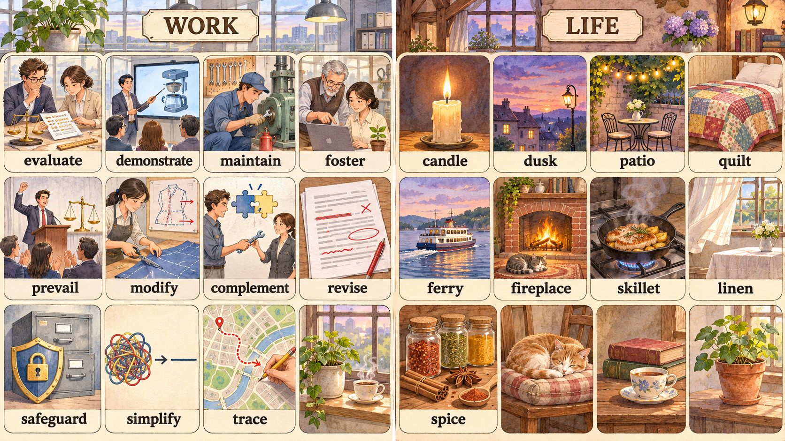

# 每日英语单词 20 个 · 2026-11-09（第 19 期）

> **定位**：面向 CET-6 核心词汇复习，以职场和生活语境掌握常用义与搭配；六级词汇与四级存在重叠，本期不宣称逐词具有经统计核验的真题频次。
> **构成与去重**：职场 11 + 生活 9；避开两个历史索引全部 360 个词条，短语按逗号整体去重。本期累计 380 词。
> **记忆说明**：以下记忆提示分两类标注——「词根」为可确认的构词提示，「联想」为便于记忆的画面联想，不作严格词源考据；搭配辨析表示常见用法，不作绝对规则。
> **配套**：根目录 `每日20词-复习窗口.md` 与 `已推荐单词索引.md`。

## 场景记忆图

- 2026-11-09：请求模型 `gpt-image-2.5-flare`；实际尺寸 1672 × 941；耗时 52.70 秒。原图保留于 `/Users/insistgang/Pictures/Sub2API Images/gpt-image-2.5-flare-20261109-125130-cd2af6ac.png`，副本已归档至 `../场景配图/`。
- 本通道无法读图自检，尚未做视觉验收；画面仅用于联想，词义以正文为准。
- 左栏为现代办公室工坊（WORK），右栏为暮色乡村小屋（LIFE）；跟随图中标签回忆每个词的画面抓手。

## 职场篇（11 词）

**1. evaluate** /ɪˈvæljueɪt/
- **词义**：v. 评价，评估；估计，估算（价值、成本、效果）。
- **例句**：We evaluate the new model on every public benchmark before shipping it.
- **翻译**：我们在发布前用每一个公开基准评测这个新模型。
- **记忆提示**：词根 —— e（出）+ val（价值，同 value / valid / equivalent）——"把价值估出来"。搭配：evaluate performance / evaluate the impact；名词 evaluation。

**2. demonstrate** /ˈdemənstreɪt/
- **词义**：v. 演示，展示；证明，说明（to sb that…）；演示（能力）。
- **例句**：She demonstrated the workflow in ten minutes, and the client was convinced.
- **翻译**：她用十分钟演示了整套流程，客户就被说服了。
- **记忆提示**：词根 —— de + monstr（显示，同 monster 最初义"奇异的展示" / demonstrate）——"当众把东西展示出来"。搭配：demonstrate that… / demonstrate a skill；名词 demonstration。

**3. maintain** /meɪnˈteɪn/
- **词义**：v. 维持，保持（状态、水平）；保养、维修（设备）；主张（观点）。
- **例句**：The team maintains a shared dashboard so nobody repeats the same query.
- **翻译**：团队维护着一块共享看板，免得有人重复查同一个数据。
- **记忆提示**：词根 —— main（主要的，同 main / maintain / mainland）——"把主要的东西撑住不掉"。搭配：maintain standards / maintain a system；名词 maintenance，与 repair 的区别见辨析台。

**4. foster** /ˈfɔːstər/
- **词义**：v. 促进，培养（习惯、氛围）；收养；adj. 养 foster 育的（较少用）。
- **例句**：Good mentors foster curiosity instead of handing over ready-made answers.
- **翻译**：好导师培养好奇心，而不是直接递上现成答案。
- **记忆提示**：词根 —— 与 food、foster 同族，同源词 "抚养、养育"——"把一棵小苗养起来"，故引申为"培养氛围"。搭配：foster a culture / foster innovation；名词 foster（寄养家庭）。

**5. prevail** /prɪˈveɪl/
- **词义**：v. 盛行，流行；获胜，胜过（prevail over / against）。
- **例句**：In the end, common sense prevailed and we kept the simpler design.
- **翻译**：最后常识占了上风，我们保留了更简单的设计。
- **记忆提示**：词根 —— pre（在前）+ vail（强有力，同 prevail / avail）——"凭力气压过对方"。搭配：prevail over sth / prevail among；形容词 prevailing（ prevailing opinion 主流意见）。

**6. modify** /ˈmɑːdɪfaɪ/
- **词义**：v. 修改，调整（方案、文件）；修饰（语法）。
- **例句**：We modified the training script after the first round of user feedback.
- **翻译**：第一轮用户反馈之后，我们修改了训练脚本。
- **记忆提示**：词根 —— mod（尺度，同 moderate / mode / modify）——"按新的尺度改一改"。搭配：modify a design / modify behaviour；名词 modification。

**7. complement** /ˈkɑːmplɪment/
- **词义**：v. 补充，与…相得益彰；n. 补充物，配套部分。
- **例句**：The two modules complement each other, so we bundle them in one package.
- **翻译**：这两个模块互相补充，所以我们打成一个包发布。
- **记忆提示**：词根 —— com（共同）+ ple（填满，同 complete / plenty）——"凑在一起把空缺填满"。⚠️ 与 compliment（赞美）只差一个字母，别写错。搭配：complement each other。

**8. revise** /rɪˈvaɪz/
- **词义**：v. 修改，修订（计划、草案、课本）；复习（英式）。
- **例句**：The committee revised the proposal after two rounds of public comments.
- **翻译**：委员会在两轮公众意见之后修订了这份提案。
- **记忆提示**：词根 —— re（再）+ vise（看，同 vision / visit / advise）——"再拿眼睛过一遍"。搭配：revise a draft / revised edition；名词 revision。

**9. safeguard** /ˈseɪfɡɑːrd/
- **词义**：v. 保护，保障（权益、隐私）；n. 防护措施。
- **例句**：We added a second login step to safeguard user data.
- **翻译**：我们增加了第二步登录，以保护用户数据。
- **记忆提示**：词根 —— safe（安全）+ guard（守卫，同 guardian / guarded）——"给安全加一道岗"。搭配：safeguard against / safeguard interests；名词 safeguard（安全防护）。

**10. simplify** /ˈsɪmplɪfaɪ/
- **词义**：v. 简化，使简单；使（过程）易于处理。
- **例句**：Simplify the report into three slides, and the team will actually read it.
- **翻译**：把报告简化成三页幻灯片，团队才会真去读它。
- **记忆提示**：词根 —— simple（简单，同 simple / simply）+ -fy（使…）——"把它变简单"。搭配：simplify a process；形容词 simple；反义 complicate / complicated。

**11. trace** /treɪs/
- **词义**：v. 追踪，追溯（来源、行踪）；描摹，勾画；n. 痕迹，踪迹。
- **例句**：We traced the error back to a single missing data field.
- **翻译**：我们把这个错误追溯到了某一个缺失的数据字段。
- **记忆提示**：联想 —— 手指沿着一张城市地图上的一串虚线点走，最终钉在某个路口上。搭配：trace the source / trace back to；名词 trace（痕迹）。

## 生活篇（9 词）

**12. candle** /ˈkændl/
- **词义**：n. 蜡烛；烛光。
- **例句**：She lit a candle on the balcony when the power went out.
- **翻译**：停电的时候，她在阳台上点了一支蜡烛。
- **记忆提示**：词根 —— 拉丁 candere（发光、燃烧，同 incandescent / candid）——"会发光的东西"。搭配：light a candle / candle dinner（烛光晚餐）。

**13. dusk** /dʌsk/
- **词义**：n. 黄昏，暮色（不可数）。
- **例句**：We walked back to the dorm at dusk, when the street lamps came on.
- **翻译**：我们在街灯亮起的时候走回了宿舍。
- **记忆提示**：联想 —— 天边最后一线橙红被紫蓝色盖住，窗户一格一格亮起来。⚠️ 与 dawn（黎明）相对，不要混。搭配：at dusk / at the stroke of dusk。

**14. patio** /ˈpætioʊ/
- **词义**：n. 露台，庭院（房屋外的硬质平台）。
- **例句**：We ate noodles on the patio until the mosquitoes drove us in.
- **翻译**：我们在露台上吃面，直到蚊子把我们赶回屋里。
- **记忆提示**：词根 —— 西班牙语 patio（院子）——"房子外面那块铺平的地"。搭配：on the patio / a patio set。

**15. quilt** /kwɪlt/
- **词义**：n. 被子，棉被（拼布缝制）；n.  patchwork 拼布作品。
- **例句**：My grandmother's old quilt keeps me warm every winter.
- **翻译**：奶奶那条旧被子每年冬天都让我暖和。
- **记忆提示**：联想 —— 一床由不同花色方块拼起来的被面，针脚一格一格缝过去。搭配：patchwork quilt / make a quilt。

**16. ferry** /ˈferi/
- **词义**：n. 渡船，轮渡；v. 摆渡，运送（定期往返）。
- **例句**：The last ferry leaves the island at eleven, so we must hurry.
- **翻译**：最后一班渡轮十一点离岛，我们必须抓紧。
- **记忆提示**：联想 —— 一艘不大的船横切水面，船尾拖出一道细白的尾迹。搭配：take the ferry / ferry people across；名词 ferry 也作动词"摆渡"。

**17. fireplace** /ˈfaɪərpleɪs/
- **词义**：n. 壁炉。
- **例句**：We dried our wet coats in front of the fireplace.
- **翻译**：我们在壁炉前把湿外套烤干。
- **记忆提示**：词根 —— fire（火）+ place（地方，同 placement）——"屋里生火的那个角落"。搭配：light the fireplace / sit by the fireplace。

**18. skillet** /ˈskɪlɪt/
- **词义**：n. 平底锅（多指带长柄的煎锅）。
- **例句**：She tossed the vegetables in a hot skillet with a little oil.
- **翻译**：她在热锅里放了一点油，把蔬菜翻炒了一下。
- **记忆提示**：联想 —— 一只沉甸甸的铸铁平底锅架在灶上，锅底滋啦冒油泡。搭配：a cast-iron skillet / in a skillet。

**19. linen** /ˈlɪnɪn/
- **词义**：n. 亚麻布，麻布；n. 亚麻（纤维）；adj. 亚麻的。
- **例句**：She hung the linen shirts on the balcony to dry in the sun.
- **翻译**：她把亚麻衬衫挂在阳台上晒干。
- **记忆提示**：词根 —— 拉丁 linum（亚麻）——"最凉快的布料"；英语中 linen 已泛指"亚麻织物"与"床单桌布类布品"。搭配：linen shirt / bed linen（床品总称）。

**20. spice** /spaɪs/
- **词义**：n. 香料；趣味，情趣（a spice of sth）；v. 加香料于。
- **例句**：A little spice of humour made the long meeting bearable.
- **翻译**：一点幽默感让那场漫长的会好熬一些。
- **记忆提示**：词根 —— 拉丁 species（旧义"种类"）——"从各种植物里取来的味道"。⚠️ 注意与 spice 派生的名词 spices 泛指香料；"a spice of" 表"一点点"。搭配：add spices / a spice of humour。

## 助记卡（词根/联想抓手 + 高频搭配）

| 单词 | 记忆抓手 | 常用搭配 |
|---|---|---|
| evaluate | val（价值）→ 把价值估出来 | evaluate performance |
| demonstrate | monstr（展示）→ 当众摆出来 | demonstrate that… |
| maintain | main（主要的）→ 撑住主力 | maintain standards |
| foster | 源自"抚养"→ 养小苗 | foster a culture |
| prevail | vail（强有力）→ 凭力气压过 | prevail over |
| modify | mod（尺度）→ 按新尺度改 | modify a design |
| complement | ple（填满）→ 互相填缺口 | complement each other |
| revise | vise（看）→ 再过一遍 | revise a draft |
| safeguard | safe + guard → 安全岗哨 | safeguard against |
| simplify | simple + -fy → 变简单 | simplify a process |
| trace | 地图上的一串虚线 | trace the source |
| candle | candere（发光）→ 会发光的东西 | light a candle |
| dusk | 天边最后一线橙红 | at dusk |
| patio | 西班牙语"院子" | on the patio |
| quilt | 拼布方块缝成的被面 | patchwork quilt |
| ferry | 小船拖着白色尾迹 | take the ferry |
| fireplace | fire + place → 生火的角落 | sit by the fireplace |
| skillet | 铸铁平底锅滋啦冒油 | a cast-iron skillet |
| linen | linum（亚麻）→ 凉快的布料 | linen shirt |
| spice | species（旧义"种类"）→ 取来的味道 | a spice of humour |

## 记忆宫殿 · 双线场景故事

### 职场线（11 词）· 从工坊评测到地图收尾

你走进一间明亮的办公室工坊，第一张桌子上两位同事正对着打印出来的评分表、尺子和一台小秤，逐项给新系统**evaluate**（评估）成绩；转过弯，讲台上的同事指着大屏上的产品图现场**demonstrate**（演示）整套流程，观众席点头；维修角里，技师拿着扳手和油壶给机器做日常**maintain**（维护保养），工具挂在洞洞板上；隔壁工位，一位资深导师俯身教实习生用笔记本，旁边花盆里有一株**foster**（培养）出来的小绿苗；再往里是辩论台，演讲者举起一只手，掌声响起，天平这一端**prevail**（胜出）了；裁缝工作台上，剪刀正咔嚓修改一块布料，身后蓝图上打着修改标记，这是**modify**（修改）；两名同事互相递工具，两块拼图咔一声扣合，这叫**complement**（互补）；复印机旁那叠草稿被红笔划满、页边全是箭头，是**revise**（修订）；墙角一只带挂锁的盾牌守着文件柜，这是**safeguard**（守护）；桌上一团乱线被理成一条直线，**simplify**（简化）完成；最后你拿起铅笔，沿城市地图上的虚线一路描到某个路口，把问题**trace**（追溯）到了源头。

> 画面链：评分表与秤 → 大屏演示 → 扳手油壶 → 导师与小苗 → 辩论台天平 → 剪刀改布 → 递工具与拼图 → 红笔草稿 → 盾牌挂锁 → 乱线变直线 → 地图上的虚线。

### 生活线（9 词）· 暮色里的小屋一天

停电的傍晚，你在**candle**（蜡烛）的小火苗旁点了根火柴，窗外正是**dusk**（黄昏），天边最后一线橙红被紫蓝吞掉；晚饭搬到**patio**（露台）上，桌上点起小串灯，几只蚊子把你们赶回屋里；床上盖着奶奶那条拼布**quilt**（被子），一格一格的针脚；末班**ferry**（渡轮）十一点离岛，你们踩着水边一路小跑；回到小屋，**fireplace**（壁炉）里的火烤干了湿外套，猫在毯子上蜷成一团；厨房里，铸铁**skillet**（平底锅）在灶上滋啦作响，锅边冒着油烟；阳台上的**linen**（亚麻）窗帘被风吹得鼓起来；柜子最上层摆着肉桂、八角和小木勺，那是**spice**（香料），柜子上还搁着一小罐**spice**（趣味）——一点幽默感。

> 画面链：蜡烛火苗 → 暮色天边 → 露台小串灯 → 拼布被子 → 渡轮尾迹 → 壁炉与猫 → 铸铁平底锅 → 亚麻窗帘 → 香料罐。

## 排雷台（12 组易混与搭配辨析）

| 辨析 | 关键差别与常见搭配 |
|---|---|
| evaluate / assess / estimate | evaluate 是评价优劣（evaluate the design）；assess 是正式评定（assess performance / risk）；estimate 是给出具体数字估算（estimate the cost）。同义但搭配不同。 |
| demonstrate / illustrate / exhibit | demonstrate 是当场演示或用证据证明（demonstrate that it works）；illustrate 是配图说明（illustrate the process）；exhibit 是展出（exhibit products at a fair）。 |
| maintain / repair / conserve | maintain 是日常保养、维持状态（maintain the system）；repair 是坏了才修（repair the engine）；conserve 是节约资源（conserve energy）。三者常在工程类阅读同段出现。 |
| modify / adjust / amend | modify 常指改动内容本身（modify the design / behaviour）；adjust 多指小幅调校（adjust the settings）；amend 是修订正式文件（amend the contract）。 |
| complement / compliment / complementarity | complement 是补足、相得益彰（complement each other）；compliment 是赞美（compliment her work）。一字母之差，邮件里别写错。 |
| revise / review / edit | revise 是修订并定稿（revise the proposal）；review 是评估审阅（review the draft）；edit 是编辑加工文字内容。 |
| prevail / conquer / overcome | prevail 是"胜过、占上风"（prevail over）；conquer 是"征服、战胜（对手/困难）"；overcome 是"克服（困难）"（overcome fear）。 prevail 常接 over。 |
| simplify / streamline / minimize | simplify 是把复杂变简单（simplify the design）；streamline 是砍掉多余环节提速（streamline the workflow）；minimize 是把数值降到最低。 |
| trace / track / trail | trace 是追出源头或勾画轮廓（trace the error / trace a line）；track 是持续记录与跟进（track progress）；trail 多指痕迹、小径。 |
| dusk / dawn / twilight | dusk 是黄昏（at dusk）；dawn 是黎明（at dawn）；twilight 是介于两者之间的朦胧光。三个词都不加 the。 |
| ferry / liner / canoe | ferry 是定期往返的渡轮（take the ferry）；liner 是大型客轮/邮轮；canoe 是独木舟。 |
| skillet / saucepan / pot | skillet 是平底煎锅（煎、炒）；saucepan 是有深度的汤锅（煮酱汁）；pot 是深锅或炖锅。英语常说 cast-iron skillet。 |

## 快速自测（5 题 · 答案折叠）

**1. 选词填空**：The committee ______ the proposal after two rounds of public comments.（revise / review / amend）

**2. 介词与搭配填空**：We added a second login step to ______ user data, and the two modules ______ each other well.（safeguard / complement）

**3. 中译英**：我们把这个错误追溯到了某一个缺失的数据字段。

**4. 词形与辨析**：在 "a ______ of humour" 和 "a hot ______" 中，同一个词的两种含义分别对应"情趣"与"平底锅"，写出该词并各给一个搭配。

**5. 生活场景选词**：We walked back to the dorm at ______, when the street lamps came on.（从 dusk / dawn / twilight 中选择）

点击展开答案

1. **revise**。revise 是"修订并定稿"，最贴合委员会改提案这一动作；review 只是审阅不必然改稿，amend 侧重修订正式条款。
2. **safeguard；complement**。固定搭配是 safeguard **against** 或 safeguard sth（保护某物），此处直接接宾语；complement each other 是"互相补充"的固定说法，不说 complement with each other。
3. **We traced the error back to a single missing data field.** 关键结构是 trace sth **back to** sth；若用 track，则应是 track down the error。
4. 该词是 **spice**。a spice of humour = 一点幽默；a hot skillet = 一只热煎锅；前者是不可数名词的"一点点"用法，后者是可数名词并需带修饰语 hot。
5. **dusk**。黄昏是 dusk；dawn 是黎明；twilight 是日落后天光未散的朦胧时段。句中的"街灯刚亮"正对应 dusk。

---

*第 19 期 · 2026-11-09 · 本期 20 词 · 累计 380 词 · 唯一资料真源：每日英语单词/*
