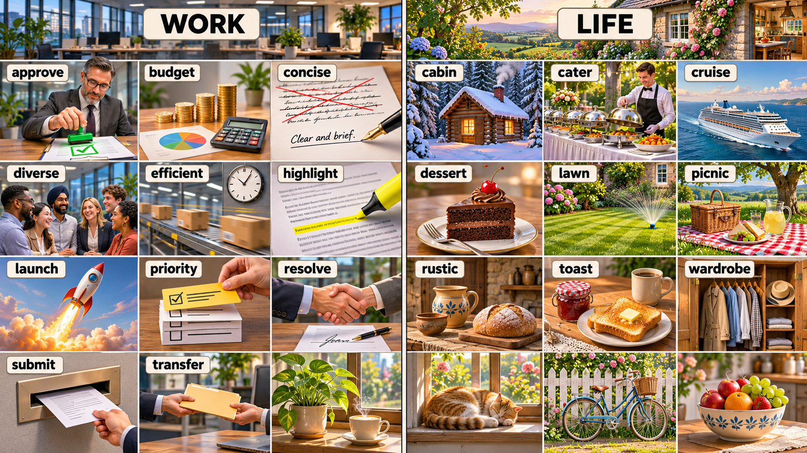

# 每日英语单词 20 个 · 2026-11-13（第 23 期）

> **定位**：面向 CET-6 六级高频/中频核心词汇，以职场和生活语境掌握常用义与搭配；六级与四级词汇存在重叠，本期不宣称逐词具有经统计核验的真题频次。
> **构成与去重**：职场 11 + 生活 9；避开两个历史索引全部 440 个词条，短语按逗号整体去重。本期累计 460 词。
> **记忆说明**：以下记忆提示分两类标注——「词根」为可确认的构词提示，「联想」为便于记忆的画面联想，不作严格词源考据；搭配辨析表示常见用法，不作绝对规则。
> **配套**：根目录 `每日20词-复习窗口.md` 与 `已推荐单词索引.md`。

## 场景记忆图

- 2026-11-13：请求模型 `gpt-image-2.5-flare`；实际尺寸 1672 × 941；耗时 57.35 秒。原图保留于 `/Users/insistgang/Pictures/Sub2API Images/gpt-image-2.5-flare-20261113-daily1113.png`，副本已归档至 `../场景配图/`。
- 本通道无法读图自检，尚未做视觉验收；画面仅用于联想，词义以正文为准。
- 左栏为现代开放办公区（WORK），右栏为阳光乡间小屋与厨房花园（LIFE）；跟随图中标签回忆每个词的画面抓手。

## 职场篇（11 词）

**1. approve** /əˈpruːv/
- **词义**：v. 批准，核准；赞成，认可；v. n. 通过，认可
- **例句**：The board approved the budget for the next quarter.
- **翻译**：董事会批准了下一季度的预算。
- **记忆提示**：词根 —— ap（朝向，同 approach / apt）+ prove（证明，同 prove / proof / improve）——"朝着某方向把事情证明成立"，故是"批准、认可"。⚠️ 常见误写：批准用 approve（动词），被批准的人或被批的事用 approved；"批准某人做某事"固定搭配 approve sb for sth / approve sb to do sth。搭配：approve a budget / approve of sth / on approval（试穿／待批）。

**2. budget** /ˈbʌdʒɪt/
- **词义**：n. 预算；v. 编预算，把…编入预算
- **例句**：We had to cut the training budget before the deadline.
- **翻译**：截止日期前，我们不得不削减培训预算。
- **记忆提示**：词根 —— bud（芽，生长）+ get（获得，同 target / budget）——"钱像芽一样一点点长出来"，故是"预算"。⚠️ 注意 budget 作动词时的读音（/ˈbʌdʒɪt/ 重音在前）与名词同形；搭配：on a tight budget / cut / increase the budget / budget for sth（为…编预算，介词是 for）。

**3. concise** /kənˈsaɪns/
- **词义**：adj. 简明的，简洁的；简短的，言简意赅的
- **例句**：Please keep the executive summary concise and factual.
- **翻译**：请把执行摘要写得简洁且基于事实。
- **记忆提示**：词根 —— con（共同）+ cid（切，同 divide / incision / precise）——"一刀切下去，把水分全砍掉"，故是"简洁"。⚠️ 词尾是 -cise 不要写成 -cise 的同音 -size；形容词比较级 more concise。搭配：a concise summary / concise and clear / in a concise manner。

**4. diverse** /daɪˈvɜːrs/
- **词义**：adj. 多种多样的，不同的；多元的
- **例句**：The team draws on diverse academic backgrounds.
- **翻译**：这个团队汇聚了多元的学术背景。
- **记忆提示**：词根 —— di（分开，同 divide / diploma）+ vers（转，同 reverse / convert / versatile）——"转向不同的方向"，故是"多样的"。⚠️ 常与 variety / diversity 混用：diverse 是形容词（修饰名词），diversity 是名词；搭配：a diverse range of / diverse backgrounds / culturally diverse。

**5. efficient** /ɪˈfɪʃnt/
- **词义**：adj. 效率高的，高效的；能干的
- **例句**：The new workflow is far more efficient than the old one.
- **翻译**：新流程比旧流程高效得多。
- **记忆提示**：词根 —— ef（往外，同 effect / efficient / exert）+ fic（做，同 factory / efficient）——"把力气用出去做事"，效率自然高。⚠️ 与 effective（有效、有效果）常混：efficient 侧重"省力省时的效率"，effective 侧重"有没有效果"。搭配：an efficient system / highly efficient / efficiency 提升。

**6. highlight** /ˈhaɪlaɪt/
- **词义**：v. 强调，突出；n. 最精彩的部分；v. n. 亮点
- **例句**：The chart highlights the gap between the two teams.
- **翻译**：这张图表突出了两个团队之间的差距。
- **记忆提示**：词根 —— high（高）+ light（光，同 lighthouse / daylight）——"用一支笔把光打在某一行上"，让它跳出来被看见，故是"突出、强调"。⚠️ 与 highlighter（荧光笔）配套记忆；名词 a highlight 指"最精彩处"。搭配：highlight the key points / the highlights of / stand out。

**7. launch** /lɔːntʃ/
- **词义**：v. 发起，启动；发射；推出（产品）；n. 发射，推出
- **例句**：We are launching the pilot program in three schools.
- **翻译**：我们将在三所学校启动这个试点项目。
- **记忆提示**：联想 —— 词源不确定，联想更可靠：想象火箭点火腾空的那一下，"launch"既指发射也指把一个项目"推出去"。⚠️ 常见搭配 launch a product / launch an initiative / launch into sth（投身于）；名词 launch 指"推出、发布"。搭配：launch a campaign / product launch。

**8. priority** /praɪˈɔːrəti/
- **词义**：n. 优先事项，优先权；优先次序；n. 重心
- **例句**：Safety has always been our top priority.
- **翻译**：安全始终是我们的首要任务。
- **记忆提示**：词根 —— prior（在…之前，同 prior / priority / premier）+ ity——"排在更前面的那件事"，故是"优先"。⚠️ 搭配固定：prioritize sth / top priority / give priority to sth（介词是 to）；名词常用复数表示一串优先事项。搭配：a high priority / set priorities。

**9. resolve** /rɪˈzɑːlv/
- **词义**：v. 解决（问题、争端）；下决心，决定；n. 决心
- **例句**：Both sides resolved the dispute without going to court.
- **翻译**：双方未上法庭就解决了争端。
- **记忆提示**：词根 —— re（回，同 resolve / repeat）+ solve（解开，同 solve / solution）——"把解开的结果拉回来"，即问题被解决。⚠️ 拼写 -solve 不是 -slove；名词 resolution 与 resolve 词根同族但词义不同（决议 / 分辨率）。搭配：resolve a dispute / resolve to do sth / a resolve to quit。

**10. submit** /səbˈmɪt/
- **词义**：v. 提交，呈递（文件、申请）；服从，顺从；投降
- **例句**：Please submit your application before Friday evening.
- **翻译**：请在周五晚间前提交你的申请。
- **记忆提示**：词根 —— sub（在…之下，同 subordinate / subscribe / subsequent）+ mit（送，同 transmit / submit / emit）——"从下面把东西送上来"，交给上级，故是"提交"。⚠️ 固定搭配 submit sth to sb / submit an application；名词 submission。搭配：submit a report / submit to pressure。

**11. transfer** /trænsˈfɜːr/
- **词义**：v. 转移，调动；转账；n. 转移；换乘
- **例句**：She transferred to the platform team last spring.
- **翻译**：她去年春天调到了平台团队。
- **记忆提示**：词根 —— trans（横过，同 transport / transform / transparent）+ fer（带，同 refer / infer / confer）——"把东西横着带过去"，故是"转移、调动"。⚠️ 易混：transfer 是"主动转移"，shift 是"位移/轮班"，transfer 的过去式双写 t（transferred）。搭配：transfer funds / transfer to another team / a bank transfer。

## 生活篇（9 词）

**12. cabin** /ˈkæbɪn/
- **词义**：n. 小屋，木屋；（船、飞机上的）舱室
- **例句**：We booked a small cabin by the lake for the weekend.
- **翻译**：我们订了湖边一间小木屋过周末。
- **记忆提示**：词根 —— cab（小室，cabinet / cabin 一族）+ in（在内）——"塞在小房间里的一小块地方"，故是"小屋、舱"。⚠️ 别和 cabin crew（空乘）混：crew 是机组人员，不是乘客。搭配：a log cabin / a cabin crew / a passenger cabin。

**13. cater** /ˈkeɪtər/
- **词义**：v. 迎合，提供饮食；承办（宴席、活动）；满足（需求）
- **例句**：The hotel caters for large family groups.
- **翻译**：这家酒店接待大型家庭团。
- **记忆提示**：词根 —— cater 与 cat（食物链，cat food / caterer）同源联想——"把食物送到客人面前"，故是"承办饮食、迎合需求"。⚠️ 词源链条不确定，此处只作联想式记忆提示；固定搭配 cater for sb / cater to sth（迎合某口味）。搭配：cater for a wedding / caters to tastes。

**14. cruise** /kruːz/
- **词义**：n. 航行，航游；v. 巡航，航行；（口语）兜风
- **例句**：They took a cruise along the coast in early summer.
- **翻译**：初夏他们沿着海岸乘船巡游。
- **记忆提示**：联想 —— 词源不确定，联想更可靠：想象一艘大船在海上慢慢滑行、留下长长的尾迹，"cruise"就是这种不赶时间的航行。⚠️ 搭配 cruise control（定速巡航）、cruise line（邮轮公司）；口语 "let's go for a cruise" 是兜风。搭配：take a cruise / cruise along。

**15. dessert** /dɪˈzɜːrt/
- **词义**：n. 甜点，甜品；餐后甜食
- **例句**：The menu offers three desserts, all of them seasonal.
- **翻译**：这份菜单提供三款甜点，全都是当季的。
- **记忆提示**：词根 —— des（离开，同 depart / dessert 对应的 dessert 源自动词 deserter 后被"south"影响而成）+ sert（服务，同 insert / desert / assert）——"餐后端上来的服务"，即"餐后甜点"。⚠️ 拼写 dessert 有两个 s、两个 t，与 desert（沙漠 / 放弃）只差一个字母；音标读 /dɪˈzɜːrt/。搭配：a dessert menu / dessert wine / after dessert。

**16. lawn** /lɔːn/
- **词义**：n. 草坪，草地
- **例句**：He mowed the lawn before the guests arrived.
- **翻译**：客人们到达前他修剪了草坪。
- **记忆提示**：联想 —— 词源不确定，联想更可靠：想象一片被割得平平整整的绿草地，"lawn"就是门前那块修剪过的草坪。⚠️ 搭配 a lawn mower（割草机）、lawn tennis（草地网球）；别与 lane（小路）混。搭配：mow the lawn / a manicured lawn / perfect lawn。

**17. picnic** /ˈpɪknɪk/
- **词义**：n. 野餐；v. 野餐
- **例句**：We packed sandwiches and had a picnic under the old tree.
- **翻译**：我们打包了三明治，在老树下野餐。
- **记忆提示**：词根 —— pick（挑选，同 pick / pickle）+ nic ——"在户外挑一处好地方摊开餐食"，故是"野餐"。⚠️ 固定搭配 have / go on a picnic；picnic basket（野餐篮）、picnic area（野餐区）。搭配：a picnic basket / go on a picnic。

**18. rustic** /ˈrʌstɪk/
- **词义**：adj. 乡村的，质朴的；n. 乡村风格
- **例句**：The kitchen has a rustic wooden table and handmade pottery.
- **翻译**：厨房里有一张乡村风格的木桌和手工陶罐。
- **记忆提示**：词根 —— rust（锈，同 rust / rusty）+ ic——"未经打磨、带点旧感和木头原色"，故是"质朴的乡村风格"。⚠️ rust 是"锈"，rustic 是"乡村的"；近义 rural（乡下的，偏地域）、country（乡村风格，偏氛围）。搭配：a rustic cabin / rustic charm / rustic furniture。

**19. toast** /toʊst/
- **词义**：n. 烤面包；祝酒，干杯；v. 烤（面包）；祝酒
- **例句**：We raised our glasses to toast the new apartment.
- **翻译**：我们举杯为新公寓干杯。
- **记忆提示**：联想 —— 词源不确定，联想更可靠：想象两片面包在烤炉里被烤得金黄（toast 的本义），以及举杯碰撞时发出的"叮"（祝酒的 toast）。⚠️ 一词两义需分场景记：早餐的 toast 是"吐司"，晚宴的 toast 是"祝酒"。搭配：make toast / raise a toast / buttered toast。

**20. wardrobe** /ˈwɔːrdroʊ/
- **词义**：n. 衣柜；全部衣物，行头
- **例句**：She is putting together a spring wardrobe from scratch.
- **翻译**：她正从头搭配一套春季行头。
- **记忆提示**：词根 —— ward（看管，同 warden / guard）+ robe（长袍，同 robe / wardrobe）——"专门用来挂长衣物的房间"，故是"衣柜"，引申为"全部衣物"。⚠️ wardrobe 也可指戏服、道具服装（costume wardrobe）；别与 room number 混。搭配：a new wardrobe / wardrobe size / a fitted wardrobe。

## 助记卡（词根/画面抓手 + 高频搭配）

| 单词 | 词根/画面抓手 | 高频搭配 |
|---|---|---|
| approve | ap + prove（证明）→ 把事情证明成立 | approve a budget |
| budget | bud + get（生长）→ 钱像芽一样长出来 | on a tight budget |
| concise | con + cid（切）→ 一刀切掉水分 | a concise summary |
| diverse | di + vers（转）→ 转向不同方向 | a diverse range of |
| efficient | ef + fic（做）→ 把力气用出去做事 | an efficient system |
| highlight | high + light（光）→ 把光打在某一行上 | highlight the key points |
| launch | 火箭腾空那一下 | launch a product |
| priority | prior（在…之前）→ 排在更前面的那件事 | top priority |
| resolve | re + solve（解开）→ 把解开的结果拉回来 | resolve a dispute |
| submit | sub + mit（送）→ 从下面把东西送上来 | submit an application |
| transfer | trans + fer（带）→ 横着带过去 | transfer funds |
| cabin | cab + in → 塞在小房间里的地方 | a log cabin |
| cater | 食物送到客人面前 | cater for a wedding |
| cruise | 大船滑行留下的长尾迹 | take a cruise |
| dessert | 餐后端上来的服务 | after dessert |
| lawn | 割得平整的绿草地 | mow the lawn |
| picnic | 在户外摊开的一餐 | go on a picnic |
| rustic | 未打磨的木头原色 | a rustic cabin |
| toast | 烤箱里的吐司与举杯的叮 | make toast |
| wardrobe | 挂长衣物的房间 | a new wardrobe |

## 一句话串记

**职场线**：董事会 **approve** 了 **budget**，要求报告写得 **concise**；团队成员背景 **diverse**，流程要 **efficient**，图表 **highlight** 出关键差距；项目即将 **launch**，先排好 **priority**；有分歧就 **resolve**，文件按时 **submit**，人手不够再 **transfer** 过来。

**生活线**：周末订了湖边的 **cabin**；婚礼请人 **cater**；夏天出海 **cruise**；餐后 **dessert** 收尾；门前 **lawn** 修得平整；树下 **picnic**；屋里摆着 **rustic** 的木桌；早餐是 **toast**；换季整理 **wardrobe**。

## 记忆宫殿 · 双线场景故事

### 职场线（11 词）· 从董事会盖章到文件归档的一天

会议室长桌尽头，主席把一枚绿色印章"啪"地按在文件上——这是 **approve**（批准）；桌上摊着硬币堆、小计算器和一张饼图——这是 **budget**（预算）；秘书用钢笔在一页空白纸上只写一句话，长段落被一道红线整段划掉——这是 **concise**（简洁）；圆桌旁坐着肤色、性别各异的六位同事——这是 **diverse**（多元）；传送带上的包裹飞快滑过墙上的钟——这是 **efficient**（高效）；荧光笔在打印稿上划过，只留下一道黄色重痕——这是 **highlight**（强调）；窗外一枚小火箭"腾"地喷着橙焰升空——这是 **launch**（启动、推出）；一叠任务卡被一只手从中间抽出最上面那张——这是 **priority**（优先事项）；两份合同上两双手稳稳握在一起——这是 **resolve**（达成解决）；文件被推进墙上的一个投递口，像投信箱——这是 **submit**（提交）；最后一个画面：文件夹从甲同事手中横着递到乙同事手里，越过桌面——这是 **transfer**（转移、调动）。一天的职场线就此闭环。

> 画面链：绿色印章 → 硬币与饼图 → 一句话加一道红线 → 六人圆桌 → 传送带与钟 → 黄色荧光痕 → 喷焰升空的小火箭 → 被抽出的顶层卡片 → 两只握手 → 墙上投递口 → 越过桌面递来的文件夹。

### 生活线（9 词）· 从湖边小屋到衣柜前的周末

你把车停在一片松林边的小木屋前——这是 **cabin**（小屋）；屋里长桌上摆满加盖的银色餐盘，围裙服务员正在布置——这是 **cater**（承办宴席、迎合需求）；接着登上一艘大船，海面被船尾划出长长的白色尾迹——这是 **cruise**（巡航）；餐后甜点上桌，一块巧克力蛋糕顶着樱桃——这是 **dessert**（甜点）；上岸回到自家门前，喷水器把绿草坪浇出一片彩虹——这是 **lawn**（草坪）；树下铺开格子布，篮子里是三明治和柠檬水——这是 **picnic**（野餐）；屋里的粗木桌上摆着手捏陶罐和一条面包——这是 **rustic**（乡村质朴）；清晨烤箱弹出两片金黄的吐司，旁边是果酱罐和咖啡杯——这是 **toast**（烤面包）；最后打开大衣柜，一排外套和帽子静静挂着，等你换季整理——这是 **wardrobe**（衣柜、行头）。周末的生活线随之收尾。

> 画面链：松林中的小木屋 → 银色餐盘与围裙 → 大船划出的白尾迹 → 樱桃蛋糕 → 草坪上的彩虹水雾 → 格子布上的野餐篮 → 粗木桌上的陶罐与面包 → 金黄吐司与果酱 → 敞开的大衣柜。

## 排雷台（18 组易混与搭配辨析）

| 辨析 | 关键差别与常见搭配 |
|---|---|
| approve / approve of / assent | approve 是"正式批准"（approve a budget / approve sb to do sth）；approve of 是"赞成、认可"（approve of the plan）；assent 多用于正式场合"点头同意"。 |
| budget / allowance / quota | budget 是"整体预算"；allowance 是"定额津贴、零用钱"（a travel allowance）；quota 是"配额、指标"（a sales quota）。⚠️ budget for sth 的介词是 for。 |
| concise / brief / short | concise 是"删掉冗余后表达同样多信息"（a concise explanation）；brief 是"篇幅短"（a brief meeting）；short 最短、最口语。 |
| diverse / various / random | diverse 强调"结构上多元、彼此不同"（diverse backgrounds）；various 是"各式各样"（various reasons）；random 是"随机的"。 |
| efficient / effective / productive | efficient 侧重"投入产出比高、少浪费"（efficient use of resources）；effective 侧重"有效果"（an effective remedy）；productive 侧重"能产出成果"（a productive meeting）。⚠️ 六级写作里三者常被当同义词替换，实际含义有别。 |
| highlight / emphasize / stress | highlight 是"用标记使其显眼"（highlight a keyword）；emphasize 是"强调重要性"（emphasize the need for...）；stress 是"重读、重音，也指压力"。 |
| launch / initiate / commence | launch 指"推出并让它开始面对公众"（launch a product / launch an initiative）；initiate 指"发起、启动过程"（initiate a project）；commence 是"正式开始"（commence work）。 |
| priority / precedence / privilege | priority 是"优先事项、优先考虑"（a top priority）；precedence 是"先后顺序、优先权"（take precedence over）；privilege 是"特权、荣幸"。 |
| resolve / settle / overcome | resolve 是"把争端或问题彻底解决"（resolve a dispute / resolve an issue）；settle 是"安顿、了结"（settle a claim）；overcome 是"克服困难"（overcome a challenge）。 |
| submit / deliver / hand in | submit 是"向上级或系统提交"（submit an application）；deliver 是"把货送到"（deliver the goods）；hand in 是"交作业、实物递交"（hand in your homework）。 |
| transfer / transport / shift | transfer 是"人或权责的调动、账户划转"（transfer funds / transfer to another team）；transport 是"物理运输"（transport goods）；shift 是"位移或轮班"（the night shift）。 |
| cabin / cottage / hut | cabin 是"原木小屋或舱室"（log cabin / passenger cabin）；cottage 偏"乡间带花园的村舍"；hut 更简陋（a mountain hut）。 |
| cater / serve / cater for | cater for 是"为（某类人）提供食宿／照顾"（cater for large groups）；serve 是"服务、上菜"（serve dinner）；cater to 是"迎合某种口味或需求"（cater to tastes）。 |
| cruise / sail / voyage | cruise 是"游轮式的休闲航行"（take a cruise）；sail 是"驾驶帆船／启航"（sail at dawn）；voyage 偏"长途海上旅行"（a long voyage）。 |
| dessert / desert / sweet | dessert 是"餐后甜点"（chocolate dessert）；desert 是"沙漠"或"放弃"（desert a post）；sweet 是"甜的"或"糖果"。⚠️ dessert 两个 s 两个 t。 |
| lawn / grass / meadow | lawn 是"修剪过的草坪"（mow the lawn）；grass 是"草、草料"；meadow 是"野地里的草地"（11-08 已用）。 |
| rustic / rural / country | rustic 偏"质感与风格朴实"（rustic furniture）；rural 偏"地域上的乡村"（rural areas）；country 偏"乡村风情的氛围"（country style）。 |
| picnic / barbecue / outing | picnic 是"野餐"（go on a picnic）；barbecue 是"烧烤聚会"（a backyard barbecue）；outing 是"短途外出"（a family outing）。 |

## 快速自测（5 题 · 答案折叠）

**1. 介词与搭配填空**：The board ______ the budget, and staff must ______ their applications by Friday.（approve / submit）

**2. 选词填空**：The new workflow is far more ______ than the old one, and the chart ______ the cost difference clearly.（efficient / effective / highlight / emphasise）

**3. 中译英**：安全始终是我们的首要任务。

**4. 词形与辨析**：在 "a ______ summary"、"a ______ dispute" 和 "a ______ of the household" 中，分别对应"简洁的"、"争端"和"衣柜"。

**5. 生活场景选词**：We packed sandwiches and had a ______ under the old tree, then opened a ______ of the drinks.（从 picnic / wardrobe / cruise / toast 中选择）

点击展开答案

1. **approved；submit**。approve 是"批准"，固定搭配 approve a budget / approve sb to do sth；submit 是"提交"，搭配 submit sth to sb / submit an application。⚠️ 注意 submit 的介词是 to（submit it **to** the office），而 approve 后面不接介词。
2. **efficient；highlight**。efficient 侧重"投入产出比高、少浪费"（a more efficient workflow）；effective 侧重"有没有效果"（an effective remedy），本题说的是流程省力，故用 efficient。后半句"图表把成本差异清晰地标出来"对应 highlight（用标记使其显眼），emphasize 则是用言语强调重要性。
3. **Safety has always been our top priority.** 关键搭配是 top priority；名词 priority 作"优先事项"时常用复数 set priorities；动词是 prioritize sth / give priority to sth（介词是 to）。
4. 依次是 **concise / resolve / wardrobe**。a **concise** summary = 简洁的摘要（强调去掉冗余）；**resolve** a dispute = 解决争端；a **wardrobe** of the household = 一家人的全部衣物（wardrobe 也可指衣柜本身）。⚠️ resolve 的名词是 resolution（决议／分辨率），别混。
5. **picnic；wardrobe**。picnic 是"野餐"（have a picnic under the tree）；wardrobe 是"衣柜／全部衣物"，此处是"打开一柜子饮料"。cruise 是"乘船巡游"，toast 是"吐司／祝酒"，均不合。

---

*第 23 期 · 2026-11-13 · 本期 20 词 · 累计 460 词 · 唯一资料真源：每日英语单词/*
