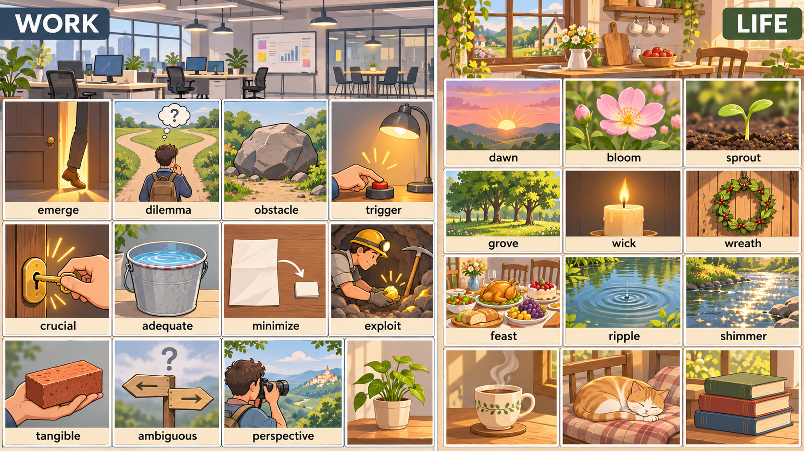

# 每日英语单词 20 个 · 2026-11-14（第 24 期）

> **定位**：面向 CET-6 六级高频/中频核心词汇，以职场和生活语境掌握常用义与搭配；六级与四级词汇存在重叠，本期不宣称逐词具有经统计核验的真题频次。
> **构成与去重**：职场 11 + 生活 9；避开两个历史索引全部 460 个词条，短语按逗号整体去重。本期累计 480 词。
> **记忆说明**：以下记忆提示分两类标注——「词根」为可确认的构词提示，「联想」为便于记忆的画面联想，不作严格词源考据；搭配辨析表示常见用法，不作绝对规则。
> **配套**：根目录 `每日20词-复习窗口.md` 与 `已推荐单词索引.md`。

## 场景记忆图

- 2026-11-14：请求模型 `gpt-image-2.5-flare`；实际尺寸 1672 × 941；耗时 49.65 秒。原图保留于 `/Users/insistgang/Pictures/Sub2API Images/gpt-image-2.5-flare-20261114-daily1114.png`，副本已归档至 `../场景配图/`。
- 本通道无法读图自检，尚未做视觉验收；画面仅用于联想，词义以正文为准。
- 左栏为现代开放办公区（WORK），右栏为阳光乡间小屋与厨房花园（LIFE）；跟随图中标签回忆每个词的画面抓手。

## 职场篇（11 词）

**1. emerge** /ɪˈmɜːrdʒ/
- **词义**：v. 出现，显现，浮现；显露，暴露；（问题）解决，摆脱
- **例句**：A clearer picture of the problem began to emerge after the second audit.
- **翻译**：第二次审计之后，问题全貌开始浮现出来。
- **记忆提示**：词根 —— e（向外，同 exit / emerge / emit）+ merge（合并，同 merge / merger / immerse）——"从水里合并着浮上来"，故是"浮现、出现"。⚠️ 常见搭配：emerge from（从…中浮现／摆脱出来）、a pattern emerges、the truth emerges；名词 emergency 与 emerge 同族但词义不同（紧急情况）。搭配：emerge from the discussion / newly emerged。

**2. dilemma** /dɪˈlemə/
- **词义**：n. 困境，进退两难的抉择
- **例句**：We are in a dilemma: we need more time, but the deadline is fixed.
- **翻译**：我们陷入两难：需要更多时间，但截止日期是固定的。
- **记忆提示**：联想 —— 词源不确定，联想更可靠：想象面前突然裂开一个深坑（希腊神话中的"困境"chasm），左边一条路右边一条路，哪边都过不去。⚠️ 注意是双写 m（dilemma），不要写成 dilema；介词搭配是 in a dilemma（也可说 in the dilemma of choosing between A and B）；别与 dilemma 的近义词 problem（可解的问题）混——dilemma 强调"两难、无完美选项"。搭配：face a dilemma / be in a dilemma / a moral dilemma。

**3. obstacle** /ˈɑːbstəkl/
- **词义**：n. 障碍，阻碍；障碍物
- **例句**：The main obstacle to implementation is a lack of training.
- **翻译**：落实的主要障碍是缺乏培训。
- **记忆提示**：词根 —— ob（朝向，同 obstruct / obstruct 的动词 obstruct）+ stac（站立，同 stack / stake / stationary）——"横在面前挡路的一根桩子"，故是"障碍"。⚠️ 固定搭配 the obstacle to（做某事的障碍，介词是 to）；动词形式 obstruct 表示"妨碍"；别与 obstacle course（障碍赛）混。搭配：overcome an obstacle / a major obstacle to progress。

**4. trigger** /ˈtrɪɡər/
- **词义**：v. 引发，触发；引起；n. 扳机，触发器；诱因
- **例句**：A single rumor triggered a wave of customer complaints.
- **翻译**：一条传闻引发了客户投诉的风潮。
- **记忆提示**：联想 —— 词源不确定，联想更可靠：想象手指扣下枪械上的一个小扳机，一发即出，"trigger"就是那个引发连锁的开关。⚠️ 常见搭配 trigger a crisis / trigger a response / trigger an alarm；名词 trigger 指"扳机、诱因"，trigger for sth。⚠️ 与 provoke（激怒、引诱）易混，trigger 偏"机制性引发"。搭配：trigger a chain reaction / a trigger point。

**5. crucial** /ˈkruːʃl/
- **词义**：adj. 至关重要的，决定性的；关键性的
- **例句**：The first two weeks of the project were crucial to its success.
- **翻译**：项目最初两周对其成功至关重要。
- **记忆提示**：词根 —— cruc（十字，同 crucify / cruise 一族的 cross 族 + crucial 同源）+ ial——"像十字路口那样非走不可的那一步"，故是"关键的"。⚠️ 常见误用：常用 it is crucial to do sth 或 sth is crucial to/for sth，但口语中它也常直接修饰名词（a crucial stage）。搭配：crucial to / crucial for / play a crucial role。

**6. adequate** /ˈædɪkwət/
- **词义**：adj. 足够的，充足的；适当的，胜任的
- **例句**：The lighting in the old office is barely adequate for video calls.
- **翻译**：旧办公室的灯光勉强够用来开视频会议。
- **记忆提示**：词根 —— ad（朝向，同 adhere / adjacent 同 ad- 族）+ equ（等同，同 equal / equation）+ ate——"刚好与需求相等"，故是"足够的"。⚠️ 与 sufficient（足够，偏书面、偏"量足"）区分：adequate 常带"够用但未必宽裕"的口语色彩，barely adequate / more than adequate。⚠️ 搭配分两种：adequate for sth（对…来说够用）、adequate to do sth（足以做某事）。

**7. minimize** /ˈmɪnɪmaɪz/
- **词义**：v. 使减到最少；最小化；尽量降低（风险、影响）
- **例句**：We designed the fallback plan to minimize the risk of data loss.
- **翻译**：我们设计了备用方案，把数据丢失的风险降到最低。
- **记忆提示**：词根 —— mini（小，同 miniature / minimum / minor）+ mize（使…化，同 maximize / optimize / emphasize）——"把东西弄到最小"，故是"最小化"。⚠️ 反义词 maximize 是六级高频常错项：minimize 降低风险，maximize 提高收益；名词 minimum / maximal。搭配：minimize risk / minimize costs / be minimized。

**8. exploit** /ɪkˈsplɔɪt/
- **词义**：v. 利用，开发（资源）；剥削；n. 英勇的行为，功绩
- **例句**：The company was accused of exploiting a loophole in the regulation.
- **翻译**：该公司被指控利用了法规中的漏洞。
- **记忆提示**：词根 —— ex（向外）+ ploit（折叠，同 ply / apply / imply / deploy 一族表"折、拧"）——"把折叠在一起的力量掰开使出来"，故是"开发利用"。⚠️ 一词两义要分清：技术语境 exploit = 利用、开发（exploit resources）；道德语境 exploit = 剥削（exploit workers）；名词 exploit = 功绩（军事功勋）。⚠️ 与 explore（探索）只差一个字母，千万别写混。搭配：exploit resources / exploit a loophole / be exploited。

**9. tangible** /ˈtændʒəbl/
- **词义**：adj. 有形的，可触摸的；确实的，实质的；明确的
- **例句**：We need tangible evidence before we commit more budget.
- **翻译**：在投入更多预算之前，我们需要看得见的证据。
- **记忆提示**：词根 —— tang（触摸，同 tangent / tangible / tantamount）+ ible（可…的，同 possible / visible）——"能被手摸到、能被验证的"，故是"有形的、确实的"。⚠️ 与 intangible（无形的）构成六级高频反义对；名词 tangibility 多用于学术写作。搭配：tangible benefits / tangible evidence / tangible results。

**10. ambiguous** /æmˈbɪɡjuəs/
- **词义**：adj. 模棱两可的，含糊不清的；有歧义的
- **例句**：The contract wording was so ambiguous that both sides felt they had won.
- **翻译**：合同措辞太含糊，双方都觉得自己赢了。
- **记忆提示**：词根 —— ambi（两边，同 ambient / ambiguous 一族的 "ambi-" 表两旁）+ gu（驱动，同 argue / guerrilla）——"话朝两边都能解释"，故是"模棱两可的"。⚠️ 反义 unambiguous（毫不含糊），与 ambiguous 一组是六级写作常用对比；名词 ambiguity。搭配：an ambiguous statement / ambiguous instructions / ambiguity in the wording。

**11. perspective** /pɜːrˈspektɪv/
- **词义**：n. 观点，视角；看法；透视图，透视法
- **例句**：Working abroad gave her a fresh perspective on her own field.
- **翻译**：在国外工作让她对自己领域有了全新的视角。
- **记忆提示**：词根 —— per（穿过，同 perceive / persist / perspective）+ spect（看，同 inspect / respect / spectator / spectrum）——"穿过某物去看"，故是"视角、看法"。⚠️ 与 prospect（前景、可能性）只差一个字母，六级常混；名词 perspective 偏"看法、角度"，prospect 偏"未来可能"。搭配：from a different perspective / gain perspective on / put things in perspective。

## 生活篇（9 词）

**12. dawn** /dɔːn/
- **词义**：n. 黎明，破晓；开端，萌芽；v. 破晓；开始显露出
- **例句**：We left before dawn to catch the first train.
- **翻译**：我们在破晓前出发去赶第一班火车。
- **记忆提示**：联想 —— 词源不确定，联想更可靠：想象天边刚泛起一线白光、黑夜还没散尽的那个瞬间，就是"黎明"。⚠️ 固定搭配 before dawn / at dawn / from dawn to dusk；动词 dawn on sb 指"（想法）开始被意识到"。⚠️ 与 dusk（黄昏）相对，别与 dorn 一类词混。搭配：at the dawn of / dawn breaks。

**13. bloom** /bluːm/
- **词义**：v. 开花；繁荣，发展；n. 开花；花朵；青春
- **例句**：The cherry trees along the river bloom in early April.
- **翻译**：河边的樱树在四月初开花。
- **记忆提示**：联想 —— 词源不确定，联想更可靠：想象一个花苞在枝头慢慢鼓胀、瓣片一片片撑开的那一下，"bloom"就是花开的过程。⚠️ 比喻义用得多：a blooming career / bloom into something；名词 bloom 还有"青春"义（in the bloom of youth）。⚠️ 别与 blossom（花朵本身，偏名词）混。搭配：bloom into / full bloom / in full bloom。

**14. sprout** /spraʊt/
- **词义**：v. 发芽，长出；出现，萌发；n. 嫩芽，幼苗
- **例句**：Tiny shoots had already sprouted along the cracked pavement.
- **翻译**：龟裂的人行道路缝里已经冒出了细小的嫩芽。
- **记忆提示**：联想 —— 词源不确定，联想更可靠：想象一粒种子在土里伸展开来、顶破土层冒出一撮绿芽，"sprout"就是萌发这件事。⚠️ 固定搭配 sprout up（冒出）、sprout from（从…长出）；比喻义 a sprouting market / new ideas sprouting。⚠️ 与 shoot（芽、shoots 蔬菜嫩芽）易混：sprout 强调"萌发"的过程。搭配：sprout leaves / sprouting seeds。

**15. grove** /ɡroʊv/
- **词义**：n. 小树林，树丛；林荫处
- **例句**：We had lunch under a small grove of birch trees.
- **翻译**：我们在一小片白桦树林下吃了午饭。
- **记忆提示**：联想 —— 词源不确定，联想更可靠：想象一小片挤在一起的树，树冠合拢成一片绿荫，就是"小树林"。⚠️ grove 偏"成片的小树"，forest 偏"大片森林"，orchard 是"果园"（11-12 已用）；也可作地名通名（the Grove）。搭配：a grove of trees / a birch grove / a shady grove。

**16. wick** /wɪk/
- **词义**：n. 灯芯，烛芯；棉捻
- **例句**：The candle burned down to a stub before the wick gave out.
- **翻译**：蜡烛烧到只剩一小截，烛芯就熄灭了。
- **记忆提示**：联想 —— 词源不确定，联想更可靠：把一根细棉线浸在蜡油里点着，火焰沿着它往上爬，这根线就是"烛芯"。⚠️ 一词多义要分场景：the wick of a candle（烛芯）、a lamp wick（灯芯）；习语 get on sb's wick（惹恼某人）少见但六级阅读偶见。⚠️ 别与 whip（鞭子）混。搭配：a candle wick / the wick burns down / trim the wick。

**17. wreath** /riːθ/
- **词义**：n. 花环，花冠；花圈（丧礼用）
- **例句**：A wreath of evergreens hung on the front door.
- **翻译**：一个常青枝编成的花环挂在前门上。
- **记忆提示**：联想 —— 词源不确定，联想更可靠：想象把松枝、冬青和浆果绕成一个圆圈挂在门上，既是节日装饰，也是哀悼时的花圈。⚠️ 拼写是 wre-ath（无元音 a），别写成 wreather；读音 /riːθ/ 结尾是 /θ/（清齿擦音），同 breath。搭配：a Christmas wreath / lay a wreath / a wreath of laurel。

**18. feast** /fiːst/
- **词义**：n. 盛宴，宴会；v. 尽情享受；宴请
- **例句**：The wedding feast ran long and loud in the old courtyard.
- **翻译**：婚宴在老院子里办得又长又热闹。
- **记忆提示**：联想 —— 词源不确定，联想更可靠：想象长桌上摆满整盘整盘的热菜，所有人举杯吃到大半夜，这就是"盛宴"。⚠️ 动词义是"尽情享受"：feast on sth / feast one's eyes on（饱览）。⚠️ 别与 feast 作动词时"宴请"混淆：host a feast。⚠️ 近义 banquet 更正式（a banquet for 500 guests）。搭配：a wedding feast / feast on / an eye feast。

**19. ripple** /ˈrɪpl/
- **词义**：n. 波纹，涟漪；v. 起涟漪；扩散，传开
- **例句**：A single email set off a ripple through the whole department.
- **翻译**：一封邮件在整个部门引发了一场连锁反应。
- **记忆提示**：联想 —— 词源不确定，联想更可靠：想象一颗小石子落进静水，水面皱成一层层向四周推开的圈，"ripple"就是这道涟漪。⚠️ 比喻义更常用：a ripple effect（一连串影响）、ripple through（迅速传开）；勿与 rapid（快速的）混。搭配：a ripple effect / ripple through / send ripples through。

**20. shimmer** /ˈʃɪmər/
- **词义**：v. 微光闪烁，闪闪发光；n. 微光，闪光
- **例句**：The lake shimmered in the last of the afternoon light.
- **翻译**：在午后最后的光线里，湖面闪着微光。
- **记忆提示**：联想 —— 词源不确定，联想更可靠：想象光在薄薄的层面上细细地跳动、碎成一片细闪，"shimmer"就是那种微微闪烁。⚠️ 与 glitter（闪耀、张扬）、gleam（一道柔和的光）、glisten（湿处反光）区分：shimmer 偏"水面、空气中的轻微闪动"，glitter 偏"华丽刺眼"。搭配：shimmering water / shimmer in the light / a shimmer of hope。

## 助记卡（词根/画面抓手 + 高频搭配）

| 单词 | 词根/画面抓手 | 高频搭配 |
|---|---|---|
| emerge | e + merge（合并）→ 从水里浮上来 | emerge from |
| dilemma | 脚下裂开一个深坑，左右两条路 | be in a dilemma |
| obstacle | ob + stac（站）→ 挡在面前的桩子 | a major obstacle to |
| trigger | tri + ger（枪）→ 扣下扳机 | trigger a crisis |
| crucial | cruc（十字）→ 十字路口那一步 | crucial to / for |
| adequate | ad + equ（等同）→ 刚好等于需求 | adequate for |
| minimize | mini + mize（化）→ 弄到最小 | minimize risk |
| exploit | ex + ploit（折）→ 把力掰开使出来 | exploit resources |
| tangible | tang（触摸）+ ible → 摸得到、验得了 | tangible benefits |
| ambiguous | ambi（两边）+ gu → 朝两边都能解释 | ambiguous wording |
| perspective | per + spect（看）→ 穿过去看 | from a different perspective |
| dawn | 天边刚泛起一线白光 | before dawn / at dawn |
| bloom | 花苞鼓胀着要绽开 | bloom into / in full bloom |
| sprout | 种子伸展开顶破土层 | sprout up / sprout from |
| grove | 树冠合拢成一片绿荫 | a grove of trees |
| wick | 浸了蜡油的细棉线，火焰沿它上爬 | a candle wick |
| wreath | 松枝与浆果绕成的圆圈 | a Christmas wreath |
| feast | 长桌摆满整盘热菜 | feast on / a wedding feast |
| ripple | 轻碰水面皱起的一层层波纹 | a ripple effect |
| shimmer | 光在薄层面上细细地跳 | shimmering water |

## 一句话串记

**职场线**：新问题从报告里 **emerge**，团队却陷入 **dilemma**；培训不足成了最大的 **obstacle**，一次误操作 **trigger** 了连锁反应；最 **crucial** 的一步是资源刚好 **adequate**；方案把损失 **minimize** 到最低，**exploit** 好现有接口，给出 **tangible** 证据；表述有点 **ambiguous**，换 **perspective** 再确认一遍。

**生活线**：**dawn** 出发看 **bloom** 盛开；墙角冒出一株 **sprout**，走进小 **grove**；点燃 **wick**、挂上 **wreath**、办一场 **feast**；湖面荡起 **ripple**，光影 **shimmer**。

## 记忆宫殿 · 双线场景故事

### 职场线（11 词）· 从问题浮现到方案落地的一天

清晨的开放办公区，第一份晨会报告里，模糊的问题像水下的轮廓一样慢慢浮上来——这是 **emerge**（浮现）；投影幕布上出现一个十字路口，同事站在中间左右为难——这是 **dilemma**（两难）；通往工位的过道正中横着一块巨石，所有人只能绕行——这是 **obstacle**（障碍）；有人手指轻轻按下桌上一个按钮，整层楼的灯同时亮起——这是 **trigger**（触发）；走廊尽头那把金色钥匙插进锁孔，管理员说"这把最 **crucial**"——这是 **crucial**（关键）；茶水间的水桶正好被接到刻度线，勉强够用——这是 **adequate**（足够）；打印机吐出一张巨大纸，秘书三折两折把它压成一枚小卡片——这是 **minimize**（最小化）；矿灯下有人用镐从岩层里稳稳取出一枚金币——这是 **exploit**（开发利用）；一只手掌托着一块沉甸甸的红砖，实实在在——这是 **tangible**（有形、可验证）；双箭头路牌指向两个方向，牌面糊得看不清——这是 **ambiguous**（模棱两可）；最后同事举起相机取景框对准远处的城市天际线，换一个角度重拍——这是 **perspective**（视角）。职场的这一天闭环。

> 画面链：水中浮现的轮廓 → 幕布上的十字路口 → 过道正中的巨石 → 被按下后亮起的按钮 → 金色钥匙与刻度线 → 接到刻度的水桶 → 三折成小卡片的大纸 → 镐尖挑出的金币 → 掌心里的红砖 → 模糊的双箭头路牌 → 取景框里的城市。

### 生活线（9 词）· 从清晨花园到湖边夜宴的一天

天还没亮透，你披衣出门，东方天际刚泛起一线灰白——这是 **dawn**（破晓）；拐过院墙，一株樱树正把花瓣一片片撑开——这是 **bloom**（开花）；砖缝里顶起一小撮绿茸茸的芽尖——这是 **sprout**（发芽）；穿过一片小树林，枝叶在头顶合拢成绿荫——这是 **grove**（小树林）；回到屋内，划着火柴，一根棉捻上的火苗稳稳立起——这是 **wick**（烛芯）；门环上挂着一圈松枝与红果编成的环——这是 **wreath**（花环）；傍晚的长桌摆满整盘热菜，所有人举杯喧闹——这是 **feast**（盛宴）；饭后走到湖边，一粒石子落水，荡开层层圆纹——这是 **ripple**（涟漪）；抬头时，最后的余晖正在水面上碎成一片细闪——这是 **shimmer**（微光闪烁）。生活的一天随之收尾。

> 画面链：灰白一线天光 → 撑开的樱树花瓣 → 砖缝里的绿芽尖 → 合拢成荫的小树林 → 立起的烛芯火苗 → 门环上的松枝花环 → 满盘热菜的长桌 → 湖面层层圆纹 → 水面上碎成一片的余晖。

## 排雷台（16 组易混与搭配辨析）

| 辨析 | 关键差别与常见搭配 |
|---|---|
| emerge / appear / arise | emerge 是"从隐藏处逐渐浮现"（a pattern emerges / emerge from）；appear 是"出现、露面"，也可指"显现"；arise 多用于问题、情况（problems arise）。 |
| dilemma / problem / issue | dilemma 强调"两难、无完美选项"（be in a dilemma）；problem 泛指"待解决的问题"（solve a problem）；issue 偏"争议、议题、发布版本"。 |
| obstacle / barrier / hindrance | obstacle 偏"具体的障碍物或障碍"（overcome an obstacle）；barrier 多指"制度、门槛、屏障"（a language barrier）；hindrance 偏"妨碍因素"（a hindrance to progress）。 |
| trigger / provoke / spark | trigger 偏"机制性引发"（trigger an alarm / trigger a crisis）；provoke 偏"激起强烈反应、挑衅"（provoke anger）；spark 多作名词"火花"，动词引出（spark a debate）。 |
| crucial / critical / vital | crucial 偏"决定成败的那一点"（crucial to success）；critical 多含"危急、批判性"（a critical stage / critical thinking）；vital 偏"维持生命所必需"（vital signs / vital to）。 |
| adequate / sufficient / ample | adequate 是"够用，但常带勉强"（barely adequate）；sufficient 是"足够"，更正式（sufficient evidence）；ample 偏"量足有余、宽敞"（ample time / ample space）。 |
| minimize / reduce / eliminate | minimize 是"压到最低"（minimize risk）；reduce 是"减少"（reduce costs）；eliminate 是"彻底消除"（eliminate waste）。⚠️ 与 maximize 正好相对。 |
| exploit / explore / utilize | exploit 在技术语境是"开发利用"（exploit resources），在道德语境是"剥削"；explore 是"探索"（explore options）；utilize 偏"正式地利用"。⚠️ exploit 与 explore 只差一个 i，极易写错。 |
| tangible / intangible / concrete | tangible 是"摸得到、看得见的"（tangible benefits）；concrete 偏"具体的、可实施的"（concrete plan）；intangible 是"无形的"（intangible assets）。 |
| ambiguous / vague / obscure | ambiguous 是"有两种以上解释"（ambiguous wording）；vague 是"含糊、不具体"（a vague answer）；obscure 是"晦涩难懂"（an obscure reference）。 |
| perspective / prospect / viewpoint | perspective 是"看问题的角度"（from a different perspective）；prospect 是"前景、可能性"（job prospects）；viewpoint 偏"某个人的看法"。 |
| dawn / dusk / sunrise | dawn 是"黎明、天亮前"（before dawn）；dusk 是"黄昏"（at dusk）；sunrise 偏"日出那一刻"（at sunrise）。⚠️ dawn 也可比喻"开端"（the dawn of an era）。 |
| bloom / blossom / flourish | bloom 偏"花朵开放"（the flowers bloom）；blossom 多作名词"花朵"，也指"发展繁荣"（blossoming career）；flourish 是"茂盛、繁荣、炫耀"（flourish in the wild）。 |
| sprout / shoot / bud | sprout 偏"萌发的过程"（seeds sprout）；shoot 多作名词"嫩芽"（bean shoots）；bud 是"花苞、蓓蕾"（budding romance）。 |
| wreath / garland / crown | wreath 是"圆形花环/花圈"（a wreath of laurel / 丧礼花圈）；garland 是"花环、花串装饰"（a garland of flowers）；crown 是"王冠、冠冕"。 |
| ripple / wave / tremor | ripple 是"细小的涟漪"，比喻"小范围连锁反应"（a ripple effect）；wave 是"大浪"（a wave of protest）；tremor 是"轻微的震颤"（a tremor in the voice）。 |

## 快速自测（5 题 · 答案折叠）

**1. 介词与搭配填空**：We designed the fallback plan to ______ the risk of data loss, so we need ______ evidence before committing more budget.（minimize / tangible）

**2. 选词填空**：A single email ______ a wave of complaints, and the missing training became the main ______ to implementation.（trigger / obstacle）

**3. 中译英**：工作 abroad 让她对自己领域有了全新的视角。

**4. 词形与辨析**：在 "an ______ wording"、"a ______ effect" 和 "a ______ of evergreen branches" 中，分别对应"含糊的"、"连锁反应"和"花环"。

**5. 生活场景选词**：We left before ______ to watch the flowers ______ under the old tree, and the pond ______ in the last light.（从 dawn / bloom / ripple / feast 中选择）

点击展开答案

1. **minimize；tangible**。minimize 搭配 minimize risk / minimize the impact of（把…压到最低）；tangible 是"看得见、摸得到、能验证的"，修饰 evidence 表示"实实在在的证据"。⚠️ 注意 tangible 与 intangible 相对，不要写成 intangable。
2. **trigger；obstacle**。trigger 偏机制性引发（trigger a wave of complaints / trigger an alert）；obstacle 固定搭配 the obstacle to sth（做某事的障碍，介词是 to）。⚠️ 若把 trigger 换成 provoke，则语义变成"激怒"；若把 obstacle 换成 barrier，则偏"制度性门槛"。
3. **Working abroad gave her a fresh perspective on her own field.** 核心是 perspective（视角、看问题的角度），固定介词是 on（a perspective on sth）；fresh perspective 是"全新视角"。⚠️ 别写成 prospect（前景、可能性），两者只差一个字母。
4. 依次是 **ambiguous / ripple / wreath**。an **ambiguous** wording = 含糊的措辞（有多种解释）；a **ripple** effect = 一连串的连锁反应（a chain reaction 范围更大）；a **wreath** of evergreen branches = 一个常青枝编成的花圈。⚠️ wreath 拼写无 a，读 /riːθ/。
5. **dawn；bloom；ripple**。before **dawn** = 天亮前出发；watch the flowers **bloom** = 看花开（bloom 是不及物动词，"看花开"用 watch sth bloom）；the pond **ripple** in the last light = 湖面在最后的光里泛着涟漪。⚠️ ripple 作动词时主语一般是 the pond（第三人称需加 s：ripples）；此处作泛指用法，填 ripple。feast 是"盛宴"，与"出发看花"无关。

---

*第 24 期 · 2026-11-14 · 本期 20 词 · 累计 480 词 · 唯一资料真源：每日英语单词/*
