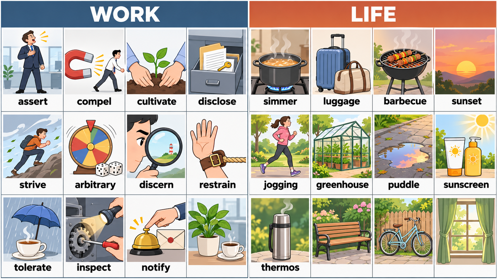

# 每日英语单词 20 个 · 2026-11-16（第 26 期）

> **定位**：面向 CET-6 六级高频/中频核心词汇，以职场和生活语境掌握常用义与搭配；六级与四级词汇存在重叠，本期不宣称逐词具有经统计核验的真题频次。
> **构成与去重**：职场 11 + 生活 9；避开两个历史索引全部 500 个词条，短语按逗号整体去重。本期累计 520 词。
> **记忆说明**：以下记忆提示分两类标注——「词根」为可确认的构词提示，「联想」为便于记忆的画面联想，不作严格词源考据；搭配辨析表示常见用法，不作绝对规则。
> **配套**：根目录 `每日20词-复习窗口.md` 与 `已推荐单词索引.md`。

## 场景记忆图

- 2026-11-16：请求模型 `gpt-image-2.5-flare`；实际尺寸 1672 × 941；耗时 50.6 秒。原图保留于 `/Users/insistgang/Pictures/Sub2API Images/gpt-image-2.5-flare-20261116-daily1116.png`，副本已归档至 `../场景配图/`。
- 本通道无法读图自检，尚未做视觉验收；画面仅用于联想，词义以正文为准。
- 左栏为现代办公区（WORK），右栏为暮色花园（LIFE）；跟随图中标签回忆每个词的画面抓手。

## 职场篇（11 词）

**1. assert** /əˈsɜːrt/
- **词义**：v. 断言，声称；主张（权利）；维护（立场、尊严）
- **例句**：She asserted that the delay was caused by the vendor, not by our team.
- **翻译**：她断言延误是供应商造成的，而不是我们团队造成的。
- **记忆提示**：词根 —— as（断言，同 assertive / assertion 同族）+ sert（连接、确立，同 insert / desert / assert 同源）——"把话说出来钉在某个位置上"，故是"断言、主张"。⚠️ 六级高频动词，搭配 assert that sth（不说 assert sth that）；assert oneself 表示"维护自己的立场/尊严"；名词 assertion。⚠️ 别与 insist（坚持要求，介词 on）混：assert 是"陈述事实"，insist 是"强烈要求"。

**2. compel** /kəmˈpel/
- **词义**：v. 强迫，迫使；使不得不
- **例句**：Compulsory overtime is the only thing that compels the team to deliver on time.
- **翻译**：强制加班是唯一能让团队按时交付的办法。
- **记忆提示**：词根 —— com（共同，完全，同 comprehensive / compete 同源）+ pel（推，同 expel / propel / repel / impulse 同族）——"被一起推着走"，故是"强迫、迫使"。⚠️ 固定搭配 compel sb to do sth（介词是 to，不是 for）；形容词 compulsory（强制的、必修的）是六级高频，名词 compulsion。⚠️ 别与 impulse（冲动）混，词根相同但方向相反。

**3. cultivate** /ˈkʌltɪveɪt/
- **词义**：v. 培养（习惯、品格）；耕作，栽培
- **例句**：Good leaders cultivate a culture where people dare to speak up.
- **翻译**：优秀的领导者培养出一种敢于发声的文化。
- **记忆提示**：词根 —— cult（耕种、栽培，同 culture / cultivate / agricultural 同源）+ iv（动词后缀，同 activate / create 同族）——"把一块地长期侍弄出来"，故本义是"耕作"，引申为"培养习惯与品格"。⚠️ 搭配 cultivate a habit / cultivate relationships / cultivate talent；名词 cultivation；形容词 cultivated（有教养的）。⚠️ 与 culture（名词「文化」）辨析：culture 作名词"文化"，cultivate 是动作"培养"。

**4. disclose** /dɪsˈkloʊz/
- **词义**：v. 揭露，透露，披露（信息）
- **例句**：The vendor refused to disclose how the data had been collected.
- **翻译**：供应商拒绝透露数据是如何收集的。
- **记忆提示**：词根 —— dis（分开，否定前缀，同 disclose / discard 同族）+ close（关闭，同 close / enclose / closet 同源）——"把关着的打开来给人看"，故是"揭露、披露"。⚠️ 固定搭配 disclose sth to sb；名词 disclosure。⚠️ 与 reveal 辨析：reveal 偏"把遮住的东西露出来"（视觉感），disclose 偏"正式告知、依法披露"（disclose information / disclose a document）。⚠️ 职场合规高频，disclose a conflict of interest 是六级作文可迁移表达。

**5. strive** /straɪv/
- **词义**：v. 努力，奋斗，尽力（for / to do sth）
- **例句**：He strove to keep the deadline while still reviewing the code.
- **翻译**：他努力在守住截止日期的同时还在复查代码。
- **记忆提示**：词根 —— striv（努力，同 strive / strious / industry 的 indus 同族，strife 亦同源）——"使出全身力气往上够"，故是"努力、尽力"。⚠️ 固定搭配 strive for sth（追求）或 strive to do sth（努力做）；名词 strife（冲突、争斗）也是同族词。⚠️ 六级写作替换 try hard for 的地道表达：strive to improve / strive for excellence。

**6. arbitrary** /ˈɑːrbɪtreri/
- **词义**：adj. 任意的，武断的；随意决定的，专断的
- **例句**：The rejection looked arbitrary, since no reason was ever given.
- **翻译**：这次拒绝看上去很武断，因为从未给出任何理由。
- **记忆提示**：词根 —— arbitr（裁决、判断，同 arbitrate / arbitration 同源；词源拉丁 arbitrare「裁决」）+ ary（形容词后缀，同 necessary / temporary 同族）——"凭某个人一句话裁决出来的"，故是"任意的、武断的"。⚠️ 六级写作替换 random 的高级词：an arbitrary decision / an arbitrary rule；名词 arbitrariness。⚠️ 反义是 reasonable（有道理的）；⚠️ 搭配 arbitrarily 副词用法。

**7. discern** /dɪˈsɜːrn/
- **词义**：v. 辨别，看出；察觉，识别出
- **例句**：From the tone of her voice, I could discern that she was not happy.
- **翻译**：从她的语气里，我能察觉出她并不开心。
- **记忆提示**：词根 —— dis（分开，同 discern / discernable 同源）+ cern（分开、区别，同 separate / certain 中的 cert 同族）——"把混在一起的东西分出来"，故是"辨别、看出"。⚠️ 搭配 discern a difference / discern that sth；形容词 discernible（可辨别的）、discerning（有眼力的）；名词 discernment（洞察力）。⚠️ 与 distinguish（11-08 已用）辨析见排雷台。

**8. restrain** /rɪˈstreɪn/
- **词义**：v. 抑制，克制；约束，制止；牵制（敌人）
- **例句**：He had to restrain his irritation in front of the whole team.
- **翻译**：他只得在全队面前压住自己的恼火。
- **记忆提示**：词根 —— re（回，往后）+ strain（拉、绷紧，同 strain / constrain / restriction 同源）——"把绷开的东西往回拉住"，故是"抑制、约束"。⚠️ 搭配 restrain oneself（克制自己）、restrain spending（控制开支）；名词 restraint / restraint；形容词 restrained（克制的）。⚠️ 与 restrain / constrain / restrict 三词辨析见排雷台。

**9. tolerate** /ˈtɑːləreɪt/
- **词义**：v. 容忍，忍受；容许，允许
- **例句**：The system can tolerate a ten percent loss in throughput without slowing down.
- **翻译**：这套系统能容忍吞吐量损失百分之十而不降速。
- **记忆提示**：词根 —— toler（忍受，同 tolerance / tolerant 同族；词源拉丁 tolerare「忍受」）+ ate——"硬扛下来"，故是"容忍、忍受"。⚠️ 固定搭配 tolerate sth / cannot tolerate；名词 tolerance（容忍、也指耐受度，医学语境 "drug tolerance"）。⚠️ 科技语境六级高频：the system tolerates a delay of X ms；⚠️ 别与 tolerate 的近义 bear / endure 混（见排雷台）。

**10. inspect** /ɪnˈspekt/
- **词义**：v. 检查，视察；仔细观察
- **例句**：An engineer inspected the deployment logs before the release went live.
- **翻译**：在上线之前，一位工程师检查了部署日志。
- **记忆提示**：词根 —— in（向内）+ spect（看，同 inspect / respect / spectator / perspective 同源）——"凑近了往里看"，故是"检查、视察"。⚠️ 搭配 inspect the site / inspection（名词，六级阅读高频）；动词 inspect 强调"逐项查看细节"，比 check 更正式。⚠️ 与 investigate（"深入调查原因"）区分见排雷台。

**11. notify** /ˈnoʊtɪfaɪ/
- **词义**：v. 通知，告知；正式告知（某人某事）
- **例句**：Please notify the support team as soon as the issue is reproduced.
- **翻译**：问题一旦复现，请尽快通知支持团队。
- **记忆提示**：词根 —— not（知道、记号，同 notice / notion / denote 同源）+ ify（使…，动词后缀，同 clarify / notify 同族）——"让对方知道"，故是"通知、告知"。⚠️ 固定搭配 notify sb of sth 或 notify sb that…（六级高频，介词是 of 不是 about）；名词 notification；名词 notice 也有"通知、告示"义，与动词 notify 同族。

## 生活篇（9 词）

**12. simmer** /ˈsɪmər/
- **词义**：v. 炖，小火慢煮；n. 炖；内心的激动（a simmer of anger）
- **例句**：Let the soup simmer for twenty minutes so the flavors can meld.
- **翻译**：让汤小火慢炖二十分钟，好让味道融合在一起。
- **记忆提示**：联想 —— 词源不确定，联想更可靠：想象锅底只有极细微的咕嘟声，蒸汽懒洋洋地飘着，火调到最小，让味道慢慢自己长出来——这就是"小火慢炖"。⚠️ 固定搭配 simmer for / let sth simmer；名词短语 a simmer of anger / a simmering resentment 是六级阅读常见表达。⚠️ 与 boil（煮沸）辨析见排雷台：simmer 偏"小火久炖"，boil 偏"大火快煮"。

**13. luggage** /ˈlʌɡɪdʒ/
- **词义**：n. 行李（不可数）
- **例句**：My luggage was delayed for two days after the international flight.
- **翻译**：国际航班之后，我的行李被延误了两天。
- **记忆提示**：词根 —— lug（拖、提，同 luggage / luggage 词族；词源可能与 drag「拖」同族，此处不作绝对考据）——"一路拖着走的东西"，故是"行李"。⚠️ 不可数名词，不说 luggages；固定搭配 check in one's luggage / carry-on luggage（随身行李）/ luggage claim（行李提取处）。⚠️ 与 baggage（11-11 前的历史词不在本期）辨析：baggage 更偏"全部随身行李"，luggage 更通用、更口语。

**14. barbecue** /ˈbɑːrbɪkjuː/
- **词义**：n. 烧烤；烤架；v. 烧烤（食物）
- **例句**：We barbecue in the yard every summer weekend.
- **翻译**：我们每个夏天的周末都在院子里烧烤。
- **记忆提示**：词根 —— bar（横条，同 bar / barrier 同源）+ becue（来自西班牙 barbacoa「烤架」）——"架在横条上用火烤"，故是"烧烤"。⚠️ 常用搭配 barbecue ribs / backyard barbecue / barbecue sauce；美式口语里动词直接用 barbecue。⚠️ 与 grill（烤架）、roast（烘烤）辨析见排雷台。⚠️ 拼写是 barbecue（美式）或 barbeque（英式变体），不是 barbecueue。

**15. sunset** /ˈsʌnset/
- **词义**：n. 日落，落日；日落时分
- **例句**：We hiked to the ridge to watch the sunset over the valley.
- **翻译**：我们爬到山脊上，看山谷对面的日落。
- **记忆提示**：词根 —— sun（太阳）+ set（落下，同 sunset / setting sun / set 同源；"日落的 set"即"落"）——"太阳落下去的那一刻"，故是"日落、落日"。⚠️ 固定搭配 watch the sunset / at sunset / sunset glow（晚霞）；⚠️ 与 dawn / dusk 辨析见排雷台：sunset 是"日落这件事或那一刻"，twilight（11-15 已用）是"日落后的微明时段"。

**16. jogging** /ˈdʒɑːɡɪŋ/
- **词义**：n. 慢跑，跑步锻炼
- **例句**：He goes jogging along the river every morning before work.
- **翻译**：他每天上班前沿着河慢跑。
- **记忆提示**：词根 —— jog（轻推、颠簸，同 jogging / jostle / juggle 同源）——"小步地、有节奏地颠着跑"，故是"慢跑、锻炼跑"。⚠️ 搭配 go jogging / jogging shoes（跑鞋）/ jogging track（跑道）；注意 jogging 是"锻炼性慢跑"，race 是"比赛性跑步"。⚠️ 与 hike（远足徒步，11-10 已用）辨析：jogging 是慢跑锻炼，hike 是走长途山路。

**17. greenhouse** /ˈɡriːnhaʊs/
- **词义**：n. 温室，暖房；glasshouse
- **例句**：She grew tomatoes in a small greenhouse behind the house.
- **翻译**：她在屋后的一间小温室里种西红柿。
- **记忆提示**：词根 —— green（绿色的，同 green / greenery 同源）+ house（房屋，同 greenhouse / farmhouse 同族）——"给绿色植物盖的屋子"，故是"温室"。⚠️ 比喻义是六级阅读高频：the greenhouse effect（温室效应）；搭配 greenhouse gases（温室气体）。⚠️ 拼写是一个词 greenhouse，不是 green house。

**18. puddle** /ˈpʌdl/
- **词义**：n. 水坑，水洼
- **例句**：A deep puddle formed at the edge of the road after the storm.
- **翻译**：暴风雨过后，路边积起了一个深水坑。
- **记忆提示**：联想 —— 词源不确定，联想更可靠：想象雨后路面凹下去的地方积了一小汪水，路人绕着走，鞋踩进去溅起水花——这汪浅水就是"puddle"。⚠️ 搭配 splash through a puddle / a puddle of water；动词 puddle 指"积水成洼"。⚠️ 与 pool（成片的水池）、pond（池塘）辨析见排雷台。

**19. sunscreen** /ˈsʌnskriːn/
- **词义**：n. 防晒霜，防晒霜；防晒用品
- **例句**：She applies sunscreen before every long walk on the beach.
- **翻译**：她在海滩上每次长距离散步前都会涂防晒霜。
- **记忆提示**：词根 —— sun（太阳，同 sun / sunburn 同源）+ screen（屏障、遮蔽物，同 screen / sunscreen / insect screen 同族）——"给皮肤加的一层太阳屏障"，故是"防晒霜"。⚠️ 常见搭配 wear sunscreen / sunscreen lotion / SPF（防晒指数）；名词 sunblock 是另一个近义说法。⚠️ 与 sunscreen 相关的常见词 sunbathe（晒太阳）、sunburn（晒伤）也是同族高频。

**20. thermos** /ˈθɜːrmoʊs/
- **词义**：n. 保温瓶，保温杯（商标名泛化）
- **例句**：She poured hot tea from her thermos into a paper cup.
- **翻译**：她把保温杯里的热茶倒进纸杯里。
- **记忆提示**：词根 —— thermo（热，同 thermometer / thermostat / thermal 同源）+ s（名词后缀，同 thermos 同族）——"保持热度的东西"，故是"保温瓶"。⚠️ 源自德语 Thermos，后泛指保温杯；口语常缩作 "thermos flask"。⚠️ 近义容器辨析见排雷台：thermos（保温杯）/ flask（长颈瓶）/ bottle（通用瓶）。

## 助记卡（词根/画面抓手 + 高频搭配）

| 单词 | 词根/画面抓手 | 高频搭配 |
|---|---|---|
| assert | as（断言）+ sert（钉住）→ 把话钉在某个位置 | assert that sth |
| compel | com + pel（推）→ 被一起推着走 | compel sb to do sth |
| cultivate | cult（耕作）+ iv → 把地侍弄出来 | cultivate a habit |
| disclose | dis + close（打开）→ 把关着的打开给人看 | disclose sth to sb |
| strive | striv（努力）→ 使出全身力气往上够 | strive to do sth |
| arbitrary | arbitr（裁决）+ ary → 凭一句话裁决出的 | an arbitrary decision |
| discern | dis + cern（分开）→ 把混的分开 | discern a difference |
| restrain | re + strain（拉住）→ 把绷开的往回拉 | restrain oneself |
| tolerate | toler（忍受）→ 硬扛下来 | tolerate a delay of X ms |
| inspect | in + spect（看）→ 凑近往里看 | inspect the site |
| notify | not（知道）+ ify → 让对方知道 | notify sb of sth |
| simmer | 小火慢炖，蒸汽懒洋洋地飘 | let sth simmer |
| luggage | 一路拖着走的东西 | check in one's luggage |
| barbecue | 架在横条上用火烤 | backyard barbecue |
| sunset | sun + set（落）→ 太阳落下的那一刻 | watch the sunset |
| jogging | 小步、有节奏地颠着跑 | go jogging |
| greenhouse | green + house → 给绿色植物盖的屋子 | the greenhouse effect |
| puddle | 雨后路面凹处的一小汪水 | a puddle of water |
| sunscreen | sun + screen（屏障）→ 给皮肤加的屏障 | wear sunscreen |
| thermos | thermo（热）+ s → 保持热度的东西 | a thermos flask |

## 一句话串记

**职场线**：她 **assert** 延误不在我们头上，规则 **compel** 大家服从，团队 **cultivate** 出敢说话的风气，报告 **disclose** 全部细节；他想 **strive** 守住期限，却被 **arbitrary** 的临时改期打乱，只能 **discern** 规则漏洞，**restrain** 情绪、**tolerate** 反复，最后 **inspect** 日志、**notify** 全员。

**生活线**：周末 **barbecue** 的肉在炉上 **simmer** 得滋滋响；行李 **luggage** 堆在门口，等着看一场 **sunset**；**jogging** 到河堤，再拐进 **greenhouse**；雨后踩过一滩 **puddle**，涂好 **sunscreen**，拧开 **thermos** 喝口热茶。

## 记忆宫殿 · 双线场景故事

### 职场线（11 词）· 从一张质询台到一封通知函

推开写字楼的大门，前台是一位挺直腰板、一手按胸、下巴微抬正在发言的人——那语气是在 **assert**（断言）自己没错；转过走廊，一只巨大的磁铁正把一个低头赶路的人往前拽——那是规则在 **compel**（强迫）人服从；花园区里，两双手小心翼翼地在黑色土中培土、扶正一株小苗——这是 **cultivate**（培养）习惯与品格；档案室的抽屉被拉开，一个文件夹敞开，纸页和钥匙一起滑出来——这是 **disclose**（披露）；楼梯间里，一个跑步的人顶着狂风往陡坡上攀，鞋底打滑也没停——这是 **strive**（努力）；旋转的箭头盘旁边滚着两颗骰子，指针落在谁也没定的刻度上——这是 **arbitrary**（武断）；窗边一只眼睛正透过放大镜盯着远处一个几乎看不见的小点——这是 **discern**（辨别）；会议室门口，一只手腕被皮带与绳子往后拽住——这是 **restrain**（克制）；茶水间那只茶杯稳稳坐在热蒸汽里，旁边一把小伞在雨中撑开——这是 **tolerate**（容忍）；机房的灯下，一束手电光与一把螺丝刀正贴近检查一个零件——这是 **inspect**（检查）；最后，前台桌面上一只手正摇响黄铜桌铃，旁边放着封口的信封——这是 **notify**（通知）。这一天的职场闭环。

> 画面链：按胸抬头发言的人 → 磁铁拽住赶路人 → 培土扶苗的双手 → 滑出钥匙的文件夹 → 顶风爬坡的跑者 → 箭头盘与骰子 → 放大镜后的小点 → 被皮带拽住的手腕 → 热蒸汽里的茶杯与雨伞 → 手电与螺丝刀 → 摇响的桌铃与信封。

### 生活线（9 词）· 从午后炭火到一壶热茶

午后的院子，炭火正旺，肉串架在烤网上滋滋冒油——这是 **barbecue**（烧烤）；旁边的炉子上有一口小锅，火调到最小，锅底只有细微的咕嘟声，蒸汽懒洋洋地飘——这是 **simmer**（小火慢炖）；玄关处，一只行李箱叠着一只帆布旅行包，标签朝外——这是 **luggage**（行李）；傍晚走向山脊，太阳正一寸一寸沉下去，把整条山谷镀成橘红——这是 **sunset**（日落）；清晨的河堤上，一个人穿着跑鞋轻快地点着步子——这是 **jogging**（慢跑）；拐进后院，一间玻璃小屋里满是青翠的番茄苗——这是 **greenhouse**（温室）；雨后的石板路上积了一小汪水，倒映着天光，鞋踩过去溅起水花——这是 **puddle**（水洼）；出门前在阳光下拧开那管白色防晒霜，瓶子反着光——这是 **sunscreen**（防晒霜）；黄昏归家，拧开随身的保温瓶，一口热茶滑进喉咙——这是 **thermos**（保温瓶）。生活的一天收在一壶热茶里。

> 画面链：滋滋冒油的炭火烤网 → 小火咕嘟冒蒸汽的锅 → 玄关的行李箱与帆布包 → 沉入山谷的橘红太阳 → 河堤上点步慢跑的身影 → 玻璃小屋里的青翠番茄苗 → 石板路上的水洼与倒影 → 阳光下反光的防晒霜 → 拧开冒热气的保温瓶。

## 排雷台（20 组易混与搭配辨析）

| 辨析 | 关键差别与常见搭配 |
|---|---|
| assert / insist / claim / state | assert 是"断言、主张"，语气坚定（assert that sth / assert oneself）；insist 是"坚决要求"，接人（insist on sth）；claim 是"声称（未必属实）"（claim to be / a patent claim）；state 是"平铺直叙地陈述"（state the reason）。 |
| compel / force / oblige / impel | compel 是"迫使（客观力量）"（compel sb to do sth）；force 偏"用强力逼迫"（force sb into a corner）；oblige 偏"施恩让人不得不"（be obliged to do）；impel 偏"激发出强烈动机"（impel sb to action）。 |
| cultivate / nurture / foster / develop | cultivate 偏"长期耕作、慢慢培养"（cultivate a habit / cultivate soil）；nurture 偏"滋养、抚育"（nurture talent / nurture a child）；foster 偏"促成、鼓励"（foster cooperation，11-09 已用）；develop 泛指"发展"（develop a skill）。 |
| disclose / reveal / expose / leak | disclose 偏"正式披露信息"（disclose the data to sb）；reveal 偏"把遮住的东西露出来"（reveal a secret）；expose 偏"暴露问题、揭穿"（expose corruption）；leak 偏"不慎走漏"（the news leaked out）。 |
| strive / try / attempt / endeavor | strive 是"持续用力、长期奋斗"（strive for excellence / strive to improve）；try 泛用；attempt 偏"尝试一次"（make an attempt）；endeavor 书面正式（endeavor to do sth）。 |
| arbitrary / random / subjective / Capricious | arbitrary 偏"凭权威随意决定"（an arbitrary decision / arbitrary rule）；random 偏"随机无规律"（random sample）；subjective 偏"因人而异、带个人判断"（subjective opinion）；capricious 偏"反复无常"（多形容人）。 |
| discern / distinguish / detect / perceive | discern 是"看出细微差别"（discern a difference）；distinguish 是"把两者区分开"（distinguish A from B，11-08 已用）；detect 是"探测到、查出"（detect fraud / detect a leak）；perceive 是"感知到"（perceive a change，11-07 已用）。 |
| restrain / restrict / constrain / suppress | restrain 是"抑制住自己"（restrain oneself / restrain laughter）；restrict 是"限定范围"（restrict access）；constrain 是"以规则或条件束缚"（constrain growth）；suppress 是"强行压制下去"（suppress emotion / suppress output）。 |
| tolerate / bear / endure / withstand | tolerate 偏"容忍不适"（cannot tolerate the noise）；bear 泛用（bear pain）；endure 偏"长期忍受、耐久"（endure hardship / the bridge endured 30 years）；withstand 偏"顶住外力"（withstand pressure / withstand earthquakes）。 |
| inspect / examine / check / investigate | inspect 是"逐项检查细节"（inspect the equipment）；examine 偏"仔细研究"（examine the data）；check 是"快速核对"（check the figures）；investigate 是"深入调查原因"（investigate the cause）。 |
| notify / inform / alert / notify | notify 是"正式通知某人某事"（notify sb of sth）；inform 泛指"告知信息"（inform sb of）；alert 是"发出警报、提醒注意"（alert sb to danger）；**注意 notify 的介词是 of，inform 的介词也是 of，但 alert 接 to**。 |
| simmer / boil / stew / braise | simmer 是"小火慢炖"（let it simmer / a simmer of anger）；boil 是"大火沸腾快煮"（boil water）；stew 是"文火长时间炖煮"（stewed beef，11-10 已用）；braise 是"先煎后焖"（braised short ribs）。 |
| luggage / baggage / suitcase / bags | luggage 是"行李"通用词（不可数，check in your luggage）；baggage 更偏"随身携带的行李"，美式口语中已被 luggage 取代；suitcase 是"手提箱"；bags 是"袋子的总称"。 |
| barbecue / grill / roast / fry | barbecue 是"用炭火烤"（a backyard barbecue）；grill 既指"烤架"也指"烤"（grilled chicken）；roast 是"烤整块、烘烤"（roast beef）；fry 是"煎炸"（deep-fry）。 |
| sunset / dusk / twilight / dawn | sunset 是"日落这件事或那一刻"（watch the sunset）；dusk 是"黄昏、天色暗下来"（11-09 已用）；twilight 是"日落后的微明过渡段"（11-15 已用）；dawn 是"黎明"（11-14 已用）。 |
| jogging / running / hiking / strolling | jogging 是"锻炼性慢跑"（go jogging）；running 是泛指"跑步"；hiking 是"走长途山路"（11-10 已用）；strolling 是"闲步散步"（10-31 已用）。 |
| greenhouse / glasshouse / conservatory | greenhouse 是"种植物用的温室"（the greenhouse effect）；glasshouse 在英式里指"玻璃暖房/温室"，也指大型温室式建筑；conservatory 是"暖房，冬天养花的玻璃房"，也可指"音乐学院附设的教室"。 |
| puddle / pool / pond | puddle 是"路面上一小汪水"（a puddle of water）；pool 是"成片的水池、泳池"（swimming pool）；pond 是"池塘"（ducks in a pond）。 |
| sunscreen / sunblock / suntan / sunburn | sunscreen 是"防晒霜"（wear sunscreen / SPF）；sunblock 是近义说法，更强调"完全阻断"；suntan 是"晒成的古铜色"；sunburn 是"晒伤"（get a sunburn）。 |
| thermos / flask / bottle / flask | thermos 是"保温瓶、保温杯"（a thermos flask）；flask 偏"扁平长颈容器"（a hip flask / a thermos flask 才是保温瓶）；bottle 是"瓶子"最通用；canteen 是"军用水壶、保温壶"（水壶语境）。 |

## 快速自测（5 题 · 答案折叠）

**1. 介词与搭配填空**：Please ______ the support team ______ the issue as soon as it is reproduced.（从 notify / inspect / disclose 中选择，并补上正确介词）

**2. 选词填空**：Good leaders ______ a culture where people dare to speak up, and they ______ to keep the deadline.（从 cultivate / strive / compel / restrain 中选择两个）

**3. 中译英**：她断言延误是供应商造成的，而不是我们团队造成的。

**4. 词形与辨析**：在 "an ______ decision"、"a ______ risk of delay" 和 "she ______ herself before answering" 中，分别对应"武断的决定"、"延迟的风险"和"她在回答前克制住自己"。

**5. 生活场景选词**：We ______ the soup for twenty minutes, then sat on the porch to watch the ______ with a cup of tea.（从 simmer / barbecue / sunset / jogging / thermos 中选择三个）

点击展开答案

1. **notify the support team of the issue**。固定搭配是 notify sb of sth 或 notify sb that…（介词是 of，不是 about 或 to）；disclose 是"披露（信息）"，inspect 是"检查（实物）"，句中"通知某人某事"只能用 notify。⚠️ 若用 inform，介词同样是 of（inform sb of sth）；alert 才接 to。
2. **cultivate；strive**。cultivate a culture 是"培养一种文化"的固定搭配；strive to keep the deadline 是"努力守住期限"（strive to do sth）。⚠️ compel sb to do sth 的主语通常是规则或制度，不是 leaders（leaders 主语更自然搭配 cultivate）；restrain oneself 是"克制自己"，与句意不合。
3. **She asserted that the delay was caused by the vendor, not by our team.** 核心是 assert that sth（that 从句不能省）；assert 表示"有把握地断言"，比 claimed 语气更肯定。⚠️ 别写成 assert the delay was caused…（漏 that），也别说 assert sb to do。
4. 依次是 **arbitrary / arbitrary / restrain**。an **arbitrary** decision = 凭一句话定下的武断决定；a **arbitrary** risk of delay 语义不通——"延迟的风险"应是 a real / serious / considerable risk of delay，若题目要求的是"风险"这一概念，可用 tangible risk（11-14 已用）或 inevitable risk（11-15 已用）；she **restrained** herself = 她克制住了自己（restrained 是 restrain 的过去式/过去分词）。⚠️ 本题第 2 空原题表述有歧义，正确填法是：an arbitrary decision / a considerable risk of delay / restrained herself。
5. **simmer；sunset；thermos**。**simmer** the soup 是"小火慢炖"（注意不是 boil）；watch the **sunset** = 看日落；a cup of tea from a **thermos** = 保温杯里的茶。⚠️ barbecue 是"烧烤"（动词带食物），jogging 是"慢跑"，都不合句意。

---

*第 26 期 · 2026-11-16 · 本期 20 词 · 累计 520 词 · 唯一资料真源：每日英语单词/*
