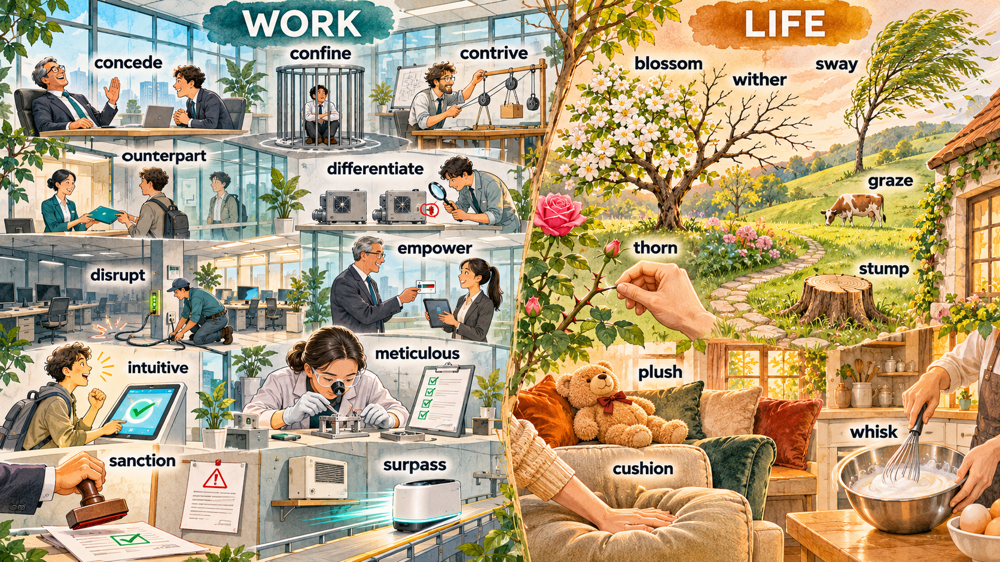

# 每日英语单词 20 个 · 2026-11-17（第 27 期）

> **定位**：面向 CET-6 六级高频/中频核心词汇，以职场和生活语境掌握常用义与搭配；六级与四级词汇存在重叠，本期不宣称逐词具有经统计核验的真题频次。
> **构成与去重**：职场 11 + 生活 9；避开两个历史索引全部 520 个词条，短语按逗号整体去重。本期累计 540 词。
> **记忆说明**：以下记忆提示分两类标注——「词根」为可确认的构词提示，「联想」为便于记忆的画面联想，不作严格词源考据；搭配辨析表示常见用法，不作绝对规则。
> **配套**：根目录 `每日20词-复习窗口.md` 与 `已推荐单词索引.md`。

## 场景记忆图

- 2026-11-17：请求模型 `gpt-image-2.5-flare`；实际尺寸 1672 × 941；耗时 61.75 秒。原图保留于 `/Users/insistgang/Pictures/Sub2API Images/gpt-image-2.5-flare-20261117-daily1117.png`，副本已归档至 `../场景配图/`。
- 本通道无法读图自检，尚未做视觉验收；画面仅用于联想，词义以正文为准。
- 左栏为现代办公区（WORK），右栏为金色时分的乡间庭院与厨房（LIFE）；跟随图中标签回忆每个词的画面抓手。

## 职场篇（11 词）

**1. concede** /kənˈsiːd/
- **词义**：v.（在争论或压力下）让步，承认；把（胜利、分数）让给对手
- **例句**：After hours of negotiation, we finally conceded a discount to close the deal.
- **翻译**：经过数小时谈判，我们终于让出一个折扣，把单子谈成了。
- **记忆提示**：词根 —— con（共同）+ cede（让出、放弃，词源拉丁 cedere「退让、退让」；同族 concession「让步、优惠」）——"往后退一步，把东西让出去"，故是"让步、承认"。⚠️ 六级阅读高频词：concede that sth（承认某事）、concede defeat（承认失败）；名词 concession（让步、优惠 concession price）。⚠️ 与 consent（同意，11-11 已用）辨析：consent 是"同意许可"，concede 是"在压力下退让"。

**2. confine** /kənˈfaɪn/
- **词义**：v. 把…限制在（某范围内）；禁闭；使不能离开
- **例句**：Please confine the discussion to the two remaining features.
- **翻译**：请把讨论限制在剩下的两个功能上。
- **记忆提示**：词根 —— con（共同）+ fin（边界、界限，词源拉丁 finis「边界、终点」，同 finish / final 同族）——"画出界线把人围在里面"，故是"限制、禁闭"。⚠️ 固定搭配 confine sb/sth to sth；名词 confinement；形容词 confined（受限的）。⚠️ 与 restrain（克制自己，11-16 已用）辨析：restrain 管的是自己，confine 管的是范围。

**3. contrive** /kənˈtraɪv/
- **词义**：v. 想出，设法做到（多指的办法或计谋）；策划
- **例句**：He contrived a clever workaround to meet the deadline without extra budget.
- **翻译**：他设法想出一个巧妙的变通办法，不追加预算也赶上了截止日期。
- **记忆提示**：词根 —— con（共同）+ triv（寻找，同 contrivance「精巧装置」同源）——"费劲心思去找出一条路"，故是"想出办法、策划"。⚠️ 六级阅读常与 ingenious 同现（contrived an ingenious solution）；名词 contrivance（精巧的装置、权宜之计）；形容词 contrived（人为做作的、不自然的）。⚠️ 与 devise（设计出方案，10-28 已用）辨析：devise 偏"正式设计"，contrive 偏"想出巧办法，常带精巧或勉强意味"。

**4. counterpart** /ˈkaʊntərpɑːrt/
- **词义**：n. 职位相当的人，对应的人或物；（契约等的）正本
- **例句**：Our sales lead met her counterpart in the partner company over video.
- **翻译**：我们的销售负责人通过视频会见了合作公司的对应负责人。
- **记忆提示**：词根 —— counter（相对、对应的，同 counterpart / counteract / counter- 系列）+ part（部分，同 part / partition / partial 同族）——"对等的那一方"，故是"职位相当的人、对应物"。⚠️ 固定搭配 the counterpart to/of sb/sth；商务英语高频（business counterpart / foreign counterpart）。⚠️ 与 peer（同级、同辈）辨析：peer 多指同辈同身份的人，counterpart 强调"在另一组织中扮演相同角色的人"。

**5. differentiate** /ˌdɪfəˈrenʃieɪt/
- **词义**：v. 区分，区别；使有差异；分化
- **例句**：It's hard to differentiate our service from cheaper rivals at first glance.
- **翻译**：乍一看，很难把我们的服务和更便宜的竞争对手区分开。
- **记忆提示**：词根 —— different（不同的，同 differentiate / different 同源）+ iate（动词后缀，同 initiate / associate 同族）——"把不同的点标出来"，故是"区分"。⚠️ 搭配 differentiate A from B、differentiate between A and B；形容词 different / differentiability 之外还有 differentiated（差异化的、精准定位的），是六年级商业写作的高频词（differentiated positioning 差异化定位）。⚠️ 与 distinguish（区分两者，11-08 已用）辨析见排雷台。

**6. disrupt** /dɪsˈrʌpt/
- **词义**：v. 扰乱，打断；使中断；颠覆（既有格局）
- **例句**：A power outage disrupted the whole workshop for two hours.
- **翻译**：一次停电让整个研讨会中断了两小时。
- **记忆提示**：词根 —— dis（分开）+ rupt（断，同 interrupt / erupt / rupture 同源）——"把连着的东西硬断开"，故是"扰乱、中断"。⚠️ 六级阅读高频：disrupt the supply chain / disrupt the market / be disrupted by；名词 disruption。⚠️ 与 interrupt（打断某人说话）辨析：interrupt 打断的是话或进程，disrupt 更强调"打乱既有秩序、造成混乱"。

**7. empower** /ɪmˈpaʊər/
- **词义**：v. 授权，使有权做；使有能力；赋能
- **例句**：The new policy empowers junior staff to approve small refunds on their own.
- **翻译**：新政策授权初级员工自行审批小额退款。
- **记忆提示**：词根 —— em（使，同 empower / employ / embrace 同族）+ power（力量，同 power / powerful / powerless 同源）——"把力量交到某人手里"，故是"授权、赋能"。⚠️ 固定搭配 empower sb to do sth；名词 empowerment（赋能），是职场英语与商业写作的高频词（employee empowerment 员工赋能）。⚠️ 与 enable（使能够，11-07 语境已用）辨析：enable 只讲"使之有能力"，empower 强调"给权限、给决定权"。

**8. intuitive** /ɪnˈtuːɪtɪv/
- **词义**：adj. 直觉的，凭直觉的；易懂的，一学就会的
- **例句**：The new dashboard is far more intuitive than the old spreadsheet.
- **翻译**：新的看板比旧表格直观得多。
- **记忆提示**：词根 —— in（向内）+ tu（看，同 intuit / tuition / 拉丁 tueri「看」同源）+ itive（形容词后缀，同 creative / native 同族）——"向内看"，即不靠推理、直接"看见"，故是"直觉的"。⚠️ 搭配 an intuitive interface / intuitive grasp；名词 intuition（直觉）也是六级高频。⚠️ 与 instinctive（本能的）辨析：instinctive 是"动物式的本能反应"，intuitive 是"经过熟悉之后形成的、说得清理由的直觉"。

**9. meticulous** /məˈtɪkjələs/
- **词义**：adj. 一丝不苟的，极细致的；一丝不苟地精确的
- **例句**：She kept meticulous records of every change made to the model.
- **翻译**：她把对模型做的每一处改动都记录得一丝不苟。
- **记忆提示**：联想 —— 想象一个拿着放大镜、屏住呼吸、连一颗螺丝都要复核三遍的匠人；"连最细小处都不放过"。⚠️ 词源不确定，联想更可靠。⚠️ 固定搭配 meticulous about sth（在某方面极其细致）、meticulous attention to detail；副词 meticulously。⚠️ 与 precise（精确的）辨析：precise 讲"数据准确"，meticulous 讲"过程一丝不苟、细节不放过"。

**10. sanction** /ˈsæŋkʃn/
- **词义**：n. 制裁；批准，认可（复数）；v. 批准，认可；对…实施制裁
- **例句**：The board finally sanctioned the plan after two months of review.
- **翻译**：董事会经过两个月的审议终于批准了这个方案。
- **记忆提示**：词根 —— sanct（神圣，同 sanction / sanctuary / saint 同源，拉丁 sanctus「神圣的」）——"因神圣而不可违犯，故予以认可（sanction 支持、批准）"；另一支含义是"施加惩罚与限制"，故 sanction 同时有"批准"与"制裁"两个相反义项。⚠️ 这是六级最经典的"一词两义"陷阱词，阅读中若接 impose sanctions on sb 则是"制裁"，若接 the plan/our request 则是"批准"。⚠️ 搭配 impose/lift sanctions on sb；名词 approval 义用复数 sanctions。

**11. surpass** /sərˈpɑːs/
- **词义**：v. 超过，胜过；比…更优
- **例句**：This quarter's revenue surpassed the entire first half of last year.
- **翻译**：本季度的收入超过了去年整个上半年。
- **记忆提示**：词根 —— super（超过，同 surpass / superior / superb / super- 系列同族）+ pass（经过，同 pass / passage / passport 同源）——"从旁边超越过去"，故是"超过、胜过"。⚠️ 固定搭配 surpass sb/sth in sth（在某方面超过）；六级阅读常见句型 A surpasses B in terms of…。⚠️ 与 exceed（超出，11-05 已用）辨析：exceed 偏"超过某个数量/上限"，surpass 偏"胜过对手、优于前者"，强调比较关系。

## 生活篇（9 词）

**12. blossom** /ˈblɑːsəm/
- **词义**：n. 花朵；v. 开花；发展，繁荣（常与 as…goes on 搭配）
- **例句**：The cherry tree by the gate was in full blossom last week.
- **翻译**：门口那棵樱桃树上周开满了花。
- **记忆提示**：词根 —— blom/bloss（花苞绽放，同 blossom / bloom 同源）——"花苞裂开"，故是"开花"。⚠️ 习语 the blossom of youth（青春年华）、a blossom of talent 是六级作文可迁移表达；动词义"迅速发展"（her career blossomed）。⚠️ 与 bloom（开花、盛放）辨析见排雷台。

**13. wither** /ˈwɪðər/
- **词义**：v. 枯萎，凋谢；使萎缩，使衰弱
- **例句**：The heat withered the roses along the south wall.
- **翻译**：高温让南墙边的玫瑰枯萎了。
- **记忆提示**：词根 —— wither 与 with（同干枯、枯萎）同源，中古英语 witheren「变干、失去水分」——"水分抽干就枯"。⚠️ 动词既可作不及物（花自己枯了），也可作及物（wither the crops）；形容词 withered（枯萎的、憔悴的）常用来写人（a withered face）。⚠️ 与 wilt（枯萎）辨析：wilt 是"因缺水而蔫、倒下"，wither 更偏"彻底干枯、萎缩"。

**14. sway** /sweɪ/
- **词义**：v. 摇动，前后摆动；使动摇，影响；n. 支配，影响
- **例句**：The tall bamboo swayed gently in the evening breeze.
- **翻译**：高高的竹子在晚风里轻轻摇摆。
- **记忆提示**：词根 —— 来自古英语 sweog「摇动」，与 swerve（转向）、sway 同族 —— "从这一侧荡到那一侧"。⚠️ 名词义"影响、支配"是六级阅读常考点：hold sway over sth（对…有支配力）。⚠️ 与 swing（摆动固定支点的钟摆）辨析：swing 靠支点与惯性，sway 是整体柔韧地晃。

**15. thorn** /θɔːrn/
- **词义**：n. 刺，荆棘；麻烦，烦心事
- **例句**：She picked the rose without getting pricked by a single thorn.
- **翻译**：她摘下那朵玫瑰，一根刺也没被扎到。
- **记忆提示**：词根 —— thorn（刺，同 thorny / thorn 刺 同源）——"玫瑰有刺"，引申为"难缠的事"；形容词 thorny（多刺的、棘手的，如 a thorny issue 棘手问题）是六级写作替换 difficult 的好词。⚠️ 固定搭配 a thorn in sb's side（眼中钉、肉中刺）。

**16. graze** /ɡreɪz/
- **词义**：v. 吃草，放牧；擦过，蹭过；n. 擦伤
- **例句**：A few cows grazed on the hillside behind our cottage.
- **翻译**：几头牛在我们小屋后面的山坡上吃草。
- **记忆提示**：词根 —— graze 与 grass（草，同 graze / grazing 同源）——"低头啃草"，故是"吃草、放牧"。⚠️ 搭配 graze on sth（吃/蹭某物）、graze cattle（放牧）；名词 a graze 是"擦伤"。⚠️ 与 browse（漫步采食，11-06 已用）辨析：browse 是"边走边挑选着吃"，graze 是"低头啃食眼前草"。

**17. plush** /plʌʃ/
- **词义**：adj. 毛绒的，长毛的；高级的，奢华的（俚语义）；n. 毛绒玩具
- **例句**：The corner of the sofa was piled with plush cushions.
- **翻译**：沙发的角落里堆着毛绒靠垫。
- **记忆提示**：联想 —— 手指按下去会陷进去的厚绒面料，毛绒玩具熊的手感；引申为"高级、奢侈的"（a plush hotel 豪华酒店）。⚠️ 词源不确定，联想更可靠。⚠️ 与 velvet（丝绒）、down（羽绒）辨析：plush 强调"长毛蓬松的手感"，down 强调"轻软的填充物"。

**18. cushion** /ˈkʊʃn/
- **词义**：n. 坐垫，垫子；v. 缓冲，减轻（冲击）
- **例句**：Soft cushions absorbed the impact of the heavy toolbox.
- **翻译**：柔软的垫子吸收了沉重工具箱的冲击。
- **记忆提示**：词根 —— cushion 与 sough（轻风声）可能同源，词源不确定，联想更可靠 —— "厚厚一层把冲击力吃掉"，故名词是"垫子"，动词是"缓冲"。⚠️ 动词义在商务语境有用：cushion the impact of price rises（缓冲涨价冲击）；搭配 cushion against sth。

**19. whisk** /wɪsk/
- **词义**：v. 搅打（蛋清等）；快速挥动；n. 蛋刷，打蛋器
- **例句**：Whisk the egg whites until they turn into stiff peaks.
- **翻译**：把蛋清搅打到变成坚挺的尖峰。
- **记忆提示**：词根 —— whisk 与 brush（刷子，同 whisk / whisker 胡须 同源）——"一把小刷子快速来回刷"，故是"搅打、快速挥动"。⚠️ 固定搭配 whisk sth（搅打某物）、whisk sth away（一挥手带走 / 一扫而空）；名词 whisk 就是"打蛋器"。⚠️ 与 stir（搅拌）、beat（打发）辨析见排雷台。

**20. stump** /stʌmp/
- **词义**：n. 树桩；残根；断肢；v. 使困惑，使无言以对
- **例句**：A freshly cut stump sat in the grass by the orchard path.
- **翻译**：果园小径旁的草地上坐着一截刚砍下的树桩。
- **记忆提示**：联想 —— 想象树被锯断后留在地面的那个圆滚滚的残根，像地面盖了一枚印章；词源不确定，联想更可靠，故是"树桩"。⚠️ 动词义"使无言以对"是六级阅读考点：be stumped by sth（被某问题难住）；名词 stump 也有"竞选演讲台"义（on the stump）。

## 助记卡（词根/画面抓手 + 高频搭配）

| 单词 | 词根/画面抓手 | 高频搭配 |
|---|---|---|
| concede | con + cede（让出）→ 往后退一步 | concede a discount |
| confine | con + fine（界线）→ 画出界线围住 | confine sth to sth |
| contrive | con + triv（寻找）→ 费心思找出一条路 | contrive a solution |
| counterpart | counter（相对）+ part → 对等的那一方 | business counterpart |
| differentiate | different + iate → 把不同的点标出来 | differentiate A from B |
| disrupt | dis + rupt（断）→ 把连着的硬断开 | disrupt the supply chain |
| empower | em + power（力量）→ 把力量交到手上 | empower sb to do sth |
| intuitive | in + tu（看）→ 向内看，不靠推理 | intuitive interface |
| meticulous | 放大镜下复核三遍螺丝 | meticulous about sth |
| sanction | sanct（神圣）→ 认可 / 制裁 | impose sanctions on sb |
| surpass | super + pass（经过）→ 从旁超越 | surpass sb in sth |
| blossom | 花苞裂开 | in full blossom |
| wither | 水分抽干就枯 | wither in the heat |
| sway | 柔韧地整体晃 | hold sway over sth |
| thorn | 玫瑰有刺 | a thorn in sb's side |
| graze | graze / grass（草）→ 低头啃草 | graze on sth |
| plush | 长毛蓬松、按下去会陷 | plush cushions |
| cushion | 厚厚一层吃掉冲击 | cushion the impact |
| whisk | 小刷子快速来回刷 | whisk the egg whites |
| stump | 砍完留下的圆形残根 | be stumped by sth |

## 一句话串记

**职场线**：谈判桌上先 **concede** 一个折扣，条件是别把讨论 **confine** 在旧框架里；客户想要奇招，那就 **contrive** 一个变通；与对侧负责人 **counterpart** 通话后，才好 **differentiate** 我们和对手；一次断电 **disrupt** 全场，新规 **empower** 一线自主审批；界面终于 **intuitive**，台账 **meticulous**，董事会 **sanction** 方案，季度数字 **surpass** 去年。

**生活线**：院里的樱桃树正 **blossom**，旁边一枝却已 **wither**；竹子被风推着 **sway**，摘玫瑰时小心 **thorn**；山坡上的牛低头 **graze**，沙发角落一堆 **plush** **cushion**，厨房里打蛋器 **whisk** 出泡沫，门口那截旧 **stump** 提醒你树砍过了。

## 记忆宫殿 · 双线场景故事

### 职场线（11 词）· 从一张谈判桌到一纸批准令

推开办公楼玻璃门，谈判桌前经理摊开手掌、往后靠了靠身位，把一个折扣让了出去——这是 **concede**（让步）；转过走廊，一圈高高的栅栏把一名员工围在地面画出的粉笔圈里——这是 **confine**（限制）；工位上，工程师正用滑轮与绳索拼出一个精巧古怪的装置解决难题——这是 **contrive**（想出妙计）；前台的接待员把文件夹递给来访者，而玻璃墙另一边站着长相几乎一样的"分身"——这是 **counterpart**（对应方）；对比台上两台几乎一样的机器，技术员举着放大镜找出一处不同并做了标记——这是 **differentiate**（区分）；接着整排工位陷入黑暗，一根被踩断的电缆横在地上，技师改接线路，灯重新亮起——这是 **disrupt**（扰乱）；玻璃墙边，一位资深管理者把门禁卡与平板递给年轻员工，她从此能自己批小额申请——这是 **empower**（授权）；触屏服务台前，第一次来的访客一按就得到清楚答案，脸上露出恍然——这是 **intuitive**（直观的）；实验室工作台上，工程师戴着镊子与放大镜，逐项对照清单核对一枚微小组件——这是 **meticulous**（一丝不苟）；前台墙上，一边是盖着章的批准文件，一边是钉着的处罚通知——这是 **sanction**（批准 / 制裁）；最后出厂坡道上，新产品从墙上那台旧型号身旁滚滚而过，把它甩在身后——这是 **surpass**（超过）。一天的职场闭环。

> 画面链：摊掌让价的经理 → 栅栏里的粉笔圈 → 滑轮绳索的精巧装置 → 玻璃墙后的"分身" → 放大镜下的机器差异 → 被踩断的电缆与恢复的灯 → 交出的门禁卡 → 触屏前一触即亮的恍然 → 镊子与放大镜的核对台 → 盖章文件旁的处罚通知 → 坡道上甩开旧型号的新品。

### 生活线（9 词）· 从一棵开花的树到一截旧树桩

穿过院门，樱桃树正开满白花，而紧挨着的一枝已经枯成干 twigs——这是 **blossom**（开花）与 **wither**（枯萎）的对照；高高的竹子被风推着，整个冠部弯成一道长弧——这是 **sway**（摇动）；一只手伸向玫瑰丛，捏住并拔掉枝上的一根硬刺——这是 **thorn**（刺）；山坡上几头牛低头啃着新鲜的青草——这是 **graze**（吃草）；回到屋里的沙发角落，大只的毛绒玩具熊陷在厚实的绒面靠垫里——这是 **plush**（毛绒）；一只手掌按上软垫，垫子陷下去、把冲击吸掉——这是 **cushion**（缓冲）；厨房里一只手握着打蛋器在金属碗中快速搅打，蛋白渐渐堆起泡沫——这是 **whisk**（搅打）；最后目光落在果园小径旁那截带新鲜年轮、坐落在草地上的旧树桩上——这是 **stump**（树桩）。一天结束在一截树桩旁。

> 画面链：白花满枝与旁边枯枝 → 弯成弧线的竹冠 → 被拔下的玫瑰刺 → 山坡上低头吃草的牛 → 绒面靠垫里的毛绒玩具熊 → 被按陷的软垫 → 碗里翻起泡沫的打蛋器 → 草地上的旧树桩。

## 排雷台（20 组易混与搭配辨析）

| 辨析 | 关键差别与常见搭配 |
|---|---|
| concede / consent / surrender | concede 是"在压力下让步、承认"（concede a point / concede that）；consent 是"同意许可"（consent to sth，11-11 已用）；surrender 是"彻底放弃抵抗、交出"（surrender control）。 |
| confine / restrain / restrict / constrain | confine 是"把范围/人圈在某个边界内"（confine sb to sth）；restrain 是"抑制住自己"（restrain oneself，11-16 已用）；restrict 是"限定范围"（restrict access）；constrain 是"以规则或条件束缚"（constrain growth）。 |
| contrive / devise / engineer | contrive 偏"想出巧办法，常带精巧或勉强意味"（contrive a solution）；devise 偏"正式设计出方案"（devise a plan，10-28 已用）；engineer 作动词偏"策划实现"（engineer a turnaround）。 |
| counterpart / peer / equivalent / twin | counterpart 强调"另一组织中扮演相同角色的人"（our counterpart in the partner firm）；peer 偏"同辈同身份"（a peer of mine）；equivalent 偏"在价值或功能上对等"（the equivalent amount）；twin 偏"完全一样的复制品"。 |
| differentiate / distinguish / discern / segregate | differentiate 是"标出差异、做成差异化"（differentiate A from B / differentiated strategy）；distinguish 是"把两者分清"（distinguish A from B，11-08 已用）；discern 是"看出细微差别"（discern a difference，11-16 已用）；segregate 是"物理分开隔离"（segregate waste）。 |
| disrupt / interrupt / disturb / hinder | disrupt 偏"打乱既有秩序、造成混乱"（disrupt the market）；interrupt 偏"打断话或进程"（interrupt a meeting）；disturb 偏"打扰安宁、弄乱"（disturb the peace）；hinder 偏"阻碍、拖慢"（hinder progress）。 |
| empower / enable / authorize / entrust | empower 偏"给权限与决定权"（empower sb to do sth）；enable 是"使之有能力"（enable sb to do sth）；authorize 是"正式批准许可"（authorize payment）；entrust 偏"托付、交付信任"（entrust sb with sth）。 |
| intuitive / instinctive / impulsive / impulse | intuitive 是"经过熟悉形成的、说得清理由的直觉"（intuitive grasp）；impulsive 是"一时冲动"（impulsive decision）；instinctive 是"本能反应"（instinctive reaction）。 |
| meticulous / precise / painstaking / thorough | meticulous 讲"过程一丝不苟、不放过细节"（meticulous about sth）；precise 讲"数据与表述准确"（precise measurement）；painstaking 讲"耗时费力"（painstaking efforts）；thorough 讲"全面、不遗漏"（a thorough review）。 |
| sanction / penalty / approve / approval | sanction 作名词可指"制裁"（impose sanctions on sb），也可指"批准、认可"（the sanction of the board）；penalty 专指"处罚、罚款"（a heavy penalty）；approval 是"批准"本身。 |
| surpass / exceed / outperform / outstrip | surpass 偏"胜过对手、优于前者"（surpass sb in sth）；exceed 偏"超出某个数量或上限"（exceed，11-05 已用）；outperform 偏"在表现上胜过"（outperform peers）；outstrip 偏"大范围超过"（outstrip expectations）。 |
| blossom / bloom / flourish / sprout | blossom 是"花朵、开花"（in full blossom）；bloom 偏"花朵（单数）/ 盛放的过程"（the cherry is in bloom）；flourish 是"繁荣、兴旺"（11-02 已用）；sprout 是"发芽"（11-14 已用）。 |
| wither / wilt / fade / shrivel | wither 偏"彻底干枯、萎缩"（wither in the heat）；wilt 是"因缺水而蔫、倒下"（wilt in the sun）；fade 偏"颜色褪去、渐弱"（fade into the background）；shrivel 偏"皱缩失水"（shriveled leaves）。 |
| sway / swing / oscillate / wave | sway 是"整体柔韧地晃"（sway in the breeze）；swing 靠支点与惯性摆动（a swinging door）；oscillate 是"规律地来回摆动"（oscillate between two options）；wave 是"挥动、波浪起伏"（wave goodbye）。 |
| thorn / spike / prickle / sting | thorn 是"植物的刺"（rose thorn）；spike 是"尖而细的金属尖"（a spike）；prickle 是"刺痛感"（a prickle of cold）；sting 是"蜇、刺痛"（a bee sting）。 |
| graze / browse / feed / nibble | graze 是"低头啃食眼前草料"（graze on grass）；browse 是"边走边挑选着吃"（browse the market，11-06 已用）；nibble 是"小口咬"（nibble at the bread）。 |
| plush / velvet / down / silky | plush 强调"长毛蓬松的手感"（plush toy）；velvet 是"丝绒、平滑有光泽"（velvet curtains）；down 是"轻软的填充物"（a down jacket）；silky 是"滑溜如丝"（silky hair）。 |
| cushion / pad / bolster / pillow | cushion 是"吸走冲击的软垫"（cushion the impact）；pad 是"薄而硬的垫片"（a keyboard pad）；bolster 是"厚实的靠枕/圆柱形枕"；pillow 是"睡觉用的枕头"。 |
| whisk / stir / beat / blend | whisk 是"快速打散并打进空气"（whisk egg whites）；stir 是"慢速搅拌"（stir the soup）；beat 是"用力打发或敲打"（beat the eggs）；blend 是"把两者混合成一体"（blend flavors）。 |
| stump / trunk / bough / snag | stump 是"砍后留在地面的树桩"（a tree stump）；trunk 是"树干"（11-15 已用）；bough 是"大树枝"；snag 是"折断的枝条、障碍"（a snag in the plan）。 |

## 快速自测（5 题 · 答案折叠）

**1. 语境选词填空**：The board finally ______ the plan, so we can start building.（从 sanction / concede / confine 中选择）

**2. 搭配填空**：Please ______ the discussion ______ the two remaining features.（从 confine 中选择，并补上正确介词）

**3. 中译英**：本季度的收入超过了去年整个上半年。

**4. 一词两义**：sanction 在 "impose sanctions on the company" 中意为 ______；在 "the board sanctioned the plan" 中意为 ______。

**5. 生活场景选词**：The roses in the courtyard are in full ______, but the branch beside them has started to ______.（从 blossom / wither / sway / thorn 中选择两个）

👉 点击展开答案

1. **sanction**；board sanctioned the plan 是"董事会批准了方案"；concede 是"让步"、confine 是"限制"，语义都不合。注意 sanction 的这一义是"批准、认可"，与 impose sanctions 的"制裁"相反。
2. **confine** …… **to**；固定搭配 confine sth to sth，表示把讨论限制在某个范围内。
3. **This quarter's revenue surpassed the entire first half of last year.**；surpass 强调"胜过前者"的比较关系；表达"超出某个数量"才用 exceed。
4. 第一个是 **制裁**（impose sanctions on sb 对某方实施制裁）；第二个是 **批准、认可**（sanction the plan 批准方案）。这是六级经典的一词两义陷阱。
5. **blossom** 与 **wither**；in full blossom 是"开满花"的固定说法；wither 是"枯萎"（因水分抽干）。sway 是"摇动"、thorn 是"刺"，语义不合。

---

*第 27 期 · 生成于 2026-11-17 · 累计已学 540 词（CET-6 向）*
