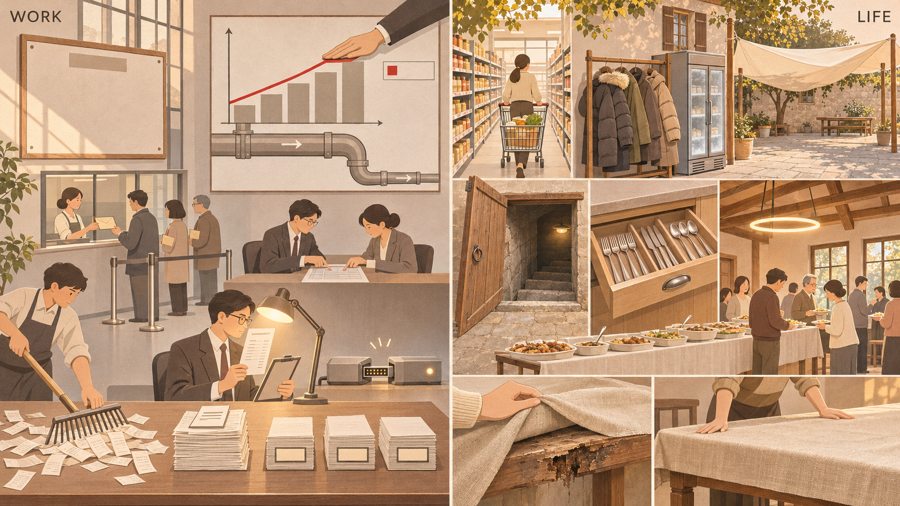

# 每日英语单词 20 个 · 2026-11-18（第 28 期）

> **定位**：面向 CET-6 六级高频/中频核心词汇，以职场和生活语境掌握常用义与搭配；六级与四级词汇存在重叠，本期不宣称逐词具有经统计核验的真题频次。
> **构成与去重**：职场 11 + 生活 9；避开历史索引全部 540 个词条，短语按逗号整体去重。本期累计 560 词。
> **记忆说明**：以下记忆提示分两类标注——「词根」为可确认的构词提示，「联想」为便于记忆的画面联想，不作严格词源考据；搭配辨析表示常见用法，不作绝对规则。
> **配套**：根目录 `每日20词-复习窗口.md` 与 `已推荐单词索引.md`。

## 场景记忆图

- 2026-11-18：请求模型 `gpt-image-2.5-flare`；实际尺寸 1672 × 941；耗时 109.89 秒。原图保留于 `/Users/insistgang/Pictures/Sub2API Images/gpt-image-2.5-flare-20261118-daily1118.png`，副本已归档至 `../场景配图/`。
- 本通道无法读图自检，未做逐处视觉验收；画面仅用于联想，词义以正文为准。
- 左栏为预算复核办公区（WORK），右栏为老宅改造后的周末家宴（LIFE）；跟随图中标签回忆每个词的画面抓手。

## 职场篇（11 词）

**1. aggregate** /ˈæɡrɪɡeɪt/（动词）；/ˈæɡrɪɡət/（名词、形容词）
- **词义**：v. 汇总，合计；n. 总数，集合体；adj. 总计的
- **例句**：The assistant aggregated last quarter's receipts into a single sheet before the review.
- **翻译**：助理在复核前，把上季度的单据汇总成了一张表。
- **记忆提示**：词根 —— ag（=ad，向）+ greg（群、聚集，拉丁 grex「羊群」；同族 congregate「聚集」、segregate「隔离」）——"把一群东西赶拢到一处"，故是"汇总、合计"。⚠️ 固定搭配 aggregate data（汇总数据）、in the aggregate（总体上）；名词 aggregation，形容词 aggregate growth（总增长）。⚠️ 与 collect / compile 的分工见排雷台：aggregate 强调"拢成一个总量"。

**2. ascertain** /ˌæsərˈteɪn/
- **词义**：v. 查明，弄清，确定（事实、原因）
- **例句**：We need to ascertain whether the delay came from the vendor or our own warehouse.
- **翻译**：我们得查明这次延误是出在供应商，还是我们自己的仓库。
- **记忆提示**：词根 —— as（=ad，向）+ certain（确定的，同 certain / certainly / certify 同源）——"朝确定的方向去把它弄清楚"，故是"查明"。⚠️ 搭配 ascertain that...、ascertain the cause；比 find out 正式，多用于审计、调查与法律语境。⚠️ 与 confirm 辨析：confirm 是"证实已有说法"，ascertain 是"从无到有查出来"。

**3. comprise** /kəmˈpraɪz/
- **词义**：v. 由…组成，包含；构成
- **例句**：The review pack comprises three parts: receipts, a summary sheet, and a signed approval.
- **翻译**：这份复核材料由三部分组成：单据、汇总表，以及一份签字批准件。
- **记忆提示**：词根 —— com（共同）+ prise（抓取，拉丁 prehendere「抓住」；同族 comprehend「理解」、enterprise「事业」）——"把几样东西一起抓进来"，故是"包含、由…组成"。⚠️ 用法方向最容易错：整体 comprise 部分（The team comprises five people），不可倒过来说 ~~is comprised by~~；正式写作优先 consist of。⚠️ 与 compose / constitute 的关系见排雷台。

**4. cumulative** /ˈkjuːmjəleɪtɪv/
- **词义**：adj. 累积的，渐增的
- **例句**：The cumulative effect of small delays pushed the launch back by three weeks.
- **翻译**：一次次小延误累积起来的效果，把上线时间推后了三周。
- **记忆提示**：词根 —— cumul（堆，拉丁 cumulus「堆、云堆」；同族 accumulate「积累」）+-ative（形容词后缀）——"一层一层堆上去的"，故是"累积的"。⚠️ 搭配 cumulative effect（累积效应）、cumulative total（累计总额）；副词 cumulatively。⚠️ 与 accumulated 区别：cumulative 讲"逐次叠加的性质"，accumulated 讲"已经攒下来的结果"。

**5. curb** /kɜːrb/
- **词义**：v. 抑制，控制（增长、开支、情绪）；n. 路缘；约束
- **例句**：The company curbed travel spending to keep the budget from slipping again.
- **翻译**：公司压住了差旅开支，免得预算再次失控。
- **记忆提示**：联想 —— curb 本义是"马嘴里的嚼子"，勒住马让它慢下来；画面抓手就是手上一紧缰绳。⚠️ 搭配 curb inflation（抑制通胀）、curb spending、put a curb on sth。⚠️ 拼写别和 curve（曲线）混：一个是"勒住"，一个是"弯过去"。

**6. divert** /daɪˈvɜːrt/
- **词义**：v. 使改道，转移（资金、注意力）；使娱乐
- **例句**：A chunk of the budget was diverted to cover an emergency repair.
- **翻译**：预算里的一笔钱被挪去填了一次紧急维修的窟窿。
- **记忆提示**：词根 —— di（=dis，离开）+ vert（转，拉丁 vertere「转」；同族 convert「转变」、reverse「反转」、versatile「多才多艺」）——"把流向转到别的方向去"，故是"改道、转移"。⚠️ 搭配 divert funds to sth（挪用资金）、divert attention from sth（转移注意力）；名词 diversion（改道、消遣）。⚠️ 与 convert 的分工：divert 改的是"去向"，convert 改的是"形态或用途"。

**7. denote** /dɪˈnoʊt/
- **词义**：v. 表示，标志着，意味着
- **例句**：In the chart, the red bar denotes spending that has not yet been approved.
- **翻译**：图里那根红柱表示还没获批的开支。
- **记忆提示**：词根 —— de（向下、明确）+ not（标记，拉丁 notare「标记」；同族 note / notice / notable）——"明确地打上一个标记"，故是"表示"。⚠️ 搭配 denote that...、be denoted by sth。⚠️ 名词 denotation（字面义）与 connotation（隐含色彩）成对出现，是六级阅读的常考点：denotation 是"字典说的"，connotation 是"语感带出来的"。

**8. compatible** /kəmˈpætəbl/
- **词义**：adj. 兼容的，可共存的；合得来的
- **例句**：The new module is not compatible with the old database, so we need a bridge layer.
- **翻译**：新模块和旧数据库不兼容，得加一层桥接。
- **记忆提示**：词根 —— com（共同）+ pat（承受、感受，拉丁 pati「忍受」；同族 patient「病人、耐心的」、sympathy「同情」）+-ible（能…的）——"能一起承受的"，故是"兼容的、合得来"。⚠️ 搭配 be compatible with sth；名词 compatibility（兼容性）。⚠️ 与 comparable、competitive 只差几个字母，是完形填空的经典陷阱，见排雷台。

**9. dispense** /dɪˈspens/
- **词义**：v. 分发，发放；配（药）；免除
- **例句**：The cashier dispensed the reimbursement envelopes one by one at the counter.
- **翻译**：出纳在柜台前把报销信封一个一个发下去。
- **记忆提示**：词根 —— dis（分开）+ pens（称重、支付，拉丁 pendere「称、付」；同族 expensive「贵的」、pension「养老金」、compensate「补偿」）——"称好了分给各人"，故是"分发、配药"。⚠️ 搭配 dispense sth to sb；高频短语 dispense with sth = 免除、省掉（dispense with formalities 免去客套）。⚠️ 与 dispatch（派遣、发出）、disperse（驱散）形近，见排雷台。

**10. contend** /kənˈtend/
- **词义**：v. 主张，声称；竞争，争夺；应付
- **例句**：The auditor contends that the figures were revised after the deadline.
- **翻译**：审计员主张，这些数字是在截止之后才被改过的。
- **记忆提示**：词根 —— con（共同）+ tend（伸展、绷紧，拉丁 tendere「伸」；同族 extend「延伸」、tension「张力」、intend「打算」）——"双方同时往一处使劲"，故是"争夺"，引申为"坚持主张"。⚠️ 三个搭配要分清：contend that...（主张）、contend with sth（应付难题）、contend for sth（争夺）。⚠️ 与 claim 相比更正式，多见于报道、评论与论证文字。

**11. discipline** /ˈdɪsəplɪn/
- **词义**：n. 纪律；训练；学科；v. 惩戒，约束
- **例句**：Cost discipline is what separates a healthy quarter from a lucky one.
- **翻译**：成本纪律，才是一个健康的季度和一次侥幸之间的差别。
- **记忆提示**：词根 —— disc（=doc，教，拉丁 discere「学习」；同族 disciple「门徒」、doctrine「教义」）——"教出来的一套规矩"，故是"纪律"，也指"一门被教出来的学问"。⚠️ 一词多义要分会：academic discipline 是"学科"，self-discipline 是"自律"，作动词 discipline sb 是"惩戒某人"。⚠️ 形容词是 disciplinary（纪律的），别把名词直接当形容词用。

## 生活篇（9 词）

**12. aisle** /aɪl/
- **词义**：n. （货架、座位之间的）过道，通道
- **例句**：She pushed the cart down the aisle where the canned goods were stacked.
- **翻译**：她推着购物车，走过堆满罐头的那条货架过道。
- **记忆提示**：词根 —— 与 isle（小岛）同音但不同源；aisle 来自拉丁 ala「翼、侧廊」——"建筑侧面留出的那条通道"，故是"过道"。⚠️ s 不发音，读 /aɪl/；搭配 aisle seat（靠过道座位）、walk down the aisle（口语里指"结婚"）。⚠️ 超市问路说 in the aisle，别说 on the aisle。

**13. apparel** /əˈpærəl/
- **词义**：n. 服装，衣着（总称，偏正式）
- **例句**：The attic closet still held winter apparel nobody had worn for years.
- **翻译**：阁楼衣柜里还塞着好些年没人穿的冬衣。
- **记忆提示**：词根 —— ap（=ad，向）+ pare（准备，拉丁 parare「准备」；同族 prepare「准备」、repair「修理」、apparatus「器械」）——"为出门准备好的东西"，故是"服装"。⚠️ 多用于行业与正式文本（apparel industry 服装业、sportswear apparel），日常口语还是 clothes。⚠️ 与 apparent（明显的）只差一个字母，是拼写与词性双重陷阱。

**14. canopy** /ˈkænəpi/
- **词义**：n. 遮篷，顶篷；（树）冠层
- **例句**：They stretched a canvas canopy over the courtyard before the guests arrived.
- **翻译**：客人到之前，他们在院子里撑起了一块帆布遮篷。
- **记忆提示**：词根 —— 出自希腊语 kōnōpeion「带蚊帐的床」，经拉丁 canopēum 进入英语——"罩在上面的那一层"，故是"遮篷、树冠"。⚠️ 搭配 a canopy of leaves（一片树冠）、forest canopy（林冠层，生态类阅读高频）。⚠️ 与 canyon（峡谷）只差一个字母，意思天差地别。

**15. cellar** /ˈselər/
- **词义**：n. 地窖，地下室；酒窖
- **例句**：The old cellar smelled of damp brick and fermented fruit.
- **翻译**：那间老地窖里是湿砖和发酵水果的味道。
- **记忆提示**：词根 —— cell（小房间，拉丁 cella「储藏室」；同族 cell「细胞」、cellular「蜂窝状的」）——"藏在地下的那间小屋"，故是"地窖"。⚠️ 搭配 wine cellar（酒窖）；英美有别：英式 cellar 多指地下储物间，美式更常说 basement。⚠️ 与 seller（卖家）、cello（大提琴）读音或拼写相近，见排雷台。

**16. cutlery** /ˈkʌtləri/
- **词义**：n. 餐具（刀、叉、匙），总称
- **例句**：He laid the cutlery out in neat rows before the buffet started.
- **翻译**：自助餐开始前，他把餐具一排排摆好。
- **记忆提示**：词根 —— cutl（=cult，刀，拉丁 culter「刀」）+-ery（集合名词后缀，如 machinery「机械」、scenery「风景」）——"一整套刀叉"，故是"餐具"。⚠️ 不可数名词，不说 ~~a cutlery~~，要说 a piece of cutlery / a set of cutlery；美式口语常说 silverware、flatware。⚠️ 与 crockery（陶瓷碗碟）分工不同：一个管金属，一个管瓷。

**17. decor** /deɪˈkɔːr/
- **词义**：n. （室内的）装饰风格，陈设
- **例句**：The whole decor was warm wood and soft light, nothing expensive but everything chosen.
- **翻译**：整体陈设是暖木色配柔光，没有一样贵，但每样都挑过。
- **记忆提示**：词根 —— decor（得体、雅致，拉丁 decorus「合宜的」；与 decorate「装饰」、decent「得体的」同源）——"布置得体的那一整套"，故是"装饰风格"。⚠️ 不可数，说 the decor is...，不说 ~~a decor~~；搭配 interior decor、festive decor。⚠️ 与 decoration 区别：decor 是整体风格，decoration 是具体装饰物或装饰这个动作。

**18. buffet** /bəˈfeɪ/（餐台）；/ˈbʌfɪt/（动词：反复冲击）
- **词义**：n. 自助餐；餐台；v.（反复）冲击，打击
- **例句**：They set up a long buffet along the wall so people could eat standing.
- **翻译**：他们沿着墙摆了一条长餐台，大家站着就能吃。
- **记忆提示**：联想 —— 源自法语 buffet「餐具柜」，先指摆菜的那只柜子，再指"自己取菜的吃法"。⚠️ 两个读音两个义项：餐台读 /bəˈfeɪ/，作动词"反复冲击"读 /ˈbʌfɪt/（be buffeted by the wind 被风反复拍打），六级阅读里这是典型的"同形异音异义"。⚠️ 与 salad bar、potluck 场景不同：buffet 强调"摆开自取"。

**19. decay** /dɪˈkeɪ/
- **词义**：n./v. 腐烂，腐朽；衰退，衰败
- **例句**：The beam showed signs of decay where the rain had seeped in.
- **翻译**：雨水渗进来的地方，那根横梁已经显出腐朽的迹象。
- **记忆提示**：词根 —— de（向下）+ cay（=cad，落下，拉丁 cadere「落下」；同族 cadence「韵律」、accident「意外」、occasion「时机」）——"一点一点往下掉、往下垮"，故是"腐烂、衰退"。⚠️ 搭配 tooth decay（蛀牙）、urban decay（城区衰败）、fall into decay（走向破败）。⚠️ 与 rot、deteriorate 的分工见排雷台。

**20. coarse** /kɔːrs/
- **词义**：adj. 粗糙的；粗俗的；粗粒的
- **例句**：She spread a coarse linen cloth over the table to hide the scratches.
- **翻译**：她在桌上铺了一块粗麻布，把划痕盖住。
- **记忆提示**：联想 —— 与 course（课程、进程）同音但不同源；coarse 原义就是"质地不细"，画面抓手是手摸麻布时那种扎手感。⚠️ 三个义项要分开：coarse cloth（粗布）、coarse language（粗话）、coarse salt（粗盐）。⚠️ 同音词 course 是完形填空的高频陷阱，见排雷台。

## 助记卡（词根/画面抓手 + 高频搭配）

| 单词 | 词根/画面抓手 | 高频搭配 |
|---|---|---|
| aggregate | ag + greg（羊群）→ 赶拢成一群 | aggregate data |
| ascertain | as + certain（确定）→ 朝确定的方向查 | ascertain the cause |
| comprise | com + prise（抓）→ 一起抓进来 | comprise three parts |
| cumulative | cumul（堆）→ 一层层堆上去 | cumulative effect |
| curb | 手上一紧马嚼子 | curb spending |
| divert | di + vert（转）→ 把流向转走 | divert funds to sth |
| denote | de + not（标记）→ 明确打个标记 | denote that... |
| compatible | com + pat（承受）→ 能一起承受 | be compatible with |
| dispense | dis + pens（称付）→ 称好分给各人 | dispense with sth |
| contend | con + tend（绷紧）→ 同时往一处使劲 | contend that... |
| discipline | disc（教）→ 教出来的一套规矩 | cost discipline |
| aisle | 侧廊留出的那条道 | aisle seat |
| apparel | ap + pare（准备）→ 出门前备好的 | apparel industry |
| canopy | 罩在上面的那一层 | a canopy of leaves |
| cellar | cell（小房间）→ 地下的储藏小屋 | wine cellar |
| cutlery | cutl（刀）+ ery（集合）→ 一整套刀叉 | a piece of cutlery |
| decor | decor（得体）→ 布置得体的整套 | interior decor |
| buffet | 法语"餐具柜"→ 摆开自取 | a buffet dinner |
| decay | de + cay（落）→ 一点点往下垮 | tooth decay |
| coarse | 手摸麻布的扎手感 | coarse cloth |

## 一句话串记

**职场线**：复核前先把单据 **aggregate** 成一张总表，再逐笔 **ascertain** 来源；材料 **comprise** 三部分，小错 **cumulative** 成大坑；先 **curb** 住超支，再查钱被 **divert** 到哪去；图例上的红柱 **denote** 未批项目，新旧系统终于 **compatible**；出纳把信封 **dispense** 到各人手上，审计员 **contend** 数字改过——最后落在一句话上：成本 **discipline**。

**生活线**：推车穿过超市 **aisle**，顺手买了件冬装 **apparel**；院里撑起 **canopy**，**cellar** 里翻出旧酒；**cutlery** 一排排摆好，**decor** 是暖木配柔光；**buffet** 长桌一开，桌布底下是 **decay** 的旧木梁，盖上去的正是那块 **coarse** 麻布。

## 记忆宫殿 · 双线场景故事

### 职场线（11 词）· 从一堆散单据到一纸成本纪律

推开财务室的门，长桌上铺满了散落的发票，文员用一把大耙子把纸片**拢成一个纸堆**，堆顶压上一张总数条——这是 **aggregate**（汇总）；审计员戴上眼镜，抽出其中一张，举到灯下比对编号与日期，一路追到供货单的源头——这是 **ascertain**（查明）；纸堆被分成三摞，摞前立着三块牌子：单据、汇总、批准——这是 **comprise**（由…组成）；墙上的柱状图一格一格往上叠，每叠一格就压得桌面更低一分——这是 **cumulative**（累积的）；一只手伸过来，按住那根还在往上冲的红线，硬生生把它压平——这是 **curb**（抑制）；红线下方的资金管道忽然拐了个弯，水流转进另一根支管——这是 **divert**（转移）；墙上图例处，一个红色方块旁边写着"未获批"，**标记**得清清楚楚——这是 **denote**（表示）；桌上是两台旧设备，两个接口一插，卡扣"咔"一声合上、灯亮了——这是 **compatible**（兼容的）；柜台窗口后，出纳从抽屉里取出信封，一个一个递到排队的人手里——这是 **dispense**（分发）；两名审计员隔桌对坐，各自把手指按在同一行数字上，谁也不让——这是 **contend**（主张、争执）；最后镜头拉远，整面墙贴着一张大通告，字很少：成本纪律——这是 **discipline**（纪律）。

> 画面链：大耙子拢起的纸堆 → 灯下比对编号的那张发票 → 摞前三块分牌 → 一格一格往上叠的柱图 → 被按住的红线 → 拐弯的资金支管 → 图例上的"未获批"红块 → 咔一声合上的接口 → 窗口递出的信封 → 隔桌对峙的两只手 → 整面墙的通告。

### 生活线（9 词）· 从一条超市过道到一张麻布长桌

推车拐进超市，两侧货架高得遮住灯光，中间只剩一条窄窄的**过道**——这是 **aisle**；冷柜旁的衣架上挂着一排厚外套，是没人细看的冬季**衣着**——这是 **apparel**；回到院子，四个人合力把一块帆布撑开、四角系上柱子，头顶忽然有了一片**阴凉**——这是 **canopy**；侧屋的木门被拉开，一道石阶往下走，凉气和酒味一起涌上来，那是一间**地窖**——这是 **cellar**；回到厨房，抽屉被整个拉出，**刀叉匙**在槽里躺成一排排——这是 **cutlery**；抬眼看去，整间屋子是暖木色配一圈柔光，墙上没有一样贵东西，却都挑过——这是 **decor**（陈设风格）；长桌沿墙摆开，盘子一路排到尽头，人们站着就能取——这是 **buffet**（自助餐）；有人掀开桌布一角，露出横梁上被雨水泡出的**腐朽**痕迹——这是 **decay**；最后一块**粗麻布**被抖开、铺满整张桌面，把所有划痕盖住——这是 **coarse**。一天收在一块麻布底下。

> 画面链：货架间的窄过道 → 冷柜旁挂着的外套 → 院子上空撑开的帆布 → 往下走的石阶与凉气 → 抽屉里排开的刀叉 → 暖木配柔光的整屋 → 沿墙排到尽头的餐台 → 桌布下腐朽的横梁 → 铺满桌面的粗麻布。

## 排雷台（19 组易混与搭配辨析）

| 辨析 | 关键差别与常见搭配 |
|---|---|
| aggregate / collect / compile | aggregate 强调"把零散项拢成一个总量"（aggregate data into a total）；collect 只是"收集起来"（collect receipts）；compile 强调"按体例汇编成册"（compile a report）。三者都可能译成"汇总"，落点不同。 |
| ascertain / confirm / verify | ascertain 是"从无到有查清楚"（ascertain the cause）；confirm 是"证实已有说法成立"（confirm the booking）；verify 是"逐项核对真伪"（verify the figures）。审计语境三者常同段出现，别混用。 |
| comprise / compose / consist of / constitute | 整体 comprise 部分（The pack comprises three parts）；部分 compose 整体时须被动（The pack is composed of three parts）；consist of 只有主动、无被动（The pack consists of three parts）；部分 constitute 整体（Three parts constitute the pack）。四个词方向完全不同。 |
| cumulative / accumulated / successive | cumulative 是"逐次叠加的性质"（cumulative effect）；accumulated 是"已经攒下来的"（accumulated savings）；successive 是"接连的、一连几个"（three successive quarters）。 |
| curb / curve / restrain / restrict | curb 是"勒住增长势头"（curb spending）；curve 是名词/动词"曲线、弯"（the curve flattens）；restrain 偏"抑制住自己或情绪"（restrain oneself）；restrict 偏"用规则限定范围"（restrict access）。 |
| divert / convert / reverse | divert 改的是"去向"（divert funds to sth）；convert 改的是"形态或用途"（convert a barn into a studio）；reverse 是"反向、倒退"（reverse a decision）。 |
| denote / indicate / signify | denote 是"符号明确代表某义"（the red bar denotes...）；indicate 是"迹象显示"（figures indicate a slowdown）；signify 偏"意味着、象征"（a nod signifies agreement）。 |
| compatible / comparable / competitive | compatible 是"能一起工作、不冲突"（compatible with）；comparable 是"可比的、相当的"（comparable quality）；competitive 是"有竞争力的"（competitive pricing）。写商务邮件最容易在这三个里写错一个。 |
| dispense / dispatch / disperse | dispense 是"按份发放、配药"（dispense medicine）；dispatch 是"派遣、发出"（dispatch a courier）；disperse 是"驱散、散开"（disperse the crowd）。 |
| contend / claim / compete | contend 后接 that 从句表"主张"，接 with 表"应付"，接 for 表"争夺"；claim 偏"声称（未必有据）"；compete 只表"竞争"。 |
| discipline / disciplinary / disciple | discipline 是名词"纪律、学科"或动词"惩戒"；disciplinary 是形容词"纪律的"（disciplinary action）；disciple 是"门徒、追随者"，拼写差一个 e，意思全变。 |
| aisle / isle / corridor | aisle 是"货架或座位之间的通道"（supermarket aisle / aisle seat）；isle 是"小岛"（the Isle of Skye），同音不同义；corridor 是建筑里的"走廊"，偏狭长通道。 |
| apparel / apparent / appearance | apparel 是名词"服装总称"；apparent 是形容词"明显的、表面上的"（for no apparent reason）；appearance 是名词"外表、出现"（make an appearance）。 |
| canopy / canyon / canvas | canopy 是"遮篷、树冠层"；canyon 是"峡谷"（the Grand Canyon）；canvas 是"帆布、画布"。三个只差一两个字母，意思毫不相干。 |
| cellar / seller / cello | cellar 是"地窖"；seller 是"卖家"（best seller 畅销品）；cello 是"大提琴"。读音相近，拼写与词性都不同。 |
| cutlery / crockery / silverware | cutlery 泛指金属刀叉匙（英式常用）；crockery 专指陶瓷碗碟杯；silverware 在美式口语中泛指餐具，字面上偏"银器"。 |
| decor / decoration / decorate | decor 是不可数的"整体陈设风格"；decoration 是可数的"装饰物"或"装饰行为"；decorate 是动词。说 ~~a beautiful decor~~ 是典型错误。 |
| decay / rot / deteriorate | decay 可指有机物腐烂，也可指城市、制度"衰败"（urban decay）；rot 偏"彻底烂掉"，口语感强；deteriorate 偏"状况逐步恶化"（health deteriorates），不限于实物。 |
| coarse / course / cause | coarse 是"粗糙、粗俗"；course 是"课程、进程、一道菜"（of course / main course）；cause 是"原因、事业"。三词同音或近音，完形高频陷阱。 |

## 快速自测（5 题 · 答案折叠）

**1. 语境选词填空**：Before the review, we must ______ whether the missing receipts were lost or simply filed late.（从 ascertain / contend / denote 中选择）

**2. 用法改错**：The pack is comprised by three parts. 请改正，并说明 comprise 的正确方向。

**3. 中译英**：小延误的累积效应把上线推后了三周。

**4. 一词两义**：buffet 在 "a long buffet along the wall" 中意为 ______，读 ______；在 "be buffeted by the wind" 中意为 ______，读 ______。

**5. 生活场景选词**：He pulled a ______ linen cloth over the table, hiding the ______ beam underneath.（从 coarse / decay / decor / cutlery 中选两个）

👉 点击展开答案

1. **ascertain**；这里是"从无到有查清事实"，正是 ascertain 的落点。contend 是"主张"（已有一方说法），denote 是"符号表示"，都不合。
2. 改为 **The pack comprises three parts.**（或 The pack is composed of three parts. / The pack consists of three parts.）。方向规则：整体 comprise 部分，不能倒过来；~~be comprised by~~ 属错误搭配，正式写作避开。
3. **The cumulative effect of small delays pushed the launch back by three weeks.**；用 cumulative effect 而非 accumulated，因为讲的是"一次次叠加产生的效应"。
4. 第一个是 **自助餐、餐台**，读 **/bəˈfeɪ/**；第二个是 **被反复冲击、拍打**，读 **/ˈbʌfɪt/**。同形异音异义，六级阅读常见考法。
5. **coarse** 与 **decay**；coarse linen cloth 是"粗麻布"，the decaying beam 是"正在腐朽的横梁"（题中 decay 用名词形式亦可：the beam in decay）。decor 是整体陈设、cutlery 是餐具，都不合。

---

*第 28 期 · 生成于 2026-11-18 · 累计已学 560 词（CET-6 向）*
