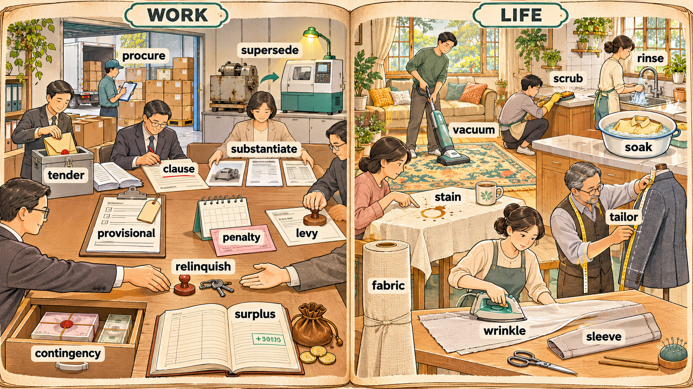

# 每日英语单词 20 个 · 2026-11-19（第 29 期 · 补做）

> **定位**：面向 CET-6 六级高频/中频核心词汇，以职场和生活语境掌握常用义与搭配；六级与四级词汇存在重叠，本期不宣称逐词具有经统计核验的真题频次。
> **构成与去重**：职场 11 + 生活 9；避开历史索引全部 560 个词条，短语按逗号整体去重。本期累计 580 词。
> **补做说明**：本期为 2026-11-19 当日 08:30 定时任务中断后的补做，词表与配图均按原系列规格新生成，不使用其他日期内容冒充。
> **记忆说明**：以下记忆提示分两类标注——「词根」为可确认的构词提示，「联想」为便于记忆的画面联想，不作严格词源考据；搭配辨析表示常见用法，不作绝对规则。
> **配套**：根目录 `每日20词-复习窗口.md` 与 `已推荐单词索引.md`。

## 场景记忆图

- 2026-11-19：请求模型 `gpt-image-2.5-flare`；实际尺寸 1672 × 941；耗时 74.06 秒。原图保留于 `/Users/insistgang/Pictures/Sub2API Images/gpt-image-2.5-flare-20261119-daily1119b.png`，副本已归档至 `../场景配图/`。
- 本版为**带词标签版**：图中标注 WORK 11 词 + LIFE 9 词，共 20 个标签，一对一对应正文各词；首版 `gpt-image-2.5-flare-20261119-daily1119.png` 漏印 `surplus` 标签（仅画出钱袋与账本），已作废并保留为历史副本。
- 本通道无法读图自检，逐词核对系按渲染结果人工确认；账本页上的 `+S0000` 属模型自造字样、单据小字不可辨，为已知瑕疵，不影响词义对应。
- 左栏为采购合同收尾的办公区与收货口（WORK），右栏为周末大扫除与改衣的居家日（LIFE）；跟随图中标签回忆每个词的画面抓手。

## 职场篇（11 词）

**1. tender** /ˈtendər/（名词、动词、形容词）
- **词义**：n. 投标，投标书；v. 正式提出，递交；adj. 温柔的，柔嫩的
- **例句**：Three suppliers submitted tenders before the deadline, and only one met the technical threshold.
- **翻译**：三家供应商在截止前递交了投标书，只有一家达到了技术门槛。
- **记忆提示**：名词与动词的 tender 来自拉丁 tendere「伸出」（同族 tend、extend、tension）——"把条件向外递出去"，故是"投标、正式提出"。⚠️ 形容词"温柔的"是另一个来源（拉丁 tener「柔软」），与本义无关，属同形异义；靠语境分辨：tender documents 是标书，a tender voice 是柔声。⚠️ 搭配 put out to tender（招标）、win a tender（中标）；美式常说 bid。

**2. clause** /klɔːz/
- **词义**：n. （合同、法律的）条款；（语法）从句
- **例句**：One clause in the contract sets a penalty if delivery slips past the agreed week.
- **翻译**：合同里有一条写明：交货晚于约定周次就要付违约金。
- **记忆提示**：词根 —— claus（关闭，拉丁 claudere「关」；同族 close、conclude、disclose、exclusive）——"用一句话把条件圈起来、关在里面"，故是"条款"；语法上的"从句"也是"嵌在主句里被圈住的一小段"。⚠️ 搭配 a penalty clause（违约金条款）、a clause in the contract；别和 cause（原因）混。

**3. provisional** /prəˈvɪʒənl/
- **词义**：adj. 临时的，暂定的
- **例句**：The inspection team issued a provisional acceptance, pending a second check next month.
- **翻译**：验收组先出了一份临时验收结论，等下个月复检再定。
- **记忆提示**：词根 —— pro（向前）+ vis（看，拉丁 videre「看」；同族 provide、vision、supervise、evident）+-ion +-al——"提前看到了、先备下的"，故 provision 是"预备、供应"，provisional 是"先顶着的、暂定的"。⚠️ 搭配 provisional acceptance（临时验收）、a provisional licence（临时执照）、provisional figures（初步数字）。⚠️ 与 temporary 不同：provisional 强调"等正式版出来就被替换"，temporary 只强调"时间短"。

**4. contingency** /kənˈtɪndʒənsi/
- **词义**：n. 意外事件，偶发情况；（预算中的）应急备用金
- **例句**：We kept ten percent of the budget as a contingency for price changes.
- **翻译**：我们把预算的一成留作应急，防着价格变动。
- **记忆提示**：词根 —— con（共同）+ ting（接触，拉丁 tangere「触碰」；同族 contact、tangible、tactile）+-ency——"几件事恰好碰到一起"，故是"偶发事件"；预算里的 contingency 就是"为碰巧出事准备的那笔钱"。⚠️ 高频搭配 a contingency plan（应急预案）、a contingency fund、as a contingency。⚠️ 与 emergency 不同：contingency 是"可能发生的意外"，偏预案；emergency 是"已经发生的紧急状况"。

**5. procure** /prəˈkjʊr/
- **词义**：v. 采购，采办；（设法）获得
- **例句**：The team had to procure the spare parts from a second vendor to keep the line running.
- **翻译**：为了不停线，团队只能从另一家供应商采办备件。
- **记忆提示**：词根 —— pro（为了）+ cure（关心、操心，拉丁 curare「照看」；同族 cure、curious、accurate、secure）——"为某件事去操心张罗"，故是"设法取得、采办"。⚠️ 搭配 procure sth from sb、procurement department（采购部）；比 buy 正式，多用于机构采购。⚠️ 名词 procurement 不可数。

**6. levy** /ˈlevi/
- **词义**：v. 征收（税、费）；n. 征税额，收费
- **例句**：The port levies a small fee on every container that stays longer than three days.
- **翻译**：港口对停留超过三天的每个集装箱征收一笔小额费用。
- **记忆提示**：词根 —— lev（举起、加在…上，拉丁 levare「举起、减轻」；同族 elevate、lever、alleviate、relief）——"把一笔钱举起来压到某人头上"，故是"征收"。⚠️ 搭配 levy a tax on sth、levy a fine；作名词时是可数的 a levy。⚠️ 与 impose 辨析：impose a tax 是"确立一项税"，levy a tax 是"把这笔税收上来"。

**7. penalty** /ˈpenəlti/
- **词义**：n. 罚款，处罚；（体育）点球；不利后果
- **例句**：Late delivery triggers a penalty of two percent of the contract value per week.
- **翻译**：延期交货每周要按合同金额的百分之二计罚。
- **记忆提示**：词根 —— pen（惩罚，拉丁 poena「代价、惩罚」，同族 punish、penal、pain）+-alty——"为违约付出的代价"，故是"罚款、处罚"。⚠️ 搭配 impose a penalty on sb、pay a penalty、the penalty for sth。⚠️ 与 fine 不同：penalty 是广义"处罚"，可以是罚款、扣分或解约；fine 专指"罚金"。

**8. substantiate** /səbˈstænʃieɪt/
- **词义**：v. 证实，用证据支持（说法、指控）
- **例句**：The report could not substantiate the claim that the delay was caused by the carrier.
- **翻译**：这份报告无法证实"延误是承运方造成的"这一说法。
- **记忆提示**：词根 —— sub（在下）+ stant（站立，拉丁 stare「站」；同族 stand、constant、stable、substance、insist）+-iate——"在下面把人撑住"，故是"给出支撑、证实"。⚠️ 搭配 substantiate a claim / an allegation；名词 substantiation。⚠️ 与 confirm 的区别：confirm 是"确认某事成立"，substantiate 强调"拿出证据把它撑起来"，常与无法证实连用（could not substantiate）。

**9. supersede** /ˌsuːpərˈsiːd/
- **词义**：v. 取代，代替（旧的事物、规定）
- **例句**：The new sealing machine superseded the old press as soon as the trial run passed.
- **翻译**：试运行一通过，新封口机就取代了那台旧压机。
- **记忆提示**：词根 —— super（在上）+ sede（坐，拉丁 sedere「坐」；同族 sit、session、preside、reside、sediment）——"坐到原来那个人位子上去"，故是"取代"。⚠️ 搭配 be superseded by sth、supersede an earlier version；多用于技术、法规、合同文本。⚠️ 与 replace 语域不同：replace 中性通用，supersede 正式、含"旧物被淘汰"意味。

**10. surplus** /ˈsɜːrpləs/
- **词义**：n. 盈余，剩余，顺差；adj. 过剩的，多余的
- **例句**：After the penalty was deducted, the project still closed with a small surplus.
- **翻译**：扣掉违约金之后，这个项目收尾时还小有盈余。
- **记忆提示**：词根 —— sur（=super，在上、额外）+ plus（更多，同族 plus、plural、supplement、surpass）——"比该有的多出来的那一块"，故是"盈余、过剩"。⚠️ 搭配 a trade surplus（贸易顺差）、budget surplus、surplus stock（积压库存）。⚠️ 反义是 deficit（赤字）；surplus 可数，说 a surplus of 5,000 yuan。

**11. relinquish** /rɪˈlɪŋkwɪʃ/
- **词义**：v. 放弃，交出（权力、控制、所有权）
- **例句**：The supplier relinquished control of the warehouse once the handover was signed.
- **翻译**：交接单签完，供应商就交出了仓库的管理权。
- **记忆提示**：词根 —— re（回、再）+ linqu（离开、放手，拉丁 relinquere「留下、离开」；同族 delinquent「失职的」、derelict「被遗弃的」）——"松手撤出来"，故是"交出、放弃"。⚠️ 搭配 relinquish control of sth、relinquish a claim / a right；比 give up 正式。⚠️ 与 abandon 不同：relinquish 是"按程序交出去"，abandon 是"扔下不管"。

## 生活篇（9 词）

**12. vacuum** /ˈvækjuːm/
- **词义**：n. 真空，空白；v. 用吸尘器打扫
- **例句**：He vacuumed the rug twice because the dust kept rising from the fibres.
- **翻译**：他吸了两遍地毯，因为灰尘一直从纤维里往上冒。
- **记忆提示**：词根 —— vac（空的，拉丁 vacuus「空」）+-uum——"空无一物"，故是"真空"；吸尘器靠的正是"抽成负压再吸"，所以 vacuum 又被拿来当动词"吸尘"。⚠️ 注意拼写是两个 u：vacuum，别写成 ~~vaccum~~。⚠️ 搭配 vacuum the floor、a power vacuum（权力真空）；名词短语 in a vacuum 意为"脱离实际环境"。⚠️ 英式口语更常说 hoover。

**13. scrub** /skrʌb/
- **词义**：v. 用力擦洗；n. 擦洗；n. 灌木丛，矮树林
- **例句**：She scrubbed the corner of the counter until the grease film was gone.
- **翻译**：她把灶台角落刷了又刷，直到那层油膜不见。
- **记忆提示**：联想 —— 短促的 /skr-/ 音像刷子来回蹭的声响，抓的是"用力、反复"这个动作感。⚠️ 搭配 scrub sth with a brush、scrub the pan clean；名词 give the floor a scrub。⚠️ 与 wipe 分工：wipe 是"抹一遍"，scrub 是"使劲蹭掉顽固污渍"。⚠️ 复数 scrubs 在美式里指"手术服"。

**14. rinse** /rɪns/
- **词义**：v. 冲洗，漂洗；n. 漂洗（一遍）
- **例句**：Rinse the cloth under running water before you wipe the table again.
- **翻译**：再擦桌子之前，先把抹布在流水下冲干净。
- **记忆提示**：联想 —— 洗衣机的 rinse 档就是"把洗涤剂漂出去"那一遍，画面抓手是水从布里被挤出来。⚠️ 搭配 rinse sth under the tap、rinse out the soap；give it a quick rinse。⚠️ 与 wash 不同：wash 是"洗掉脏"，rinse 只负责"用水冲掉残留"。

**15. soak** /soʊk/
- **词义**：v. 浸泡，使湿透；n. 浸泡
- **例句**：Leave the collar to soak for an hour, and the yellow ring will lift.
- **翻译**：让衣领泡上一个钟头，那圈黄印就会浮起来。
- **记忆提示**：词根 —— 一般认为与 suck「吸」同出一支（古英语 socian）——"让水被吸进去"，故是"浸泡、湿透"。⚠️ 搭配 soak sth in water、leave sth to soak、be soaked to the skin（浑身湿透）。⚠️ 与 dip 不同：dip 是"蘸一下就拿出来"，soak 是"放着不管，让它吸饱"。⚠️ 口语 soak up the sun 指"晒太阳"。

**16. stain** /steɪn/
- **词义**：n. 污渍，斑点；v. 弄脏，留下污痕；v. 给…染色
- **例句**：A coffee stain had dried into the tablecloth and would not come out in cold water.
- **翻译**：桌布上的一块咖啡渍已经干进去了，冷水根本洗不掉。
- **记忆提示**：词根 —— 拉丁 tingere「浸染」（同族 tint、tincture）——"颜色渗进纤维里"，故既是"污渍"也是"染色"。⚠️ 搭配 remove a stain、leave a stain on sth、stain the wood（给木头上色）。⚠️ 与 spot 不同：spot 是"一小点"，可以是干净的斑点；stain 一定带"弄脏、洗不掉"的意味。

**17. fabric** /ˈfæbrɪk/
- **词义**：n. 织物，布料；结构，体系（社会的 fabric）
- **例句**：She chose a heavy cotton fabric so the curtains would fall straight.
- **翻译**：她挑了块厚的棉布，好让窗帘垂得笔直。
- **记忆提示**：词根 —— fabr（工匠、制作，拉丁 faber「工匠」；同族 fabricate、forge）——"工匠做出来的东西"，先指"织出来的布"，再引申为"搭起来的结构"。⚠️ 搭配 a piece of fabric、the fabric of society（社会结构）。⚠️ 与 cloth 不同：fabric 偏工业与设计语境，可数；cloth 更日常。

**18. wrinkle** /ˈrɪŋkl/
- **词义**：n. 皱纹，皱褶；v. （使）起皱；n. 小窍门（口语）
- **例句**：A quick press with a hot iron took the wrinkles out of the sleeve.
- **翻译**：热熨斗压过去，袖子上的褶子就没了。
- **记忆提示**：联想 —— 古英语里 wrinkle 就是"蜷曲、缠起来"的样子，抓的是布面上一道道细褶的画面。⚠️ 搭配 iron out the wrinkles、wrinkles around the eyes；口语 a new wrinkle 指"新招数"。⚠️ 与 crease 不同：crease 多是"折出来的一道硬折痕"（裤线），wrinkle 是"细碎的自然褶"。

**19. tailor** /ˈteɪlər/
- **词义**：n. 裁缝；v. 量身定制，按需调整
- **例句**：The tailor took the sleeve up two centimetres and marked it with chalk.
- **翻译**：裁缝把袖子收短了两厘米，用粉笔做了记号。
- **记忆提示**：词根 —— tail（剪、裁，来自拉丁 talea「切下的枝条」→ 法语 tailler「剪」）+-or（人）——"专门下剪刀的人"，故是"裁缝"；引申为"按尺寸改造"，再抽象成 tailor sth to sth（量身定制）。⚠️ 同族 detail（切成细碎→细节）、retail（再切一刀→零售）、entail。⚠️ 搭配 tailor-made、tailor a plan to the budget。

**20. sleeve** /sliːv/
- **词义**：n. 袖子；（机械）套管，套筒
- **例句**：One sleeve was turned inside out on the board, waiting for the seam to be reopened.
- **翻译**：一只袖子被翻过来摊在案板上，等着把缝拆开。
- **记忆提示**：联想 —— 古英语 slēf，本义就是"套在手臂上的那一截"；机械里的 sleeve 是"套在轴外面的筒"，同一个"套"的意象。⚠️ 搭配 roll up one's sleeves（撸起袖子干活）、have sth up one's sleeve（留着一手）、a record sleeve（唱片套）。⚠️ 与 cuff 分工：sleeve 是整条袖子，cuff 是袖口。

## 助记卡（词根/画面抓手 + 高频搭配）

| 单词 | 词根/画面抓手 | 高频搭配 |
|---|---|---|
| tender | tend（伸出）→ 把条件递出去 | put out to tender |
| clause | claus（关）→ 圈起来的一小段 | a penalty clause |
| provisional | pro + vis（先看）→ 先顶着用的 | provisional acceptance |
| contingency | con + ting（碰）→ 碰巧撞上的事 | a contingency plan |
| procure | pro + cure（操心）→ 为事去张罗 | procure sth from sb |
| levy | lev（举起）→ 举起来压上去 | levy a fee on sth |
| penalty | pen（代价）→ 违约要付的代价 | impose a penalty |
| substantiate | sub + stant（在下站住）→ 底下撑住 | substantiate a claim |
| supersede | super + sede（坐）→ 坐上那个位子 | be superseded by |
| surplus | sur + plus（更多）→ 多出来的那块 | a trade surplus |
| relinquish | re + linqu（放手）→ 松手撤出 | relinquish control of |
| vacuum | vac（空）→ 抽空再吸 | vacuum the floor |
| scrub | /skr-/ 刷子来回蹭的声响 | scrub sth clean |
| rinse | 洗衣机漂洗档，水从布里挤出 | rinse out the soap |
| soak | 与 suck 同支，让水吸进去 | leave sth to soak |
| stain | tingere（浸染）→ 颜色渗进纤维 | remove a stain |
| fabric | fabr（工匠）→ 织出来的东西 | the fabric of society |
| wrinkle | 布面上一道道细褶的蜷曲感 | iron out the wrinkles |
| tailor | tail（剪）+ or（人）→ 下剪刀的人 | tailor sth to sth |
| sleeve | 套在手臂上的那一截 | roll up one's sleeves |

## 一句话串记

**职场线**：三家 **tender** 递进来，红笔先圈住那条 **clause**；验收只给了 **provisional**，预算里另留一笔 **contingency**；备件得去 **procure**，港口还要 **levy** 一笔费；延期就按 **penalty** 算，检测单和发票一起才能 **substantiate**；新机器 **supersede** 了旧压机，账面最后还剩一点 **surplus**——交接单签完，钥匙就此 **relinquish**。

**生活线**：先拿 **vacuum** 把地毯过一遍，再蹲下 **scrub** 灶台角；抹布在龙头下 **rinse** 干净，衣领留在盆里 **soak**；桌布上那块 **stain** 洗不掉，索性换一卷新 **fabric**；熨斗一过 **wrinkle** 就平了，**tailor** 量好袖长改了 **sleeve**。

## 记忆宫殿 · 双线场景故事

### 职场线（11 词）· 从一只标箱到一串交出去的钥匙

会议室的门被推开，长桌上立着一只上了锁的标箱，几个人依次把封好的信封塞进去，旁边摊开一份还带着折痕的标书——这是 **tender**（投标）；红笔落在合同第七行的小段上，划出一道下划线，那一小段写着"逾期即罚"——这是 **clause**（条款）；板夹上夹着一张盖了章的验收单，角上挂着的标签还松着，说明只是"先过一遍"——这是 **provisional**（暂定的）；侧边的抽屉被拉开，一叠用封条扎好的钞票单独躺在一角，谁都不许动——这是 **contingency**（应急备用金）；后门外的收货口，管理员拿着清单，对着一个个纸箱逐一打勾——这是 **procure**（采办入库）；桌角一份费用通知被按上圆章，"啪"一声——这是 **levy**（征收）；日历旁边压着一张逾期罚单，红框圈着日期——这是 **penalty**（罚款）；验收员把照片、检测报告、发票三样并排推齐，才敢在结论上签字——这是 **substantiate**（用证据证实）；墙边一台旧压机被推靠到角落，新机器插上电，指示灯一亮——这是 **supersede**（取代）；翻到账本最后一页，余额栏是正数，旁边一只小钱袋、几枚散币——这是 **surplus**（盈余）；最后，供应商代表把公章和一串钥匙推到桌子中央，对面的人伸手接住——这是 **relinquish**（交出）。

> 画面链：塞满信封的标箱 → 红笔划过的第七行 → 标签松着的验收单 → 封条扎好的那叠钱 → 收货口打勾的清单 → "啪"一声的费用章 → 红框圈日期的罚单 → 并排推齐的三份证据 → 灯亮起来的新机器 → 余额为正的账本末页 → 推到桌子中央的章与钥匙。

### 生活线（9 词）· 从一个地毯的灰到一只改短的袖口

周末的门一开，先把吸尘器推出来，在地毯上压着来回走，灰尘从纤维里被拔起来——这是 **vacuum**（吸尘）；接着蹲下去，硬毛刷在灶台边角上来回蹭，油膜一层层被刮掉——这是 **scrub**（擦洗）；抹布在龙头下被拧了又冲，白水变浑又变清——这是 **rinse**（冲洗）；发黄的衣领被按进一盆水里，就那么泡着不管——这是 **soak**（浸泡）；回到桌边，桌布上一圈咖啡印已经干进去，手指点着它，怎么也去不掉——这是 **stain**（污渍）；干脆换路子，把一卷厚厚的棉麻布立在裁衣桌上——这是 **fabric**（布料）；熨斗贴着布面滑过去，身后那道褶子立刻平了——这是 **wrinkle**（皱褶被熨平）；软尺绕过肩膀、贴着胳膊量下来，粉笔在布上划一道线——这是 **tailor**（裁缝）；最后把那只袖子翻过来摊平在案板上，缝口拆开，准备收短两厘米——这是 **sleeve**（袖子）。一个周末，收在一只袖口上。

> 画面链：地毯上来回的吸尘器 → 灶台角上蹭的硬毛刷 → 龙头下拧冲的抹布 → 盆里泡着的衣领 → 桌布上那圈咖啡印 → 立在案上的棉麻布卷 → 熨斗滑过后平掉的褶 → 软尺与粉笔划线 → 翻面摊平的袖子。

## 排雷台（18 组易混与搭配辨析）

| 辨析 | 关键差别与常见搭配 |
|---|---|
| tender / bid / quote | tender 是正式的"投标（书）"，多用于工程、政府采购（put out to tender）；bid 更通用，美式常用（submit a bid）；quote 是"报价单"，只给价格不给方案。 |
| tender / gentle / delicate | tender 作形容词是"温柔的、柔嫩的"（a tender voice），与"投标"同形异义；gentle 是"温和、不粗暴"；delicate 是"精致、易损"。tender documents 与 tender words 完全是两回事。 |
| clause / cause / course | clause 是"条款、从句"（a penalty clause）；cause 是"原因、事业"（the cause of the delay）；course 是"课程、进程"（of course）。三词近音，合同文本里认错一个就误读整条。 |
| provisional / temporary / tentative | provisional 是"等正式版出来就被替换"（provisional acceptance）；temporary 只强调"时间短"（a temporary job）；tentative 偏"试探性、还没定下来"（a tentative agreement）。 |
| contingency / emergency / crisis | contingency 是"可能发生的意外"，用于预案与备用金（a contingency plan）；emergency 是"已经发生的紧急状况"（in an emergency）；crisis 是"已经恶化的危机"（a debt crisis）。 |
| procure / purchase / acquire | procure 是机构"设法采办"，含"四处张罗才能拿到"的意味（procure parts from a second vendor）；purchase 只陈述"买"这个交易；acquire 偏"取得所有权或能力"（acquire a subsidiary / a skill）。 |
| levy / impose / charge | levy 是"把税费实际收上来"（levy a fee on containers）；impose 是"确立一项税费或惩罚"（impose a tariff）；charge 是"向某人要价"（charge 50 yuan for delivery）。 |
| penalty / fine / sanction | penalty 是广义"处罚"，可以是罚款、扣分、解约（a penalty clause）；fine 专指"罚金"（a parking fine）；sanction 兼有"批准"与"制裁"两义，靠语境分辨。 |
| substantiate / confirm / verify | substantiate 是"拿出证据把说法撑起来"，常与否定连用（could not substantiate the claim）；confirm 是"确认成立"（confirm the booking）；verify 是"逐项核对真伪"（verify the figures）。 |
| supersede / replace / substitute | supersede 正式，指"旧物被淘汰、新物占位"（be superseded by）；replace 中性通用（replace the battery）；substitute 强调"临时用另一件顶替"（substitute A for B）。 |
| surplus / excess / leftover | surplus 是"账面上多出来的盈余"（a trade surplus）；excess 是"超出限度的部分"，常含贬义（excess baggage）；leftover 是"用剩的、吃剩的"（leftovers）。 |
| relinquish / abandon / waive | relinquish 是"按程序交出权力或所有权"（relinquish control）；abandon 是"扔下不管"（abandon the plan）；waive 是"主动放弃某项权利或费用"（waive the fee）。 |
| vacuum / emptiness / void | vacuum 是物理的"真空"，也指"权力或信息的空白"（a power vacuum）；emptiness 偏情绪上的"空虚"；void 偏法律"无效"或"一片虚空"（null and void）。 |
| scrub / wipe / polish | scrub 是"使劲蹭掉顽固污渍"（scrub the pan）；wipe 是"抹一遍"（wipe the table）；polish 是"擦到发亮"（polish the shoes）。 |
| rinse / wash / soak | rinse 只负责"冲掉残留"（rinse out the soap）；wash 是"洗掉脏"（wash the shirt）；soak 是"泡着让它吸饱"（leave it to soak）。三者常在同一段清洁流程里依次出现。 |
| stain / spot / mark | stain 一定带"渗进去、洗不掉"的意味（a coffee stain）；spot 是"一小点"，可以是干净的（a spot of ink）；mark 最中性，任何痕迹都算（a mark on the wall）。 |
| fabric / cloth / textile | fabric 偏设计与工业语境，可数（a heavy cotton fabric）；cloth 更日常，常不可数（a piece of cloth）；textile 是行业统称，多用复数（the textile industry）。 |
| wrinkle / crease / fold | wrinkle 是"细碎的自然褶"（wrinkles on the sleeve）；crease 是"折出来的一道硬折痕"（the crease in the trousers）；fold 是"折叠处"（a fold in the paper）。 |

## 快速自测（5 题 · 答案折叠）

**1. 语境选词填空**：Only one supplier met the technical threshold, so the others' ______ were returned unopened.（从 tender / clause / levy 中选择）

**2. 用法改错**：The new machine has superseded by the old press. 请改正，并说明 supersede 的方向。

**3. 中译英**：我们把预算的一成留作应急，防着价格变动。

**4. 一词两义**：tender 在 "submit a tender" 中意为 ______，在 "a tender voice" 中意为 ______；两个义项是否同源？

**5. 生活场景选词**：She left the collar to ______ for an hour, then ______ it under the tap.（从 soak / rinse / scrub / stain 中选两个）

👉 点击展开答案

1. **tenders**；投标书被原封退回，正是 tender 作名词的典型场景。clause 是条款、levy 是征收，都不合。也可用 bids（美式）。
2. 改为 **The new machine has superseded the old press.**（或 The old press has been superseded by the new machine.）。方向规则：新物 supersede 旧物，用主动；旧物作主语时必须用被动 be superseded by，不能写成 ~~has superseded by~~。
3. **We kept ten percent of the budget as a contingency against price changes.**；contingency 是"为可能发生的意外预留的那部分"，against / for 都可接。若写 emergency fund 则偏"已发生的紧急状况"，落点不同。
4. 第一个是 **投标（书）**，第二个是 **温柔的**；**不同源**——"投标"来自拉丁 tendere「伸出」，"温柔的"来自拉丁 tener「柔软」，属同形异义，只能靠语境分辨。
5. **soak** 与 **rinse**；leave sth to soak 是"泡着不管"，rinse it under the tap 是"在龙头下冲净"，两步在清洁流程里前后相接。scrub 要用力蹭，stain 是污渍本身，都不合。

---

*第 29 期 · 补做于 2026-11-20（原始日期 2026-11-19）· 累计已学 580 词（CET-6 向）*
