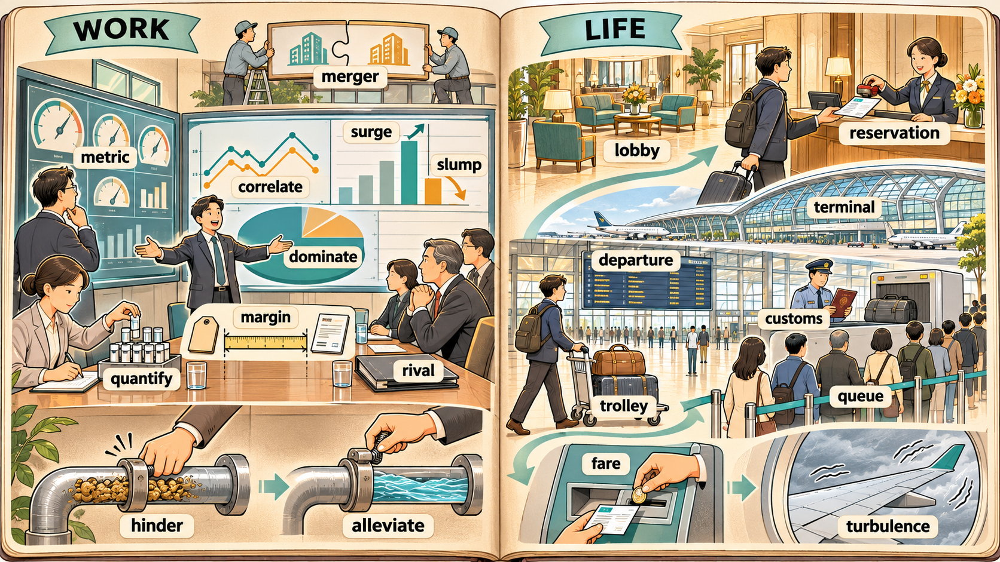

# 每日英语单词 20 个 · 2026-11-20（第 30 期 · 补做）

> **定位**：面向 CET-6 六级高频/中频核心词汇，以职场和生活语境掌握常用义与搭配；六级与四级词汇存在重叠，本期不宣称逐词具有经统计核验的真题频次。
> **构成与去重**：职场 11 + 生活 9；避开历史索引全部 580 个词条（含第 29 期补做的 20 词），短语按逗号整体去重。本期累计 600 词。
> **补做说明**：本期为 2026-11-20 当日 08:30 定时任务中断后的补做，词表与配图均按原系列规格新生成，不使用其他日期内容冒充。
> **记忆说明**：以下记忆提示分两类标注——「词根」为可确认的构词提示，「联想」为便于记忆的画面联想，不作严格词源考据；搭配辨析表示常见用法，不作绝对规则。
> **配套**：根目录 `每日20词-复习窗口.md` 与 `已推荐单词索引.md`。

## 场景记忆图

- 2026-11-20：请求模型 `gpt-image-2.5-flare`；实际尺寸 1672 × 941；耗时 58.13 秒。原图保留于 `/Users/insistgang/Pictures/Sub2API Images/gpt-image-2.5-flare-20261120-daily1120.png`，副本已归档至 `../场景配图/`。
- 本版为**带词标签版**：图中标注 WORK 11 词 + LIFE 9 词，共 20 个标签，一对一对应正文各词，一次生成即带齐。
- 本通道无法读图自检，逐词核对系按渲染结果人工确认；看板与航班屏上的小字为示意性排线、不可辨，属已知瑕疵，不影响词义对应。
- 左栏为季度业绩复盘会（WORK），右栏为一次返程：酒店大堂 → 航站楼 → 海关 → 登机口 → 机上（LIFE）；跟随图中标签按路线回忆每个词。

## 职场篇（11 词）

**1. metric** /ˈmetrɪk/
- **词义**：n. 指标，衡量标准；（数学）度量
- **例句**：The team agreed on four metrics before the quarter started, so nobody could argue later.
- **翻译**：季度开始前团队就定好了四个指标，免得事后各说各话。
- **记忆提示**：词根 —— metr（测量，希腊 metron「度量」；同族 meter、measure、symmetry、diameter）+-ic——"用来量东西的那把尺"，故是"指标"。⚠️ 商务语境的常见搭配：key metrics、track a metric、a metric for success；口语里 metrics 多用复数。⚠️ 与 measure 不同：metric 是"被选来考核的那一个数"，measure 可以是任何"措施、办法"。

**2. quantify** /ˈkwɑːntɪfaɪ/
- **词义**：v. 量化，用数量表示
- **例句**：It is hard to quantify the cost of a delayed launch, but we tried anyway.
- **翻译**：上线延期的代价很难量化，但我们还是试着算了。
- **记忆提示**：词根 —— quant（多少，拉丁 quantus「多大」；同族 quantity、quantum、quota）+-ify（使…）——"把'多少'说出来"，故是"量化"。⚠️ 搭配 quantify the impact / the risk、hard to quantify；名词 quantification。⚠️ 与 measure 不同：quantify 是把模糊的东西变成数字这一步，measure 是实际去测量。

**3. correlate** /ˈkɔːrəleɪt/
- **词义**：v. （使）相互关联，有相关性；n. 相关物
- **例句**：Higher traffic correlates with more sign-ups, but that does not prove the traffic caused them.
- **翻译**：流量高与注册多确实相关，但这证明不了是流量带来的注册。
- **记忆提示**：词根 —— cor（=con，共同）+ relate（联系）——"彼此挂上钩"，故是"相关联"。⚠️ 搭配 correlate with sth、be correlated with；名词 correlation（相关性）。⚠️ 高频考点：correlation does not imply causation（相关不等于因果），六级阅读里这句话几乎是固定表述。

**4. margin** /ˈmɑːrdʒɪn/
- **词义**：n. 利润率，差额；页边空白；余地，边缘
- **例句**：After the discount, the margin on that order was almost zero.
- **翻译**：打完折之后，那笔订单的利润几乎是零。
- **记忆提示**：词根 —— marg（边缘，拉丁 margo「边界」；同族 marginal「边缘的、微弱的」）——"两头的差距留下的那条边"，故既是"页边空白"，也是"售价与成本之间的差额"（利润空间）。⚠️ 搭配 gross margin（毛利率）、by a narrow margin（以微弱差距）、margin of error（误差范围）。⚠️ 与 profit 不同：profit 是"赚到的钱"，margin 是"占售价的比例"。

**5. surge** /sɜːrdʒ/
- **词义**：n. 激增，涌动；v. 急剧上升，蜂拥
- **例句**：Orders surged in the last week of the campaign and the warehouse could not keep up.
- **翻译**：活动最后一周订单激增，仓库根本跟不上。
- **记忆提示**：词根 —— surg（升起，拉丁 surgere「上升」；同族 source、resource、insurgent）——"往上涌"，故是"激增、涌动"。⚠️ 搭配 a surge in demand、surge to a record high、a power surge（电涌）。⚠️ 与 rise 相比，surge 含"突然、幅度大"的意味；反义是 slump。

**6. slump** /slʌmp/
- **词义**：n./v. 暴跌，骤降；v. 瘫坐，耷拉
- **例句**：Sales slumped for three straight months before the new pricing took effect.
- **翻译**：新定价生效前，销量连跌了三个月。
- **记忆提示**：联想 —— 词形像"整个人往下一沉"的动作，画面抓手是一根柱子塌下去；经济义与"瘫坐"义共用一个"往下塌"的意象。⚠️ 搭配 a slump in sales、slump to a five-year low、be in a slump（处于低迷期）。⚠️ 与 decline 不同：decline 可缓可急，slump 一定是"跌得又急又狠"。

**7. rival** /ˈraɪvl/
- **词义**：n. 竞争对手，对手；v. 与…匹敌，比得上
- **例句**：A rival launched a cheaper model two weeks before our release.
- **翻译**：对手在我们发布前两周推出了一款更便宜的型号。
- **记忆提示**：词根 —— rival 原指"共用一条河的人"（拉丁 rivus「河流」），为争水而相争，故是"对手"。⚠️ 搭配 a rival company / firm、rivals in the market、be rivalled only by（只有…能比）。⚠️ 与 competitor 近义，但 rival 更强调"势均力敌、长期对抗"，competitor 只陈述"同在竞争"。

**8. dominate** /ˈdɑːmɪneɪt/
- **词义**：v. 主导，支配；占主导地位；俯视
- **例句**：Two platforms dominate the market, and everyone else fights for the remaining share.
- **翻译**：两个平台主导着市场，其余的人只能去抢剩下的份额。
- **记忆提示**：词根 —— domin（主人、支配，拉丁 dominus「主人」；同族 domain、dominant、dominion）+-ate（动词后缀）——"以主人身份压在上面"，故是"主导、支配"。⚠️ 搭配 dominate the market、a dominant position、dominate the conversation（占满话题）。⚠️ 名词 dominance；别与 dome（圆顶）混，虽同源于"屋顶、家宅"。

**9. hinder** /ˈhɪndər/
- **词义**：v. 阻碍，妨碍
- **例句**：Slow approvals hindered the rollout more than the technical problems did.
- **翻译**：比起技术问题，审批太慢对上线推进的阻碍更大。
- **记忆提示**：词根 —— hind（后面的，古英语 hinder「在后」；同族 behind、hindmost）——"把人往后拖"，故是"阻碍"。⚠️ 搭配 hinder sb from doing sth、hinder progress / growth；名词 hindrance。⚠️ 与 prevent 不同：prevent 是"让它根本发生不了"，hinder 只是"让它变慢、变难"。

**10. alleviate** /əˈliːvieɪt/
- **词义**：v. 缓解，减轻（痛苦、问题）
- **例句**：A temporary subsidy alleviated the pressure on small suppliers, but only for a quarter.
- **翻译**：一笔临时补贴缓解了小供应商的压力，但只顶了一个季度。
- **记忆提示**：词根 —— al（=ad，向）+ lev（轻，拉丁 levare「举起、减轻」；同族 levity、elevate、relief、lever）+-iate——"把重量往上抬一点"，故是"缓解"。⚠️ 搭配 alleviate pain / pressure / congestion；名词 alleviation。⚠️ 与 solve 不同：alleviate 只让症状变轻，不解决根因；与 relieve 近义，alleviate 更正式、更常搭抽象名词。

**11. merger** /ˈmɜːrdʒər/
- **词义**：n. （公司、机构）合并，并购
- **例句**：The merger went through only after both sides agreed to keep the smaller brand alive.
- **翻译**：双方答应保留那个小品牌之后，这桩合并才获批。
- **记忆提示**：词根 —— merg（浸入、并入，拉丁 mergere「浸没」；同族 merge、emerge、submerge）+-er（名词后缀）——"两家一起沉进同一个池子"，故是"合并"。⚠️ 搭配 a merger with / between、the merger of A and B、merger talks。⚠️ 与 acquisition 不同：merger 是"两家并成一家"，acquisition 是"一家把另一家买下来"，后者有明确的买方。

## 生活篇（9 词）

**12. lobby** /ˈlɑːbi/
- **词义**：n. （酒店、剧院）大堂，门厅；v. 游说
- **例句**：He waited in the lobby with his suitcase, checking the time every two minutes.
- **翻译**：他拖着手提箱在大堂等，每两分钟看一次表。
- **记忆提示**：词根 —— lobby 原指"修道院、议会的门廊"，因为议员在门廊里拦人陈情，才引申出动词"游说"。⚠️ 搭配 hotel lobby、wait in the lobby、lobby for a bill（游说立法）。⚠️ 与 hall 不同：hall 是建筑里的厅，lobby 特指"入口处那块等候区"。

**13. reservation** /ˌrezərˈveɪʃn/
- **词义**：n. 预订（房、座）；保留意见，疑虑
- **例句**：The reservation was under his Chinese name, so the clerk had to search twice.
- **翻译**：预订是用他的中文名登记的，前台查了两遍才找到。
- **记忆提示**：词根 —— re（回）+ serv（保存、看守，拉丁 servare「守护」；同族 reserve、preserve、conserve、observe）+-ation——"先替你留起来"，故是"预订"；把话"留一手"就是"保留意见"。⚠️ 搭配 make / cancel a reservation、a reservation about sth（对…有疑虑）、without reservation（毫无保留）。⚠️ 美式口语订座常说 booking。

**14. terminal** /ˈtɜːrmɪnl/
- **词义**：n. 航站楼，终点站；（计算机）终端；adj. 末端的，晚期的
- **例句**：The shuttle dropped him at the wrong terminal, and he had to walk one building over.
- **翻译**：摆渡车把他放错了航站楼，他只好走到隔壁那栋。
- **记忆提示**：词根 —— termin（界限、终点，拉丁 terminus「界标」；同族 term、terminate、determine）+-al——"线路到头的那一站"，故是"航站楼、终点站"，引申为"末端的、晚期的"。⚠️ 搭配 Terminal 2、a bus terminal、terminal illness（晚期疾病）。⚠️ 别把 terminal 当成"飞机"本身；它指"楼"。

**15. departure** /dɪˈpɑːrtʃər/
- **词义**：n. 出发，离开；背离，偏离
- **例句**：The departure board flipped to "delayed" just as he reached the gate.
- **翻译**：他刚到登机口，航班屏就翻成了"延误"。
- **记忆提示**：词根 —— de（离开）+ part（分开，拉丁 partire「分出」；同族 part、partial、partition、depart）+-ure——"从原处分开走人"，故是"出发、离开"。⚠️ 搭配 departure time / gate / lounge、a departure from tradition（背离传统）。⚠️ 反义 arrival；机场两个词成对出现，别只认一个。

**16. customs** /ˈkʌstəmz/
- **词义**：n. 海关；（复数）关税
- **例句**：Customs held his bag for twenty minutes because of two boxes of tea.
- **翻译**：因为两盒茶叶，海关把他的行李扣了二十分钟。
- **记忆提示**：词根 —— custom（习惯、惯例，拉丁 consuetudo）——"由来已久的做法"；国家按惯例对进出境货物查验征税，这一整套机构就叫 customs，且恒用复数。⚠️ 搭配 go through customs、customs clearance（清关）、customs officer / duty。⚠️ 与 habit 不同：custom 偏"群体沿袭的做法"，habit 偏"个人不自觉的习惯"。

**17. trolley** /ˈtrɑːli/
- **词义**：n. 手推车，行李车；（英）购物车；（美）有轨电车
- **例句**：He stacked both suitcases on one trolley and still had a hand free for his coffee.
- **翻译**：他把两个箱子都摞在一辆行李车上，还空出一只手拿咖啡。
- **记忆提示**：联想 —— 四个小轮子加一个筐，"推着走"是它唯一的身份；英美用法分岔：英式 trolley 是超市推车，美式 trolley 多是"电车"。⚠️ 搭配 a luggage trolley、a shopping trolley、trolley problem（电车难题）。⚠️ 美式超市推车说 shopping cart，别混。

**18. queue** /kjuː/
- **词义**：n. 队列，长队；v. 排队
- **例句**：The queue at security curved twice around the hall before he could even see the desk.
- **翻译**：安检的队伍在大厅里拐了两个弯，他还看不到柜台。
- **记忆提示**：词根 —— queue 来自拉丁 cauda「尾巴」——"一条尾巴似的长队"，故是"队列"；拼写里那几个不发音的字母是法语留下的痕迹。⚠️ 读音 /kjuː/，与字母 Q 同音；搭配 join the queue、queue up（排队）、jump the queue（插队）。⚠️ 美式口语更常说 stand in line。

**19. fare** /fer/
- **词义**：n. 车费，票价；n. 食物，饭菜；v. 进展，表现（fare well）
- **例句**：The fare from the terminal to the hotel was fixed, so there was nothing to argue about.
- **翻译**：从航站楼到酒店的车费是固定的，没什么可争的。
- **记忆提示**：词根 —— 古英语 faran「行走、旅行」（同族 fare、farewell、seafarer、wayfarer）——"出行要付的那笔钱"，故是"车费、票价"；同源另一路指"一路上的吃食"，故 fare 也指"饭菜"。⚠️ 搭配 bus / taxi fare、half fare、fare well / badly（进展顺利／不顺）。⚠️ 与 fee 不同：fare 专指"乘坐交通工具的钱"，fee 是"服务、会员、专业费用"。

**20. turbulence** /ˈtɜːrbjələns/
- **词义**：n. （气流）颠簸，湍流；动荡，骚乱
- **例句**：The seatbelt sign came on before the turbulence, which was unusually thoughtful.
- **翻译**：安全带指示灯在颠簸之前就亮了，这次难得体贴。
- **记忆提示**：词根 —— turb（搅动，拉丁 turbare「扰乱」；同族 disturb、turbid、perturb）+-ulence（名词后缀）——"被搅浑、搅乱的状态"，故既是气流的"颠簸"，也是局势的"动荡"。⚠️ 搭配 clear-air turbulence（晴空颠簸）、political turbulence；形容词 turbulent。⚠️ 与 shake 不同：turbulence 是气流本身的状态，shake 是你感受到的动作。

## 助记卡（词根/画面抓手 + 高频搭配）

| 单词 | 词根/画面抓手 | 高频搭配 |
|---|---|---|
| metric | metr（量）→ 用来量东西的那把尺 | key metrics |
| quantify | quant（多少）→ 把"多少"说出来 | quantify the impact |
| correlate | cor + relate（挂钩）→ 彼此挂上 | correlate with sth |
| margin | marg（边）→ 售价与成本之间那条边 | gross margin |
| surge | surg（上升）→ 往上涌 | a surge in demand |
| slump | 柱子一下塌下去的沉 | a slump in sales |
| rival | 共用一条河的争水人 | a rival company |
| dominate | domin（主人）→ 以主人身份压在上面 | dominate the market |
| hinder | hind（在后）→ 把人往后拖 | hinder sb from doing |
| alleviate | al + lev（轻）→ 把重量抬起来一点 | alleviate pressure |
| merger | merg（并入）→ 沉进同一个池子 | a merger with |
| lobby | 门廊里拦人陈情 | hotel lobby |
| reservation | re + serv（留）→ 先替你留着 | make a reservation |
| terminal | termin（界标）→ 线路到头那一站 | Terminal 2 |
| departure | de + part（分开）→ 分开走人 | departure gate |
| customs | custom（惯例）→ 按惯例查验的机构 | go through customs |
| trolley | 四轮一筐，推着走 | a luggage trolley |
| queue | cauda（尾巴）→ 一条尾巴似的队 | queue up |
| fare | faran（行走）→ 出行要付的钱 | taxi fare |
| turbulence | turb（搅动）→ 被搅乱的状态 | clear-air turbulence |

## 一句话串记

**职场线**：复盘先看四个 **metric**，再把它 **quantify** 成数字；两条曲线一起动只能说 **correlate**，别急着当因果；折扣一打 **margin** 几乎归零，一款产品 **surge**，另一款 **slump**；桌对面的 **rival** 盯着同一张图，两个平台 **dominate** 了大半市场；管道被掐住，流量被 **hinder**，松开卡箍才 **alleviate**；背景里两块招牌拼成一框——那是 **merger**。

**生活线**：拖着箱子穿过 **lobby**，前台核对 **reservation**；摆渡车停在 **terminal**，抬头看 **departure** 屏；行李过机、护照递进 **customs**，**trolley** 一路推到登机口；队伍 **queue** 拐了两个弯，机器上付完 **fare**；坐下没多久，机翼外的 **turbulence** 就来了。

## 记忆宫殿 · 双线场景故事

### 职场线（11 词）· 从一面仪表墙到两块拼合的招牌

复盘会的门一推开，整面墙是一排圆形仪表，指针各自停在一个数上，分析师站着抬头读——这是 **metric**（指标）；旁边的同事把样品一个个数进托盘，再把这个数写到板上，模糊的感觉第一次变成数字——这是 **quantify**（量化）；屏幕上两条曲线一上一下，节奏完全一致，一只手指顺着它们比过去——这是 **correlate**（相互关联）；桌上一张价签、一张成本单，中间那段空隙被一把尺子量着——这是 **margin**（差额）；图表里一根柱子带着箭头直冲上去——这是 **surge**（激增）；紧挨着的那根却塌了下来——这是 **slump**（暴跌）；桌子对面坐着另一家公司的团队，抱着自己的文件夹，眼睛盯着同一张图——这是 **rival**（对手）；主讲人张开双臂，把饼图最大的一块整个盖住——这是 **dominate**（主导）；给图表供数的管道被掐住，里头堵着渣——这是 **hinder**（阻碍）；一只手松开卡箍，水才重新缓缓流过——这是 **alleviate**（缓解）；最后镜头推到背景，两块公司招牌被抬到一起，嵌进同一个框——这是 **merger**（合并）。

> 画面链：一排停着数的仪表 → 数进托盘的样品 → 同起同落的两条线 → 被尺子量住的差价空隙 → 带箭头冲上去的柱 → 塌下去的那根柱 → 对面抱文件夹的团队 → 双臂盖住的大半个饼图 → 掐住堵塞的管道 → 松开卡箍后缓流的水 → 拼进同一框的两块招牌。

### 生活线（9 词）· 从酒店大堂到一扇抖动的舷窗

手提箱的轮子在大理石上响，他穿过酒店大堂，房卡还捏在手里——这是 **lobby**（大堂）；前台把一张打印好的单子盖了章递过来，那是提前留好的房——这是 **reservation**（预订）；门外是长长的玻璃拱顶，远处停着飞机，那是整栋航站楼——这是 **terminal**（航站楼）；进到大厅里，头顶一块航班屏一格一格地翻——这是 **departure**（出发）；海关柜台前，护照被翻开，行李从帘子后面过机——这是 **customs**（海关）；两只箱子摞上一辆推车，还空出一只手——这是 **trolley**（手推车）；登机口前队伍拐了一道又一道，一个挨一个——这是 **queue**（队列）；自动售票机前投进硬币，票和零钱一起吐出来——这是 **fare**（车费）；坐进座位，窗外机翼在乱流里抖，线条一圈圈地晃——这是 **turbulence**（颠簸）。一趟回程，落在一次抖动上。

> 画面链：大理石上的箱轮与大堂 → 前台盖章的那张单 → 玻璃拱顶下的飞机 → 一格格翻动的航班屏 → 翻开护照的海关柜台 → 摞着两只箱的推车 → 拐了两道的队伍 → 吐出票和硬币的售票机 → 乱流里抖动的机翼。

## 排雷台（18 组易混与搭配辨析）

| 辨析 | 关键差别与常见搭配 |
|---|---|
| metric / measure / indicator | metric 是被选来考核的"那一个数"（key metrics）；measure 可指"措施、办法"，也可指"度量"（take measures）；indicator 是"指示物、迹象"（an indicator of growth）。 |
| quantify / measure / calculate | quantify 是把模糊的东西变成数字这一步（quantify the impact）；measure 是实际去量（measure the room）；calculate 是"按公式算出来"（calculate the cost）。 |
| correlate / relate / cause | correlate 只讲"统计上同起同落"（correlate with）；relate 是"有关联"，可指人或事（relate to the topic）；cause 才是"导致"。相关不等于因果，是六级阅读的固定考点。 |
| margin / profit / markup | margin 是"占售价的比例"（gross margin 30%）；profit 是"赚到的钱"（a profit of 5,000 yuan）；markup 是"在成本上加的价"。 |
| surge / rise / soar | surge 强调"突然且幅度大"（a surge in demand）；rise 中性（prices rose 2%）；soar 强调"高得不寻常"（profits soared）。 |
| slump / decline / drop | slump 是"跌得又急又狠"，也指"低迷期"（be in a slump）；decline 可缓可急，偏正式；drop 最中性，可数（a drop of 3%）。 |
| rival / competitor / opponent | rival 强调"势均力敌、长期对抗"（a rival firm）；competitor 只陈述"同在竞争"；opponent 多用于比赛、辩论与政见上的"对手"。 |
| dominate / lead / monopolize | dominate 是"占主导地位"（dominate the market）；lead 是"领先"，差距可小；monopolize 是"独占、垄断"，含排他意味。 |
| hinder / prevent / obstruct | hinder 是"让它变慢变难"（hinder progress）；prevent 是"让它根本发生不了"（prevent errors）；obstruct 偏"物理或程序上堵住"（obstruct the entrance）。 |
| alleviate / relieve / solve | alleviate 让症状变轻，不解决根因（alleviate pressure）；relieve 近义但更通用、更口语（relieve pain）；solve 才是"解决"。 |
| merger / acquisition / takeover | merger 是"两家并成一家"（a merger between A and B）；acquisition 是"买下来"，有明确买方（the acquisition of B by A）；takeover 常含"接管、敌意收购"意味。 |
| lobby / hall / lounge | lobby 特指入口处的等候区（hotel lobby）；hall 是建筑里的大厅（the dining hall）；lounge 是"休息室、候机厅"（the departure lounge）。 |
| reservation / booking / appointment | reservation 偏"留位、留房"（make a reservation）；booking 是英式口语同义词；appointment 是"约人见面"的时间（a doctor's appointment）。 |
| terminal / station / stop | terminal 是"线路到头的那一站、航站楼"（Terminal 2）；station 是沿途任何"车站"；stop 是"公交站点"。 |
| departure / arrival / delay | departure 是"出发"（departure gate）；arrival 是"到达"（arrivals hall）；delay 是"延误"，三者常同屏出现。 |
| customs / costume / customer | customs 是"海关"，恒用复数；costume 是"戏服、装束"；customer 是"顾客"。三词只差一两个字母。 |
| trolley / cart / trolleybus | trolley 在英式是"手推车"，在美式常指"有轨电车"；cart 在美式就是"超市推车"；trolleybus 是"无轨电车"。 |
| turbulence / turmoil / shake | turbulence 是气流或局势的"扰动状态"（clear-air turbulence）；turmoil 偏"人心、政局的一片混乱"；shake 是你感到的那一下晃动。 |

## 快速自测（5 题 · 答案折叠）

**1. 语境选词填空**：Traffic growth ______ with higher sales, but the report warns that this does not prove causation.（从 correlate / quantify / dominate 中选择，注意形式）

**2. 用法改错**：Slow approvals prevented the rollout from finishing on time, though it did finish. 请判断 prevented 是否恰当，并给出更准确的词。

**3. 中译英**：打完折之后，那笔订单的利润几乎是零。

**4. 一词两义**：reservation 在 "make a reservation" 中意为 ______，在 "I have reservations about the plan" 中意为 ______。

**5. 生活场景选词**：He stacked both cases on one ______, then joined the ______ at security.（从 trolley / queue / fare / customs 中选两个）

👉 点击展开答案

1. **correlated**（或 has correlated / correlates）；这里只陈述"同起同落"的统计关系，用 correlate with 的过去式最自然。quantify 是"量化"、dominate 是"主导"，都不合；后半句 "does not prove causation" 正是 correlate 的配套考点。
2. **不恰当**——项目最终完成了，只是慢了。应改为 **hindered**：Slow approvals **hindered** the rollout... 。prevent 表示"没能发生"，与 "though it did finish" 矛盾；hinder 才是"拖慢、使之变难"。
3. **After the discount, the margin on that order was almost zero.**；用 margin 而非 profit，因为说的是"占售价的比例几乎为零"；若说 profit was almost zero 也通，但落点变成"钱的绝对数"。
4. 第一个是 **预订（留位、留房）**；第二个是 **保留意见、疑虑**（have reservations about sth）。同一词根 re + serv「先留着」的两种引申：留位子，和"把话留一手"。
5. **trolley** 与 **queue**；stack the cases on a trolley 是"把箱子摞上行李车"，join the queue at security 是"排进安检队伍"。fare 是车费、customs 是海关，都不合此处的动作。

---

*第 30 期 · 补做于 2026-11-20（原始日期 2026-11-20）· 累计已学 600 词（CET-6 向）*
