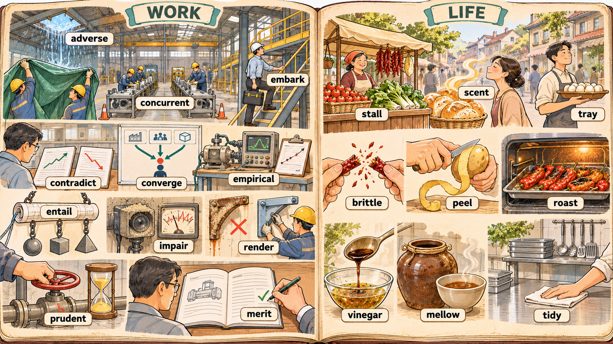

# 每日英语单词 20 个 · 2026-11-21（第 31 期）

> **定位**：面向 CET-6 六级高频/中频核心词汇，以职场和生活语境掌握常用义与搭配；六级与四级词汇存在重叠，本期不宣称逐词具有经统计核验的真题频次。
> **构成与去重**：职场 11 + 生活 9；避开历史索引全部 600 个词条（第 1--30 期），短语按逗号整体去重。本期累计 620 词。
> **记忆说明**：以下记忆提示分两类标注——「词根」为可确认的构词提示，「联想」为便于记忆的画面联想，不作严格词源考据；搭配辨析表示常见用法，不作绝对规则。
> **配套**：根目录 `每日20词-复习窗口.md` 与 `已推荐单词索引.md`。

## 场景记忆图

- 2026-11-21：请求模型 `gpt-image-2.5-flare`；实际尺寸 1672 × 941；耗时 50.98 秒。原图保留于 `/Users/insistgang/Pictures/Sub2API Images/gpt-image-2.5-flare-20261121-daily1121.png`，副本已归档至 `../场景配图/`。
- 本版为**带词标签版**：图中标注 WORK 11 词 + LIFE 9 词，共 20 个标签，一对一对应正文各词，一次生成即带齐。
- 左栏为一次老厂房改造评审（WORK）：漏雨的屋顶 → 两条并行的产线 → 两份打架的数据 → 意见汇到同一点 → 踏上二楼平台的第一步 → 试运行台 → 拴着三只砝码的图纸 → 粉尘糊住的传感器 → 页边的一个勾 → 只开一半的阀门 → 换掉锈蚀支架。
- 右栏为一个周六的买菜做饭（LIFE）：街角摊位 → 面包香 → 一盘鸡蛋 → 碎掉的干辣椒 → 卷出的土豆皮 → 起泡的烤辣椒 → 倒醋 → 陈醋陶罐 → 擦净的台面。
- 书页与单据上的小字为示意性排线、不可辨，属已知瑕疵，不影响词义对应。

## 职场篇（11 词）

**1. adverse** /ædˈvɜːrs/
- **词义**：adj. 不利的，有害的；相反的，对立的
- **例句**：The retrofit stalled when adverse weather kept the roof open for a week.
- **翻译**：改造卡住了——恶劣天气让屋顶整整敞开了一周。
- **记忆提示**：词根 —— ad（向）+ vers（转，拉丁 vertere「转」；同族 reverse、convert、divert、versatile、versus）——"转过来正对着你"，挡在路上的那股劲就是"不利的"。⚠️ 搭配 adverse weather / conditions、adverse effect on sth、an adverse reaction（不良反应）。⚠️ 与 averse 只差一个字母：adverse 说的是"事"（不利），averse 说的是"人"（不情愿，be averse to）。

**2. concurrent** /kənˈkɜːrənt/
- **词义**：adj. 同时发生的，并行的；一致的
- **例句**：Running two concurrent upgrades on the same line doubled the risk of a shutdown.
- **翻译**：同一条产线上并行做两项升级，停机的风险翻了一倍。
- **记忆提示**：词根 —— con（共同）+ curr（跑，拉丁 currere「跑」；同族 current、occur、recur、curriculum、excursion）+-ent——"几条线一起跑"，故是"并行的"。⚠️ 搭配 concurrent with sth、concurrent sessions（并行分会场）；名词 concurrency。⚠️ 与 consecutive 差在"重叠"还是"相接"：concurrent 是同时占着时间，consecutive 是一个接一个不断。

**3. contradict** /ˌkɑːntrəˈdɪkt/
- **词义**：v. 反驳，驳斥；与…相矛盾
- **例句**：The vendor's report contradicted the readings we took on site.
- **翻译**：供应商的报告和我们在现场读到的数据对不上。
- **记忆提示**：词根 —— contra（相反）+ dict（说，拉丁 dicere「说」；同族 dictate、predict、verdict、dictionary）——"说反话"，故既是"反驳"也是"相矛盾"。⚠️ 搭配 contradict sb / sth、contradict each other、contradict itself；形容词 contradictory（说法互相打架的）、名词 contradiction。⚠️ 与 refute 不同：contradict 只是"对不上、说相反"，refute 是"拿出证据把它驳倒"。

**4. converge** /kənˈvɜːrdʒ/
- **词义**：v. 汇聚，集中；（意见、数字）趋于一致
- **例句**：After three rounds of review, both teams' estimates converged on the same figure.
- **翻译**：三轮评审之后，两个团队的估算落在了同一个数上。
- **记忆提示**：词根 —— con（共同）+ verg（转向，拉丁 vergere「转向」；同族 diverge、verge）——"各自转向同一点"，故是"汇聚、趋同"。⚠️ 搭配 converge on / at sth、converge with sth；名词 convergence；反义 diverge（分岔）。⚠️ 六级阅读常拿"两派观点逐渐 converge"表示"分歧缩小"，不是"完全一致"。

**5. embark** /ɪmˈbɑːrk/
- **词义**：v. 着手，开始（on / upon）；上船，登机
- **例句**：We embarked on the second phase before the first one had fully settled.
- **翻译**：第一阶段还没完全稳定，我们就着手第二阶段了。
- **记忆提示**：词根 —— em（=in，进入）+ bark（船，古法语 barque「小船」；同族 embarkation）——"上船"，一件事一旦上船就只能往前，故引申为"着手、开始"。⚠️ 搭配 embark on / upon sth、embark on a career；名词 embarkation。⚠️ 后面必须接 on / upon，不能直接说 embark the project。

**6. empirical** /ɪmˈpɪrɪkl/
- **词义**：adj. 经验的，实证的；以观察或实验为依据的
- **例句**：The proposal sounded reasonable, but there was little empirical evidence behind it.
- **翻译**：这方案听着合理，背后却几乎没有实证依据。
- **记忆提示**：词根 —— em（=en，在…之中）+ peir（尝试，希腊 peira「试验」；同族 experience、experiment、expert）+-ical——"从一次次试出来的经验里来的"，故是"实证的"。⚠️ 搭配 empirical evidence / data / study、empirical research；反义 theoretical；副词 empirically。⚠️ 六级里 empirical 常与 evidence、findings 同现，看到它就往"拿数据说话"上想。

**7. entail** /ɪnˈteɪl/
- **词义**：v. 牵涉，需要；使…成为必要
- **例句**：Adding a second shift would entail hiring twelve more people by June.
- **翻译**：加一个班次，就意味着六月前还要再招十二个人。
- **记忆提示**：词根 —— en（使…）+ tail（=tale，切割、限定，古法语 taillier「切」；同族 tailor、detail、retail）——"把附带条件一起切进这件事里"，故是"牵涉、必然带来"。⚠️ 搭配 entail costs / risks / changes、sth entails doing sth；名词 entailment 少用，写作时直接用动词最稳。⚠️ 与 involve 相比，entail 更强调"逻辑上必然要付的代价"，多用于方案、政策类主语。

**8. impair** /ɪmˈper/
- **词义**：v. 损害，削弱（功能、能力）
- **例句**：Fine dust impaired the sensors long before anyone noticed the drift.
- **翻译**：细粉尘早就损害了传感器，只是没人注意到读数在漂。
- **记忆提示**：词根 —— im（使…进入某种状态）+ pair（=pejor，更坏，拉丁 pejor「更差的」；同族 pejorative）——"把东西往坏里推一把"，故是"损害功能"。⚠️ 搭配 impair one's ability / vision / hearing、seriously impaired；名词 impairment（减值、损伤）。⚠️ 与 damage 不同：impair 几乎只接抽象功能（视力、判断、性能），damage 可以接具体物件（damage the machine）。

**9. merit** /ˈmerɪt/
- **词义**：n. 优点，价值，长处；v. 值得，应得
- **例句**：The plan has merit, but not enough to justify a full shutdown.
- **翻译**：这方案有价值，但还不足以支撑整线停机。
- **记忆提示**：词根 —— mer（挣得、配得上，拉丁 merere「挣得」；同族 meritorious、emeritus）——"自己挣来的那份价值"，故是"优点"；动词义"值得"就是"配得上被考虑"。⚠️ 搭配 have merit、on merit（凭实力）、merit consideration（值得考虑）、merit attention。⚠️ 与 advantage 不同：advantage 是"比对手多出来的那一点"，merit 是"这件事本身的好处"。

**10. prudent** /ˈpruːdnt/
- **词义**：adj. 谨慎的，审慎的；精明的
- **例句**：It would be prudent to run the new line at half load for a month.
- **翻译**：新线先半负荷跑一个月，才算稳妥。
- **记忆提示**：词根 —— prud（=prov，预先看见，拉丁 providere「预先看」；同族 provide、provident、providence）+-ent——"先把风险看在眼里"，故是"审慎的"。⚠️ 搭配 it is prudent to do sth、a prudent decision、prudent use of resources；名词 prudence。⚠️ 与 cautious 不同：cautious 偏"怕出错而小心"，prudent 偏"算过账之后的稳妥"，是褒义的评价词。

**11. render** /ˈrendər/
- **词义**：v. 使成为，使变得；给予，提供；（用艺术形式）表现
- **例句**：Rust had rendered two of the support brackets unsafe, so we replaced them all.
- **翻译**：锈蚀已经让两个承重支架不再安全，于是我们全换了。
- **记忆提示**：词根 —— ren（=re，回）+ der（给，拉丁 dare「给」；同族 donate、edition、date）——"给回去"，故是"提供、给予"；给出某种状态就是"使成为"。⚠️ 高频结构 render sth + 形容词：render sth useless / harmless / impossible、render assistance（提供帮助）。⚠️ 别按"渲染"死记，六级里它八成是"使…变成"这个骨架。

## 生活篇（9 词）

**12. stall** /stɔːl/
- **词义**：n. 摊位，货摊；v. （发动机）熄火；拖延，搁置
- **例句**：The stall at the corner sells the only tomatoes that still smell like tomatoes.
- **翻译**：街角那个摊位卖的番茄，是唯一还闻得出番茄味的。
- **记忆提示**：词根 —— 古英语 steall「位置、站立处」（同族 install、station、stand）——"摆在那里的一个位子"，故是"摊位"；发动机"停住不动"也是同一个"定住"的意思。⚠️ 搭配 a market stall、run a stall、the engine stalled、talks stalled（谈判僵住）。⚠️ 与 booth 不同：stall 多是露天或市场里的简易摊，booth 是有隔板的小隔间（电话亭、展位）。

**13. scent** /sent/
- **词义**：n. 香味，气味；（动物的）嗅迹；v. 嗅到，察觉
- **例句**：The scent of new bread pulled him two blocks out of his way.
- **翻译**：新出炉面包的香味，把他多引了两个街区。
- **记忆提示**：词根 —— 拉丁 sentire「感觉、察觉」（同族 sense、sensitive、consent、sentiment）——"被鼻子察觉到的那一点"，故是"气味"。⚠️ 搭配 the scent of sth、a faint / sweet scent、on the scent of（追踪）；动词 scent danger（察觉危险）。⚠️ 三兄弟要分清：scent（气味）、cent（分，货币）、sent（send 的过去式），读音完全一样。

**14. tray** /treɪ/
- **词义**：n. 托盘，浅盘；（文件）盘
- **例句**：He carried a tray of eggs across the courtyard without breaking one.
- **翻译**：他端着一盘鸡蛋穿过院子，一个都没破。
- **记忆提示**：联想 —— 词源不确定（一说古英语 treg「木制浅器」），联想更可靠：一只手平平托住的浅盘，端鸡蛋、端茶杯、端文件都用它。⚠️ 搭配 a tray of sth、a tea tray、on a tray、the in-tray（待办文件盘）。⚠️ 与 plate 不同：plate 是每人一份的平盘，tray 是"一次端很多"的托盘。

**15. brittle** /ˈbrɪtl/
- **词义**：adj. 易碎的，脆的；（声音、笑容）紧绷的，勉强的
- **例句**：The dried chillies were so brittle that they shattered in his hand.
- **翻译**：干辣椒脆得一捏就在他手里碎了。
- **记忆提示**：词根 —— 与 break 同源（古英语 breotan「折断」）——"一掰就断、没有韧性"，故是"脆的"。⚠️ 搭配 brittle hair / bones / plastic、a brittle laugh（勉强的笑）；名词 brittleness。⚠️ 与 fragile 不同：fragile 是"经不起碰"，多指精细易损之物；brittle 是"材质本身硬而脆"，受力就裂不弯。

**16. peel** /piːl/
- **词义**：v. 削皮，剥（皮）；n. （果）皮，外皮
- **例句**：She peeled the potatoes in one long strip without looking down.
- **翻译**：她一眼没低，就把土豆皮削成一整条。
- **记忆提示**：词根 —— 拉丁 pellis「皮」（同族 pelt、pellicle）——"把那层皮取下来"，故是"削皮"；名词就是"那层皮"。⚠️ 搭配 peel sth、peel off（剥落；脱掉）、orange peel、peel the label off。⚠️ 与 strip 不同：peel 专指"剥薄薄一层皮或膜"，strip 是"把外层整条扯掉"，力度更大。

**17. roast** /roʊst/
- **词义**：v. 烤，烘（肉、蔬菜、坚果）；n. 烤肉；adj. 烤制的
- **例句**：He roasted the peppers until the skins blistered, then let them steam in a covered bowl.
- **翻译**：他把辣椒烤到表皮起泡，再盖在碗里焖一会儿。
- **记忆提示**：联想 —— 日耳曼语源、经古法语 rostir 进入英语，本义与"串起来在火上转着烤"有关，"转"这个动作比词根更好记。⚠️ 搭配 roast beef / chicken、oven-roast、roast vegetables；美式口语 a roast 还指"公开吐槽某人"的场合。⚠️ 与 bake 不同：roast 是明火或高温干烤（肉、根茎菜），bake 是烤箱里的面点、面包。

**18. vinegar** /ˈvɪnɪɡər/
- **词义**：n. 醋
- **例句**：A spoon of vinegar woke up the whole dressing.
- **翻译**：一勺醋就把整碗料汁提起来了。
- **记忆提示**：词根 —— vin（酒，拉丁 vinum「葡萄酒」；同族 wine、vineyard、viniculture）+ egar（=aigre，酸的，同族 eager、acid、acrid）——"变酸了的酒"，故是"醋"。⚠️ 搭配 a splash / dash of vinegar、rice vinegar、malt vinegar、vinegar-based sauce。⚠️ 拼写里的 -egar 不是 egg，别写成 ~~vineggar~~。

**19. mellow** /ˈmeloʊ/
- **词义**：adj. （味道）醇厚的、（声音）圆润的、（光）柔和的；成熟的；v. （使）变柔和
- **例句**：The vinegar had mellowed with age and tasted almost sweet.
- **翻译**：那坛醋放陈了，酸得圆润，几乎带甜。
- **记忆提示**：联想 —— 词源不确定（一说与"成熟、变软"的古老词根有关），联想更可靠：把尖锐的酸味磨圆，剩下的那点回甘就是 mellow。⚠️ 搭配 a mellow flavour / tone / light、mellow with age、mellow out（放松下来）。⚠️ 与 mild 不同：mild 是"不刺激、温和"，mellow 是"经时间打磨后变得圆熟"，含褒义与时间感。

**20. tidy** /ˈtaɪdi/
- **词义**：adj. 整洁的，井井有条的；v. 整理，收拾（tidy up）
- **例句**：He wiped the counter, stacked the trays, and tidied up before the soup was even cold.
- **翻译**：汤还没凉，他就擦完台面、摞好托盘，把厨房收拾干净了。
- **记忆提示**：词根 —— tid（时节、得当，古英语 tid「时间」；同族 tide、timely、tidings）+-y——"合乎时令、各就各位"，故是"整洁"；动词义"收拾"就是"让东西各回各位"。⚠️ 搭配 tidy up、a tidy room、keep sth tidy、a tidy sum（一笔不小的钱，口语）。⚠️ 与 neat 不同：tidy 强调"归置到位"，neat 更强调"外表干净利落"。

## 助记卡（词根/画面抓手 + 高频搭配）

| 单词 | 词根/画面抓手 | 高频搭配 |
|---|---|---|
| adverse | ad + vers（转）→ 转过来正对着你 | adverse weather |
| concurrent | con + curr（跑）→ 几条线一起跑 | concurrent with sth |
| contradict | contra + dict（说）→ 说反话 | contradict each other |
| converge | con + verg（转向）→ 转向同一点 | converge on sth |
| embark | em + bark（船）→ 上船就往前 | embark on sth |
| empirical | em + peir（试）→ 试出来的经验 | empirical evidence |
| entail | en + tail（切）→ 附带条件切进来 | entail costs |
| impair | im + pair（更坏）→ 往坏里推一把 | impair one's ability |
| merit | mer（挣得）→ 挣来的那份价值 | have merit |
| prudent | prud（预见）→ 先看见风险 | it is prudent to do |
| render | re + der（给）→ 给成某种状态 | render sth useless |
| stall | steall（站位）→ 摆在那的一个位子 | a market stall |
| scent | sentire（察觉）→ 被鼻子察觉 | the scent of sth |
| tray | 一只手掌平托的浅盘 | a tray of eggs |
| brittle | 与 break 同源 → 一掰就断 | brittle hair |
| peel | pellis（皮）→ 取下那层皮 | peel off |
| roast | 串起来在火上转着烤 | roast vegetables |
| vinegar | vin（酒）+ aigre（酸）→ 变酸的酒 | a dash of vinegar |
| mellow | 尖锐的酸被时间磨圆 | mellow with age |
| tidy | tid（得当）→ 各就各位 | tidy up |

## 一句话串记

**职场线**：屋顶漏雨是 **adverse**，两条产线 **concurrent** 一起动；供应商的报告和现场日志 **contradict**，几个部门的箭头最后 **converge** 到同一个数；第一阶还没稳就 **embark** 第二阶段，试运行台上的曲线才算 **empirical**；方案 **entail** 停机、加人、加钱三笔代价，粉尘先把传感器 **impair** 了；方案本身有 **merit**，但只开一半阀门才叫 **prudent**；锈到变形的支架，早已 **render** 整段平台不安全。

**生活线**：周六拐进街角的 **stall**，新面包的 **scent** 先撞上来；一盘鸡蛋端过院子叫 **tray**，干辣椒脆得 **brittle**，一捏就碎；土豆皮被刀削成一条 **peel**，辣椒进烤箱 **roast** 到起泡；一勺 **vinegar** 把料汁提起来，陈醋在陶罐里放得 **mellow**；汤还没凉，台面已经擦得 **tidy**。

## 记忆宫殿 · 双线场景故事

### 职场线（11 词）· 从一片漏雨的屋顶到一根换下的锈支架

推开车间大门，第一眼是屋顶被掀开的一道口子，雨斜着灌进来，四个人扯着防水布往上顶——这是 **adverse**（不利的）；低头两条产线同时开工，一队人守一条，钢架还没装完就并排往前走——这是 **concurrent**（并行的）；休息区的桌上摊着两份纸，一份供应商报告画着上箭头，一份现场日志画着下箭头，工程师的笔在两行数字之间来回敲——这是 **contradict**（相矛盾）；墙上那张总平面图上，三个部门的箭头从不同角落射出来，全都扎进同一个红点——这是 **converge**（汇聚）；戴安全帽的主管把一只脚踩上通往二楼平台的钢梯第一级，工具包还在手里晃——这是 **embark**（着手）；平台边一台试运行的台架上，传感器把曲线画进夹板上的实测记录——这是 **empirical**（实证的）；再往里，一卷图纸被铁链锁住，链子上垂着三只铁砝码，一只比一只沉——这是 **entail**（牵涉代价）；粉尘最大的角落，传感器镜头糊成一片，表针乱跳——这是 **impair**（损害）；回到评审桌，方案册摊开在某一页，一只手在页边画了个小勾——这是 **merit**（有价值）；桌角一只阀门，手只肯拧开一半，旁边立着沙漏——这是 **prudent**（审慎）；最后镜头抬到头顶，一根锈得发弯的支架被打了个红叉，工人正把一根新的直支架装上去——这是 **render**（使变得）。

> 画面链：斜灌进来的雨与四个人顶着的防水布 → 两条并排推进的产线 → 一上一下两份打架的纸 → 三个箭头扎进同一个红点 → 踩上钢梯第一级的那只脚 → 台架上画进夹板的曲线 → 铁链下三只越来越沉的砝码 → 糊住镜头乱跳的表针 → 页边那个小勾 → 只肯开一半的阀门与沙漏 → 打红叉的锈支架旁新装的直支架。

### 生活线（9 词）· 从一个街角摊位到一块擦干净的台面

周六早市，拐角那个木头摊位堆着番茄和青菜，红辣椒一串串挂在棚下——这是 **stall**（摊位）；隔壁篮子里刚出炉的面包正冒气，几道弯曲的香气直往路人鼻子里钻——这是 **scent**（香味）；一个男人一只手平托着浅盘穿过院子，盘里鸡蛋一个挨一个——这是 **tray**（托盘）；回到厨房，两根手指捏起一只干辣椒，轻轻一掰就碎成一片红屑——这是 **brittle**（易碎的）；刀贴着土豆转一圈，一条不断的皮卷着往下垂——这是 **peel**（削皮）；烤盘推进去，辣椒表皮一点点鼓泡、发焦——这是 **roast**（烤）；勺子倾下去，深色的醋流进料汁碗——这是 **vinegar**（醋）；灶台边一只上了釉的陶罐敞着口，陈醋在旁边碗里泛着柔和的光和一点热气——这是 **mellow**（醇厚）；汤还在锅里，抹布已经从台面这头擦到那头，托盘摞齐、勺子归位——这是 **tidy**（收拾整洁）。一天从街角开始，在一块干净的台面上收尾。

> 画面链：堆着番茄青菜的木头摊位 → 直往鼻子里钻的面包香 → 平托着一盘鸡蛋的手 → 两指间碎成红屑的干辣椒 → 卷着垂下的土豆皮 → 表皮鼓泡发焦的烤辣椒 → 流进料汁碗的深色醋 → 泛着柔光的陈醋陶罐 → 擦到头的抹布与摞齐的托盘。

## 排雷台（19 组易混与搭配辨析）

| 辨析 | 关键差别与常见搭配 |
|---|---|
| adverse / averse | adverse 说"事"：不利的（adverse weather、adverse effect on）；averse 说"人"：不情愿的（be averse to risk）。两词读音起头不同，adverse 重音在前。 |
| concurrent / consecutive / simultaneous | concurrent 是"同时并行、时间重叠"（concurrent projects）；consecutive 是"一个接一个不断"（three consecutive days）；simultaneous 强调"同一瞬间发生"（simultaneous translation）。 |
| contradict / refute / deny | contradict 是"说法对不上、出言相反"（contradict the data）；refute 是"用证据驳倒"（refute the claim）；deny 只是"否认"，不必给证据。 |
| converge / diverge / assemble | converge 是"从各处汇到一点、趋同"（converge on a figure）；diverge 是它的反义"分岔、分歧扩大"；assemble 只是"把人或件聚到一起"，不含"趋于一致"。 |
| embark on / launch / commence | embark on 强调"迈出第一步、上船往前走"，常接抽象名词（embark on a career）；launch 是"正式推出"（launch a product）；commence 最正式，只陈述"开始"（commence operations）。 |
| empirical / experimental / theoretical | empirical 强调"依据观察与实测数据"（empirical evidence）；experimental 是"实验性质的、还在试"（an experimental model）；theoretical 是"理论上的"，与 empirical 成对出现。 |
| entail / involve / require | entail 是"逻辑上必然带来的代价"（entail extra costs）；involve 中性，只陈述"牵涉在内"（involve three teams）；require 是"规定或需要"，语气更硬。 |
| impair / damage / weaken | impair 几乎只接抽象功能（impair vision、impair performance）；damage 可接具体物件（damage the machine）；weaken 是"使变弱"，可用于人、结构、论证。 |
| merit / advantage / virtue | merit 指"这件事本身的好处、值得考虑之处"（have merit）；advantage 是"比起对手多出的优势"（a competitive advantage）；virtue 偏"品德、美德"，也可指"优点"但更书面。 |
| prudent / cautious / discreet | prudent 是"算过账后的稳妥"，褒义（a prudent decision）；cautious 是"怕出错而小心"，中性偏保守；discreet 专指"说话行事不张扬、守密"。 |
| render / make / cause | render 后面常接"形容词"表状态（render sth useless）；make 同样可接形容词但更口语（make it easy）；cause 接"结果名词"（cause delays），不能说 cause sth useless。 |
| stall / booth / stand | stall 是市场里的简易摊位（a market stall），也可指发动机熄火；booth 是有隔板的小间（a phone booth、a trade booth）；stand 是展架、报摊（a news stand）。 |
| scent / smell / odor | scent 偏"好闻的气味、嗅迹"（the scent of bread）；smell 中性，可好可坏，最常用；odor 偏"异味"，常带负面（a strange odor）。 |
| tray / plate / platter | tray 是"一次端很多"的托盘（a tray of eggs）；plate 是每人一份的平盘；platter 是上菜用的大浅盘，多用于冷盘、拼盘。 |
| brittle / fragile / crisp | brittle 是"材质硬而脆，受力就裂不弯"（brittle bones）；fragile 是"精细易损、经不起碰"（fragile glass）；crisp 是"脆得爽口"，用于食物与语气（crisp bacon）。 |
| peel / strip / skin | peel 专指"剥薄薄一层皮或膜"（peel the potatoes、peel off a label）；strip 是"把外层整条扯掉"，力度更大（strip the paint）；skin 作动词多指"给动物去皮"。 |
| roast / bake / grill | roast 是明火或高温干烤肉与根茎菜（roast beef）；bake 是烤箱里的面点（bake bread）；grill 是"架在火上、从上往下烤"（grill the fish）。 |
| vinegar / dressing / sauce | vinegar 是"醋"本身；dressing 是"拌沙拉用的调味汁"，通常以醋或油打底；sauce 是泛指"酱汁"，浇在菜上。 |
| mellow / mild / tender | mellow 是"经时间打磨后变圆熟"（mellow with age）；mild 是"不刺激、温和"（mild flavour）；tender 是"肉质柔嫩、易嚼"（tender meat），与味道无关。 |

## 快速自测（5 题 · 答案折叠）

**1. 语境选词填空**：The two audits ran ______ on the same line, and neither team knew the other was there.（从 concurrent / consecutive / converge 中选择，注意形式）

**2. 用法改错**：The new policy will entail for extra training costs. 请判断 entail 的用法是否恰当，并改正。

**3. 中译英**：锈蚀已经让两个承重支架不再安全，于是我们全换了。

**4. 一词两义**：stall 在 "a market stall" 中意为 ______，在 "the engine stalled" 中意为 ______。

**5. 生活场景选词**：He carried a ______ of eggs across the yard, then ______ the potatoes in one long strip.（从 tray / peel / roast / brittle 中选两个，注意形式）

👉 点击展开答案

1. **concurrently**（或 were concurrent）；句意是"两次审计在同一条产线上同时进行"，强调时间重叠，用副词 concurrently 最自然。consecutive 是"连续不断、一个接一个"，与"两条线并行"矛盾；converge 是"汇聚"，不能这样用。
2. **不恰当**——entail 是及物动词，后面直接接"代价"，不能加 for。应改为：The new policy will **entail** extra training costs. 若想保留 for 的结构，可换成 **call for**（需要）或 **result in**（导致）。
3. **Rust had rendered two of the support brackets unsafe, so we replaced them all.**；用 render sth + 形容词的结构，比 made them unsafe 更书面，也是六级写作的加分句式。
4. 第一个是 **摊位、货摊**；第二个是 **（发动机）熄火、停住不动**。两个义项共用"定在一个位子上不动"的意象：摊位是"摆定的位子"，熄火是"机器定住不转"。
5. **tray** 与 **peeled**；carry a tray of eggs 是"端一盘鸡蛋"，peel the potatoes 是"削土豆皮"，与 "in one long strip" 搭配的只能是削皮的动作。brittle 是形容词"易碎的"，roast 是"烤"，都不合此处。

---

*第 31 期 · 2026-11-21 · 累计已学 620 词（CET-6 向）*
