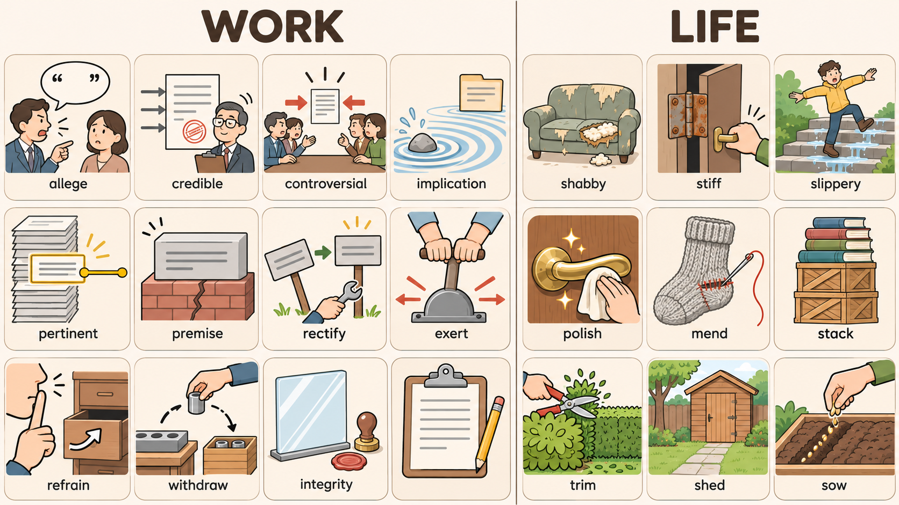

# 每日英语单词 20 个 · 2026-11-22（第 32 期）

> **定位**：面向 CET-6 六级高频/中频核心词汇，以职场和生活语境掌握常用义与搭配；六级与四级词汇存在重叠，本期不宣称逐词具有经统计核验的真题频次。
> **构成与去重**：职场 11 + 生活 9；避开历史索引全部 620 个词条（第 1--31 期），短语按逗号整体去重。本期累计 640 词。
> **记忆说明**：以下记忆提示分两类标注——「词根」为可确认的构词提示，「联想」为便于记忆的画面联想，不作严格词源考据；搭配辨析表示常见用法，不作绝对规则。
> **配套**：根目录 `每日20词-复习窗口.md` 与 `已推荐单词索引.md`。

## 场景记忆图

- 2026-11-22：请求模型 `gpt-image-2.5-flare`；实际尺寸 1672 × 941；耗时 49.51 秒。原图保留于 `/Users/insistgang/Pictures/Sub2API Images/gpt-image-2.5-flare-20261122-083720-ac166b25.png`，副本已归档至 `../场景配图/`。
- 本版为**带词标签版**：图中标注 WORK 11 词 + LIFE 9 词，共 20 个标签，一对一对应正文各词，一次生成即带齐。
- 左栏为一次供应商检测数据评审（WORK）：指着对方说话的空引号气泡 → 三股证据汇入的盖章报告 → 长桌两侧对着同一份文件推箭头 → 石头入水涟漪扩散到合规档案 → 一摞纸里只有一页被圈出 → 砖台托着论证块、砖台开裂 → 扳手把歪牌掰直 → 双手下压杠杆、箭头外散 → 把抽屉推回去并竖起食指 → 从工作台把样件收回木箱 → 无裂的玻璃与完整的印章。
- 右栏为周末修整后院（LIFE）：掉漆露絮的旧沙发 → 生锈半开的门铰链 → 湿台阶上张开双臂的人 → 布擦到发亮的铜把手 → 针线补羊毛袜 → 整齐摞高的木箱与书 → 剪刀修齐一排树篱 → 后院尽头的小木棚 → 手把种子撒进土垄。
- 书页、单据、招牌上的线条均为示意性排线、不可辨，属已知瑕疵，不影响词义对应。

## 职场篇（11 词）

**1. allege** /əˈledʒ/
- **词义**：v. （未经证实地）声称，指称；作为理由提出
- **例句**：The supplier's internal memo alleges that two inspectors signed off on tests that were never run.
- **翻译**：供应商的内部备忘录指称，两名检验员在从未做过的测试上签了字。
- **记忆提示**：词根 —— al（=ad，向）+ leg（派遣、送出，拉丁 legare「派遣、委托」；同族 delegate、legacy、league）——"把人派出去传话"，传回来的只是一方之词，故 allege 天生带"尚未证实"的味道。⚠️ 搭配 be alleged to do sth、it is alleged that…、allegedly（据称）。⚠️ 与 claim 不同：claim 可以理直气壮，allege 在新闻和法律语境里默认"待证"。

**2. credible** /ˈkredəbl/
- **词义**：adj. 可信的，可靠的；有说服力的
- **例句**：The explanation was plausible, but it was not credible until the raw logs arrived.
- **翻译**：这个解释听着说得通，但在原始日志到手之前还谈不上可信。
- **记忆提示**：词根 —— cred（相信，拉丁 credere「相信」；同族 credit、credential、creed、incredible）+-ible（能…的）——"能被相信的"。⚠️ 搭配 credible evidence / source / witness、a credible explanation；名词 credibility（公信力）。⚠️ 与 plausible 不同：plausible 只是"听着圆得上"，credible 是"够格被当真"，暗含证据支撑。

**3. controversial** /ˌkɑːntrəˈvɜːrʃl/
- **词义**：adj. 有争议的，引起争论的
- **例句**：The decision to award the contract without a second bid was controversial even inside the company.
- **翻译**：没走第二轮比价就把合同授出去，这个决定即便在公司内部也很有争议。
- **记忆提示**：词根 —— contro（=contra，相反）+ vers（转，拉丁 vertere「转」）+-ial——"被转到对立面的"；一件事只要两边人朝相反方向转，就是"有争议"。⚠️ 搭配 a controversial decision / issue / figure、highly controversial；名词 controversy /ˈkɑːntrəvɜːrsi/。⚠️ 与 debatable 不同：debatable 是"还可以讨论、尚无定论"，controversial 是"已经吵起来了"。

**4. implication** /ˌɪmplɪˈkeɪʃn/
- **词义**：n. 影响，可能的后果；（话里未明说的）含义，暗示
- **例句**：The finding has one implication nobody wanted to say out loud: the recall may have to cover the whole batch.
- **翻译**：这个发现带来一个没人愿意说出口的后果：召回范围可能得覆盖整批货。
- **记忆提示**：词根 —— im（向内）+ plic（折叠，拉丁 plicare「折」；同族 complicated、explicit、duplicate、multiply）+-ation——"折在里面、没摊开的那一层"，故既是"言外之意"，也是"连带后果"。⚠️ 搭配 have implications for sth、by implication（言下之意）、serious implications。⚠️ 与 consequence 不同：consequence 是已经发生之后的"结果"，implication 是"接下来会牵出什么"的推演。

**5. pertinent** /ˈpɜːrtnənt/
- **词义**：adj. 相关的，切题的；恰当的
- **例句**：Half the file was irrelevant; only the three pages about curing times were pertinent.
- **翻译**：半份材料都无关，只有讲养护时间的那三页是切题的。
- **记忆提示**：词根 —— per（贯穿）+ tin（持住，拉丁 tenere「握」；同族 contain、retain、sustain、tenant）+-ent——"一直扣在主题上不松手"，故是"切题的"。⚠️ 搭配 pertinent to sth、pertinent information / question。⚠️ 与 relevant 同义，但 pertinent 更书面，强调"恰好打在点上"；口语里 relevant 更常用。

**6. premise** /ˈpremɪs/
- **词义**：n. 前提，假设；（复数 premises）房屋及场地，经营场所
- **例句**：The whole schedule rests on one premise: that the mould arrives before the end of the month.
- **翻译**：整个排期压在一个前提上：模具得在月底前到。
- **记忆提示**：词根 —— pre（在前）+ mis（送，拉丁 mittere「送」；同族 mission、submit、transmit、admit）——"事先摆在前面的那句话"，后面的推理全踩在它上面。⚠️ 搭配 on the premise that…、a false premise、business premises（经营场所，恒用复数）。⚠️ 别把 premises 只当成 premise 的简单复数：说 premises 时通常指房子和地。

**7. rectify** /ˈrektɪfaɪ/
- **词义**：v. 纠正，矫正；改正（错误、偏差）
- **例句**：We rectified the offset in the calibration file before the next shipment went out.
- **翻译**：下一批货发出前，我们把校准文件里的偏移量改正了。
- **记忆提示**：词根 —— rect（直、正，拉丁 rectus「直的」；同族 correct、direct、erect、rectangle）+-ify（使…）——"把弯的掰直"，故是"纠正"。⚠️ 搭配 rectify a mistake / an error / the situation、rectify the imbalance。⚠️ 与 correct 相比，rectify 更正式，多用于制度、偏差、失衡这类系统性问题。

**8. exert** /ɪɡˈzɜːrt/
- **词义**：v. 施加（影响、压力、控制）；运用（能力、力气）
- **例句**：The client exerted pressure quietly, through deadlines rather than emails.
- **翻译**：客户施压的方式很安静——不靠邮件，靠交期。
- **记忆提示**：词根 —— ex（向外）+ ert（=sert，编连，拉丁 serere「编、接」；同族 insert、assert、desert）——"把力往外推出去"，故是"施加"。⚠️ 搭配 exert pressure / influence / control on sb、exert oneself（使劲，努力）。⚠️ exert 后面必须带宾语，不能单独说 he exerted；"对某人施压"是 exert pressure on sb，语序不能颠倒。

**9. refrain** /rɪˈfreɪn/
- **词义**：v. 抑制，忍住（refrain from doing sth）；n. （歌曲的）副歌
- **例句**：Both sides agreed to refrain from commenting until the audit report was out.
- **翻译**：双方约定，审计报告出来之前都不对外评论。
- **记忆提示**：词根 —— re（往回）+ frain（缰绳，拉丁 frenum「马嚼子」）——"把缰绳往回一拉"，故是"收住不做"。⚠️ 搭配 refrain from doing sth（固定接 from + 动名词）；名词义"副歌"另有来源，两义分开记。⚠️ 与 resist 不同：resist 是"顶住外来的诱惑或压力"，refrain 是"主动管住自己的动作"。

**10. withdraw** /wɪðˈdrɔː/
- **词义**：v. 撤回，收回；退出，撤离；取（款）
- **例句**：The vendor withdrew the batch from the line before the first unit reached the customer.
- **翻译**：第一批还没到客户手上，供应商就把那批货从产线上撤了下来。
- **记忆提示**：词根 —— with（向后，古英语 wið「逆向」）+ draw（拉）——"往回拉"，撤回、退出、取钱三义一线。⚠️ 搭配 withdraw sth from sth、withdraw from a deal、withdraw money；名词 withdrawal。⚠️ 不规则变化 withdraw--withdrew--withdrawn。

**11. integrity** /ɪnˈteɡrəti/
- **词义**：n. 诚信，正直；完整性，完好
- **例句**：The report questioned the integrity of the test data, not the integrity of the engineers.
- **翻译**：报告质疑的是测试数据的完整性，不是工程师的操守。
- **记忆提示**：词根 —— in（否定）+ teg（触碰，拉丁 tangere「触」；同族 tactile、contact、intact、tangent）+-ity——"没被碰过、没缺口"；物是"完整"，人是"没被腐蚀"，故一身两义。⚠️ 搭配 personal / professional integrity、data integrity、structural integrity。⚠️ 形容词 integral 是"不可或缺的"，不是"诚实的"，别顺势推错。

## 生活篇（9 词）

**12. shabby** /ˈʃæbi/
- **词义**：adj. 破旧的，磨损的；衣衫褴褛的；卑劣的，不光彩的
- **例句**：The sofa was shabby but so comfortable that nobody wanted to replace it.
- **翻译**：那张沙发破得掉渣，却舒服到没人想换。
- **记忆提示**：联想 —— 词源不确定（常被说成与 scab「痂」有关，但这条线并不牢靠），联想更可靠：一块布反复被磨，起了毛边、露出内里，就是 shabby。⚠️ 搭配 a shabby coat / sofa、shabby treatment（不公正的对待）、a shabby trick（下作的手段）。⚠️ 与 worn 不同：worn 是中性的"用旧了"，shabby 带"该换了"的评价色彩。

**13. stiff** /stɪf/
- **词义**：adj. 僵硬的，不易弯曲的；生硬的，拘谨的；（风、处罚）猛烈的，严厉的；adv. 极其（口语）
- **例句**：The back door was so stiff that you had to lift the handle before it would turn.
- **翻译**：后门僵得很，得先把把手往上提一下才拧得动。
- **记忆提示**：词根 —— 古英语 stif「僵直、坚硬」（同族 stiffen、stiffness）——"该弯的地方不肯弯"，门轴、脖子、态度都能用它。⚠️ 搭配 a stiff hinge / neck、a stiff smile、stiff competition / penalty、bored stiff（无聊透顶）。⚠️ stifle（使窒息）与它形近，但词源关联说法不一，别硬当同族记。

**14. slippery** /ˈslɪpəri/
- **词义**：adj. 滑的，湿滑的；难对付的，狡猾的
- **例句**：The steps turn slippery the moment it rains, so he always takes the side path.
- **翻译**：一下雨台阶就打滑，所以他总走旁边那条小路。
- **记忆提示**：词根 —— slip（滑，中古英语 slippen「滑倒」）+-ery——"脚踩上去留不住"；用到人身上，就是"抓不住、说话不算数"。⚠️ 搭配 a slippery floor / road、a slippery slope（滑坡效应，写作好用）、a slippery character。⚠️ 与 smooth 不同：smooth 是"平整光滑"，中性或褒义；slippery 是"滑到危险"。

**15. polish** /ˈpɑːlɪʃ/
- **词义**：v. 擦亮，抛光；润色，改进；n. 光泽；上光剂
- **例句**：He polished the brass handle until he could see the doorway in it.
- **翻译**：他把铜把手擦到能照见门洞。
- **记忆提示**：词根 —— 古法语 polir、拉丁 polire「磨光」（同族 polite，本义"磨过的、文雅的"）——"磨到发亮"；把文章磨一遍，就是"润色"。⚠️ 搭配 polish sth (up)、polish a draft / a speech、shoe polish、a high polish。⚠️ 美音 /ˈpɑːlɪʃ/、英音 /ˈpɒlɪʃ/；大写的 Poland 才是"波兰"，小写才是"擦亮"。

**16. mend** /mend/
- **词义**：v. 修补，缝补；痊愈，好转；n. 补丁，修补处
- **例句**：She mended the same sock three times rather than throw it away.
- **翻译**：同一只袜子她补了三回，也没舍得扔。
- **记忆提示**：词根 —— 由 amend（修正）截短而来，amend 出自拉丁 emendare（e- 出 + menda 缺陷）——"把缺陷去掉"。⚠️ 搭配 mend a sock / a fence、mend one's ways（改过自新）、on the mend（在好转）。⚠️ 与 repair 不同：mend 偏手工小修补（衣物、栅栏），repair 可用于机器、建筑等大件。

**17. stack** /stæk/
- **词义**：n. 一堆，一摞；v. 堆放，摞起；（store 的）货架
- **例句**：Crates were stacked three high along the back wall of the shed.
- **翻译**：木箱沿着棚屋后墙摞了三层高。
- **记忆提示**：联想 —— 词源不确定（一说来自古诺斯语 stakkr「草堆」），联想更可靠：东西一层压一层往上长，长成一座小塔，就是 stack。⚠️ 搭配 a stack of books / papers、stack up（堆积；站得住脚）、stack the shelves。⚠️ 与 pile 不同：stack 强调"码得整齐"，pile 只是"堆在一起"，允许乱。

**18. trim** /trɪm/
- **词义**：v. 修剪；削减（预算、人员）；装饰；adj. 整齐的，苗条的
- **例句**：He trimmed the hedge back to the height of the fence and left the clippings in a bag.
- **翻译**：他把树篱剪到跟栅栏一样高，碎枝装了一袋。
- **记忆提示**：词根 —— 古英语 trymman「使整齐、加固」——"把多余的边角去掉、让形状收干净"，故既是"修剪"也是"削减"。⚠️ 搭配 trim the hedge / one's hair、trim the budget、in trim（状态良好）、trimmed with（以…装饰）。⚠️ 与 cut 不同：trim 是"按形状修整"，有"修到合适"的目的，不是随便切一刀。

**19. shed** /ʃed/
- **词义**：n. 棚屋，小屋；v. 脱落，掉（叶、皮）；流出（泪、血）；摆脱
- **例句**：The mower lives in the shed at the end of the path, behind the hedge.
- **翻译**：割草机放在小路尽头、树篱后头那间棚屋里。
- **记忆提示**：联想 —— 两个义项来自不同的古英语词（"小屋"与"阴影"有关，"脱落"来自"分开"那一支），不必硬连；抓手是画面：后院尽头一间小木棚，秋天树在它旁边 shed 叶子。⚠️ 搭配 a garden / tool shed、shed leaves、shed light on（阐明，六级高频）、shed tears。⚠️ 与 hut 不同：shed 多指自家院里放工具杂物的小棚，hut 是供人临时住或避雨的小屋。

**20. sow** /soʊ/
- **词义**：v. 播种；散布，播下（思想、麻烦的种子）
- **例句**：He sowed the seeds in rows and marked each row with a cut stick.
- **翻译**：他把种子按行播下，每行插一根削好的木棍做记号。
- **记忆提示**：词根 —— 古英语 sāwan「播种」，与 seed、season 同出"撒种"这一支——"把种子撒进土里"，引申为"播下想法的种子"。⚠️ 搭配 sow seeds、sow doubt / confusion、reap what you sow（种什么收什么）。⚠️ 不规则变化 sow--sowed--sown；别与 sew /soʊ/（缝）混，两者同音不同义。

## 助记卡（词根/画面抓手 + 高频搭配）

| 单词 | 词根/画面抓手 | 高频搭配 |
|---|---|---|
| allege | al + leg（派人传话）→ 一方之词待证 | be alleged to do |
| credible | cred（相信）+ ible → 能被相信 | credible evidence |
| controversial | contro + vers（转向对立面）→ 两边对转 | a controversial issue |
| implication | im + plic（折）→ 折在里层没摊开 | have implications for |
| pertinent | per + tin（持住）→ 扣住主题不放 | pertinent to sth |
| premise | pre + mis（送）→ 事先摆在前面的那句 | on the premise that |
| rectify | rect（直）+ ify → 把弯的掰直 | rectify a mistake |
| exert | ex + ert（编连）→ 把力往外推 | exert pressure on |
| refrain | re + frain（缰绳）→ 拉回缰绳 | refrain from doing |
| withdraw | with（反向）+ draw（拉）→ 往回拉 | withdraw from a deal |
| integrity | in + teg（触碰）→ 没缺口、没被腐蚀 | data integrity |
| shabby | 布被磨出毛边、露出内里 | a shabby sofa |
| stiff | 古英语 stif（僵直）→ 该弯不肯弯 | a stiff hinge |
| slippery | slip（滑）+ ery → 踩上去留不住 | a slippery slope |
| polish | polire（磨光）→ 磨到发亮 | polish a draft |
| mend | amend 截短 → 去掉缺陷 | on the mend |
| stack | 一层压一层长成小塔 | a stack of papers |
| trim | trymman（使整齐）→ 去掉边角收干净 | trim the hedge |
| shed | 后院尽头那间小木棚；秋天落叶 | shed light on |
| sow | sāwan（播种）→ 把种子撒进土里 | sow seeds |

## 一句话串记

**职场线**：供应商的备忘录 **allege** 检验造假，报告在原始日志到手前算不上 **credible**；不走二轮比价就授标，这件事本身就 **controversial**，而它最大的 **implication** 是召回范围得扩到整批；半份材料里只有三页 **pertinent**，整个排期却压在一个 **premise** 上——模具月底前到；于是先 **rectify** 校准偏移，客户不催不问、只用交期 **exert** 压力，双方约定 **refrain** 对外发声，把那批货 **withdraw** 下产线，最后被追问的是数据的 **integrity**，不是人的操守。

**生活线**：客厅那张 **shabby** 沙发谁都不肯换，后门铰链 **stiff** 到要先把把手往上提，雨天台阶 **slippery** 只好绕小路；铜把手 **polish** 到能照见门洞，同一只袜子 **mend** 了三回，木箱沿墙 **stack** 到三层高；树篱 **trim** 到跟栅栏齐平，割草机照旧住进小路尽头那间 **shed**，开春的种子按行 **sow** 下，每行插一根木棍做记号。

## 记忆宫殿 · 双线场景故事

### 职场线（11 词）· 从一间评审室到一辆倒出货区的推车

推开评审室的门，长桌一头站着采购，手指点着对面供应商代表，嘴上一个空引号气泡悬着，里头一个字都没有——这是 **allege**（声称待证）；桌中央一份盖了章的报告，三股灰色箭头从三个方向汇进纸里，旁边的审计员缓缓点头——这是 **credible**（可信的）；可长桌两侧的人各自往前推箭头，都顶在同一份空白文件上，谁也说服不了谁——这是 **controversial**（有争议的）；墙角一只石头落进水盆，涟漪一圈圈荡开，一直荡到柜子上那只合规档案夹——这是 **implication**（连带后果）；柜前一摞半人高的纸，只有一页被荧光笔圈住，一条亮线把它牵回主线——这是 **pertinent**（切题的）；那页纸底下垫着一块砖台，砖台正中裂了一道缝，上面还稳稳托着一大块论证——这是 **premise**（前提）；走廊尽头，一只手拿扳手把歪掉的指示牌一点点掰回竖直——这是 **rectify**（纠正）；回到桌边，两只手压在一根粗杠杆上往下按，箭头从底座四散开——这是 **exert**（施加压力）；有人伸手把半开的抽屉推回去，同时竖起一根食指抵在嘴前——这是 **refrain**（忍住不说）；货区那边，一只手把台面上的样件抓起、丢回木箱——这是 **withdraw**（撤回）；最后镜头停在一块没有一丝裂纹的玻璃和一粒压下去的印章上——这是 **integrity**（完整、操守）。一屋子人吵完，真正被记住的只有那块没裂的玻璃。

> 画面链：空引号气泡 → 三股箭头汇入的盖章报告 → 两侧同时顶住同一份文件 → 涟漪荡到合规档案 → 一摞纸里被圈住的那一页 → 裂了缝仍托着论证的砖台 → 扳手把歪牌掰直 → 双手下压杠杆、箭头四散 → 推回抽屉并竖起食指 → 样件被丢回木箱 → 无裂的玻璃与压下的印章。

### 生活线（9 词）· 从一个堆着旧沙发的客厅到一排插着木棍的土垄

周六上午，客厅中央那张沙发扶手掉漆、坐垫裂口露出白絮——这是 **shabby**（破旧）；绕到后门，铰链锈成褐色，门只开了一半，一只手提着把手往上使劲——这是 **stiff**（僵硬）；出门下台阶，雨还没干，台阶上一层水光，人张开双臂一级一级往下蹭——这是 **slippery**（湿滑）；门厅那只铜把手被一块布反复来回擦，擦出几道星芒——这是 **polish**（擦亮）；回屋坐下，针带着线穿过羊毛袜的破洞，一针一针拉合——这是 **mend**（缝补）；后墙边木箱和书一层层码上去，摞成齐整的三层——这是 **stack**（摞起）；院子里剪刀开合，把长疯的树篱修成一条平线，碎枝落进袋里——这是 **trim**（修剪）；小路尽头，一间小木棚立在树篱后面，门虚掩，割草机停在里头——这是 **shed**（棚屋）；棚边一只长方木箱里，手一扬，种子落进划好的土沟，每行插一根削尖的木棍——这是 **sow**（播种）。一天从一张不肯换的旧沙发开始，在一排插好木棍的土垄上收尾。

> 画面链：掉漆露絮的旧沙发 → 提着把手才拧得动的锈铰链 → 湿台阶上张开双臂的人 → 擦出星芒的铜把手 → 针线穿过袜子的破洞 → 沿墙摞成三层的木箱 → 剪成一条平线的树篱 → 树篱后那间虚掩的小木棚 → 手一扬、种子落进土沟。

## 排雷台（20 组易混与搭配辨析）

| 辨析 | 关键差别与常见搭配 |
|---|---|
| allege / claim / assert | allege 是"未经证实地指称"，新闻法律默认待证（be alleged to do、allegedly）；claim 是"声称自己有权或属实"，语气可强可弱（claim responsibility）；assert 是"坚定断言"，重在态度硬（assert one's innocence）。 |
| credible / plausible / credulous | credible 是"够格被相信"，有证据支撑（credible evidence）；plausible 只是"听着自洽"（a plausible excuse，可能仍是假的）；credulous 是"人太容易信"，含贬义（a credulous buyer）。 |
| controversial / debatable / contentious | controversial 是"已经引起争论"（a controversial policy）；debatable 是"还有讨论空间、无定论"（it is debatable whether…）；contentious 语气更重，指"必吵"的议题（a contentious clause）。 |
| implication / consequence / inference | implication 是"话外之意、接下来会牵出什么"（have implications for）；consequence 是"已经发生的结果"，常带后果意味（face the consequences）；inference 是"推理这个动作或结论"（draw an inference）。 |
| pertinent / relevant / applicable | pertinent 最书面，强调"正中要点"（pertinent to the question）；relevant 最通用，只表示"有关系"（relevant experience）；applicable 指"规则、条款可适用"（applicable law）。 |
| premise / hypothesis / assumption | premise 是"推理所踩的前提"，可明说也可默认（on the premise that…）；hypothesis 是"待验证的科学假设"（test a hypothesis）；assumption 是"未加验证就当作成立"（a hidden assumption）。 |
| rectify / correct / remedy | rectify 最正式，多用于制度、偏差、失衡（rectify the imbalance）；correct 通用，改错即可（correct a typo）；remedy 强调"补救已造成的损害"（remedy the damage）。 |
| exert / impose / apply | exert 是"把力、影响推出去"（exert pressure on sb）；impose 是"强加于人"，带不受欢迎的意味（impose a fine on）；apply 是"施加或应用"，中性（apply force、apply a rule）。 |
| refrain / restrain / abstain | refrain 是自己收住不做（refrain from commenting）；restrain 是"按住、约束"，可对人也可对情绪（restrain sb from leaving）；abstain 专指"投票弃权、戒断不沾"（abstain from voting）。 |
| withdraw / retreat / revoke | withdraw 是"撤回、退出"，宾语可是货、申请、资金（withdraw the batch）；retreat 是"人往后退"，多为军事或态度转向（retreat from the position）；revoke 是"正式吊销"，用于执照、许可（revoke a licence）。 |
| integrity / honesty / entirety | integrity 兼指"操守"与"完整性"（personal integrity、data integrity）；honesty 只指"不说谎"；entirety 指"整体"（in its entirety，完整地）。 |
| shabby / worn / ragged | shabby 是"破旧到该换，带评价色彩"（a shabby sofa）；worn 中性，只陈述"用旧了"（worn tyres）；ragged 指"边缘破烂成条"（ragged jeans）。 |
| stiff / rigid / harsh | stiff 是"该弯不肯弯"，可用于物件、脖颈、态度（a stiff hinge、a stiff smile）；rigid 是"刚性、不容变通"，多形容制度与思维（rigid rules）；harsh 是"严厉、刺人"，用于处罚、言语、环境（harsh words）。 |
| slippery / smooth / slick | slippery 是"滑到危险"（a slippery road）；smooth 是"平整光滑"，中性或褒义（smooth surface）；slick 偏"滑得发亮"，也可形容"油滑圆熟"（a slick salesman）。 |
| polish / rub / buff | polish 是"磨到发亮"，也可指"润色"（polish a draft）；rub 只是"来回摩擦"，不含结果（rub the surface）；buff 是"用软轮或布打出镜面光泽"，更专业（buff the car）。 |
| mend / repair / patch | mend 偏手工小修补（mend a sock）；repair 可用于机器、建筑等大件（repair the roof）；patch 是"打补丁"，临时盖住破处（patch a tyre）。 |
| stack / pile / heap | stack 强调"码得整齐、往上摞"（stack the crates）；pile 只是"堆在一起"，可以杂乱（a pile of clothes）；heap 更随意、更大量（a heap of sand）。 |
| trim / cut / prune | trim 是"按形状修整到合适"（trim the hedge）；cut 是"切、割"，目的中性（cut the rope）；prune 专指"为生长而剪枝"（prune the branches）。 |
| shed / hut / cabin | shed 是院里放工具杂物的小棚（a garden shed）；hut 是供人临时住或避雨的小屋（a wooden hut）；cabin 可指小木屋，也指船舱、机舱（a log cabin）。 |
| sow / sew / plant | sow 专指"撒播种子"（sow seeds、sow doubt）；sew 是"缝"，与针线搭配，同音不同义（sew a button）；plant 是"栽下苗木、植株"（plant a tree）。 |

## 快速自测（5 题 · 答案折叠）

**1. 语境选词填空**：The witness was calm and specific, so his account sounded ______ enough for the panel to reopen the case.（从 credible / credulous / incredible 中选一个，注意形式）

**2. 用法改错**：Both sides agreed to refrain to comment until the report came out. 请判断 refrain 的用法是否恰当，并改正。

**3. 中译英**：报告质疑的是测试数据的完整性，不是工程师的操守。

**4. 一词两义**：shed 在 "the mower lives in the shed" 中意为 ______，在 "shed light on the problem" 中意为 ______。

**5. 生活场景选词**：He ______ the hedge to the height of the fence, ______ the crates three high, and then ______ the seeds in rows.（从 trim / stack / sow / mend 中选三个，注意形式）

👉 点击展开答案

1. **credible**；句意是"证人的陈述冷静而具体，听起来足以让评审组重启案件"，说的是"够格被相信"，用 credible。credulous 是"轻信的"，形容人而不形容陈述，且带贬义，用在这里会把证人写成好骗的人。
2. **不恰当**——refrain 固定接 from + 动名词，不能接不定式。应改为：Both sides agreed to **refrain from commenting** until the report came out. 若想保留 to do 结构，可换成 **agree not to comment**。
3. **The report questioned the integrity of the test data, not the integrity of the engineers.**；同一个 integrity 在一句里承担两种意思（数据的"完整性"与人的"操守"），这正是它的高频考法。
4. 第一个是 **棚屋、小木屋**（名词）；第二个是 **（把光）投到…上**，shed light on 意为"阐明、使…变得清楚"，是六级阅读与写作的高频搭配。
5. **trimmed**、**stacked**、**sowed**；trim the hedge 是"把树篱修到合适高度"，stack the crates three high 是"把木箱摞到三层"，sow the seeds in rows 是"按行播种"。mend 是"缝补"，与树篱、木箱都不搭。

---

*第 32 期 · 2026-11-22 · 累计已学 640 词（CET-6 向）*
