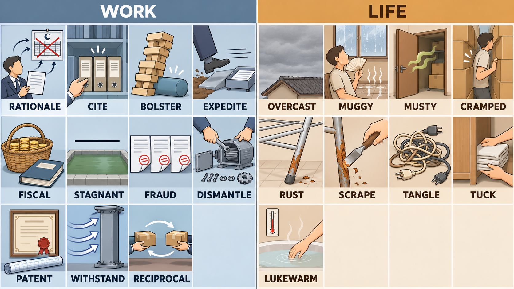

# 每日英语单词 20 个 · 2026-11-23（第 33 期）

> **定位**：面向 CET-6 六级高频/中频核心词汇，以职场和生活语境掌握常用义与搭配；六级与四级词汇存在重叠，本期不宣称逐词具有经统计核验的真题频次。
> **构成与去重**：职场 11 + 生活 9；避开历史索引全部 640 个词条（第 1--32 期），短语按逗号整体去重。本期累计 660 词。
> **记忆说明**：以下记忆提示分两类标注——「词根」为可确认的构词提示，「联想」为便于记忆的画面联想，不作严格词源考据；搭配辨析表示常见用法，不作绝对规则。
> **配套**：根目录 `每日20词-复习窗口.md` 与 `已推荐单词索引.md`。

## 场景记忆图

- 2026-11-23：请求模型 `gpt-image-2.5-flare`；实际尺寸 1672 × 941；耗时 51.56 秒。原图保留于 `/Users/insistgang/Pictures/Sub2API Images/gpt-image-2.5-flare-20261123-daily1123.png`，副本已归档至 `../场景配图/`。
- 本版为**带词标签版**：左栏 WORK 11 词 + 1 空格，右栏 LIFE 9 词 + 3 空格，共 20 个标签，一对一对应正文各词，一次生成即带齐、拼写已逐词核对。
- 左栏为一次预算评审到一份互惠签约（WORK）：箭头指向被打叉排班表的理由单 → 抽出三个文件夹逐个点 → 长枕垫住摇晃木塔 → 脚从泥里拔上带速度线的斜坡 → 藤篮硬币与深蓝账簿 → 一潭不流动的静水与平直线 → 三张盖同一枚章的发票 → 扳手拆机、螺栓排开 → 带火漆印的镜框与卷起图纸 → 钢柱弹开四道风箭头 → 两只手互换同样的盒子。
- 右栏为闷热周六收拾储物间（LIFE）：整块灰云压在屋顶 → 扇风的人与冒水的地砖 → 门缝飘出淡绿气味 → 侧身挤过两摞纸箱 → 被啃成橙褐的架脚 → 凿子推下卷起的锈屑 → 地上缠成死结的接线板 → 床单角消失在柜缝 → 温度计指针停在正中的一缸水。
- 单据、证书、屏幕上的线条均为示意性排线、不可辨，属已知瑕疵，不影响词义对应。

## 职场篇（11 词）

**1. rationale** /ˌræʃəˈnæl/
- **词义**：n. 理由，根本原因；（决策背后的）原理说明
- **例句**：The board wanted the rationale behind cutting the night shift, not just the savings.
- **翻译**：董事会要的是砍掉夜班背后的理由，不只是省下多少钱。
- **记忆提示**：词根 —— rat（计算、理性，拉丁 ratio「计算、理由」、ratus；同族 reason、rate、ratio、rational）+-ale（名词后缀）——"把道理算清楚、摊在纸上的那一份"。⚠️ 搭配 the rationale behind / for sth、explain the rationale。⚠️ 与 reason 不同：reason 是任何理由，可以随口一说；rationale 是一整套自洽的论证，多出现在决策文件与评审会上。

**2. cite** /saɪt/
- **词义**：v. 引用，引证；举出（事例、数据）；传唤（法院）
- **例句**：In the review she cited three site reports, all dated the same week.
- **翻译**：评审时她引用了三份现场报告，日期都落在同一周。
- **记忆提示**：词根 —— cit（召唤、使动，拉丁 citare「叫来」；同族 excite、incite、recite、citation）——"把别人的话叫到台前来作证"。⚠️ 搭配 cite a source / an example、cite sb as an example、be cited for（因…被传唤或被表彰）。⚠️ cite / site / sight 三者同音：cite 是引用，site 是场地，sight 是视力。

**3. bolster** /ˈboʊlstər/
- **词义**：v. 支撑，加强（信心、论据、销量）；n. 长枕，垫枕
- **例句**：Two independent audits bolstered the claim that the delay was not our fault.
- **翻译**：两份独立审计撑住了"延误不是我们的责任"这个说法。
- **记忆提示**：词根 —— 古英语 bolster「长枕、垫枕」——"在快塌的东西底下塞一只长枕头"，故既是实物垫枕，也是给论据"垫背"。⚠️ 搭配 bolster confidence / sales / an argument、bolster up。⚠️ 与 reinforce 不同：reinforce 是加固本体（加钢筋），bolster 是从旁托一把，常带"原本不太站得住"的意味。

**4. expedite** /ˈekspədaɪt/
- **词义**：v. 加快，加速办理；促进（流程、发货、审批）
- **例句**：One call to the customs broker expedited the release of the samples.
- **翻译**：给报关行打了一个电话，样品就提前放行了。
- **记忆提示**：词根 —— ex（向外、脱离）+ ped（脚，拉丁 pes / pedis；同族 pedal、pedestrian、impede、expedient）——"把脚从泥里拔出来"，走不动的人一旦脱身就快起来了。⚠️ 搭配 expedite the process / shipment / approval。⚠️ 同根的 impede 意思正相反（阻碍）：一个解脚，一个绊脚。

**5. fiscal** /ˈfɪskl/
- **词义**：adj. 财政的，国库的；财务的（fiscal year 财年）
- **例句**：The project was frozen halfway through the fiscal year.
- **翻译**：项目在财年过半时被冻住了。
- **记忆提示**：词根 —— fisc（钱篮、国库，拉丁 fiscus「篮子、钱袋」；同族 confiscate 没收）——古罗马收税用篮子装钱，"国库那只篮子"引申为财政。⚠️ 搭配 fiscal year（财年）、fiscal policy（财政政策）、fiscal deficit。⚠️ 与 financial 不同：financial 泛指一切金钱事务，fiscal 特指政府或公司的财政年度与收支安排。

**6. stagnant** /ˈstæɡnənt/
- **词义**：adj. 停滞的，不发展的；（水）不流动的，发臭的
- **例句**：Headcount stayed flat for two years because sales were stagnant.
- **翻译**：因为销售停滞，编制两年没动过。
- **记忆提示**：词根 —— stagn（死水塘，拉丁 stagnum「池塘」；同族 stagnate、stagnation）+-ant——"水不流、不换"，一潭死水既不长东西，也会发臭。⚠️ 搭配 stagnant sales / economy / water、a stagnant pool。⚠️ 与 stationary 不同：stationary 是"位置不动"（车停着），stagnant 是"该长却不长"（生意、水流）。

**7. fraud** /frɔːd/
- **词义**：n. 欺诈，骗局；骗子；冒牌货
- **例句**：The invoices looked fine until someone noticed the same round stamp on all three vendors' bills.
- **翻译**：那几张发票看着都正常，直到有人发现三家供应商的单据盖着同一枚圆章。
- **记忆提示**：词根 —— fraud（欺骗，拉丁 fraus / fraudis；同族 fraudulent、defraud）——"把假的做成跟真的一样"。⚠️ 搭配 commit fraud、tax / insurance fraud、obtain sth by fraud。⚠️ 与 deception 不同：deception 可以只是战术误导，fraud 必须是违法、可追责的。

**8. dismantle** /dɪsˈmæntl/
- **词义**：v. 拆除，拆卸；（逐步）废除（制度、组织）
- **例句**：They dismantled the old line in three days and sold the parts by weight.
- **翻译**：他们三天就把旧产线拆了，零件按斤卖掉。
- **记忆提示**：词根 —— dis（去除）+ mantle（斗篷、罩子，拉丁 mantellum；同族 mantle、mantel）——"把罩在外面的斗篷脱下来"，一层层脱光就是拆解。⚠️ 搭配 dismantle a machine / a system / barriers。⚠️ 与 demolish 不同：demolish 是砸成废墟（拆楼），dismantle 是按顺序拆成零件，还能装回去。

**9. patent** /ˈpætnt/
- **词义**：n. 专利，专利权；adj. 明显的；v. 取得专利
- **例句**：The patent expires next spring, and two rivals are already circling.
- **翻译**：专利明年春天到期，两家对手已经在旁边转圈了。
- **记忆提示**：词根 —— pat（敞开，拉丁 patere「敞开」；同族 patent 形容词"明显的"）——中世纪的 letters patent 是"公开的信函"，把技术摊开给所有人看，换一段独占期。⚠️ 搭配 apply for / hold / infringe a patent、patent pending。⚠️ 美音 /ˈpætnt/，英音常读 /ˈpeɪtnt/；形容词义"明显的"多用于 a patent error 这类书面表达。

**10. withstand** /wɪðˈstænd/
- **词义**：v. 经受住，抵挡（压力、冲击、时间考验）
- **例句**：The design has to withstand salt spray and a decade of vibration.
- **翻译**：这个设计得同时顶住盐雾和十年的振动。
- **记忆提示**：词根 —— with（对抗，古英语 wið「逆向」）+ stand（站）——"顶着站住"，不是躲开，而是站着挨。⚠️ 搭配 withstand pressure / heat / the test of time。⚠️ 不规则变化 withstand--withstood--withstood；withstand 后直接跟宾语，不加 against。

**11. reciprocal** /rɪˈsɪprəkl/
- **词义**：adj. 相互的，互惠的；对等的；n. 倒数（数学）
- **例句**：The deal is reciprocal: they share test data, we share the supply chain.
- **翻译**：这份协议是互惠的：他们共享测试数据，我们共享供应链。
- **记忆提示**：词根 —— re（回）+ pro（向前）+ -cus，拉丁 reciprocus「原路折返的、交替的」（同族 reciprocate 回报）——"你递过来的，我原路递回去"。⚠️ 搭配 a reciprocal arrangement / agreement、on a reciprocal basis、reciprocal trust。⚠️ 与 mutual 不同：mutual 只说"双方共同的"（mutual friend 共同的朋友），reciprocal 强调"你对我、我也对你"的对等动作。

## 生活篇（9 词）

**12. overcast** /ˈoʊvərkæst/
- **词义**：adj. 阴天的，多云的；阴沉的；v. 使阴暗，遮蔽
- **例句**：The sky stayed overcast all Saturday, so the washing never dried.
- **翻译**：整个周六天都阴着，晾出去的衣服一直没干。
- **记忆提示**：词根 —— over（覆盖）+ cast（投、抛，古诺斯语 kasta；同族 broadcast、forecast、cast）——"云把整片天盖住、把光整个投暗"。⚠️ 搭配 an overcast sky / morning、overcast with clouds。⚠️ 与 cloudy 不同：cloudy 只要天上有云，overcast 是云层铺满、看不见太阳的那种整片灰。

**13. muggy** /ˈmʌɡi/
- **词义**：adj. 闷热潮湿的（空气黏腻、汗出不透）
- **例句**：It was so muggy that the floor tiles sweated.
- **翻译**：闷热到地砖都在冒汗。
- **记忆提示**：词根 —— 古诺斯语 mugga「薄雾、细雨」（同源一说，可靠度中等）——"空气里全是看不见的水汽，糊在皮肤上"。⚠️ 搭配 muggy weather / afternoon、hot and muggy。⚠️ 与 humid 不同：humid 是气象意义上的"湿度高"，中性；muggy 一定带"闷得难受"的身体感受。

**14. musty** /ˈmʌsti/
- **词义**：adj. 有霉味的，发霉的；陈腐的，过时的
- **例句**：The spare room smelled musty the moment the door opened.
- **翻译**：门一开，备用房那股霉味就扑上来。
- **记忆提示**：联想 —— 词源不确定（一说由 moist「潮湿」变来，一说与 must「新酒」有关，两条都不牢靠），联想更可靠：一个关了很久的柜子，潮气闷在里面，开门那一下的味道就是 musty。⚠️ 搭配 a musty smell / room / basement。⚠️ 与 stale 不同：stale 是"不新鲜"（放久的面包、旧空气），musty 特指受潮发霉的那种闷味。

**15. cramped** /kræmpt/
- **词义**：adj. 狭窄拥挤的；（字迹）又小又难认的；（肌肉）抽筋的
- **例句**：The storage room is so cramped that you have to turn sideways to reach the shelf.
- **翻译**：储物间窄到得侧着身子才够得着架子。
- **记忆提示**：词根 —— cramp（夹钳、抽筋，中古英语 crampe）+-ed——"被夹钳夹住"，手脚伸不开；字写得太挤，也像被夹住。⚠️ 搭配 cramped quarters / apartment、cramped handwriting、a cramped feeling。⚠️ 与 narrow 不同：narrow 只讲宽度小，cramped 讲"挤到舒展不开"，带主观不适。

**16. rust** /rʌst/
- **词义**：n. 锈，铁锈；v. （使）生锈；荒废，退步
- **例句**：Rust had eaten through the bottom of the drying rack.
- **翻译**：锈已经把晾衣架底部啃穿了。
- **记忆提示**：词根 —— 古英语 rūst「锈」（同族 rusty）——"铁被时间和水啃出来的一层褐"。⚠️ 搭配 rust away / through、rust-proof、rusty skills（生疏的手艺）。⚠️ 与 rustle 只差两个字母：rust 是锈，rustle 是树叶的沙沙声。

**17. scrape** /skreɪp/
- **词义**：v. 刮，擦；刮掉；勉强通过；n. 擦伤；困境
- **例句**：He scraped the rust off the frame with an old chisel.
- **翻译**：他用一把旧凿子把架子上的锈刮掉。
- **记忆提示**：词根 —— 古诺斯语 skrapa「刮、擦」（同族 scrap 碎片）——"硬物贴着表面推过去，把表层带下来"。⚠️ 搭配 scrape sth off / away、scrape through（勉强过关）、scrape a living、a scrape（窘境）。⚠️ 与 scratch 不同：scratch 是"划出痕"，力集中在一个点；scrape 是"贴着面推"，把一层东西刮走。

**18. tangle** /ˈtæŋɡl/
- **词义**：v. （使）缠结，纠缠；n. 纠结的一团；混乱
- **例句**：The extension cords were tangled into a knot nobody wanted to touch.
- **翻译**：几根接线板缠成一个谁都不愿意碰的死结。
- **记忆提示**：词根 —— 中古英语 tangel，与古诺斯语「海草」同形——海草在水里长成一片，随水缠在一起，越扯越紧。⚠️ 搭配 get tangled (up) in sth、a tangled mess、tangle with sb（和某人起冲突）。⚠️ 与 twist 不同：twist 是"拧、扭"这个动作，tangle 是多方缠在一起的那个结果。

**19. tuck** /tʌk/
- **词义**：v. 塞进，掖好；使隐藏；n. （衣服的）褶
- **例句**：She tucked the folded sheets into the gap beside the wardrobe.
- **翻译**：她把叠好的床单塞进衣柜旁边的缝隙里。
- **记忆提示**：联想 —— 词源不确定（可能来自中古低地德语 tucken「拉、塞」），联想更可靠：把被角掖到床垫下面、把小孩塞进被窝，都是 tuck。⚠️ 搭配 tuck sth in / into sth、tuck sb in（给…掖被子）、tuck away（藏起来）。⚠️ 与 insert 不同：insert 是"插进一个孔位"，中性的技术动作；tuck 是把软东西掖进边角，带妥帖、藏好的意味。

**20. lukewarm** /ˌluːkˈwɔːrm/
- **词义**：adj. 微温的，不冷不热的；（态度）不热心的
- **例句**：After two hours in the dust, even a lukewarm shower felt like a luxury.
- **翻译**：在灰尘里泡了两个钟头，连温水澡都像奢侈。
- **记忆提示**：词根 —— luke（微温，中古英语 luke，可能来自 lew「温的」）+ warm（暖）——"luke 本身就已经是微温，warm 只是陪衬"，故是"不冷不热"。⚠️ 搭配 lukewarm water、a lukewarm response / support。⚠️ 形容态度时是贬义"反应平平"；形容水时不褒不贬，就是"温的"。

## 助记卡（词根抓手 + 高频搭配）

| 单词 | 词根/画面抓手 | 高频搭配 |
|---|---|---|
| rationale | rat（计算、理性）+ ale → 把道理摊在纸上 | the rationale behind sth |
| cite | cit（叫来）→ 把别人的话叫到台前 | cite a source |
| bolster | 古英语「长枕」→ 底下垫一枕 | bolster confidence |
| expedite | ex + ped（脚）→ 把脚从泥里拔出来 | expedite the process |
| fiscal | fisc（钱篮、国库）→ 国库那只篮子 | fiscal year |
| stagnant | stagn（死水塘）→ 水不流、不换 | stagnant sales |
| fraud | fraus（欺骗）→ 假的做成跟真的一样 | commit fraud |
| dismantle | dis + mantle（斗篷）→ 脱掉外壳 | dismantle a system |
| patent | pat（敞开）→ 公开换独占 | apply for a patent |
| withstand | with（对抗）+ stand（站）→ 顶着站住 | withstand pressure |
| reciprocal | re + pro → 原路递回去 | a reciprocal agreement |
| overcast | over + cast（投）→ 云把天整个盖住 | an overcast sky |
| muggy | 古诺斯语「薄雾」→ 水汽糊在皮肤上 | hot and muggy |
| musty | 关久的柜子开门那一下的味道 | a musty smell |
| cramped | cramp（夹钳）→ 被夹住伸不开 | cramped quarters |
| rust | 古英语 rūst → 铁被水啃出的一层褐 | rust away |
| scrape | 古诺斯语 skrapa → 贴面推走一层 | scrape sth off |
| tangle | 海草在水里缠成一团 | get tangled up |
| tuck | 把被角掖到床垫下面 | tuck sth into |
| lukewarm | luke（微温）+ warm → 不冷不热 | a lukewarm response |

## 一句话串记

**职场线**：财年 **fiscal** 过半，夜班销售 **stagnant**，董事会要一份裁撤的 **rationale**；经理 **cite** 三份现场报告，又用独立审计把结论 **bolster** 住，托人 **expedite** 审批；翻账时三张发票盖着同一枚章——**fraud**，于是整条产线被 **dismantle**，**patent** 证书从墙上取下收进箱底；总部来电质询，项目组硬 **withstand** 住，最后签下一份 **reciprocal** 条款：数据换供应链。

**生活线**：周六天整片 **overcast**，空气闷得黏手 **muggy**；推开储物间的门，一股 **musty** 味先出来，屋子窄到要侧身 **cramped**；窗边铁架起了 **rust**，拿旧凿子一点点 **scrape** 掉；地上接线板 **tangle** 成一团，索性先不管，把叠好的床单 **tuck** 进柜缝；忙完冲个澡，水 **lukewarm**，不冷不热刚好。

## 记忆宫殿 · 双线场景故事

### 职场线（11 词）· 从一间预算评审室到一份签好的互惠条款

推开评审室的门，投影上一条销售曲线平得像用尺子画的，一点起伏都没有——这是 **stagnant**（停滞）；桌前摊着一本深蓝封皮的账簿，旁边一只藤篮里堆满硬币——这是 **fiscal**（财年）；董事长把一张纸推过来，纸上伸出七八支箭头，全指向墙上那张被红笔打叉的排班表——这是 **rationale**（理由）；左侧的分析师起身，从书架上抽出三个文件夹，一份一份点过去——这是 **cite**（引用）；他把一摞摇摇欲坠的木块往里推，底下塞进一只长圆柱枕，塔稳住了——这是 **bolster**（撑住）；走廊那头，一个人抬脚从泥里拔出来，踩上带三道速度线的斜坡，托盘顺势滑了出去——这是 **expedite**（加速）；回来翻账，三张发票并排摊开，每张右下角都是同一枚红色圆章，纸角被人掀起一角——这是 **fraud**（造假）；于是车间里两只手拿扳手把机器一层层拆开，螺栓按顺序排在地上——这是 **dismantle**（拆除）；办公室墙上那只带火漆印的镜框被取下来，卷起的图纸靠在墙根——这是 **patent**（专利）；最后镜头给到一根钢柱，四道弧形风箭头撞上去全被弹开——这是 **withstand**（顶住）；谈判桌上，两只手各推一只同样的盒子给对方——这是 **reciprocal**（互惠）。一间屋子里最贵的不是那台机器，是那枚反复出现的章。

> 画面链：平直如尺的曲线 → 藤篮硬币与账簿 → 箭头全指向被打叉的排班表 → 抽出三个文件夹逐个点 → 长枕垫住摇晃的木塔 → 脚从泥里拔上斜坡 → 三张同章的发票 → 扳手拆机、螺栓排开 → 火漆印镜框被取下 → 钢柱弹开四道风箭头 → 两只手互换同样的盒子。

### 生活线（9 词）· 从一个整片灰的天到一缸不冷不热的水

周六早上抬头，天是一整块均匀的灰，云低低压在屋顶上——这是 **overcast**（阴天）；屋里的人拿一张折起的纸扇风，地砖上一层水光，热气从地面往上飘成弯线——这是 **muggy**（闷热）；推开储物间的门，几缕淡绿色的气味先飘出来，绕过纸箱——这是 **musty**（霉味）；人侧过身，才从两摞箱子中间挤过去——这是 **cramped**（狭窄）；窗边铁架的下脚被啃成一片橙褐色，皮一层层翘起——这是 **rust**（铁锈）；一只手握旧凿子贴上去推，锈屑卷着落下——这是 **scrape**（刮）；地上几根接线板绕成一个死结，插头朝各个方向支出来——这是 **tangle**（缠结）；最后两只手把叠好的床单往衣柜旁的窄缝里塞，一角消失在缝里——这是 **tuck**（掖进去）；忙完拧开浴缸的水，一只手试温度，墙上温度计的指针停在正中，水面只浮起一点薄汽——这是 **lukewarm**（不冷不热）。一天从一块整灰的天开始，在一缸刚好的水里收尾。

> 画面链：整块灰的天压在屋顶 → 扇风的人与冒水的地砖 → 门缝里飘出的绿气味 → 侧身挤过两摞纸箱 → 被啃成橙褐的架脚 → 凿子推下卷起的锈屑 → 地上那个死结 → 床单角消失在柜缝 → 温度计指针停在正中。

## 排雷台（20 组易混与搭配辨析）

| 辨析 | 关键差别与常见搭配 |
|---|---|
| rationale / reason / justification | rationale 是一整套自洽的论证，多用于决策文件（the rationale behind the cut）；reason 是任何理由，可以随口一说（for some reason）；justification 侧重"为已做的事找正当性"，带辩护色彩（a justification for the war）。 |
| cite / quote / mention | cite 是"引出出处以作依据"，可引数据、报告（cite a source）；quote 必须逐字照抄原话（quote a line from the report）；mention 只是"提一句"，不承担举证责任（mention it in passing）。 |
| bolster / reinforce / boost | bolster 是从旁托一把，常指原本不牢的信心或论据（bolster confidence）；reinforce 是加固本体，加材料让它更结实（reinforce the wall）；boost 是"往上抬一把"，多指数量、销量、士气（boost sales）。 |
| expedite / accelerate / hasten | expedite 专指"把流程办快"，用于审批、发货、通关（expedite the shipment）；accelerate 是速度本身变快（accelerate the car）；hasten 多指催促某事早点发生，常带"促成"意味（hasten the decline）。 |
| fiscal / financial / monetary | fiscal 特指政府或公司的财政年度与收支（fiscal year、fiscal deficit）；financial 泛指一切金钱事务（financial difficulties）；monetary 专指货币层面，多由国家银行体系出面（monetary policy）。 |
| stagnant / stationary / sluggish | stagnant 是"该长不长"，用于销售、经济、水流（stagnant sales）；stationary 是"位置不动"（a stationary bike）；sluggish 是"动得慢"，可用于人、引擎、市场（a sluggish start）。 |
| fraud / deception / scam | fraud 是违法可追责的欺诈（commit fraud）；deception 可以是战术误导，未必违法（obtain sth by deception）；scam 是口语里的"骗局"，多指一次性圈钱（an online scam）。 |
| dismantle / demolish / disassemble | dismantle 是按顺序拆成零件，也能指逐步废除制度（dismantle a system）；demolish 是砸成废墟（demolish the building）；disassemble 更技术化，只讲"把组装件拆开"（disassemble the unit）。 |
| patent / apparent / evident | patent 作形容词是"明显的"，书面且偏正式（a patent error）；apparent 是"看上去如此"，可暗示未必属实（for no apparent reason）；evident 是"有证据支撑的显而易见"（it is evident that…）。 |
| withstand / endure / resist | withstand 强调"顶住外部冲击而不损"，多用于材料、结构（withstand pressure）；endure 强调"长时间忍受"，带主观承受（endure the noise）；resist 是"抵抗、不受其影响"（resist temptation）。 |
| reciprocal / mutual / common | reciprocal 强调"你对我、我也对你"的对等动作（a reciprocal agreement）；mutual 只说"双方共同的"（a mutual friend）；common 是"共有的、常见的"（common ground）。 |
| overcast / cloudy / gloomy | overcast 是云层铺满、看不见太阳的整片灰（an overcast sky）；cloudy 只要有云就算（partly cloudy）；gloomy 偏主观，是"阴沉得让人压抑"（a gloomy morning）。 |
| muggy / humid / damp | muggy 是闷热黏腻的身体感受（a muggy afternoon）；humid 是气象意义的湿度高，中性（a humid climate）；damp 是"物体带湿气"，常暗示该干没干（damp walls）。 |
| musty / stale / moldy | musty 是受潮闷出来的霉味（a musty basement）；stale 是"不新鲜"（stale bread、stale air）；moldy 是已经长出霉斑，程度更实（moldy cheese）。 |
| cramped / narrow / tight | cramped 是挤到舒展不开，带不适（cramped quarters）；narrow 只讲宽度小，中性（a narrow street）；tight 是"绷得紧、余量小"（a tight fit、a tight schedule）。 |
| rust / rustle / crust | rust 是铁锈（rust away）；rustle 是树叶、纸张的沙沙声（the rustle of leaves）；crust 是硬外壳（a bread crust）。 |
| scrape / scratch / scrub | scrape 是贴着表面推、把一层东西刮走（scrape off the paint）；scratch 是尖端划出痕（scratch the screen）；scrub 是加水和清洁剂反复刷洗（scrub the floor）。 |
| tangle / twist / mess | tangle 是多方缠在一起的结果（get tangled up）；twist 是"拧、扭"这个动作（twist the wire）；mess 是泛指的凌乱（a mess on the desk）。 |
| tuck / insert / stuff | tuck 是把软东西掖进边角，带妥帖意味（tuck the sheet in）；insert 是插进一个孔位，中性技术动作（insert the card）；stuff 是硬塞，常显过量（stuff clothes into a bag）。 |
| lukewarm / tepid / warm | lukewarm 是"不冷不热"，形容态度时是贬义（a lukewarm response）；tepid 与 lukewarm 近义，但更书面、更常形容液体（tepid water）；warm 是褒义的"温暖的"（a warm welcome）。 |

## 快速自测（5 题 · 答案折叠）

**1. 语境选词填空**：The plant manager was asked to explain the ______ behind closing the night shift, not just the money it saved.（从 rationale / reason / justification 中选一个最贴切的）

**2. 用法改错**：The new coating is designed to withstand against extreme heat and salt spray. 请判断 withstand 的用法是否恰当，并改正。

**3. 中译英**：他们用两份独立审计支撑了这个结论，并托人加快了审批流程。

**4. 一词两义**：patent 在 "apply for a patent" 中意为 ______，在 "a patent error" 中意为 ______。

**5. 生活场景选词**：The afternoon was so ______ that the tiles sweated; the spare room smelled ______; and the water in the tub was only ______.（从 muggy / musty / lukewarm / overcast 中选三个）

👉 点击展开答案

1. **rationale**；句子要的是"关掉夜班背后那套自洽的论证"，且与 not just the money it saved 对照，正是 rationale 的典型语境（the rationale behind sth）。reason 也能填，但太泛，撑不起"要一整套说法"的语气；justification 偏"为已做的事辩护"，与评审会上要理由的语境略有偏移。
2. **不恰当**——withstand 是及物动词，后面直接跟宾语，不加 against。应改为：The new coating is designed to **withstand extreme heat and salt spray**. 若想保留 against，可换成 **stand up against** 或 **resist**。
3. **They bolstered the conclusion with two independent audits and had the approval process expedited.**；bolster 是"从旁支撑论据"，expedite 是"加快流程"；注意 have sth done 结构里用 expedited。
4. 第一个是 **专利（名词）**；第二个是 **明显的（形容词）**，a patent error 意为"一个明显的错误"，这层书面义在六级阅读里偶有出现。
5. **muggy**、**musty**、**lukewarm**；闷热到地砖冒汗是 muggy，备用房那股味是 musty，浴缸里不冷不热的水是 lukewarm。overcast 只讲天色阴沉，与"地砖冒汗""霉味"都不搭。

---

*第 33 期 · 2026-11-23 · 累计已学 660 词（CET-6 向）*
