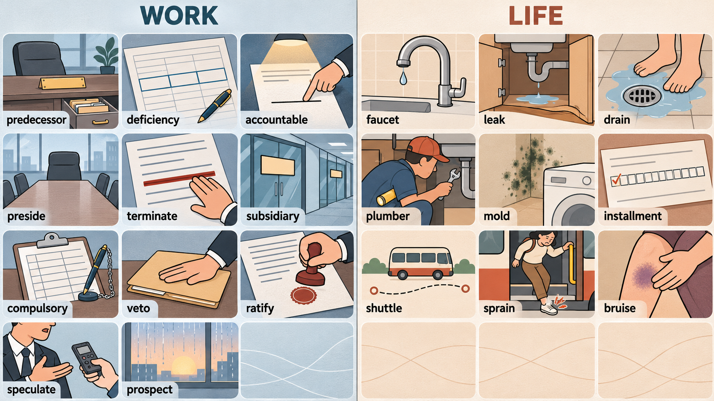

# 每日英语单词 20 个 · 2026-11-24（第 34 期）

> **定位**：面向 CET-6 六级高频/中频核心词汇，以职场和生活语境掌握常用义与搭配；六级与四级词汇存在重叠，本期不宣称逐词具有经统计核验的真题频次。
> **构成与去重**：职场 11 + 生活 9；避开历史索引全部 660 个词条（第 1--33 期），短语按逗号整体去重。本期累计 680 词。
> **记忆说明**：以下记忆提示分两类标注——「词根」为可确认的构词提示，「联想」为便于记忆的画面联想，不作严格词源考据；搭配辨析表示常见用法，不作绝对规则。
> **配套**：根目录 `每日20词-复习窗口.md` 与 `已推荐单词索引.md`。

## 场景记忆图

- 2026-11-24：请求模型 `gpt-image-2.5-flare`；实际尺寸 1672 × 941；耗时 58.22 秒。原图保留于 `/Users/insistgang/Pictures/Sub2API Images/gpt-image-2.5-flare-20261124-093530-54132ad8.png`，副本已归档至 `../场景配图/`。
- 本次为**带词标签版**：左栏 WORK 11 词 + 1 空格，右栏 LIFE 9 词 + 3 空格，共 20 个标签，一对一对应正文各词；本次缩略图可直接辨认，已逐词核对拼写。
- 左栏为一场交接评审到一扇朝东的窗（WORK）：前任名牌与敞开抽屉 → 台账上三格空白 → 聚光灯下的签字栏 → 长桌最前那把主位椅 → 压在条款上的手掌 → 走廊尽头小一号的门牌 → 绑着锁链的签到表 → 合上并按住文件夹的手 → 按在末页的红印 → 举到面前的录音笔 → 朝东的窗。
- 右栏为周六修水管到崴脚（LIFE）：弯口挂着水珠的水龙头 → 柜内水槽下的一小滩水 → 地漏周围积起的水 → 蹲在柜前拧管子的水管工 → 洗衣机旁墙角的霉斑 → 打了第一个勾的分期单 → 两点间往返的接驳车 → 车门台阶上歪掉的脚踝 → 小腿上的紫淤青。

## 职场篇（11 词）

**1. predecessor** /ˈpredəsesər/
- **词义**：n. 前任，前辈；（被取代的）原有事物
- **例句**：My predecessor left a filing system that only he could read.
- **翻译**：我的前任留下了一套只有他自己看得懂的归档体系。
- **记忆提示**：词根 —— pre（在前）+ de（离开）+ cess（走，拉丁 cedere「让、走」；同族 proceed、recede、successor）+-or（人）——"先走一步、把位子让出来的人"。⚠️ 搭配 the predecessor of sth、my predecessor as manager。⚠️ 反义 successor：一个是把位子让出来的，一个是接住位子的。

**2. deficiency** /dɪˈfɪʃnsi/
- **词义**：n. 缺乏，不足；缺陷，不足之处
- **例句**：The audit flagged a serious deficiency in how we track spare parts.
- **翻译**：审计指出我们在备件跟踪上存在严重缺陷。
- **记忆提示**：词根 —— de（向下、不足）+ fic（做，拉丁 facere；同族 efficient、proficient、sufficient）+-iency ——"没做够的那一块"。⚠️ 搭配 a deficiency in sth、vitamin deficiency、make up for a deficiency。⚠️ 与 deficit（10-29 已用）不同：deficit 多指账面缺口（财政赤字、贸易逆差），deficiency 指"该有的不够或该做的没做到"。

**3. accountable** /əˈkaʊntəbl/
- **词义**：adj. 负有责任的，应作出解释的
- **例句**：Whoever signs off on the budget is accountable for every line of it.
- **翻译**：谁签批这笔预算，就要对其中每一行负责。
- **记忆提示**：词根 —— ac（朝向）+ count（计算、账目）+ -able ——"这笔账能一路算到你头上"。⚠️ 搭配 be accountable to sb for sth、hold sb accountable。⚠️ 与 responsible 不同：responsible 是"负责去做"，重在分工；accountable 是"出了事要被追着解释"，重在担责，且不可推给下属。

**4. preside** /prɪˈzaɪd/
- **词义**：v. 主持（会议、仪式）；掌管，领导
- **例句**：The vice president presided over the review while the CEO was abroad.
- **翻译**：CEO 在国外期间，由副总裁主持这场评审。
- **记忆提示**：词根 —— pre（在前）+ sid（坐，拉丁 sedere；同族 sit、session、reside）——"坐在最前面那把椅子上"。⚠️ 搭配 preside over / at a meeting。⚠️ 不及物动词，必须带 over 才能接会议；preside over 也可指"掌管、主导"某个局面。

**5. terminate** /ˈtɜːrmɪneɪt/
- **词义**：v. 终止，结束；解雇；（车辆）到终点
- **例句**：The contract terminates automatically if either side misses two payments.
- **翻译**：任何一方两次未付款，合同就自动终止。
- **记忆提示**：词根 —— termin（界限、终点，拉丁 terminus；同族 terminal、determine、exterminate）+-ate ——"走到界线为止"。⚠️ 搭配 terminate a contract / employment、terminate at（到…终止）。⚠️ 与 end 不同：end 中性、可自动发生；terminate 是正式地、往往单方面地掐断，合同、雇佣、妊娠多用它。

**6. subsidiary** /səbˈsɪdieri/
- **词义**：n. 子公司，附属机构；adj. 附属的，次要的
- **例句**：The Shenzhen subsidiary handles procurement for the whole group.
- **翻译**：深圳子公司负责整个集团的采购。
- **记忆提示**：词根 —— sub（在下）+ sid（坐）+ -iary ——"坐在下面那张桌子旁的公司"。⚠️ 搭配 a wholly-owned subsidiary、a subsidiary of sth、be subsidiary to sth。⚠️ 与 subsidy（10-30 已用）只差尾缀：subsidiary 是下级公司，subsidy 是自上而下拨的钱。

**7. compulsory** /kəmˈpʌlsəri/
- **词义**：adj. 强制的，义务的；必修的
- **例句**：Safety training is compulsory for anyone entering the plant.
- **翻译**：进厂的人一律必须接受安全培训。
- **记忆提示**：词根 —— com（加强）+ puls（推、驱，拉丁 pellere；同族 compel、impulse、repel、pulse）+-ory ——"被推着走，没有第二个选项"。⚠️ 搭配 compulsory education、a compulsory course、be compulsory for sb。⚠️ 与 compulsive 形近义远：compulsory 是"外部强制"，compulsive 是"内心强迫性的"（compulsive shopping 强迫性购物）。

**8. veto** /ˈviːtoʊ/
- **词义**：v. 否决，禁止；n. 否决权
- **例句**：Finance vetoed the hire two days before the offer letter went out.
- **翻译**：财务在录用通知发出前两天否掉了这个招聘。
- **记忆提示**：词根 —— veto 本是拉丁语第一人称"我禁止"，古罗马保民官喊这一声就能拦下法案，所以这个词本身就是一句台词。⚠️ 搭配 veto a plan / a bill、exercise the veto、a veto over sth。⚠️ 变形：复数 vetoes，过去式 vetoed；作名词时多指制度性的"否决权"。

**9. ratify** /ˈrætɪfaɪ/
- **词义**：v. 正式批准，签署认可（条约、合同、修正案）
- **例句**：The board ratified the new procurement policy on Friday.
- **翻译**：董事会周五正式批准了新的采购政策。
- **记忆提示**：词根 —— rat（确定，拉丁 ratus「已定下的」；同族 rate、ratio、rational）+-ify（使…）——"把谈成的东西盖成确定的"。⚠️ 搭配 ratify a treaty / an agreement / an amendment。⚠️ 与 approve 不同：approve 可以只是点头同意，ratify 必须走完正式程序、产生法律效力。

**10. speculate** /ˈspekjuleɪt/
- **词义**：v. 推测，猜测；投机（买卖）
- **例句**：Analysts speculated that the two units would be merged before year-end.
- **翻译**：分析人士推测这两个部门会在年底前合并。
- **记忆提示**：词根 —— spec（看，拉丁 specere；同族 inspect、prospect、spectator）+-ulate ——"站在远处反复看"，看不真切就只能推演；盯着行情猜涨跌就成了投机。⚠️ 搭配 speculate about / on sth、speculate that…、speculate in property。⚠️ 与 guess 不同：speculate 通常有线索、有推演过程，guess 可以完全凭感觉。

**11. prospect** /ˈprɑːspekt/
- **词义**：n. 前景，可能性；潜在客户；v. 勘探
- **例句**：The prospect of a second round of cuts unsettled the whole team.
- **翻译**：可能还有第二轮削减，这让整个团队心里发慌。
- **记忆提示**：词根 —— pro（向前）+ spect（看）——"往前看能看见的东西"。⚠️ 搭配 the prospect of doing sth、job prospects、prospect for gold。⚠️ 与 perspective（11-14 已用）不同：prospect 是"前方有什么"，perspective 是"站在哪个角度看"。

## 生活篇（9 词）

**12. faucet** /ˈfɔːsɪt/
- **词义**：n. （美式）水龙头，旋塞
- **例句**：The cold-water faucet drips all night, and the sound carries into the bedroom.
- **翻译**：冷水龙头整夜滴水，声音一直传到卧室里。
- **记忆提示**：联想 —— 词源不确定（一说来自古法语 fausset「塞子、出水口」，可靠度中等），联想更可靠：那个弯下脖子的金属头，水正从弯口一滴一滴挂下来。⚠️ 搭配 turn on / off the faucet、a dripping faucet。⚠️ 美式 faucet 对应英式 tap；阀门本体叫 valve，别混用。

**13. leak** /liːk/
- **词义**：v. 漏，渗；泄露（信息）；n. 漏洞，裂缝；泄露
- **例句**：Water had been leaking under the sink for weeks before anyone noticed.
- **翻译**：水槽下面漏了好几个星期才有人发现。
- **记忆提示**：词根 —— 古诺斯语 leka「漏」（同族 leakage、leaky）——"该关住的东西一点点跑出去"。⚠️ 搭配 leak out、a gas leak、leak sth to the press。⚠️ 与 drip 不同：drip 是看得见的一滴一滴，leak 是从缝里渗，常在地板下面悄悄发生。

**14. drain** /dreɪn/
- **词义**：v. 排水，排干；使耗尽；n. 下水道，地漏
- **例句**：The floor drain is slow, so water pools around your feet when you shower.
- **翻译**：地漏下水慢，洗澡时水就积在脚边。
- **记忆提示**：词根 —— 古英语 drēahnian「排干」（同族 drainage）——"把水一点点引走"；钱和人被一点点抽空，也用这个词。⚠️ 搭配 drain away / off、a blocked drain、drain sb of sth。⚠️ 与 sewer 不同：drain 是具体的排水口、排水管，sewer 是整座城市的下水道系统。

**15. plumber** /ˈplʌmər/
- **词义**：n. 水管工，管道工
- **例句**：The plumber quoted three hundred yuan just to look at the pipe.
- **翻译**：水管工光来看一眼管子就报价三百。
- **记忆提示**：词根 —— plumb（铅，拉丁 plumbum；同族 plumbing、plummet 铅锤）+-er（人）——古罗马的水管用铅做，"铅匠"就成了水管工。⚠️ 搭配 call a plumber、the plumbing system。⚠️ 注意 b 不发音：/ˈplʌmər/，别读成"普朗伯"。

**16. mold** /moʊld/
- **词义**：n. 霉，霉菌；模子，模型；v. 塑造，影响…的形成
- **例句**：Mold had climbed the corner of the bathroom wall behind the washing machine.
- **翻译**：霉已经爬上洗衣机后面那面墙的墙角。
- **记忆提示**：词根 —— 古诺斯语 mold「土、模子」，拉丁 modulus「小量度」也汇入"模子"这一支（同族 model、modulate）——同一个词，一边是土里长出来的霉，一边是拿来定形的模子。⚠️ 搭配 mold grows on sth、break the mold（打破常规）、mold sb into sth。⚠️ 美式 mold 对应英式 mould；与 musty（11-23 已用）不同：mold 是霉本身，musty 是那股霉味。

**17. installment** /ɪnˈstɔːlmənt/
- **词义**：n. 分期付款的一期；（连载、分册的）一部分
- **例句**：They put the washer on twelve installments and paid the first one on the spot.
- **翻译**：洗衣机分十二期，首期当场就付了。
- **记忆提示**：词根 —— in（进入）+ stall（位置、站位，古英语 steall；同族 install、stall）+-ment ——"把一笔钱分几次放进约定的格子"。⚠️ 搭配 pay in installments、the first / last installment。⚠️ 美式 installment，英式 instalment（少一个 l）；与 deposit（10-25 已用）不同：deposit 是先付的定金，installment 是之后按期付的款。

**18. shuttle** /ˈʃʌtl/
- **词义**：n. 穿梭班车，摆渡车；梭子；v. 往返运送，穿梭
- **例句**：A free shuttle runs between the subway station and the mall every ten minutes.
- **翻译**：地铁站和商场之间有免费接驳车，每十分钟一班。
- **记忆提示**：词根 —— 古英语 scytel「投掷物、梭子」（与 shoot 有同源关系）——织布时梭子来回穿，两点之间来回跑的车便也叫 shuttle。⚠️ 搭配 a shuttle bus / service、shuttle between A and B、shuttle sb to sth。⚠️ 与 ferry（11-09 已用）不同：ferry 多走水路，也可指渡运；shuttle 走陆路，路线短、班次密。

**19. bruise** /bruːz/
- **词义**：n. 淤青，擦伤；v. 使受淤伤；伤害（感情、自尊）
- **例句**：A purple bruise came up on his shin where the rack had hit him.
- **翻译**：架子撞到的小腿处起了一块紫淤青。
- **记忆提示**：词根 —— 古英语 brȳsan「压碎」——"皮没破，底下的血管先被压破了"。⚠️ 搭配 have a bruise on sth、bruise easily、a bruised ego。⚠️ 与 scar 不同：bruise 会自己褪色消失，scar 是长住的疤。

**20. sprain** /spreɪn/
- **词义**：v. 扭伤（关节）；n. 扭伤
- **例句**：He sprained his ankle stepping off the shuttle before it had fully stopped.
- **翻译**：接驳车还没停稳他就下车，把脚踝扭了。
- **记忆提示**：联想 —— 词源不确定（一说与古法语 espraindre「挤压」有关，可靠度中等），联想更可靠：脚下一歪，韧带被生生拧了一下，外面看不出伤，里面已经拉伤。⚠️ 搭配 sprain an ankle / a wrist、a bad sprain。⚠️ 与 strain 不同：sprain 是关节韧带扭伤，strain 是肌肉拉伤，也可泛指"用力过度"。

## 助记卡（词根抓手 + 高频搭配）

| 单词 | 词根/画面抓手 | 高频搭配 |
|---|---|---|
| predecessor | pre + cess（走）→ 先走一步让位的人 | my predecessor as manager |
| deficiency | de（不足）+ fic（做）→ 没做够的那一块 | a deficiency in sth |
| accountable | ac + count（账）→ 账能算到你头上 | be accountable for sth |
| preside | pre + sid（坐）→ 坐最前面那把椅子 | preside over a meeting |
| terminate | termin（终点）→ 走到界线为止 | terminate a contract |
| subsidiary | sub（下）+ sid（坐）→ 下面那张桌子的公司 | a wholly-owned subsidiary |
| compulsory | com + puls（推）→ 被推着走，没得选 | compulsory education |
| veto | 拉丁语"我禁止"→ 一句话拦下法案 | veto a plan |
| ratify | rat（已定）→ 把谈成的盖成确定的 | ratify a treaty |
| speculate | spec（看）→ 远处反复看，看不真就猜 | speculate about sth |
| prospect | pro + spect（看）→ 往前能看见的东西 | the prospect of doing sth |
| faucet | 弯下脖子的金属头，水从弯口滴下 | a dripping faucet |
| leak | 古诺斯语「漏」→ 从缝里一点点跑掉 | leak out |
| drain | 古英语「排干」→ 把水引走 | a blocked drain |
| plumber | plumb（铅）→ 用铅做管的匠人 | call a plumber |
| mold | 古诺斯语「土/模子」→ 一边长霉一边定形 | break the mold |
| installment | in + stall（格子）→ 钱分几次放进格子 | pay in installments |
| shuttle | 织布梭子来回穿 → 两点间往返的车 | a shuttle bus |
| bruise | 古英语「压碎」→ 皮没破，血管先破 | a bruised ego |
| sprain | 脚下一歪，韧带被拧了一下 | sprain an ankle |

## 一句话串记

**职场线**：办公桌还留着 **predecessor** 的名牌，抽屉里那套归档法只有他看得懂；翻到备件台账，三格空白——**deficiency**，采购主管当场被点名，签字的人要 **accountable**；副总裁坐上主位 **preside**，法务把合同推过来，指着"两次逾期自动 **terminate**"；走廊尽头挂着 **subsidiary** 的招牌，HR 递来一张 **compulsory** 培训签到表；财务抬手把扩张方案按住——**veto**；周五董事会盖章 **ratify**，楼下记者举着录音笔 **speculate**，最后镜头停在一扇朝东的窗——**prospect**。

**生活线**：厨房的 **faucet** 滴了一整夜，水槽下面 **leak** 出一小滩水，地漏 **drain** 又慢，洗澡水积在脚边；只好叫 **plumber** 来拆管子，他指着洗衣机后面那片 **mold** 摇头；索性换新，售货员说可以分十二期 **installment**；两人坐免费 **shuttle** 去大商场，车没停稳他就跳下去，脚踝 **sprain** 了；回家卷起裤腿，小腿上一块紫 **bruise**。

## 记忆宫殿 · 双线场景故事

### 职场线（11 词）· 从一场交接评审到一扇朝东的窗

推开门，办公桌上还立着一块 **predecessor**（前任）的名牌，抽屉里那套归档法只有他本人看得懂；翻到备件台账，中间三格是空的，笔尖停在空白处——这是 **deficiency**（缺件）；采购主管被当场点名，所有人的目光都落到他在签字栏留下的那一笔——这是 **accountable**（要担责）；副总裁在长桌最前那把椅子上坐下，两只手往桌面一按，会议室安静下来——这是 **preside**（主持）；法务把合同推过来，食指压在"两次逾期即终止"那一行——这是 **terminate**（终止）；镜头顺着走廊走到尽头，玻璃门上贴着另一块招牌，字体比总部那块小一号——这是 **subsidiary**（子公司）；HR 递来一张签到表，第一行印着"必须参加"，笔已经绑在桌角——这是 **compulsory**（强制）；财务没有起身，只抬手把摊开的扩张方案合上、按在桌心——这是 **veto**（否决）；周五，董事长在文件末页盖下印章，红印压住签名——这是 **ratify**（正式批准）；楼下一名记者把录音笔举到受访者面前，问题里全是"可能""或许"——这是 **speculate**（推测）；最后画面停在一扇朝东的窗，天刚亮，玻璃上还挂着昨夜的水痕——这是 **prospect**（前景）。一间会议室里真正值钱的不是那把主位椅，是那块盖下去的红印。

> 画面链：前任名牌与抽屉 → 台账上三格空白 → 签字栏前的那道目光 → 最前面那把椅子 → 压在"终止"那一行的手指 → 走廊尽头小一号的招牌 → 绑在桌角的签到表 → 合上并按住方案的手 → 末页的红印 → 举到面前的录音笔 → 朝东的窗。

### 生活线（9 词）· 从一个滴水的水龙头到小腿上一块紫

周六早上，厨房那只 **faucet**（水龙头）滴了一整夜，水珠挂在弯口，落进不锈钢盆里一声一声；弯腰打开柜门，水槽下面已经 **leak**（渗漏）出一小滩水，木板边缘鼓起来；卫生间的 **drain**（地漏）也慢，洗澡水积在脚边打转，得拿脚拨一拨才下去；只好打电话叫 **plumber**（水管工），他蹲在柜子前拧开管子，手电筒夹在腋下；他抬头照了照洗衣机后面，那片墙角的 **mold**（霉）已经爬上踢脚线，颜色像一块摊开的旧地图；索性换台新的，售货员在单子上写下"十二期"，笔尖在第一格打了个勾——这是 **installment**（分期）；两人坐上商场门口那辆 **shuttle**（接驳车），车在两点之间来回跑，玻璃上贴着线路图；车还没停稳他就跳下去，脚下一歪——**sprain**（扭伤），整个人扶着栏杆缓了两秒；回家卷起裤腿，小腿上鼓起一块紫 **bruise**（淤青），按下去有点疼。一天从一滴水开始，最后落在一块淤青上。

> 画面链：弯口挂着的水珠 → 柜门里鼓起的地板 → 脚边打转的积水 → 蹲着拧管子的水管工 → 爬上踢脚线的那片霉 → 单子上打了勾的第一格 → 来回跑的接驳车 → 扶栏杆的那两秒 → 按下去有点疼的紫块。

## 排雷台（20 组易混与搭配辨析）

| 辨析 | 关键差别与常见搭配 |
|---|---|
| predecessor / successor / forerunner | predecessor 是同一职位的前任（my predecessor as manager）；successor 是接任者（the successor to the CEO）；forerunner 是某事物的"前身、先驱"，不一定是同一岗位（a forerunner of the modern computer）。 |
| deficiency / deficit / shortage | deficiency 是"该有的不够或该做的没做到"，可指营养、能力、制度（a deficiency in the process）；deficit 是账面缺口，多用于财政、贸易（a trade deficit）；shortage 是某物一时不够用（a water shortage）。 |
| accountable / responsible / liable | accountable 强调出事要向上解释、不可推卸（be accountable to the board）；responsible 强调分工上"负责做"（responsible for the launch）；liable 是法律上的赔偿责任（be liable for damages）。 |
| preside / chair / host | preside 是坐在主位主持流程，必须带 over（preside over the meeting）；chair 可直接带宾语，也可指"担任主席"（chair the committee）；host 是"做东、主办"，重在招待与场地（host the conference）。 |
| terminate / end / expire | terminate 是正式地、常单方面地掐断合同或雇佣（terminate the contract）；end 中性，可自然结束（the meeting ended）；expire 是"到期自动失效"，主体是期限、证件（the visa expires in May）。 |
| subsidiary / branch / affiliate | subsidiary 是法律上独立、被控股的子公司（a wholly-owned subsidiary）；branch 是分公司、分支机构，不是独立法人（a local branch）；affiliate 是关联机构，股权关系可松可紧（an affiliate of the group）。 |
| compulsory / mandatory / compulsive | compulsory 多指法律或制度规定的义务（compulsory education）；mandatory 多指上级或规则硬性要求（a mandatory meeting）；compulsive 是心理上的强迫性（compulsive gambling），别混用。 |
| veto / reject / overrule | veto 是否决权，往往一票即可拦下（veto the proposal）；reject 是泛指的"不接受"（reject an application）；overrule 是上级推翻下级的裁定（the court overruled the objection）。 |
| ratify / approve / endorse | ratify 是走完程序、产生法律效力的正式批准（ratify the treaty）；approve 可以只是点头同意（approve the budget）；endorse 是公开背书、站台支持（endorse a candidate）。 |
| speculate / guess / presume | speculate 是有线索的推演，常用于市场与局势（speculate about the merger）；guess 可以完全凭感觉（guess the answer）；presume 是"在未证实前先当作如此"（presume innocence）。 |
| prospect / perspective / outlook | prospect 是前方具体的可能性与机会（job prospects）；perspective 是看问题的角度与纵深感（from a historical perspective）；outlook 是对整体的展望，偏宏观（the economic outlook）。 |
| faucet / tap / valve | faucet 是美式"水龙头"（a dripping faucet）；tap 是英式同义词，也可指"轻拍、窃听"（turn off the tap）；valve 是管道上的阀门本体（a shut-off valve）。 |
| leak / drip / seep | leak 是从缝里漏，可指水也可指信息（leak the memo）；drip 是看得见的一滴一滴（the tap drips）；seep 是缓慢地渗，常指液体渗进材料（water seeping through the wall）。 |
| drain / sewer / ditch | drain 是具体的排水口、地漏、排水管（a blocked drain）；sewer 是城市下水道系统（the sewer system）；ditch 是露天的沟渠（a drainage ditch）。 |
| plumber / plumbing / plummet | plumber 是人（call a plumber）；plumbing 是管道系统或"水管工程"（the plumbing is old）；plummet 是"骤跌"，与铅锤同源（prices plummeted）。 |
| mold / mildew / musty | mold 是霉本身，也可指模子（mold on the wall）；mildew 是墙面、布料上那层薄霉，程度较轻（mildew on the curtain）；musty 是形容词，指那股霉味（a musty room）。 |
| installment / deposit / down payment | installment 是分期付款的每一期（pay in installments）；deposit 是先付的定金或押金（pay a deposit）；down payment 是首付，金额通常更大（a 30% down payment）。 |
| shuttle / ferry / commute | shuttle 是短途高频的往返班车（an airport shuttle）；ferry 多指渡轮，也可指渡运（take the ferry）；commute 是自己通勤这个行为（commute to work）。 |
| bruise / scar / bump | bruise 是皮下淤青，会自己褪（a bruise on the shin）；scar 是长住的疤（a scar on his arm）；bump 是鼓起的包，未必变色（a bump on the head）。 |
| sprain / strain / twist | sprain 是关节韧带扭伤（sprain an ankle）；strain 是肌肉拉伤或用力过度（strain a muscle）；twist 只是"拧、扭"这个动作，未必受伤（twist your ankle 口语中也可指崴脚）。 |

## 快速自测（5 题 · 答案折叠）

**1. 语境选词填空**：The auditor flagged a serious ______ in the way spare parts were logged, though the department's budget showed no ______ at all.（从 deficiency / deficit / shortage 中选两个）

**2. 用法改错**：The vice president presided the review meeting while the CEO was abroad. 请判断 preside 的用法是否恰当，并改正。

**3. 中译英**：董事会周五正式批准了新政策，但财务此前已经否决了扩张方案。

**4. 一词两义**：mold 在 "mold on the bathroom wall" 中意为 ______，在 "break the mold" 中意为 ______。

**5. 生活场景选词**：The ______ dripped all night, water had been ______ under the sink for weeks, and the floor ______ was too slow to take it away.（从 faucet / leak / drain / plumber 中选三个）

👉 点击展开答案

1. **deficiency**、**deficit**；前半句说"登记方式有缺陷"，是流程上没做到位，用 deficiency；后半句说预算账面上没有缺口，用 deficit。shortage 指某物一时不够用，与"登记方式"不搭。
2. **不恰当**——preside 是不及物动词，主持某场会议要说 preside **over** a meeting。应改为：The vice president **presided over** the review meeting while the CEO was abroad. 若想直接带宾语，可换成 **chair** the meeting。
3. **The board ratified the new policy on Friday, but Finance had already vetoed the expansion plan.**；ratify 强调走完程序、正式生效，veto 强调一票拦下；注意时态先后用过去完成时 had vetoed。
4. 第一个是 **霉（名词）**；第二个是 **模子（名词）**，break the mold 意为"打破常规、跳出旧套路"，这层引申义在六级阅读里常见。
5. **faucet**、**leaking**、**drain**；整夜滴水的是水龙头，水槽下面渗了几个星期的是 leak（此处用进行完成结构 had been leaking），下水慢的是地漏 drain。plumber 是人，与三个空都不搭。

---

*第 34 期 · 2026-11-24 · 累计已学 680 词（CET-6 向）*
