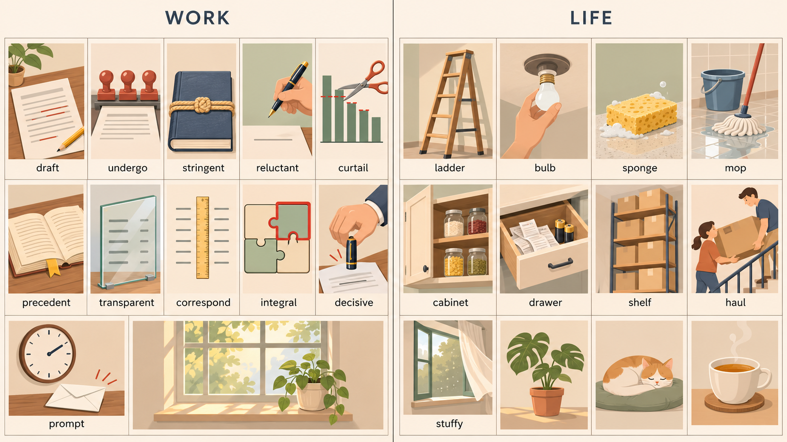

# 每日英语单词 20 个 · 2026-11-25（第 35 期）

> **定位**：面向 CET-6 六级高频/中频核心词汇，以职场和生活语境掌握常用义与搭配；六级与四级词汇存在重叠，本期不宣称逐词具有经统计核验的真题频次。
> **构成与去重**：职场 11 + 生活 9；避开历史索引全部 680 个词条（第 1--34 期），短语按逗号整体去重。本期累计 700 词。
> **记忆说明**：以下记忆提示分两类标注——「词根」为可确认的构词提示，「联想」为便于记忆的画面联想，不作严格词源考据；搭配辨析表示常见用法，不作绝对规则。
> **配套**：根目录 `每日20词-复习窗口.md` 与 `已推荐单词索引.md`。

## 场景记忆图

- 2026-11-25：请求模型 `gpt-image-2.5-flare`；实际尺寸 1672 × 941；耗时 47.23 秒。原图保留于 `/Users/insistgang/Pictures/Sub2API Images/gpt-image-2.5-flare-20261125-092336-71a19ae8.png`，副本已归档至 `../场景配图/`。
- 本次为**带词标签版**：左栏 WORK 11 词 + 1 装饰格，右栏 LIFE 9 词 + 3 装饰格，4 × 3 等大网格，共 20 个标签，一对一对应正文各词；本次缩略图可直接辨认，已逐词核对拼写。
- 左栏为一场续签评审（WORK）：带铅笔划线的纸稿 → 三道红印章下的文件 → 绳子绷紧的规则手册 → 悬在签字栏外的那支笔 → 被剪短柱子的图表 → 夹着黄标签的旧合同 → 能看穿的成本面板 → 中间压着尺子的两列数字 → 被红框圈住的拼图块 → 按在纸上的印章 → 落地即到的信封与时钟。
- 右栏为换季大扫除（LIFE）：靠墙的木梯 → 手换下的灯泡 → 起泡的湿海绵 → 水桶旁的拖把 → 打开的上柜 → 拉到底的抽屉 → 摞到顶的架子 → 两人抬箱下楼梯 → 窗帘被风吹起的窗。

## 职场篇（11 词）

**1. draft** /dræft/
- **词义**：n. 草案，草稿；v. 起草，草拟；（美）征兵
- **例句**：I've drafted the renewal proposal; legal still needs two days on the wording.
- **翻译**：续签方案我已经起草好了，法务还要两天抠措辞。
- **记忆提示**：词根 —— 与 draw、draught 同源（"拉、画"）：先拉出几条线就是草图，先拉出几行字就是草稿。⚠️ 搭配 draft a contract / a proposal、the first draft、a rough draft。⚠️ 英式 draught 多指"穿堂风、生啤"，商务草稿一律用 draft。

**2. undergo** /ˌʌndərˈɡoʊ/
- **词义**：v. 经历，经受（审查、治疗、变化等往往不好受的过程）
- **例句**：The proposal has to undergo three rounds of legal review before it reaches the board.
- **翻译**：这份方案要过三轮法务审查才能上董事会。
- **记忆提示**：词根 —— under（在下）+ go（走）——"从头底下走过去、硬扛过去"，所以多接被动的、不好受的经历。⚠️ 搭配 undergo review / surgery / training / changes。⚠️ 及物动词，直接接过程，不加 to；experience 可中性甚至主动享受，undergo 偏"被经历"。

**3. stringent** /ˈstrɪndʒənt/
- **词义**：adj. 严格的，严厉的；（财政）紧缩的
- **例句**：Their quality checks are far more stringent than anything in our own plant.
- **翻译**：他们的质检比我们自己厂里严得多。
- **记忆提示**：词根 —— string（绳、拉紧；拉丁 stringere「绷紧」）+-ent ——"把绳子绷到最紧"。⚠️ 搭配 stringent rules / standards / requirements、a stringent budget。⚠️ 与 strict 近义但更书面，多修饰制度、标准、条件；说人严厉用 strict / stern，不用 stringent。

**4. reluctant** /rɪˈlʌktənt/
- **词义**：adj. 不情愿的，勉强的
- **例句**：The client is still reluctant to commit to a two-year term.
- **翻译**：客户还是不太愿意签两年。
- **记忆提示**：词根 —— re（往回）+ luct（挣扎；拉丁 luctari）+-ant ——"被往前推，还在往回挣"。⚠️ 搭配 be reluctant to do sth、a reluctant agreement、reluctantly agree。⚠️ to 后面接动词原形，不接 doing；比 unwilling 多一层"心里别扭、勉强答应"。

**5. curtail** /kɜːrˈteɪl/
- **词义**：v. 削减，缩短；限制（权利、自由）
- **例句**：Headquarters wants us to curtail travel spending by fifteen percent this quarter.
- **翻译**：总部要我们这季度把差旅支出砍掉 15%。
- **记忆提示**：联想 —— curt（短的）+ tail（尾巴），"把尾巴剪短"；词源不确定，联想更可靠。⚠️ 搭配 curtail spending / production / rights、curtail a trip。⚠️ 比 cut 正式，多用于预算、产能、行程、自由；cut 更口语、更万能。

**6. precedent** /ˈpresɪdənt/
- **词义**：n. 先例，前例；惯例；adj. 在前的（正式）
- **例句**：Setting a precedent like this will make every future request harder to refuse.
- **翻译**：开了这种先例，以后每个请求都更难拒绝。
- **记忆提示**：词根 —— pre（在前）+ ced（走）+-ent ——"走在前面的那一步，后面的人照着踩"。⚠️ 搭配 set / establish a precedent、without precedent、a precedent for sth。⚠️ 名词重音在首音节 /ˈpresɪdənt/，作形容词读 /prɪˈsiːdənt/；拼写比 president（总统）少一个 t，别混。

**7. transparent** /trænsˈpærənt/
- **词义**：adj. 透明的；公开透明的，易懂的
- **例句**：We keep the cost breakdown transparent so nobody suspects a hidden margin.
- **翻译**：我们把成本明细摊开，免得有人怀疑里头藏了利润。
- **记忆提示**：词根 —— trans（穿过）+ par（显形；拉丁 parere）+-ent ——"光能穿过去，里外都看得见"。⚠️ 搭配 a transparent process / pricing、be transparent about sth。⚠️ 引申的"透明"指信息公开，不是物理透明；形容人坦率更常说 straightforward。

**8. correspond** /ˌkɔːrəˈspɑːnd/
- **词义**：v. 相符，一致；相当于；通信
- **例句**：The quote corresponds closely with what the market is charging right now.
- **翻译**：这份报价跟眼下市场行情基本对得上。
- **记忆提示**：词根 —— cor（com-，共同）+ respond（回应）——"两边一问一答对得上"，于是既指"相符"，也指"通信"。⚠️ 搭配 correspond with / to sth、correspond with sb（与某人通信）。⚠️ correspond with 有"相符"与"通信"两义，看宾语判断；correspond to 更偏"相当于"。

**9. integral** /ˈɪntɪɡrəl/
- **词义**：adj. 不可或缺的，构成整体必需的；完整的；n. 积分
- **例句**：On-site support is an integral part of the package, not an optional add-on.
- **翻译**：现场支持是这套方案里拆不掉的一块，不是可选项。
- **记忆提示**：词根 —— in（不）+ teg（触动；拉丁 tangere）+-ral → integer（完整的）——"碰不得、拆不开的整块"。⚠️ 搭配 be integral to sth、an integral part of sth。⚠️ 与 essential 相比：integral 强调"本来就是整体的一部分、拆了就散"，essential 强调"必须有"。

**10. decisive** /dɪˈsaɪsɪv/
- **词义**：adj. 决定性的；果断的，决断的
- **例句**：Her decisive call on pricing saved us another two weeks of arguing.
- **翻译**：她在定价上那一下果断拍板，替我们省了两周争论。
- **记忆提示**：词根 —— de（离开）+ cis（切；拉丁 caedere，同族 decide、precise、scissors）+-ive ——"一刀切下去，事情就定了"。⚠️ 搭配 a decisive factor / moment、be decisive about sth、play a decisive role。⚠️ decisive 是"能定局的/果断的"，decided 是"明确的、明显的"；decisive 不等于"已经决定的"。

**11. prompt** /prɑːmpt/
- **词义**：adj. 迅速的，及时的；v. 促使，引起；n. 提示，提词
- **例句**：Thanks for the prompt reply; we can lock the schedule this afternoon.
- **翻译**：谢谢这么快回复，今天下午就能把排期定下来。
- **记忆提示**：词根 —— pro（向前）+ em（取；拉丁 emere「拿」）→ promptus「现成备好的」——"随手就能拿出来"，所以既"及时"又"促使"。⚠️ 搭配 a prompt reply / response、prompt sb to do sth、at six prompt（六点整）。⚠️ 作动词是"促使某人做"，不是"提醒"；"提醒"用 remind。

## 生活篇（9 词）

**12. ladder** /ˈlædər/
- **词义**：n. 梯子；（晋升的）阶梯，层级
- **例句**：He climbed the ladder to change the bulb and found a stain on the ceiling.
- **翻译**：他爬上梯子换灯泡，才发现天花板上有一片水痕。
- **记忆提示**：联想 —— 词源不确定（古英语 hlæder，与"倚靠"一义的关系说法不一），联想更可靠：梯子必须靠着墙才站得稳。⚠️ 搭配 climb / set up a ladder、the career ladder。⚠️ 复数是 ladders；自动扶梯是 escalator，固定楼梯是 staircase，别混。

**13. bulb** /bʌlb/
- **词义**：n. 灯泡；球茎，鳞茎
- **例句**：The bulb in the hallway died again, so the whole floor is dark after six.
- **翻译**：楼道那只灯泡又坏了，六点以后整层都黑着。
- **记忆提示**：词根 —— 拉丁 bulbus「洋葱状的球体」——先指球茎，再指玻璃做的"那颗球"。⚠️ 搭配 change / replace a bulb、a 40-watt bulb、a tulip bulb。⚠️ 日常说 light bulb 最清楚；灯管是 tube / tube light，台灯是 lamp（指灯具，不指灯泡）。

**14. sponge** /spʌndʒ/
- **词义**：n. 海绵，洗碗擦；v. 用海绵擦拭；揩油，白吃白拿
- **例句**：Wipe the counter with a damp sponge before the stains set.
- **翻译**：趁污渍还没吃进去，用湿海绵把台面擦一遍。
- **记忆提示**：词根 —— 希腊 spongia「海绵」经拉丁进入英语，词形几乎没变。⚠️ 搭配 a damp sponge、sponge down / off sth、sponge off sb（蹭吃蹭喝）。⚠️ 海绵擦是 sponge，钢丝球是 scouring pad；作动词的引申义"揩油"多带 off。

**15. mop** /mɑːp/
- **词义**：n. 拖把；v. 拖（地）；擦（汗、泪）
- **例句**：She mopped the kitchen floor twice before the guests arrived.
- **翻译**：客人来之前她把厨房地面拖了两遍。
- **记忆提示**：联想 —— 词源不确定（一说与拉丁 mappa「布」有关，可靠度低），联想更可靠：一块布扎在杆子头上，在地上画圈。⚠️ 搭配 mop the floor、mop up（把水擦干；收拾残局）、a mop and bucket。⚠️ mop up 的引申义"收拾残局"在新闻里很常见。

**16. cabinet** /ˈkæbɪnət/
- **词义**：n. 橱柜，储物柜；（政府的）内阁
- **例句**：The spare keys are in the cabinet above the sink.
- **翻译**：备用钥匙在水槽上方那个柜子里。
- **记忆提示**：词根 —— cabin（小屋）+-et（小）——"小屋子似的柜子"；君王把顾问关进小房间议事，于是又有了"内阁"。⚠️ 搭配 a kitchen / bathroom cabinet、a cabinet meeting、a cabinet member。⚠️ 英式 cupboard 更常指厨房碗柜；cabinet 偏"带门带抽屉的储物柜"。

**17. drawer** /drɔːr/
- **词义**：n. 抽屉；开票人，出票人（读 /ˈdrɔːər/）
- **例句**：The takeaway menus have been sitting in the bottom drawer for a year.
- **翻译**：外卖单子在最底下那层抽屉里躺了一年。
- **记忆提示**：词根 —— draw（拉）+-er ——"能被拉出来的那一格"。⚠️ 搭配 open / pull out a drawer、the top drawer、a chest of drawers。⚠️ 抽屉读 /drɔːr/；"开票人、绘图者"读 /ˈdrɔːər/，同一个拼写两个音、两个义。

**18. shelf** /ʃelf/
- **词义**：n. 架子，搁板；大陆架；shelf life 保质期
- **例句**：Put the heavy jars on the lower shelf so you don't have to stretch.
- **翻译**：重罐子放下面那层，省得每次都够。
- **记忆提示**：词根 —— 古英语 scylfe「岩架、平台」——"墙上凸出来的一块平面"。⚠️ 搭配 on the shelf、a bookshelf、shelf life（保质期）。⚠️ 复数 shelves，f 变 v；"被搁置、无人问津"也说 on the shelf。

**19. haul** /hɔːl/
- **词义**：v. 拖，拉，搬运；n. 一趟运输；一次收获（的量）
- **例句**：We hauled the old sofa down four flights because the elevator was out.
- **翻译**：电梯停了，我们只好把旧沙发从四楼抬下来。
- **记忆提示**：词根 —— 与 hale（强拉）同源，出自法语 haler「拉」——"使大劲拖"。⚠️ 搭配 haul sth up / down / away、a long haul（漫长的过程）、the haul（一次收获）。⚠️ 与 carry 不同：haul 强调费力、东西重、距离长。

**20. stuffy** /ˈstʌfi/
- **词义**：adj. 闷的，不通风的；古板的，一本正经的
- **例句**：The room gets stuffy by noon, so we leave the window open all morning.
- **翻译**：屋子到中午就闷，我们整个上午都开着窗。
- **记忆提示**：词根 —— stuff（塞满；古法语 estoffer）+-y ——"被塞得满满当当、一点风都进不来"。⚠️ 搭配 a stuffy room、feel stuffy、a stuffy professor。⚠️ 与 musty（11-23 已用）不同：stuffy 是"闷、憋"，musty 是"有霉味"；闷热潮湿还可用 muggy / humid。

## 助记卡

| 单词 | 词根/画面抓手 | 高频搭配 |
|---|---|---|
| draft | 与 draw 同源 → 先拉出几行字 | draft a proposal |
| undergo | under + go → 从底下走过去 | undergo review |
| stringent | string（绷紧）→ 绳子拉到最紧 | stringent standards |
| reluctant | re + luct（挣扎）→ 往前推还往回挣 | be reluctant to do |
| curtail | curt + tail → 把尾巴剪短 | curtail spending |
| precedent | pre + ced（走）→ 走在前面的那一步 | set a precedent |
| transparent | trans + par（显形）→ 里外看得见 | a transparent process |
| correspond | cor + respond → 一问一答对得上 | correspond with sth |
| integral | in + teg（碰）→ 拆不开的整块 | an integral part of |
| decisive | de + cis（切）→ 一刀定局 | a decisive factor |
| prompt | 拉丁 promptus「现成」→ 随手拿出 | a prompt reply |
| ladder | 靠墙才站得稳的梯子 | climb the ladder |
| bulb | 拉丁「洋葱球」→ 玻璃那颗球 | change a bulb |
| sponge | 希腊「海绵」，词形没变 | a damp sponge |
| mop | 布扎在杆头，在地上画圈 | mop the floor |
| cabinet | cabin + et（小）→ 小屋子似的柜 | a kitchen cabinet |
| drawer | draw（拉）+-er → 拉出来那一格 | pull out a drawer |
| shelf | 古英语「岩架」→ 凸出的平面 | on the shelf |
| haul | 法语 haler「拉」→ 使大劲拖 | haul sth upstairs |
| stuffy | stuff（塞满）+ -y → 一点风都进不来 | a stuffy room |

## 记忆宫殿 · 双线场景故事

### 职场线（11 词）· 一场续签评审

周一早上九点，会议室桌上摊着还带打印机余温的 **draft**（草案），页边全是铅笔划的线；这份稿子必须 **undergo**（经受）三轮法务审查，条款一年比一年 **stringent**（严格），连违约金的小数点都被红笔圈出来；客户代表翻到第三页就停了手，笔悬在签字栏外迟迟不落，明显 **reluctant**（不情愿）签两年；总部邮件紧跟着进来，要求 **curtail**（削减）差旅预算 15%，有人当场把图表上最高的两根柱子划掉；项目经理把去年那份合同摊开，夹着黄色标签的那一页正是指向先例——这是 **precedent**（先例）；财务把成本明细投到幕布上，一栏一栏摊开，坚持要 **transparent**（透明）；报价与市场行情 **correspond**（相符），中间压着一把尺子比过，没人再反驳；现场支持被红框圈住，是 **integral**（不可或缺）的一块，删不得；负责人把笔帽一按、印章压在签名旁，**decisive**（果断）地拍了板；散会不到两小时，客户回信就 **prompt**（及时）地到了，只有一句"同意"。

> 画面链：打印机余温的纸稿 → 三道红印章 → 绷着绳子的规则手册 → 停在第三页悬着的笔 → 被剪短的柱状图 → 夹着黄标签的旧合同 → 幕布上摊开的成本表 → 压着尺子的两列数字 → 被红框圈住的拼图块 → 按下去的那枚印章 → 两小时后落地的信封。

### 生活线（9 词）· 换季大扫除

周六上午，**ladder**（梯子）从储物间拖出来靠在墙边，脚还晃了两下才稳；仰头拧下那只烧黑的 **bulb**（灯泡），天花板上一片旧水痕一下显出来；台面上摊着湿 **sponge**（海绵），一圈一圈擦过油点，泡沫顺手背滑下来；**mop**（拖把）在手里转，地上留下一道道水光；抬手打开 **cabinet**（橱柜）最上层，那罐糖已经结成硬块；**drawer**（抽屉）拉到底，票据、旧电池、写不出墨的笔滚成一片；抬头看 **shelf**（架子），纸箱摞到快顶到天花板；两个人只好合力 **haul**（搬）那只旧箱下楼，楼道里回声很响；回来关上门，屋里 **stuffy**（闷）得厉害，索性把窗全推开，风一下灌进来，窗帘整个鼓起来。

> 画面链：靠墙晃了两下的梯子 → 烧黑拧下的灯泡 → 天花板旧水痕 → 起泡的湿海绵 → 地上一道道水光 → 打开的最上层柜门 → 拉到底的抽屉 → 摞到顶的架子 → 抬下楼的旧纸箱 → 被风吹鼓的窗帘。

## 排雷台（19 组易混与搭配辨析）

| 辨析 | 关键差别与常见搭配 |
|---|---|
| draft / draught / drift | draft 是草稿、起草，美式拼写（draft a proposal）；draught 是英式拼写，多指穿堂风、生啤（a draught of cold air）；drift 是"漂流、漂移、大意"（the drift of his argument）。 |
| undergo / experience / endure | undergo 是"被经历"某个流程或治疗（undergo surgery）；experience 中性，可主动也可享受（experience the culture）；endure 强调"忍受住、扛过去"（endure the noise）。 |
| stringent / strict / stern | stringent 修饰制度、标准、条件，很书面（stringent standards）；strict 最通用，可修饰人也可修饰规则（a strict teacher）；stern 多形容表情、态度严厉（a stern look）。 |
| reluctant / unwilling / hesitant | reluctant 是心里别扭、勉强答应（reluctant to commit）；unwilling 更干脆的"不愿意"（unwilling to pay）；hesitant 是"犹豫、拿不定主意"（hesitant about the price）。 |
| curtail / cut / downsize | curtail 正式，砍预算、产能、自由、行程（curtail spending）；cut 最口语、最万能（cut costs）；downsize 专指裁员或缩编（the firm downsized last year）。 |
| precedent / president / precedence | precedent 是先例（set a precedent）；president 是总统、总裁；precedence 是"优先次序"（take precedence over sth）。 |
| transparent / translucent / opaque | transparent 完全透明、看得穿（transparent glass）；translucent 半透明、透光不透影（translucent paper）；opaque 不透明，也指"含糊难懂"（opaque wording）。 |
| correspond / match / coincide | correspond with 指"相符、通信"（correspond with the data）；match 是"配对、相配"（match the samples）；coincide 指时间地点"恰好重合"或意见"一致"（our views coincide）。 |
| integral / essential / indispensable | integral 强调"是整体的一部分、拆了就散"（an integral part of the design）；essential 强调"必需、缺了不行"（essential nutrients）；indispensable 语气最强，多指人（10-29 已用，an indispensable assistant）。 |
| decisive / decided / conclusive | decisive 是"能定局的、果断的"（a decisive factor）；decided 是"明显的、明确的"（a decided advantage）；conclusive 指证据"确凿、能定论"（conclusive proof）。 |
| prompt / punctual / timely | prompt 强调"反应快、不拖延"（a prompt reply）；punctual 指"守时、准点"（be punctual for class）；timely 指"来得正是时候"（a timely warning）。 |
| ladder / staircase / escalator | ladder 是可搬动的梯子（climb a ladder）；staircase 是楼内固定楼梯（a narrow staircase）；escalator 是自动扶梯（take the escalator）。 |
| bulb / tube / lamp | bulb 是灯泡本体（change a bulb）；tube 是灯管（a fluorescent tube）；lamp 是整盏灯具（a desk lamp）。 |
| sponge / foam / scourer | sponge 是海绵、海绵擦（a damp sponge）；foam 是泡沫材料，也指"起泡"（foam padding）；scourer 是钢丝球、百洁布（a steel scourer）。 |
| mop / sweep / wipe | mop 用拖把拖湿地面（mop the floor）；sweep 用扫帚扫（sweep the yard）；wipe 用布擦表面（wipe the table）。 |
| cabinet / cupboard / closet | cabinet 是带门带抽屉的储物柜，也指内阁（a kitchen cabinet）；cupboard 偏英式碗柜、食品柜（the kitchen cupboard）；closet 是嵌入墙内的衣柜（hang it in the closet）。 |
| drawer / shelf / compartment | drawer 是能拉出来的抽屉（the bottom drawer）；shelf 是固定的搁板（the top shelf）；compartment 是分隔出的小格、隔间（a glove compartment）。 |
| haul / carry / drag | haul 强调费力搬重物、距离长（haul the box upstairs）；carry 中性，随身携带（carry a bag）；drag 是"在地上拖"，也指"拖时间"（drag the case along）。 |
| stuffy / musty / muggy | stuffy 是"闷、不通风"（a stuffy room）；musty 是"有霉味"（11-23 已用，a musty basement）；muggy 是"又闷又潮"的天气（11-23 已用，a muggy afternoon）。 |

## 快速自测（5 题 · 答案折叠）

**1. 语境选词填空**：The client remains ______ to sign a two-year term, mainly because the penalty clause is unusually ______, so we have ______ed a softer version.（从 reluctant / stringent / draft 中各选一词的适当形式）

**2. 用法改错**：He is reluctant to signing the contract until legal explains the clause. 请判断 reluctant 的搭配是否恰当，并改正。

**3. 中译英**：总部的口径很明确：把差旅预算砍掉一成，但现场支持是不可拆的一块。

**4. 一词两义**：transparent 在 "a transparent sheet of plastic" 中意为 ______，在 "a transparent review process" 中意为 ______。

**5. 生活场景选词**：The hallway ______ had burned out, so he propped the ______ against the wall; by the time he finished, the flat felt ______ and he pushed every window open.（从 bulb / ladder / stuffy 中选词填空）

👉 点击展开答案

1. **reluctant**、**stringent**、**draft**；客户"不情愿"签两年，条款"严格"，于是我们"起草"了一个更温和的版本。注意第三空要用过去分词 drafted，因为动作已完成。
2. **不恰当**——reluctant 后接不定式，不接动名词。应改为：He is reluctant **to sign** the contract until legal explains the clause. 类似结构还有 be reluctant to admit / to commit。
3. **Headquarters is clear: curtail travel spending by ten percent, but on-site support is an integral part of the deal.**；curtail 比 cut 正式，适合传达上级口径；integral part of 是固定搭配，不写 integral part in。
4. 第一个是 **物理上透明的（能看穿）**；第二个是 **信息公开、可核查的**，这是六级阅读里更常考的那层引申义。
5. **bulb**、**ladder**、**stuffy**；坏掉的是灯泡，靠墙立着的是梯子，干完活屋里"闷"得开窗。三词都是可数名词或形容词，不要误填成 mop（拖把）或 sponge（海绵）。

---

*第 35 期 · 2026-11-25 · 累计已学 700 词（CET-6 向）*
