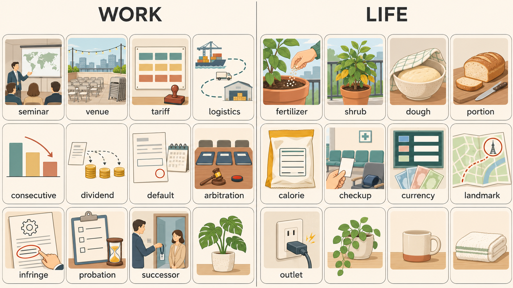

# 每日英语单词 20 个 · 2026-11-26（第 36 期）

> **定位**：面向 CET-6 六级高频/中频核心词汇，以职场和生活语境掌握常用义与搭配；六级与四级词汇存在重叠，本期不宣称逐词具有经统计核验的真题频次。
> **构成与去重**：职场 11 + 生活 9；避开历史索引全部 700 个词条（第 1--35 期），短语按逗号整体去重。本期累计 720 词。
> **记忆说明**：以下记忆提示分两类标注——「词根」为可确认的构词提示，「联想」为便于记忆的画面联想，不作严格词源考据；搭配辨析表示常见用法，不作绝对规则。
> **配套**：根目录 `每日20词-复习窗口.md` 与 `已推荐单词索引.md`。

## 场景记忆图

- 2026-11-26：请求模型 `gpt-image-2.5-flare`；实际尺寸 1672 × 941；耗时 55.11 秒。原图保留于 `/Users/insistgang/Pictures/Sub2API Images/gpt-image-2.5-flare-20261126-092811-d5fd8903.png`，副本已归档至 `../场景配图/`。
- 本次为**带词标签版**：左栏 WORK 11 词 + 1 装饰格，右栏 LIFE 9 词 + 3 装饰格，4 × 3 等大网格，共 20 个标签，一对一对应正文各词；本次缩略图可直接辨认，已逐词核对拼写。
- 左栏为一场跨境项目评审（WORK）：研讨会投影 → 屋顶露台上的空椅 → 墙上的关税色块表与印章 → 港口集装箱到仓库的虚线 → 三根下滑的柱子 → 被分成四摞的硬币 → 到期栏空白的发票与红圈章 → 长桌上的三本卷宗与木槌 → 红笔圈住的专利段落 → 带复选框的评估板与沙漏 → 递出的工牌。
- 右栏为周末的阳台与厨房（LIFE）：撒肥的手 → 栏杆边叶尖发黄的盆灌木 → 布下鼓起的面团 → 切开的面包与刀 → 包装背面的空白营养标签 → 诊所里捏着排号单的手 → 汇率牌与三张钞票 → 圈住塔的地图 → 插头与插座的火花。

## 职场篇（11 词）

**1. seminar** /ˈsemɪnɑːr/
- **词义**：n. 研讨会，专题讨论会；（大学的）研究班课程
- **例句**：She runs a monthly seminar for new account managers on how to read a client's balance sheet.
- **翻译**：她每月给新客户经理开一次研讨会，讲怎么读客户的资产负债表。
- **记忆提示**：词根 —— 拉丁 seminarium「苗圃」、semen「种子」——"撒种子、养苗"的地方，后来指专门培育想法的小型研讨班。⚠️ 搭配 hold / attend a seminar、a training seminar、a seminar on sth。⚠️ 与 workshop 不同：seminar 偏"有人讲 + 一起辩"，workshop 偏"动手做"。

**2. venue** /ˈvenjuː/
- **词义**：n. （会议、活动、比赛的）举办地点，场地
- **例句**：The venue fell through two days before the launch, so we moved the whole thing to the hotel's top floor.
- **翻译**：发布会前两天场地黄了，我们只好把整场活动挪到酒店顶层。
- **记忆提示**：词根 —— 拉丁 venire「来」的过去分词词根 vent-（同族 convene、intervene）——"大家都来的那个地方"。⚠️ 搭配 book / change a venue、a venue for sth、venue capacity。⚠️ 只指"活动地点"，不指房产；泛指空间可用 the space / the site。

**3. tariff** /ˈtærɪf/
- **词义**：n. 关税；（宾馆、服务的）价目表，收费标准
- **例句**：The new tariff adds eight percent to every component we ship in from overseas.
- **翻译**：新关税让我们从海外运进的每一个部件都多出 8%。
- **记忆提示**：词根 —— 经意大利语 tariffa 上溯阿拉伯语 ta'rif「通告、清单」——先是一张价目表，后来专指海关那张税表。⚠️ 搭配 impose / raise / cut tariffs、tariff barriers、a tariff on sth。⚠️ 关税常用复数 tariffs；duty 更泛，toll 是过路费。

**4. logistics** /ləˈdʒɪstɪks/
- **词义**：n. 物流；后勤（组织与调度工作）
- **例句**：Logistics says the spare parts won't clear the port until Thursday.
- **翻译**：物流那边说备件要到周四才能清关出港。
- **记忆提示**：词根 —— 法语 logistique，源自 loger「安顿、扎营」——军队在哪儿扎营、粮草怎么运，就是后勤；与希腊 logos 的关联说法不一，不取。⚠️ 搭配 handle / manage logistics、logistics costs、the logistics of sth。⚠️ 指"物流"时带 -s 但视为不可数；形容词是 logistic / logistical。

**5. consecutive** /kənˈsekjətɪv/
- **词义**：adj. 连续的，接连不断的
- **例句**：We've missed the delivery window three consecutive weeks, and the client is counting.
- **翻译**：我们已经连续三周没赶上交付窗口，客户正一笔一笔数着。
- **记忆提示**：词根 —— con（共同）+ secut（跟随；拉丁 sequi，同族 sequence、consequence）+-ive ——"一个跟着一个，中间不断"。⚠️ 搭配 three consecutive days / quarters、on consecutive days。⚠️ consecutive 按次数算；continuous 强调时间空间上没断过；successive 也指接连，但更书面，常修饰任期与世代。

**6. dividend** /ˈdɪvɪdend/
- **词义**：n. 股息，红利；好处，回报
- **例句**：The board kept the dividend flat, which tells you how cautious they are about next year.
- **翻译**：董事会把分红维持在原来的水平，可见他们对明年有多谨慎。
- **记忆提示**：词根 —— 拉丁 dividendum「该被分掉的东西」，dividere「分」（同族 divide）——公司把利润切一块分给股东。⚠️ 搭配 pay / cut / raise a dividend、an annual dividend、pay dividends（带来好处）。⚠️ pay dividends 是"见效、有回报"的固定说法，不指"发钱"。

**7. default** /dɪˈfɔːlt/
- **词义**：n./v. 违约，未履行（付款、义务）；n. （系统的）默认设置
- **例句**：The client defaulted on the second installment, so the deposit clause kicks in.
- **翻译**：客户第二期款就违约没付，定金条款这下生效了。
- **记忆提示**：词根 —— de（缺、离）+ fault（拉丁 fallere「失约、欺骗」，同族 fail、failure）——"该做的那件事没做"。⚠️ 搭配 default on a loan / payment、by default（默认地）、the default setting。⚠️ 电脑里的"默认"是同一逻辑：你不选，系统就按"没做选择"的那一套走。

**8. arbitration** /ˌɑːrbɪˈtreɪʃn/
- **词义**：n. 仲裁，公断
- **例句**：Both sides signed the contract with an arbitration clause, so this never goes to court.
- **翻译**：双方合同里都写了仲裁条款，所以这事不会闹到法院。
- **记忆提示**：词根 —— 拉丁 arbiter「在场见证并裁决的人」+-ation ——"请一个中立的第三方来断"。⚠️ 搭配 go to arbitration、an arbitration clause / panel、binding arbitration。⚠️ 仲裁裁决通常有约束力；mediation 只是调解，第三方不判；litigation 才是诉讼。

**9. infringe** /ɪnˈfrɪndʒ/
- **词义**：v. 侵犯（专利、版权、权利）；违反（法规）
- **例句**：Their new module infringes two of our claims, and legal wants a letter out this week.
- **翻译**：他们的新模块侵犯了我们两项权利要求，法务这周就要发函。
- **记忆提示**：词根 —— in（进入）+ fring（打破；拉丁 frangere，同族 fracture、fragment）——"闯进别人的界，把线踩断"。⚠️ 搭配 infringe a patent / copyright、infringe on sb's rights。⚠️ 接专利、版权时是及物动词，不加 on；违反法规更常说 violate / breach。

**10. probation** /proʊˈbeɪʃn/
- **词义**：n. 试用期；（法律的）缓刑
- **例句**：New hires stay on probation for three months, with a review at the end of week ten.
- **翻译**：新员工试用期三个月，第十周末做一次评估。
- **记忆提示**：词根 —— 拉丁 probare「检验、证明」（同族 prove、probable）+-ion ——"先把你放在场上试一试行不行"。⚠️ 搭配 on probation、pass / fail probation、a probation period。⚠️ 在职试用用 probation；学生实习是 internship；产品试用是 trial。

**11. successor** /səkˈsesər/
- **词义**：n. 继任者，接班人；接替的事物
- **例句**：Her successor inherits a team of nine and a backlog of unresolved tickets.
- **翻译**：她的继任者接手的是九个人的团队和一堆没结的工单。
- **记忆提示**：词根 —— suc（sub-，随后）+ cess（走；拉丁 cedere，同族 proceed、access）+-or ——"走在后面、接着往下走的那个人"。⚠️ 搭配 the successor to sb / sth、a worthy successor、a successor product。⚠️ 职位、产品都能用；继承财产的人是 heir。

## 生活篇（9 词）

**12. fertilizer** /ˈfɜːrtəlaɪzər/
- **词义**：n. 肥料，化肥
- **例句**：A handful of fertilizer in spring is enough; any more and the leaves burn.
- **翻译**：春天撒一把肥料就够了，再多叶子就烧了。
- **记忆提示**：词根 —— fert（带来、出产；拉丁 ferre「带来」，同族 fertile、transfer）+-ilize + -er ——"让土里多长出东西的那把料"。⚠️ 搭配 apply / spread fertilizer、a bag of fertilizer、organic fertilizer。⚠️ fertilizer 是肥料本身；manure 多指粪肥；pesticide 是杀虫剂，别混。

**13. shrub** /ʃrʌb/
- **词义**：n. 灌木
- **例句**：The shrub by the balcony rail has yellowed at the tips, probably too much sun.
- **翻译**：阳台栏杆边那丛灌木叶尖发黄了，多半是晒过头。
- **记忆提示**：联想 —— 古英语 scrybb「灌木丛」，更早来源不明，联想更可靠：矮、丛生、正好挡在半腰的一团绿。⚠️ 搭配 a flowering shrub、trim / prune a shrub、shrubbery（灌木丛）。⚠️ shrub 是木本、多年生；bush 更口语，也指荒野；herb 是草本。

**14. dough** /doʊ/
- **词义**：n. 面团；（口语）钱
- **例句**：Leave the dough in a warm corner until it doubles, then knock it back.
- **翻译**：把面团放在暖和的角落发到两倍大，然后排气。
- **记忆提示**：词根 —— 古英语 dāg「揉好的面团」，与德语 Teig 同源 ——"湿面粉揉成的一团"。⚠️ 搭配 knead / roll out the dough、let the dough rise、cookie dough。⚠️ 拼写别和 though、through 混；dough 里的 gh 不发音。

**15. portion** /ˈpɔːrʃn/
- **词义**：n. 一份，份量；部分；v. 分配，分给
- **例句**：The recipe says four portions, but the two of us finished the whole tray.
- **翻译**：食谱上写四份，结果我们俩把一整盘吃完了。
- **记忆提示**：词根 —— 拉丁 portio「份额、部分」——"从整块里分给你的那一份"。⚠️ 搭配 a generous / small portion、portion out sth、portion control。⚠️ portion 指实际给的量；serving 是营养标示上的"建议一份"；share 偏份额、股份。

**16. calorie** /ˈkæləri/
- **词义**：n. 卡路里，热量单位
- **例句**：I stopped counting calories years ago; I just watch the portion size.
- **翻译**：我早就不数卡路里了，只盯着份量吃。
- **记忆提示**：词根 —— 拉丁 calor「热」（同族 caloric）——"把这份食物烧掉，能放出多少热"。⚠️ 搭配 count calories、a low-calorie diet、burn calories。⚠️ 食品包装上首字母大写的 Calorie 其实指千卡 kcal；1 kcal ≈ 4.18 kJ。

**17. checkup** /ˈtʃekʌp/
- **词义**：n. 体检；检查
- **例句**：The annual checkup is covered by the plan, but the blood work is billed separately.
- **翻译**：年度体检套餐里含了，但验血是单收费的。
- **记忆提示**：词根 —— check（核对）+ up（彻底）——"从头到脚核对一遍"。⚠️ 搭配 an annual / routine checkup、a dental checkup、go for a checkup。⚠️ 名词连写 checkup；动词分开写 check up on sb（核查某人）。

**18. currency** /ˈkɜːrənsi/
- **词义**：n. 货币，通货；通用，流行
- **例句**：Check the local currency before you land; the airport rate is always the worst.
- **翻译**：落地前先看看当地货币，机场汇率从来最差。
- **记忆提示**：词根 —— curr（跑；拉丁 currere，同族 current、course）+-ency ——"在市面上跑来跑去、人人肯收的东西"。⚠️ 搭配 foreign currency、exchange currency、gain currency（开始流行）。⚠️ currency 指币种；现金是 cash；汇率是 exchange rate。

**19. landmark** /ˈlændmɑːrk/
- **词义**：n. 地标，标志性建筑；（事件的）里程碑
- **例句**：The old water tower is the only landmark you can see from the highway.
- **翻译**：那座老水塔是高速路上唯一能看见的地标。
- **记忆提示**：词根 —— land（土地）+ mark（标记）——"立在土地上、用来认路的那个记号"。⚠️ 搭配 a famous / historic landmark、a landmark decision / case。⚠️ 指建筑用 landmark；指进度节点用 milestone；指风景名胜用 sight / attraction。

**20. outlet** /ˈaʊtlet/
- **词义**：n. 插座，电源接口；出口，排放口；折扣店
- **例句**：There's only one outlet behind the desk, so the lamp and the router fight over it.
- **翻译**：桌子后面就一个插座，台灯和路由器天天抢。
- **记忆提示**：词根 —— out（出）+ let（放出，中古英语 letten）——"让东西出去的那个口"：电流出去是插座，污水出去是排放口，货出去是折扣店。⚠️ 搭配 a power outlet、a retail outlet、an outlet for sth（发泄途径）。⚠️ 美式 outlet 是墙上插座，英式多说 socket；插头是 plug。

## 助记卡

| 单词 | 词根/画面抓手 | 高频搭配 |
|---|---|---|
| seminar | 拉丁「苗圃」→ 撒种子养想法 | hold a seminar |
| venue | venire「来」→ 大家都来的地方 | book a venue |
| tariff | 阿拉伯「清单」→ 海关那张税表 | impose tariffs |
| logistics | loger「扎营」→ 粮草怎么运 | handle logistics |
| consecutive | con + secut（跟随）→ 一个接一个 | three consecutive weeks |
| dividend | dividere（分）→ 利润切一块 | pay dividends |
| default | de + fault（失约）→ 该做的没做 | default on a loan |
| arbitration | arbiter（裁决者）→ 请第三方来断 | go to arbitration |
| infringe | in + fring（打破）→ 踩断别人的界 | infringe a patent |
| probation | probare（检验）→ 先试你行不行 | on probation |
| successor | suc + cess（走）→ 走在后面接手 | the successor to sb |
| fertilizer | fert（带来）→ 让土多长东西 | apply fertilizer |
| shrub | 矮而丛生的一团绿 | trim a shrub |
| dough | 古英语「揉好的面团」 | let the dough rise |
| portion | 拉丁「份额」→ 分给你的那份 | a small portion |
| calorie | calor（热）→ 烧掉放多少热 | count calories |
| checkup | check + up → 全身核对一遍 | an annual checkup |
| currency | curr（跑）→ 市面上流通的东西 | foreign currency |
| landmark | land + mark → 认路的记号 | a historic landmark |
| outlet | out + let → 让东西出去的口 | a power outlet |

## 记忆宫殿 · 双线场景故事

### 职场线（11 词）· 一场跨境项目评审

周一九点，跨境项目评审以一场 **seminar**（研讨会）开场，投影第一页就是刚更新的 **tariff**（关税）表，红色的税档一栏压过一栏；会开到一半行政进来道歉——隔壁还有一场婚礼在布场，**venue**（场地）的椅子得自己搬；**logistics**（物流）经理接着把激光笔移到港口到仓库的虚线，说备件还卡在清关；财务翻出**连续**三个季度（**consecutive**）下滑的柱状图，说今年的 **dividend**（分红）只能维持原样；话音未落法务推门进来：客户 **default**（违约）了，第二期款到期没到；议程当场改线，直接转 **arbitration**（仲裁）程序；对方反手一封函，指控我们的模块 **infringe**（侵犯）了他们两项专利；人事在桌边小声提醒，新来的助理这周该做 **probation**（试用期）评估；散会时老经理把工牌放在桌上，**successor**（继任者）已经站在门口等他交接。

> 画面链：投影上的关税表 → 隔壁婚礼堆着的椅子 → 港口到仓库的虚线 → 三根下滑的柱子 → 被压平的分红单 → 到期栏空白的付款通知 → 长桌上的三本卷宗 → 红笔圈住的专利段落 → 带复选框的评估板 → 递出去的那张工牌。

### 生活线（9 词）· 周六：阳台、厨房、体检、订票

周六上午先去阳台，那盆 **shrub**（灌木）叶尖发黄，抓一把 **fertilizer**（肥料）撒进土里；回厨房，**dough**（面团）在盆里涨到两倍，切开时特意收着 **portion**（份量），顺手翻过包装看 **calorie**（卡路里）；下午去医院做年度 **checkup**（体检），抽血前空腹刚好够时辰；晚上摊开电脑订机票，先查目的地 **currency**（货币）汇率，再在地图上把要去的 **landmark**（地标）圈出来；睡前给手机充电，插头刚推进 **outlet**（插座），屋里"啪"一声跳了闸。

> 画面链：叶尖发黄的灌木 → 撒进土里的颗粒 → 涨到两倍的面团 → 切开的那一片 → 包装背面的热量表 → 体检排号单 → 汇率牌价 → 地图上圈住的塔 → 冒火星的插座。

## 排雷台（20 组易混与搭配辨析）

| 辨析 | 关键差别与常见搭配 |
|---|---|
| seminar / workshop / briefing | seminar 是有人讲、大家辩的研讨会（hold a seminar）；workshop 是动手做的工作坊（a writing workshop）；briefing 是单向通报的简报会（a morning briefing）。 |
| venue / site / premises | venue 是活动举办地（book a venue）；site 是施工、事故或网站所在地（the construction site）；premises 是法律意义上的经营场所（on the premises）。 |
| tariff / duty / toll | tariff 多指进口关税，常成表成档（impose tariffs on steel）；duty 是泛指的税，也指职责（customs duty）；toll 是过路费、通行费（a toll road）。 |
| logistics / supply chain / freight | logistics 是调度与运输的组织工作（handle logistics）；supply chain 是整条供应链网络（a fragile supply chain）；freight 指货运的货物或运费（air freight）。 |
| consecutive / successive / continuous | consecutive 按次数一个接一个（three consecutive quarters）；successive 也指接连，更书面，常修饰任期与世代（successive governments）；continuous 强调时间空间上没断过（continuous rain）。 |
| dividend / bonus / interest | dividend 是股息分红（pay a dividend）；bonus 是奖金（a year-end bonus）；interest 是利息（interest on the loan）。 |
| default / fault / defect | default 是违约、未履行（default on a payment）；fault 是过错、故障（it's my fault）；defect 是产品缺陷（a manufacturing defect）。 |
| arbitration / mediation / litigation | arbitration 由第三方裁决且有约束力（binding arbitration）；mediation 只是撮合调解，第三方不判（go to mediation）；litigation 是打官司（costly litigation）。 |
| infringe / violate / invade | infringe 多接专利、版权、权利（infringe a patent）；violate 多接法律、规定、协议（violate the rules）；invade 是武力入侵或侵犯隐私（invade sb's privacy）。 |
| probation / internship / trial | probation 是入职后的试用考察期（on probation）；internship 是学生实习（a summer internship）；trial 是产品、服务的试用（a free trial）。 |
| successor / heir / replacement | successor 是职位继任者（the successor to the CEO）；heir 是财产继承人（the sole heir）；replacement 是替换件或替补（a replacement for the broken part）。 |
| fertilizer / manure / pesticide | fertilizer 是肥料统称，多指化肥（apply fertilizer）；manure 是粪肥等有机肥（cow manure）；pesticide 是杀虫剂（spray pesticide）。 |
| shrub / bush / herb | shrub 是木本、多年生的灌木（a flowering shrub）；bush 更口语，也指荒野（the African bush）；herb 是草本，多指香草、药草（fresh herbs）。 |
| dough / batter / pastry | dough 是能揉能擀的面团（knead the dough）；batter 是能倒的稀面糊（pancake batter）；pastry 是酥皮或糕点（puff pastry）。 |
| portion / serving / share | portion 是实际盛给你的那一份（a generous portion）；serving 是营养标示上的建议食用量（one serving of rice）；share 是份额、股份（a market share）。 |
| calorie / kilojoule / nutrient | calorie 是热量单位（count calories）；kilojoule 是千焦，1 kcal ≈ 4.18 kJ；nutrient 是营养素本身（essential nutrients）。 |
| checkup / check-in / inspection | checkup 是体检（an annual checkup）；check-in 是值机、入住（online check-in）；inspection 是官方或工程检查（a safety inspection）。 |
| currency / cash / exchange rate | currency 是币种（foreign currency）；cash 是现金（pay in cash）；exchange rate 是汇率（a favorable exchange rate）。 |
| landmark / milestone / sight | landmark 是实体地标，也可指里程碑式判决（a landmark case）；milestone 是进度节点（hit a milestone）；sight 是景点（see the sights）。 |
| outlet / socket / plug | outlet 是美式墙上的插座（a power outlet）；socket 是英式或技术上的插孔（a wall socket）；plug 是手里那个插头（pull the plug）。 |

## 快速自测（5 题 · 答案折叠）

**1. 语境选词填空**：The client has ______ed on two ______ payments, so legal is already preparing for ______.（从 default / consecutive / arbitration 中各选一词的适当形式）

**2. 用法改错**：Their new module infringes on two of our patents, and we may default the payment. 请指出两处搭配问题并改正。

**3. 中译英**：这场研讨会的场地换了三次，物流那边的备件还是被关税卡在港口。

**4. 一词多义**：outlet 在 "a power outlet" 中意为 ______，在 "a retail outlet" 中意为 ______，在 "an outlet for frustration" 中意为 ______。

**5. 生活场景选词**：After a handful of ______, the ______ by the rail greened up; the ______ rose to twice its size, and one ______ was enough for two people.（从 fertilizer / shrub / dough / portion 中选词填空）

👉 点击展开答案

1. **default**、**consecutive**、**arbitration**；客户"违约"了"连续"两期款，法务已在准备"仲裁"。注意第一空用过去分词 defaulted，第二空 consecutive 修饰复数 payments。
2. 第一处 **infringes on → infringes**：infringe 接专利、版权时是及物动词，不加 on（infringe on 多接 rights、freedom）。第二处 **default the payment → default on the payment**：default 表示"违约不付"时必须带 on。
3. **We changed the seminar venue three times, and logistics still has the spare parts held up at the port by tariffs.**；venue 是可数名词，tariff 表关税常用复数。
4. 依次是 **电源插座**、**零售门店 / 折扣店**、**发泄途径**；三层意思都从"让东西出去的口"长出来。
5. **fertilizer**、**shrub**、**dough**、**portion**；撒的是肥料，长的是灌木，发起来的是面团，够两个人吃的是那一份。四空都是可数或不可数名词，注意 dough 不可数、portion 可数。

---

*第 36 期 · 2026-11-26 · 累计已学 720 词（CET-6 向）*
